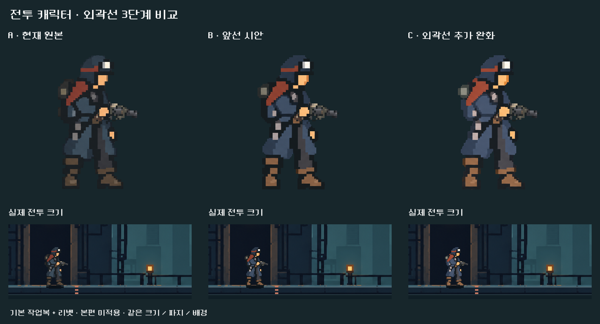
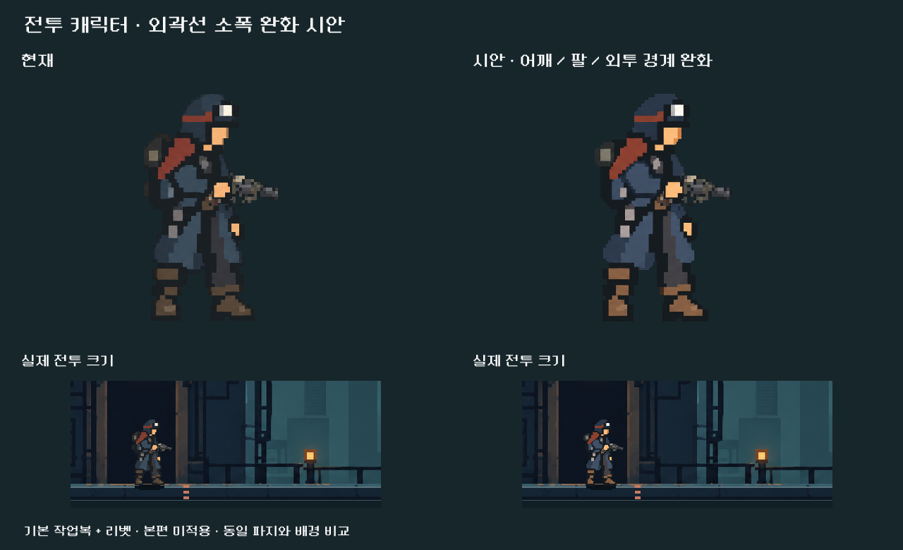

# 전투 캐릭터 외곽선 완화 시안

2026-10-25 · 사용자 요청: 본편 적용 전에 시안 비교.

**후속 확정:** 사용자가 C안(v5)을 채택했다. 기본 전투 몸체에 적용하고, 무기 선택은 별도 초상화를 그리지 않고 전투의 실제 캐릭터와 총기를 함께 보여주도록 변경했다. 아래 미적용/선택 대기 문구는 시안 당시 기록이다. [본편 적용 결과](../../../qa/reports/hero_contour_live_2026-10-25.md).

## 추가 비교 요청 — 외곽선을 더 줄인 C안

사용자가 앞선 시안보다 외곽선을 더 줄인 버전을 추가 요청했다. B는 기존 v4를 변경 없이 유지했고, C는 v4를 입력으로 image_gen에서 추가 편집한 `pistol_body_outline_v5.png`다. 가방·소매·외투·부츠 바깥의 검은 덩어리를 더 줄여 재질색으로 경계를 잡았다. 팔·몸통 등 겹침에 필요한 어두운 부분은 남겼다. 약 50% 추가 감소는 생성 지시의 목표이며 픽셀별 측정 수치는 아니다.

[추가 편집 프롬프트 전문](prompt_v5.txt). 실제 무기 합성을 유지한 격리 실행으로 3개 버전을 같은 크기에서 캡처했다. 종료 0, 오류 출력 없음, 전투 상태 해시 불변. A/B/C 비교판을 시각 검수했다. 사용자의 선호 결정은 미정이고 본편은 미적용이다. 색·형태의 미세한 생성 편차와 전체 동작 검수의 한계는 앞선 시안과 같다.

## 비교

- 왼쪽은 현재 기본 작업복, 오른쪽은 선택한 v4 시안이다.
- 어깨·소매·외투 가장자리의 검은 덩어리를 옷감의 어두운 청회색으로 연결했다. 팔과 몸통, 손과 총이 겹치는 경계는 남긴다.
- 기존 리벳 무기, 파지 위치, 전투 배경, 표시 크기로 비교했다. 아래 이미지는 1280×900 전투 화면에서 추출한 원래 표시 크기다.
- 본편 원화·코드·사용자 저장에는 적용하지 않았다. 모든 복장으로 확대하는 작업도 아직 하지 않았다.

## 제작 및 검수

built-in image_gen으로 기존 `pistol_body_v2.png`를 편집했다. 선택 파일은 `pistol_body_outline_v4.png`(1536×1024 RGBA, 3×2 포즈 배열)이다. 원본은 보존했다. 최초 시안은 변화가 작았고, v2는 검은 대비가 다시 강해져 제외했다. v3의 외곽선 방향에 v4에서 스카프의 붉은 채도를 원본에 가깝게 조정했다.

프롬프트 전문은 [최초](prompt.txt), [v2](prompt_v2.txt), [v3](prompt_v3.txt), [v4](prompt_v4.txt)에, 입력·생성 파일·해시는 [provenance.json](provenance.json)에 기록했다. 이미지 편집에는 image_gen을 사용했으며 비교판은 Godot으로 구성했다.

격리 저장 경로에서 Godot 4.7 Compatibility로 실행했다. 전투 모델 해시 불변, 종료 코드 0, 오류 출력 없음. 실제 전투 크기와 확대 비교를 시각 확인했다. 생성 편집이라 색과 외형이 픽셀 단위로 완전히 동일하지는 않다. 본편 적용 시 6개 포즈 전체의 손·총 접점 및 움직임 검수가 추가로 필요하다. 이번 결과는 외곽선 방향을 고르는 시안이며 전체 애니메이션 품질 통과를 의미하지 않는다.
