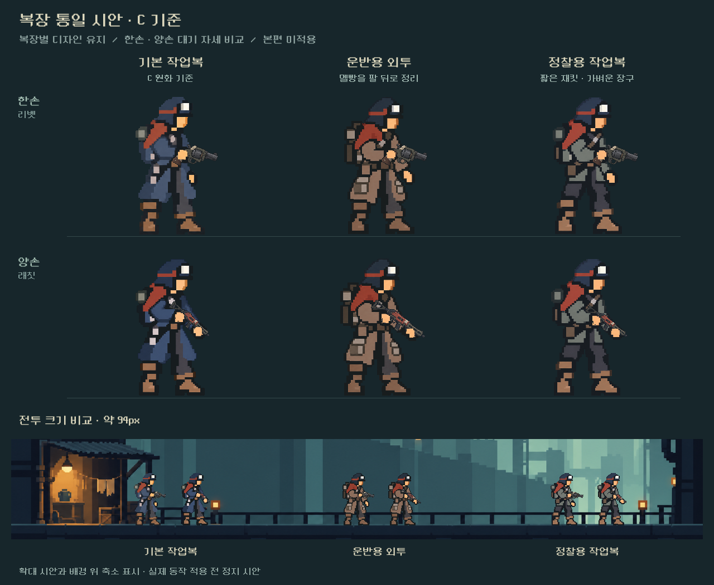
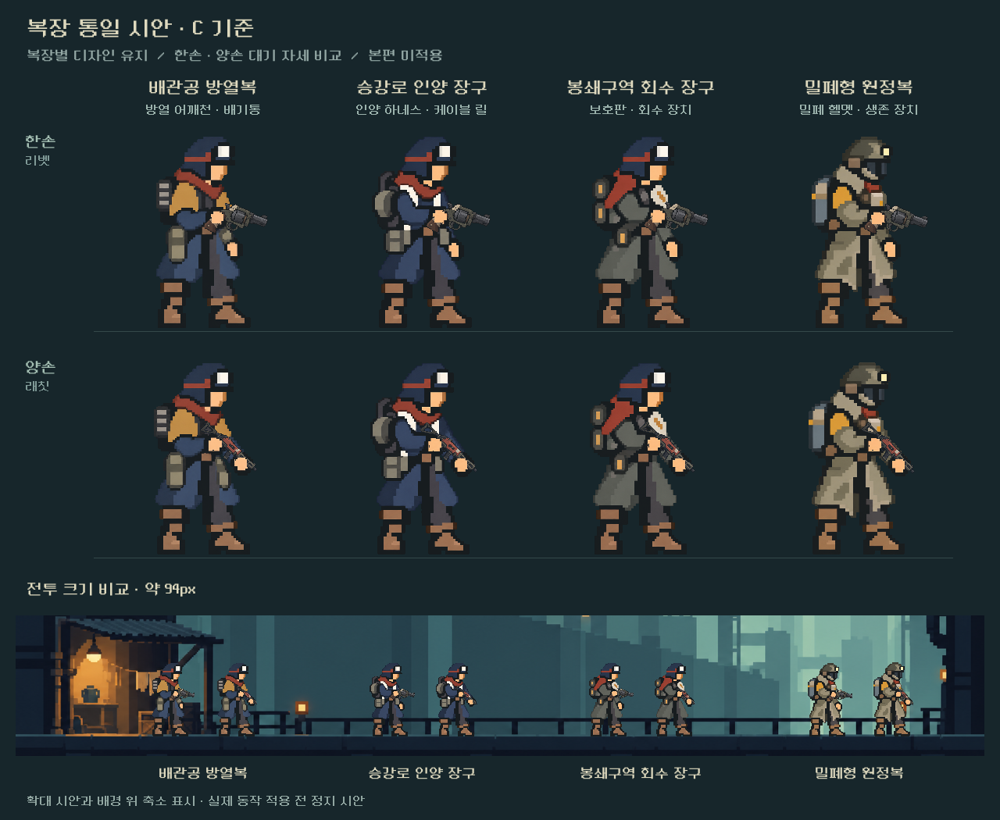

# 전체 7복장 시안 후속 — 멜빵 교정 및 나머지4종

후속 상태: 사용자 승인 후 [본편 통합](../../../qa/reports/outfits_unified_2026-10-25.md) 완료. 아래는 시안 제작 당시의 비교/출처 기록이며 실제 동작·장소 적용과 구별한다.

## 운반복 교정

사용자가 지적한 한손 운반복의 대각 멜빵이 앞팔 소매를 덮는 원화 오류를 수정했다. 첫 편집v3에서 한손은 고쳐졌으나 양손에 같은 띠가 생겨 재수정했다. **최종은 carrier_v4.png**이며, 두 자세 모두 멜빵을 앞팔 뒤 가슴에 두고 소매를 하나의 갈색 면으로 연결했다. 손과 파지의 방향은 유지했다. v2/v3는 이력이다.

## 나머지4종 개선

기존 각 복장의 원화와 C 기준work_v2를 실제 입력으로 사용했다. 넓은 색면, 선택적인 재질색 경계, 몸 비율과 한손/양손 낮은 대기 파지를 맞췄다.

- 배관공 방열복: 방열 어깨천·등 배기통.
- 승강로 인양 장구: 밝은 하네스·등 케이블 릴.
- 봉쇄구역 회수 장구: 비대칭 보호판·회수 장치.
- 밀폐형 원정복: 전용 밀폐 헬멧·호흡 장치·생존통. 기본복 모자로 바꾸지 않았다.

## 제작과 확인

- 내장 image_gen 편집. 후처리로 원화 픽셀을 수정하지 않음.
- 새 최종PNG5장: carrier_v4, heatworker_v1, hoist_v1, recovery_v1, expedition_v1. 각1774×887 RGBA 투명2자세.
- [원본·입력 역할·전체 프롬프트](remaining_generation.json), [메타데이터·해시](remaining_provenance.json).
- [격리 비교 렌더](render_all_preview.gd), [실행 런처](render_all_preview.ps1).
- Godot4.7 격리 실행 성공, stderr없음. 전체7복장×2파지×245px/94px=28표시, [표시 기록](all_preview_checks.json). 두 최종 비교판을 직접 열어 겹침·크기·가방/복장 차이·접지를 확인했다.
- 실제 총기를 정지 시안의 측정한 손 접점에 겹쳐 확인한 것. 본편의6키포즈/무기5종/총기 저해상도 합성/실내/선택·전투 화면은 아직 적용하거나 검증하지 않았다. 사용자 미감 확인도 후속.
- 이전 [첫3종 기록](README.md)의 범위·정지 시안 한계는 유지한다. 최신 운반복은 이번v4가 우선한다.

