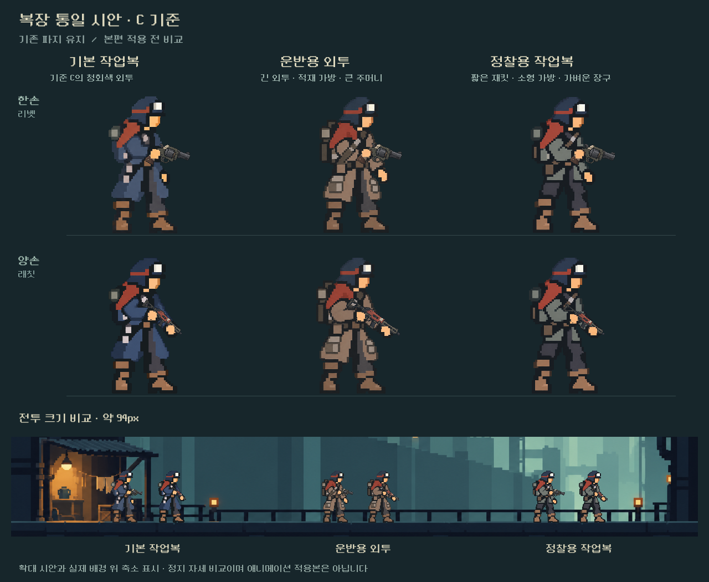

# 기본·운반·정찰 복장 통일 시안 — 2026-10-25

**후속 최신:** 운반복의 멜빵/팔 겹침을v4로 수정하고 나머지4종의 C 기준 시안을 추가했다. 전체7종은 [최신 비교판·범위](ALL_OUTFITS.md)를 본다. 아래 comparison.png와 carrier_v2는 첫 전달 이력이다.

후속 상태: **사용자 승인 후 [7복장 본편 통합](../../../qa/reports/outfits_unified_2026-10-25.md) 완료**. 아래는 최초 정지 시안 제작 기록이다.

사용자 요청은 리벳·스파이크의 승인 C 원화를 도트풍/인체 기준으로 삼아 양손 계열도 통일하고, 운반복·정찰복을 구분하되 현재 파지를 유지하는 것이다. 이번 범위는 시안 먼저이며, 실제 게임의 리소스/등록/규칙/저장은 변경하지 않았다.

## 시안

- 기본 작업복: 승인 C의 청회색 외투·녹슨 어깨천·모자·비율 유지. 양손 버전은 같은 기본 몸체의 표현을 목표로 제작.
- 운반용 외투: 탁한 갈색 긴 외투, 수직 적재 가방, 큰 짐 주머니. 색 외에도 가방과 하단 실루엣으로 구분.
- 정찰용 작업복: 회녹색 짧은 재킷, 작은 가방과 허리 장구, 노출된 바지 허벅지. 가벼운 실루엣으로 구분.
- 한손은 기존처럼 한 손을 낮게 두고 리벳을 들며, 양손은 앞손을 낮춰 총을 아래로 받치는 기존 대기 파지다.
- 비교판의 기본복/한손은 **기존 승인 C 파일 자체**를 사용한다. 새 work_v2의 왼쪽 재생성 그림은 승인본 교체 제안이 아니며 비교판에서는 사용하지 않았다.

## 제작 및 내부 수정

내장 image_gen 편집으로 복장별 2자세 투명 PNG를 생성했다. 입력은 승인 C, 기존 양손 몸체(파지 참고만), 과거 복장 초상화(의상 아이디어만)였다. 최초 출력의 오른쪽 팔이 조준 자세처럼 올라간 오류를 발견해 현재 래칫 선택 화면을 추가 입력으로 사용, 양손 low-ready 자세를 수정했다. 정찰복도 하단 옷자락을 짧게 교정했다.

- 최종 원화: work_v2.png, carrier_v2.png, scout_v2.png. 각1774×887 RGBA, 두 셀, 실제 알파0~255.
- 전체 원본/수정 프롬프트와 입력 역할, 생성 원본 경로: [generation.json](generation.json).
- 파일 크기·알파·참조/출력 해시: [provenance.json](provenance.json).
- 시안 코드: [render_preview.gd](render_preview.gd), 실행: [render_preview.ps1](render_preview.ps1).
- 원본 이미지는 후처리/덮어쓰기하지 않았다. Godot 비교판에서 실제 총기 리소스를 레이어로 그렸다.

## 확인 범위

격리 APPDATA/LOCALAPPDATA의 Godot4.7 정지 렌더. 세 복장×두 파지×두 크기(245px 확대,94px 전투 크기)12회 표시. 게임 캠페인/저장은 로드하지 않았다. 같은 배경 위에서 옷자락·가방·색 구분, 머리 비율, 몸 가림, 발 접지를 제작자가 시각 확인했다. 결과는 [preview_checks.json](preview_checks.json).

비교판의 무기 접점은 시안의 실제 손 위치를 측정해 등록했다. **기존 게임의 손/총구 등록표를 그대로 사용한 본편 검증은 아니다.** 원화 레이아웃과 손 위치가 제작용512셀 등록에서 달라졌으므로, 채택 후 원본 C를 최대한 유지하며6키포즈 아틀라스와 손/총구 접점을 맞춰야 한다. 한손·양손의 동작 방식은 유지한다.

이번 정지 시안은 리벳/래칫 대표 합성만 확인했다. 스파이크/스플린터/리액터 합성, 반동·재장전·냉각6자세, 전투/선택 화면 연결과 실내 자세, Galaxy 확인은 후속이다. 총기 그림은 실제 자산을 사용했지만 비교판은 전투의 저해상도 무기 서브뷰포트를 재현하지 않으므로 총기 선명도 판단용이 아니다. 사용자의 미감 승인은 아직 받지 않았다.

최초 실행은 PowerShell의 한글 경로 해석으로 실패했고, 프로젝트 경로를 실제 폴더에서 찾아 수정했다. 이후 렌더는 성공했으나 ExitCode가 null인 Windows 런처 판정 오류가 있어 성공 로그/오류 로그를 함께 검사하도록 정정했다. 최종 실행은 exit0, CONCEPT COMPLETE, stderr없음.

