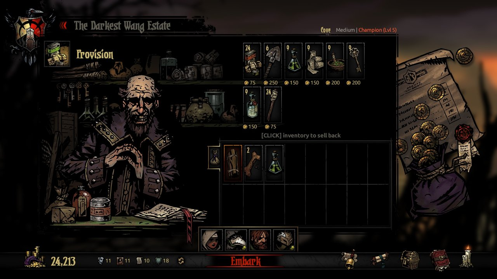
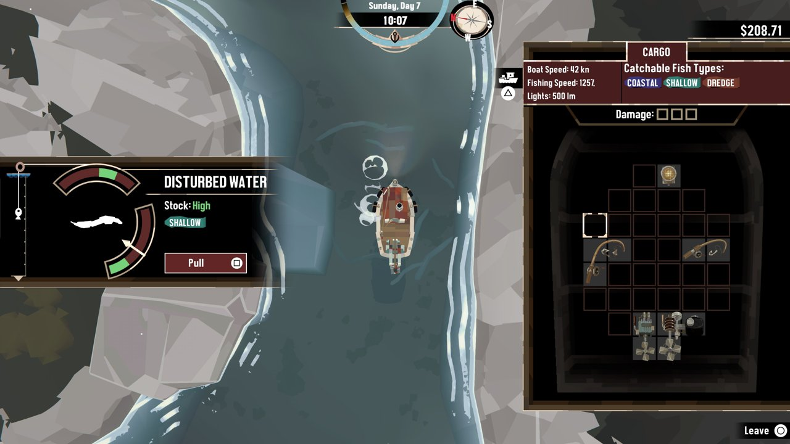
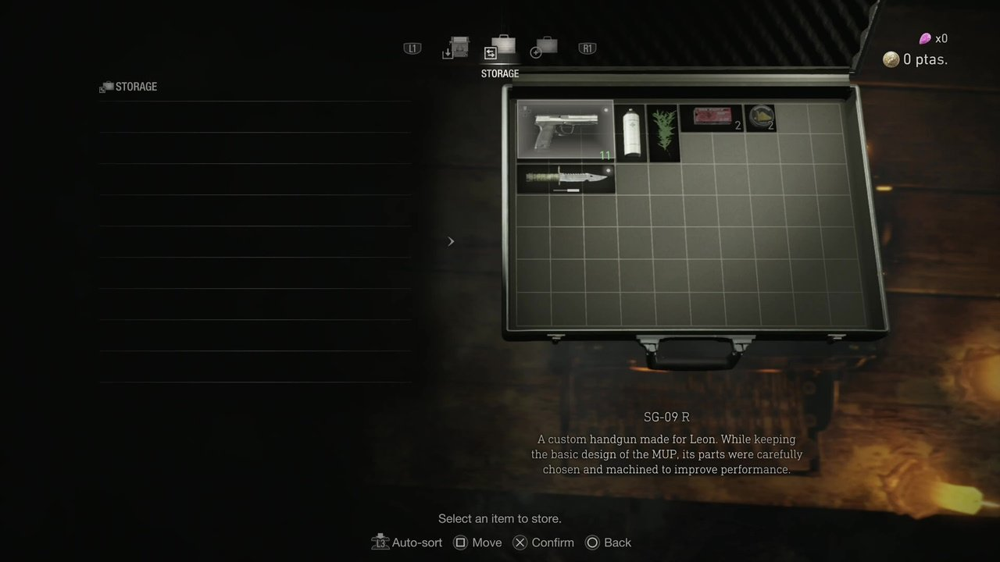
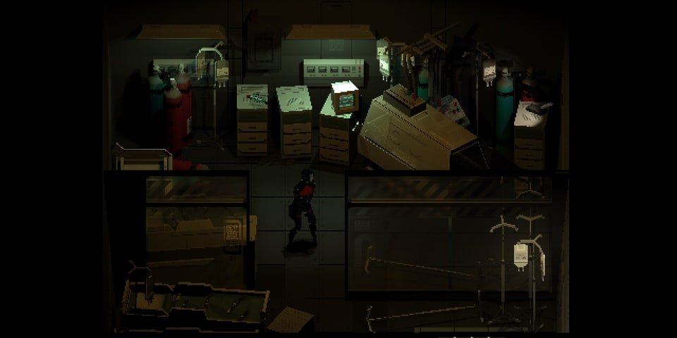

# 탄약고(보급소) 레퍼런스

2026-11-07. [UI 개편 대상](../../../direction/ui-rework-scope.md) 5순위 '보급소 — 탄 후보·추가/교체·보급 완료·보류'의 시안을 만들기 전에 고른 실제 게임 화면 4개. 연구용 참조이며 게임 자산으로 쓰지 않는다.

현재 탄약고의 목적: 이 장소에서 **탄 1장을 받는다**(보유 탄 보충 또는 새 탄). 가방이 차 있으면 한 장을 내보내고 받는다. 필요한 정보는 받을 탄의 성능, 같은 탄을 몇 장 갖고 있는지, 휴대 한도가 어떻게 바뀌는지다. 기존 화면은 장소 그림 아래 탄 카드 3장과 같은 모양의 버튼만 반복되어, '보급받는다'는 행위와 휴대 한도가 이어지지 않았다.

| 게임 | 화면 | 가져올 원리 | 가져오지 않을 점 | 출처 |
| --- | --- | --- | --- | --- |
| Darkest Dungeon | 출정 전 보급  | 상인의 진열(수량·가격)과 **내 짐칸 격자가 빈칸까지** 한 화면에 있다. 무엇을 사면 어디가 차는지 바로 보인다. | 손그림 판넬·두꺼운 장식틀, 구매 가격 중심 구성(탄약고는 무료 1장) | [LP Archive, Darkest Dungeon Update 04](https://lparchive.org/Darkest-Dungeon/Update%2004/) |
| Dredge | 낚시 지점과 화물칸  | 지점의 재고 정보(왼쪽)와 **내 화물칸**(오른쪽)이 같은 순간에 보인다. 가져오기 전에 공간이 있는지 판단한다. | 테트리스식 칸 배치(우리 탄은 모두 1칸) | [TheSixthAxis, Dredge Review](https://www.thesixthaxis.com/2023/05/08/dredge-review/) |
| Resident Evil 4 (리메이크) | 보관함과 가방  | 가방이 **장면 속 물건**으로 놓이고, 어두운 배경에서 물건만 밝게 읽힌다. | 큰 격자 관리 화면 전체, 회전·정렬 조작 | [GodisaGeek, RE4 Remake: How to carry more items](https://godisageek.com/2023/03/resident-evil-4-remake-how-to-carry-more-items/) |
| SIGNALIS | 보관실  | 어두운 창고에 선반과 상자만 조명으로 드러나는 분위기. 창은 최소한으로. | 위에서 내려다보는 시점, 6칸 소지 제한 규칙 | [TheSixthAxis, Signalis Review](https://www.thesixthaxis.com/2022/11/04/signalis-review/) |

## 시안에 적용한 것

- 1차: 탄약고 배경 가운데의 열린 보급함 위에 받을 탄 3장을 띄웠다(RE4). 사용자 피드백(캐릭터가 가려짐)으로 2차에서 오른쪽 상세 창 아래로 옮겼고, 3차에서 정비소·관문과 같은 **아래 선반**에 두었다(교체 시 같은 선반이 내 탄 묶음으로 전환). 장면은 어두운 보관실 분위기로만 남긴다(Signalis).
- 아래 선반은 **내 휴대 탄약**: 종류별 묶음과 휴대 칸 게이지(빈칸 포함). 받을 탄은 금색 칸, 내보낼 탄은 붉은 칸으로 미리 표시한다(Darkest Dungeon·Dredge).
- 오른쪽 비교창은 정비소·관문과 같은 형식으로 '현재 → 확보 후'를 보여 주고 `추가로 확보` / `교체해서 확보`를 고른다.

[시안·화면·검증](../../../qa/reports/supply_review_2026-11-07/README.md)
