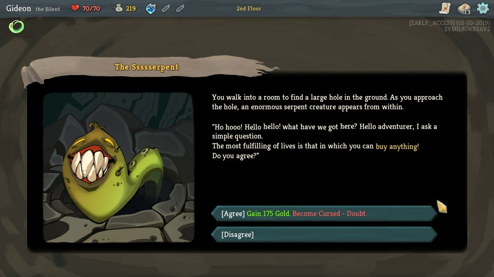
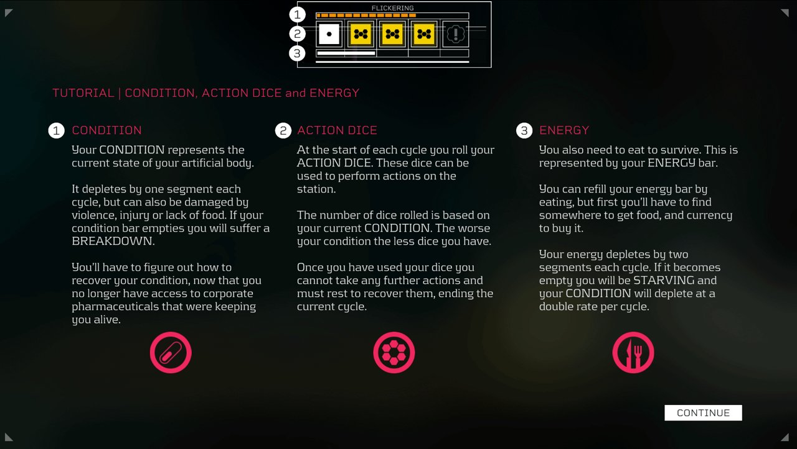
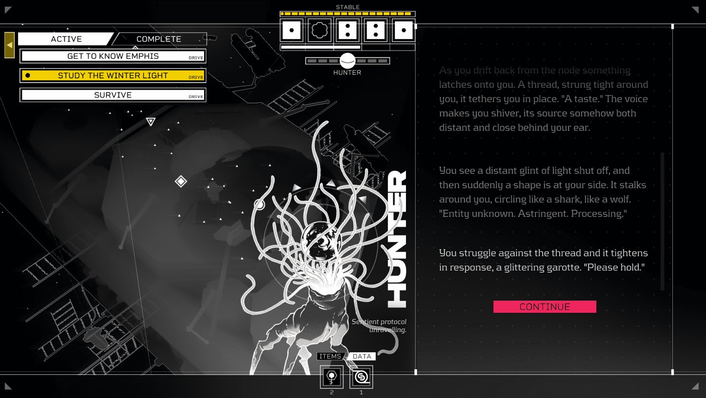

# 사건·조우 레퍼런스

2026-11-08. [UI 개편 대상](../../../direction/ui-rework-scope.md) 6순위 '사건·조우 — 최초 선택·유료 선택·매복/전투·전리품·해결'의 시안 전에 고른 실제 게임 화면. 연구용 참조이며 게임 자산으로 쓰지 않는다.

현재 사건의 목적: 짧은 단서를 읽고 **두 행동 중 하나**를 고른다(일부는 크레딧 비용). 결과는 고른 뒤에만 공개된다. 결과는 크레딧·도시 기록·탄 발견·매복(그 자리에서 전투) 중 하나다. 기존 화면은 탄약고 그림을 빌려 쓰고, 선택 카드와 버튼이 탄약고와 같은 모양이라 '사건'이라는 성격이 약했다.

| 게임 | 화면 | 가져올 원리 | 가져오지 않을 점 | 출처 |
| --- | --- | --- | --- | --- |
| Slay the Spire | 사건  | 짧은 서술 바로 아래에 선택지가 이어지고, 선택지 줄에 **대가가 함께** 적힌다. 읽고 → 고르는 한 기둥. | 결과를 미리 다 적는 방식(우리 사건은 결과를 숨긴다), 두루마리 장식틀 | [Gideon's Gaming, Slay the Spire Review](https://gideonsgaming.com/slay-the-spire-review-the-heart-of-the-cards/) |
| Citizen Sleeper | 장소 위 행동  | 장소 장면이 화면 전체에 있고, 행동마다 **위험·비용 표시**가 작게 붙는다. | 주사위 슬롯·여러 행동 동시 배치 | [Checkpoint Gaming, Citizen Sleeper Review](https://checkpointgaming.net/reviews/2022/05/citizen-sleeper-review-poetic-death-awaits-you/) |
| Citizen Sleeper | 서술 기둥  | 인물 그림 옆에 **서술 기둥**이 있고, 결과 뒤에는 행동 하나(Continue)만 남는다. | 세로 대형 인물 일러스트(우리에게 없는 자산) | 같은 출처 |

FTL 사건 창도 찾았으나 쓸 수 있는 사건 화면 캡처를 확보하지 못해 제외했다.

## 시안에 적용한 것

- 배경은 **그 구역의 전투 배경**이다. 매복이 걸리면 같은 자리에서 싸운다. 장면 위를 차갑게 어둡게 덮어 '모르는 상황'을 표현했다(Citizen Sleeper).
- 오른쪽 이야기 창: 제목 → 서술 → 선택지 2개. 선택지는 첫 줄에 행동과 **비용**(없으면 '비용 없음', 부족하면 'N Cr 부족'), 둘째 줄에 단서(Slay the Spire).
- 고른 뒤에는 같은 창에 결과 서술과 결과 표시(획득·기록·매복·발견), **다음 행동 하나**만 남긴다(Citizen Sleeper).
- 탄 발견은 탄약고와 같은 아래 선반을 쓴다.

[시안·화면·검증](../../../qa/reports/event_review_2026-11-08/README.md)
