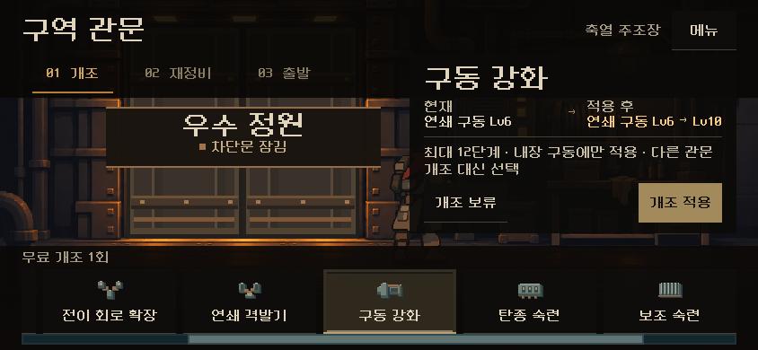
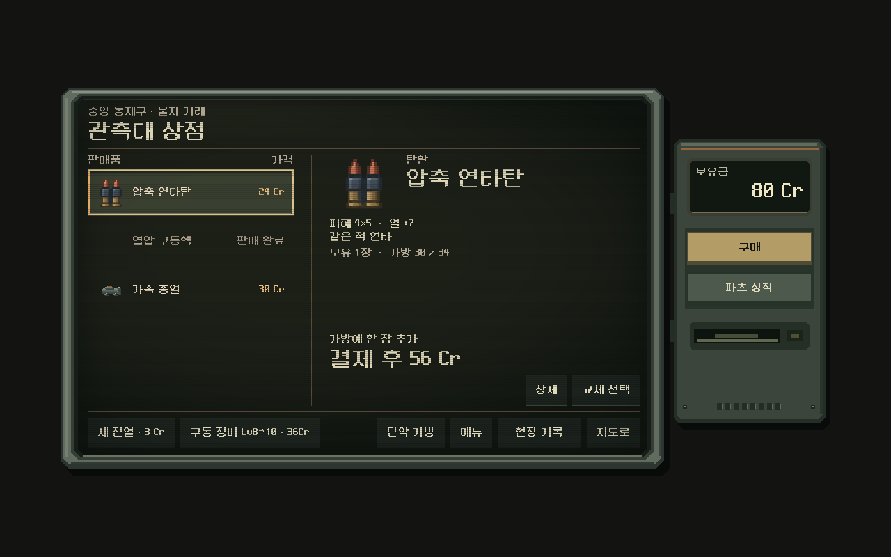

# 탄환·파츠 재정비 — 성장 구조 v2 기준

2026-11-10. 사용자 요청: "전체 탄환과 파츠를 재정비해 줘. 현재 바꾼 구조에 적합한 탄환들과 파츠 구성이 되어 있는지." 기준은 [성장·빌드 구조 v2](growth-structure.md)다(특수탄 우선 장전, 총기 내장 구동, 코어 제한 없음, 탄종 숙련).

결정 상태: 사용자 위임에 따른 **디렉터 결정**이다. 사람 플레이 확인 전이다. 이전 등반·저장은 바뀌지 않는다(모든 변경은 `growth_structure_version=1` 등반에만 적용).

비교 시험(11-10): 이 표가 '현재 구성'이다. 탄 이름 대신 태그를 보는 구성은 [태그 시험판](tag-build.md)이며 등반 설정에서 고른다.

## 한눈에

- **고친 것**
  - 지원탄에도 숙련을 줬다(보조 숙련).
  - 손패 시절 파츠인 예비 급탄기를 '빼내기 +1'로 바꿨다.
  - 성장 구동 3종이 자기 총기에 중복 제시되지 않게 했다(앞 단계).
- **그대로 둔 것**: 대부분의 탄과 파츠. 특수탄 우선 장전으로 오히려 안정된 것(선두 격발기, 삼중 시퀀서 등)이 있다.
- **남은 결정**: 연계탄 재도입, 삼중 시퀀서 강세 여부, 성장 구동의 자동 성장, 리벳 개편.

## 탄환 18종

| 탄 | 분류 | v2에서 | 조치 |
| --- | --- | --- | --- |
| 연타 | 공격(다회) | 숙련 타격당 +1, 공명기·기록기와 연결 | 유지 |
| 철갑 | 공격(단타) | 숙련 +2(단타), 돌파 내장(리벳 등)과 맞음 | 유지 |
| 소이 | 공격 | 숙련 +1, 열압 내장(리액터)과 맞음 | 유지 |
| 전격 | 공격 | 숙련 +1 | 유지 |
| 충격 | 공격(제어) | 숙련 +2(단타). 밀치기는 그대로 | 유지 |
| 추격 | 공격 | 숙련 +2 | 유지 |
| 우회 | 공격 | 숙련 +2 | 유지 |
| 열방출 | 공격 | 숙련 +2 | 유지 |
| 기폭 | 공격(피해 0) | 숙련이 직접 피해를 만든다(+2/단계) | 유지, 관찰 |
| 연계 | 공격 | 새 획득 풀에서 빠져 있다. 특수탄 우선 장전으로 서로 다른 탄이 앞에 모여 조건이 잘 맞게 됐다 | **재도입 검토(결정 필요)** |
| 증폭 | 지원 | 숙련 대상이 아니었다 | **보조 숙련: 증폭 +1/단계** |
| 잔열 증폭 | 지원 | 〃 | **보조 숙련: +2/단계** |
| 배율 | 지원(×2) | ×2 강화에는 가산값을 실을 수 없다(저장 검증) | 숙련 제외 |
| 파쇄 | 지원 | 숙련 대상이 아니었다 | **보조 숙련: 장갑 −1/단계** |
| 냉각 | 지원 | 〃 | **보조 숙련: 열 −1/단계** |
| 불씨 | 지원 | 〃 | **보조 숙련: 화상 이동 +1/단계** |
| 차단 | 지원(제어) | 획득 일시 정지 상태. 정지 시간을 늘리면 위험 | 숙련 제외 |
| 예약 | 지원 | 획득 일시 정지 상태. 특수탄 우선 장전과 역할이 겹친다 | 정지 유지 |

**보조 숙련**: 관문에 '보조 숙련'을 추가했다. 덱에 가장 많은 지원탄 계열이 대상이고, 최대 4단계다. 주력 숙련(탄종 숙련)과 같은 관문 칸을 두고 경쟁한다.

## 파츠 34종

| 분류 | 파츠 | v2에서 | 조치 |
| --- | --- | --- | --- |
| 성장 구동 | 연쇄 구동핵, 열압 구동핵, 돌파 구동핵 | 자기 총기에는 내장. 다른 총기에는 두 번째 구동(희귀 조커) | 자기 총기 제시 제외(완료). 자동 성장은 4단계에서 정리 |
| 특화(옛 코어) | 냉각 약실, 잔열 노심, 야전 압축기, 과구경 총열, 열폭주 노심, 분기 전이기, 충격 피스톤 | 1개 제한이 없어져 다른 파츠와 함께 쓴다. 대가는 그대로 | 유지 |
| 〃 | 삼중 시퀀서 | 특수탄 우선 장전으로 서로 다른 특수탄 3종이 자주 모인다. 대가(기본탄 −1)는 덜 아프다 | 유지, **강세 관찰** |
| 배율·위치 | 선두 격발기 | 첫 발이 항상 특수탄이 되어 안정됐다 | 유지 |
| 〃 | 제3 격발기, 후미 점화기 | 순서를 맞추기 쉬워졌다(예비 급탄기와 연결) | 유지 |
| 규칙 | 연타 공명기 | 빌드 엔진 시험 | 유지 |
| 성장 | 타격 기록기 | 〃 | 유지 |
| 가산 | 가속 총열, 열축전 코일, 전이 축전기, 충격 가이드, 증폭 시퀀서, 복열 노리쇠, 점화 약실, 배리어 파쇄기, 처형 조준기, 교차 급탄기 | 작지만 정상 작동 | 유지. ★강화로 키운다([보상·경제](reward-economy.md)) |
| 운용 | 압축 안정기, 연쇄 방열기, 확장 방열판, 회수 순환펌프, 회수 가속기, 확장 탄창 | 정상 작동 | 유지 |
| 손패 시절 | **예비 급탄기** | '패 교환 +1회'. 패 교환 버튼은 예전 손패 전투 화면에만 있어 탄창 등반에서는 **효과가 없었다** | **v2: 탄창당 빼내기 +1회(2 → 3발)** |
| 〃 | 예약 급탄기 | 예약탄과 함께 획득 일시 정지 | 정지 유지 |

## 확인

- `tests/growth_structure_rules.gd`: 38검사(보조 숙련 제시·적용·효과, 냉각·파쇄 성장, v2 밖 무효, 예비 급탄기 빼내기 +1·문구).
- 자동 등반(관문 1회 주력 숙련, 1회 보조 숙련, 나머지 기본 정책): 리벳 완주 369턴, 래칫 완주 239턴, 리액터 완주 459턴(기존 333 / 335 / 463).
- 처음 시험에서 배율탄에 보조 숙련을 넣어 리액터 등반이 저장 복원에서 실패했다. 배율 강화에 가산값을 실을 수 없어서였다. 배율탄을 숙련에서 빼고, 강화 저장 상한을 16 → 40으로 넓혀(스파이크 ×2 + 잔열 증폭 숙련 대비) 다시 완주했다.

## 남은 결정 → 처리 (11-10, 사용자 "1~4까지 진행해 줘")

1. **연계탄 재도입**: 새 등반(획득 판정 v4)의 획득 풀에 다시 넣었다. 이전 등반(v2~3)은 계속 제외(`ammo_discovery.gd`).
2. **삼중 시퀀서**: 실제 등반 덱 6개로 첫 탄창을 200번씩 섞어 확인했다. 3종 조건이 성립하는 비율이 기존 15~65%에서 특수탄 우선 장전 88~100%로 올라 사실상 상시 +3이었다. 새 등반은 **4종**을 요구한다(성립 0~76%, 기존 3종 비율과 비슷).
3. **성장 구동의 성장**: 아래 순서로 시험했다.
   - 승리 성장을 완전히 없애고 관문 '구동 강화'(+4)만 남김: 관문 4번 중 2번을 써서 발수 개조가 밀렸고, 리벳 최종 보스 실패, 리액터 463 → 527턴.
   - 상점 '구동 정비'(크레딧)만 추가: 구동이 Lv2~4에 그쳐 리벳 실패, 리액터 669턴.
   - **채택**: 구동의 전투 조건(연쇄 3타 이상, 열압 고열 사격, 돌파 8 이상 단타)을 달성한 승리 성장은 Lv8까지 유지한다. **Lv9~12는 선택으로만 오른다**: 관문 '구동 강화' +4, 상점 '구동 정비' +2(12·18·24…Cr). 구동 정비는 탄창 등반에서 숨겨져 있던 상점의 '압축 충전' 자리를 쓴다. 폭 1000 미만 화면에서는 하단 줄이 넘쳐(6번째 키) 상점 '메뉴' 안에 둔다. 이 구성에서 세 총기 모두 완주했고, 래칫·리액터는 마지막 상점에서 Lv10을 샀다. 원칙 '자동 성장 없음'은 '조건을 달성하지 않으면 자라지 않고, 상한 너머는 선택'으로 고쳐 적용한다.
4. **리벳 개편**: 새 등반에서 리벳이 빼낸 탄은 소모되지 않고 **같은 탄창 뒤로** 간다(빼내기 횟수는 그대로 소모). 원하는 탄을 앞으로 당기면서 탄을 잃지 않는다. 무기 상세에 '빼낸 탄은 탄창 뒤로'로 표시된다. 자동 플레이는 빼내기를 거의 쓰지 않아 효과는 사람 플레이에서 확인해야 한다.

### 검증

- `tests/growth_structure_rules.gd` 51검사.
  - 관문 구동 강화와 옛 상한 확장 제외
  - 조건 달성 승리 +1, 8에서 멈춤
  - Lv12 저장 가능
  - 삼중 4종
  - 연계 v4만
  - 리벳 뒤로 재배치(횟수 소모, 덱 무손실)
- `tests/overhaul_ui.gd` 30검사(1280×800, 844×390).
  - 관문 화면에 구동 강화·탄종 숙련·보조 숙련이 보이고, 짧은 화면에서는 옆으로 넘겨 닿는다.
  - 구동 강화 6 → 10과 저장.
  - 상점 '구동 정비 Lv8→10 · 36Cr' 구매와 다음 단계 42Cr. 844×390에서는 메뉴에서 구매.
- 상점 화면 검사(`shop_terminal_live_runner`): 처음에는 844×390에서 하단 줄이 넘쳐 구매·파츠 키와 겹쳤다. 짧은 화면에서는 메뉴로 옮겨 318검사 통과.
- 자동 등반(상점마다 구동 정비, 관문 1회 숙련): 리벳 386턴, 래칫 242턴, 리액터 510턴. 모두 완주(기존 333 / 335 / 463).

| 화면 | |
| --- | --- |
| 관문(844×390) |  |
| 상점 구동 정비 |  |

## 아직 남은 것

- 리벳·리액터는 기존 구조보다 총 턴이 15%, 10% 많다(자동 플레이 기준). 사람 플레이로 체감을 본 뒤 조정한다.
- 관문 선택지가 최대 8개로 늘었다. 짧은 화면에서는 옆으로 넘겨야 한다.
- 상점 '메뉴' 창은 아직 이전 청록 작업 창이다(짧은 화면의 구동 정비가 여기 있다).
- 크레딧은 여전히 86~98 남는다. 보상·경제 2단계(탄 제거·★강화·이자)가 다룬다.
