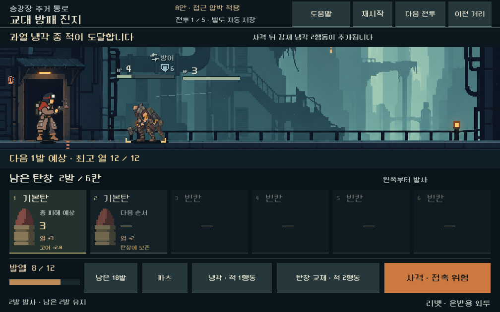
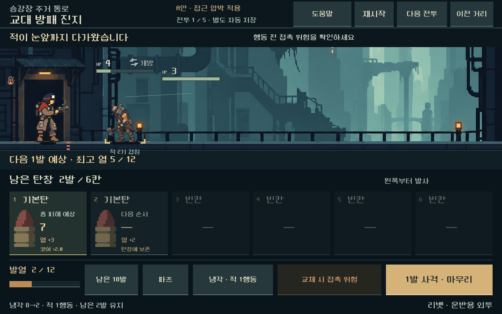

# 탄창 운용에 맞춘 접근 압박 비교

**후속:** [총기별 탄창 비교](weapon-magazine.md)가 최신 기본 실행이다. 아래 리벳 접근 비교와 저장은 보존한다. 새 다섯 총기 비교의 보스만 거리80% 후보를 사용하며 아래50% 결과와 구분한다.

2026-10-31 · [A안 탄창 운용](combat-magazine-loop.md)의 후속. [통합 개편](combat-ui-rework.md) 2단계.

## 결정 상태

- **사용자 요구:** 적이 앞까지 거의 오지 않아 즉사 구조의 긴장감이 약하다. A안과 탄창 확대 방향에서 다음 작업을 진행한다.
- **디렉터 후보:** 방패 진지와 첫 보스의 이동 적만 시작 거리를 절반으로 줄여 올림하고 이동량을 +1 한다. 정지 사수·보스 본체의 위치/공격 시계, 적 HP·장갑·수·피해는 유지한다.
- **구현:** 독립 A안 비교 플레이에 적용했다. 방패 진지·첫 보스·사수 매복·무리전·성장 확인전의 5개 획득 상태를 선택하고, 같은 탄창으로 이전 거리와 새 압박을 전환할 수 있다.
- **범위:** 리벳+돌파 코어 6칸 비교. 본편 새 등반에 아직 활성화하지 않으며 다른 총기·정예·새 규칙으로 획득한 연속 등반은 후속이다. 아래 수치는 전 게임의 최종 난도 확정이 아니다.

## 접근 규칙

| 전투 | 이동 적의 변경 | 유지하는 역할 |
| --- | --- | --- |
| 교대 방패 진지 | 방패병 거리22/이동1 → 11/2, 호위 거리27/이동2 → 14/3 | 사격 사이 장갑 개폐를 보며 과열·냉각·교체 비용 판단 |
| 첫 보스 | 이동 호위와 예비의 거리×0.5 올림, 이동+1 | 호위가 먼저 파고들고 보스의 발사/요격 시계는 그대로 작동 |
| 사수 매복 | 이번 후보에서 유지 | 앞 사수 제압과 발사체 대응 |
| 흩어진 약탈단 | 유지 | 짧은 연쇄 처치 |
| 모여든 약탈단 | 유지 | 얻은 조합을 빠르게 활용하는 전투 |

모든 전투를 같은 길이나 속도로 만들지 않는다. 두 발 사격·냉각1행동·교체2행동·과열 추가2행동과 잔탄 보존은 이전 탄창 후보 그대로다. 이동하는 호위가 정지 보스 앞으로 나오는 표적 순서 변화는 실제 거리 계산의 결과이며 별도 강제 표적 규칙을 넣지 않는다. 예비의 투입 시점·도착 턴 행동 규칙도 유지한다.

버전은 최초 전투 준비 상태에 한 번만 적용한다. 부분 사격 저장을 열 때 거리와 속도를 다시 조정하지 않는다. 저장된 버전·전투 역할·전투 번호·탄창 규칙이 맞지 않으면 복원을 거부한다.

## 비교 결과와 판단

실제 획득 상태 5개에서 거리 비율 5개×이동 보너스 2개×탄 순서 6개×운용 2개를 비교했다(600조건). 체력을 늘리거나 보유 탄을 추가해 결과를 맞추지 않았다. 방패전은 거리0.4보다 여유가 있는 **0.5/+1**을 선택했고 보스도 같은 값을 비교 후보로 채택했다.

다음은 원본 탄 순서와 5개 섞기 시드, ‘과열 예상 시 냉각·빈 탄창 교체’ 정책을 사용한 결과다. 접촉 여유는 살아 있는 이동 적의 현재 거리/이동량을 올림한 적 행동 수이며, 발사체 위협은 별도의 실제 행동 예측으로 판단한다.

| 전투 | 이전 최소 접촉 여유 | 새 최소 접촉 여유 | 접촉 2행동 이내를 만난 조건 | 이전 → 새 전투 턴 |
| --- | --- | --- | --- | --- |
| 방패 진지 | 11~12 | 2~3 | 0/6 → 4/6 | 3~4 → 3~4 |
| 첫 보스 | 6~9 | 1~2 | 0/6 → 6/6 | 10~15 → 8~14 |
| 사수 매복 | 11~12 | 동일 | 0/6 → 0/6 | 2 → 2 |
| 무리전 | 8 | 동일 | 0/6 → 0/6 | 1~2 → 1~2 |
| 성장 확인전 | 9 | 동일 | 0/6 → 0/6 | 1~2 → 1~2 |

**전투를 더 길게 만들지 않고 몸체 접근이 다음 선택에 영향을 주는 사례가 생겼다.** 다만 위 숫자는 제한된 상태/정책의 결과이며 사람의 승률·재미를 의미하지 않는다.

현재 기본 방패 진지에서 실제 사격 두 번 뒤:

- 그대로 사격하면 열 한계에 걸려 사격1+강제 냉각2행동을 쓰고 접촉으로 패배한다.
- 냉각1행동 뒤 남은 탄으로 사격하면 승리한다.
- 그 냉각 직후 탄창을 교체하면 교체2행동 도중 적이 도달한다. 남은 탄을 활용할 이유가 생긴다.

이는 일부러 빈 재장전을 반복해 만든 위기 화면이 아니다. **정상적으로 두 번 사격해 도달한 상태**다. 실제 위험 원인을 ‘과열 냉각 중 적 도달’로 표시하고 사격·교체 버튼에도 각각의 접촉/피격 위험을 표시한다.

추가 순서 감사는 방패/보스 각각 40개 시드(80조건)다. 동일 냉각 정책은 75조건에서 승리했고 보스 5조건에서 실패했다. 제한된 탐색으로 이 5조건 모두 다른 합법 승리 경로를 찾고 실제 모델로 재생했다. 일부는 탄창을 먼저 바꾸고, 일부는 냉각 대신 사격을 이어간다. 이는 특정 순서의 강제 패배 여부를 점검한 결과이며, 모든 탄 순서의 해결 가능성이나 초보자의 발견 가능성을 증명하지 않는다.

## 실행과 화면

[비교 플레이 실행](../../OPEN_COMBAT_UI_STUDY.cmd). 상단 **이전 거리/접근 강화**는 같은 전투·탄 순서로 재시작한다. **다음 전투**는 다섯 개 독립 획득 상태를 순환한다. 보상이나 장비를 이전 사례에서 이어받는 캠페인 진행 버튼은 아니다. 상태와 비교 선택은 이전 시안·실제 캠페인과 별도로 저장한다.

전장은 일렬 접지를 유지하고 거리 숫자를 상시 추가하지 않는다. 위협 안내 줄은 전장과 분리해 가까운 적의 HP와 겹치지 않는다. 행동 비용·잔탄·실제 예상 피해와 과열 추가 행동이 함께 보인다. 파츠 배율은 2.15를 2로 반올림하지 않고 실제 값을 표시한다.

## 다음 단계

1. 이 압박에서 총기별 탄창 용량·사격 단위를 비교한다. 스플린터의 무작위 표적과 리액터/스파이크의 고유 동작을 유지하며 리벳의 두 발 규칙을 일괄 복제하지 않는다.
2. 새 규칙으로 초반 3~5전투의 실제 획득·정비·저장 경로를 이어서 검증하고 정예를 포함한다. 기존 획득 저장의 비교만으로 본편 전체 균형을 확정하지 않는다.
3. 사람이 위험을 읽고 선택을 바꿀 수 있는지 재테스트한다. 모바일 지속 프레임·기기 발열과 최종 미감 검수도 남는다.

[기능·실제 화면·회귀·한계](../qa/reports/combat_approach_2026-10-31.md).
