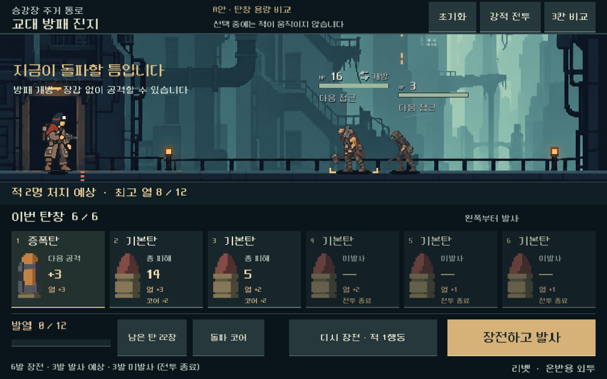

# A안 채택과 탄창 용량 확대 비교

**후속 구현:** [탄창 운용 비교 플레이](combat-magazine-loop.md)로 이어졌다. 현재 기본 실행은 두 발 사격·냉각·교체·별도 저장을 포함한다. 아래 내용은 용량만 바꿨던 이전 비교의 기록이며, 당시 저장 불가였던 +3 후보를 현재는 별도 규칙 버전으로 처리한다.

2026-10-31 · [통합 계획](combat-ui-rework.md)의 1단계 후속 및 2단계 준비.

## 결정 상태

- **사용자 확정:** A 하단 탄창형을 기반으로 진행한다. B 측면 탄창형은 이전 비교안으로 보존하며 기본안 선택을 다시 요청하지 않는다.
- **사용자 요청:** “탄환도 더 많이 들어가야 할 것 같아”. 실제 탄창 용량 확대와 화면 표시 수 확대 중 의도를 확인하는 질문을 보냈으며 아직 답변은 없다.
- **작업 가정:** 실제 장전·발사 가능한 용량 확대를 우선 해석해 되돌릴 수 있는 독립 비교를 진행했다. 답변을 받으면 해당 범위를 반영한다.
- **디렉터 비교값:** 리벳+돌파 코어의 기존 3칸과 4/6칸을 비교하고 **6칸 화면을 기본 시안**으로 제공한다. 전 총기의 최종 용량을 6칸으로 확정하거나 모든 탄을 반드시 발사하는 규칙을 채택한 것은 아니다.
- **구현 범위:** 독립 A 확장 시안, 현행 계산으로 용량만 바꾼 비교. 본편 무기·발열·탄약/저장 규칙은 유지한다. 자기 덱에서 탄창 전체를 추첨하는 새 구조는 아직 미구현이다.

## 전체 화면

탄환 영역을 가로 전체로 넓혀 6칸을 한 줄로 표시하고, 발열·탄약 상세·파츠·재장전·발사를 그 아래로 옮겼다. 한 줄의 발사 순서와 실제 총 피해를 유지하며, 카드 그림은 자기 영역 안에 맞춘다. 기존 A/B 씬은 수정하지 않고 확장 씬을 별도로 두었다.

발사되지 않는 탄에 기본 피해를 그대로 표시하지 않는다. ‘미발사’와 원인(전투 종료/과열 중단)을 함께 보여 주고, 실제 발사 뒤에도 원래 탄창의 결과를 확인할 수 있다. 과열 시 발사한 탄 수, 미발사 배출 수, 강제 재장전 중 적 행동 수를 표시한다. 적 이름과 시안의 상황 안내, 기존 전투 결과 표기가 겹치지 않도록 중복 결과 표시를 정리했다.

[시안 실행](../../OPEN_COMBAT_UI_STUDY.cmd): 6칸으로 시작. 상단의 3칸/6칸 비교, 기본/강적 전투, 초기화를 사용한다. **고정된 두 획득 상태에서 한 차례 사격 결과를 비교하는 시안**이다. 완전한 덱 구성·재추첨·후속 장전 플레이 화면은 아니다.

## 현행 발열을 유지한 용량 비교

출발점은 시드 731042, 운반용 외투, 리벳, 돌파 코어의 실제 획득 저장이다. 같은 소유 손패를 지원탄 우선/기본 피해순으로 정렬한 뒤 앞의 3/4/6발을 사용했다. 같은 용량 내 최적 순서를 탐색하거나 사람의 선택을 재현한 결과는 아니다. 401은 합법적인 재장전으로 방패를 연 뒤 비교했다.

| 상황 | 용량 | 실제 발사 | 미발사 | 최고 열 / 한계 | 사격 입력에 포함된 적 행동 |
| --- | ---: | ---: | ---: | --- | ---: |
| 무리전 201 | 3 | 2 | 1 | 6 / 12 | 0 |
| 무리전 201 | 4 | 2 | 2 | 6 / 12 | 0 |
| 무리전 201 | 6 | 2 | 4 | 6 / 12 | 0 |
| 방패 개방 401 | 3 | 3 | 0 | 8 / 12 | 0 |
| 방패 개방 401 | 4 | 3 | 1 | 8 / 12 | 0 |
| 방패 개방 401 | 6 | 3 | 3 | 8 / 12 | 0 |
| 첫 보스 802 | 3 | 3 | 0 | 9 / 12 | 1 |
| 첫 보스 802 | 4 | 4 | 0 | 12 / 12 | 3 |
| 첫 보스 802 | 6 | 4 | 2 | 12 / 12 | 3 |

앞 두 상황은 적을 먼저 모두 처치한다. 보스의 4/6칸은 과열 후 강제 재장전 2행동이 붙어 총 적 3행동이 발생한다. 6칸에서는 못 쏜 2발도 현행 재장전 규칙에 따라 사용함으로 배출된다. 따라서 **용량 증가만으로 긴 조합의 선택 가치가 커진다고 판단할 수 없다.**

새 탄창 구조의 비교에서 다음을 함께 정한다.

1. 탄창을 더 길게 채울 이득과, 냉각·지원·공격을 섞어 실제로 활용할 수 있는 경로.
2. 도중에 사격을 멈출 수 있는지, 과열/교체 때 미발사 탄을 어떻게 처리하는지. 현재의 강제 전량 배출을 새 구조에 자동 복제하지 않는다.
3. 더 많은 탄을 한 행동에 처리할 때 적의 접근 기회가 지나치게 줄지 않는지.
4. 무기별 용량·발사 방식, 용량 감소 파츠, 여러 칸을 쓰는 압축탄과 남은 탄 부족 상황.
5. 열 한계를 일률적으로 높여 해결하지 않고, 사용자가 지적한 초반 열 부담과 냉각의 선택 가치를 함께 검토.

## 본편 적용과 저장 경계

이번 비교는 독립 모델에서만 `capacity_bonus`를 조정한다. 기존 저장 형식은 이 보너스를 0~2로 제한하므로, 3칸에서 6칸으로 올린 후보(+3)는 **기존 저장 검증에서 거부되는 것이 정상**이다. 비교용 JSON을 실제 캠페인 저장으로 사용하지 않는다.

본편 적용 시에는 새 등반의 명시적인 탄창 규칙 버전과 무기별 기준값으로 다루고, 기존 보너스 검증을 단순히 풀거나 이전 진행 중 전투를 몰래 확대하지 않는다. 이 전환 정책과 실제 저장/복원은 2단계 구현에서 검증한다. 지금은 기존 저장을 변경하지 않았다.

## 검증과 남은 일

- 실제 모델/예측 비교 9조건, 105검사 실패 0. 예측이 상태/RNG를 바꾸지 않으며 실제 적·발사체·종료 상태와 일치함을 확인.
- 1008×630, 1280×576, 1280×800의 UI·터치·과열 결과 141검사 실패 0, 실제 GPU 캡처 9장. 6칸 적재, 3/6칸 전환, 강적 전환, 미발사 설명, 과열 후 배출, 초기화/상세 확인.
- 작업 전 기존 스크립트·씬·리소스/JSON 274개 해시 동일. 본편과 이전 A/B 비교 파일 보존. 기본 실행 파일만 새 시안으로 연결.
- [규칙 비교 원자료](../qa/reports/assets/combat_ui_capacity_2026-10-31/rules.json) · [UI 결과](../qa/reports/assets/combat_ui_capacity_2026-10-31/ui.json) · [파일 해시](../qa/reports/assets/combat_ui_capacity_2026-10-31/manifest.json).
- 미검증: 전 총기 균형, 여러 시드/복장, 전체 등반 탄약 경제, 실제 모바일 성능/기기 발열, 사람의 판독성과 조합 재미, 새 탄창 저장/복원. 6칸은 최종 수치가 아니다.

다음은 A안을 유지하면서 탄창 단위 교체·사격 단위·접근 비용을 비교하고, 6칸의 실제 활용 가치와 미발사 탄 정책을 함께 결정하는 작업이다.
