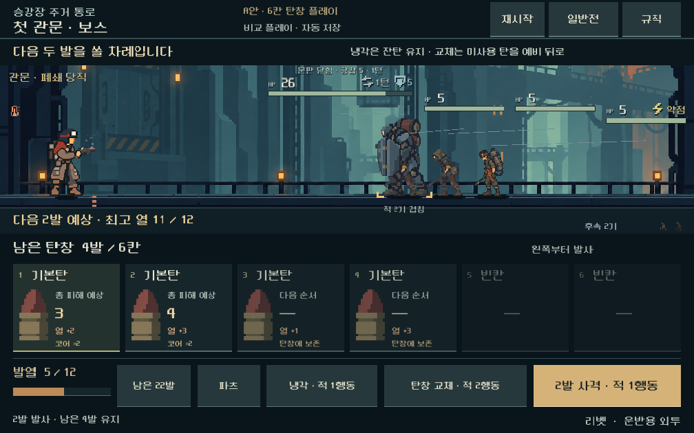

# A안 탄창 운용 비교 플레이

**후속 구현:** [탄창·접근 압박 비교](combat-approach.md)에 방패전/보스의 이동 적 접근을 조정하고 5개 전투와 같은 탄창의 이전 거리 비교를 연결했다. 아래는 접근을 바꾸기 전 탄창 운용 비교의 기록이다. 현재 기본 실행은 후속 접근 비교로 연결한다.

2026-10-31 · [통합 개편](combat-ui-rework.md) 2단계의 첫 실행 비교. [용량만 늘렸던 이전 비교](combat-magazine-capacity.md)를 실제 반복 플레이로 확장했다.

## 결정 상태와 범위

- **사용자 확정:** A 하단 탄창형을 기반으로 작업을 계속한다. 더 많은 탄환을 요청했다.
- **디렉터의 구현 후보:** 리벳+돌파 코어 6칸, 두 발씩 사격, 유한한 자기 덱에서 탄창 단위 공급, 잔탄 보존 냉각. 수치와 다른 총기의 방식을 최종 확정한 것은 아니다.
- **현재 실행 범위:** 실제 획득한 일반전 401과 첫 보스 802의 독립 비교 플레이. 사격 → 냉각/교체 → 추가 사격 → 승패까지 이어지며 별도로 자동 저장한다.
- **본편 경계:** 공통 전투 모델에 명시적인 비교 버전을 추가했지만 본편 새 등반에서는 활성화하지 않는다. 이전 저장과 본편의 기존 규칙·화면을 유지한다. 본편 통합과 모든 총기 균형까지 완료한 단계가 아니다.
- 탄환 수 요청은 실제 용량 확대라는 작업 가정으로 계속 진행한다. 답변이 없었던 구체 의미를 사용자 확정으로 바꾸거나 A/B 선택을 다시 묻지 않는다.

## 현재 비교 규칙

| 행동 | 처리 | 적 행동 비용 |
| --- | --- | --- |
| 전투 시작 | 보유 덱의 이미 섞인 예비 순서에서 탄창을 채움 | 준비 중 0 |
| 사격 | 다음 최대 2발. 지원탄도 한 발에 포함. 남은 탄은 그대로 유지 | 1. 모두 처치해 승리하면 적은 행동하지 않음 |
| 냉각 | 리벳 기준 열 6 감소, 연속 발열 부담 초기화, 잔탄과 탄창 순서 유지 | 1 |
| 탄창 교체 | 미사용 탄을 예비 맨 뒤로 돌린 후 새 탄창. 리벳 기존 냉각량 8 적용 | 2 |
| 과열 | 사격 중단 후 열 0으로 강제 냉각. 미발사 탄 보존 | 사격 뒤 추가 2. 도중 승패가 나면 즉시 종료 |
| 비상 보급 | 공격탄 고갈 시 기존 기본탄 4발 규칙 유지. 새 탄창에 우선 공급 | 교체 비용 + 1 + 이전 보급 횟수 |

냉각량은 총기 재장전 냉각량의 75%를 올림한 값이며 리벳에서 6이다. 초기 비교의 냉각 4는 같은 6발을 활용하는 데 냉각 두 번이 필요해 강제 냉각과 비용이 같았다. 현재 6 후보에서는 사전 냉각 한 번으로 적 행동 하나를 아낄 수 있다. 열 상한 12를 높여 해결하지 않는다.

사용한 탄은 이번 전투의 사용함에 남는다. 미사용 탄만 예비에 돌려보내므로 교체가 특수탄을 복제하거나 사용탄을 무한 순환시키지 않는다. 초기 장착을 반복하는 무료 재추첨과 열 0에서의 무료 대기는 불가능하다. 냉각은 밀치기 예산이나 재장전 전용 효과를 회복하지 않는다.

첫 발/마지막 발 고정은 유지한다. 순서에서 처음 만난 적합한 고정탄을 해당 위치에 놓고, 충돌하는 고정탄이나 남은 칸에 맞지 않는 큰 탄은 예비에 남긴다. 압축탄은 카드 수가 아니라 실제 차지하는 칸을 계산한다. 사격을 나눠도 첫 발/후미 보너스와 탄종 연계는 실제 탄창 전체를 기준으로 계산한다.

장전 즉시 발사는 이번 후보에 넣지 않았다. 전투 진입/교체 때 탄창을 자동 장착하고, 다음 두 발을 확인한 뒤 사격한다. 확률 고장·빗나감·발사체 HP 변경도 이번 범위가 아니다.

## 실제 비교 결과

같은 획득 상태, 같은 6발 순서를 사용한 통제 비교다. ‘최고 열’은 사격 직후의 최고값이며, 전투 전체의 승리 시간 비교가 아니라 **첫 탄창을 처리하는 구간**의 비교다.

| 상황 | 운용 | 발사 / 미발사 배출 | 최고 열 | 적 행동 |
| --- | --- | --- | ---: | ---: |
| 방패 개방 일반전 | 기존 일괄 사격 | 3 / 0 | 8 | 0 |
| 방패 개방 일반전 | 두 발씩 사격 | 4 / 0 | 11 | 1 |
| 첫 보스 | 기존 일괄 사격 | 4 / 2 | 12 | 3 |
| 첫 보스 | 두 발씩, 과열 감수 | 6 / 0 | 12 | 5 |
| 첫 보스 | 두 발씩, 사전 냉각 1회 | 6 / 0 | 10 | 4 |

첫 보스에서 큰 탄창을 실제로 끝까지 활용하는 경로가 생겼다. 일반전은 사격 사이 방패가 닫히므로 필요한 탄 수와 적 행동이 늘어난다. 단순 용량 증가와 달리 행동 구분이 적 상태를 바꾼다는 결과다.

별도로 같은 획득 덱/적에서 순서만 5개 시드로 바꿔 끝까지 진행했다. 일반전은 3~4턴·5발, 보스는 10~15턴·11~14발로 모두 승리했다. 이는 ‘과열 예상 때 냉각, 빈 탄창 교체’ 정책의 제한된 결과이며 최적 전략이나 새로운 규칙으로 획득한 전체 등반의 결과가 아니다.

**근접 긴장감은 아직 해결되지 않았다.** 관찰된 최소 적 거리는 일반전 19~21, 보스 12~17로 몸체 접촉까지 여유가 남았다. 접촉 경고 화면은 합법적인 교체를 반복해 의도적으로 접근시킨 QA 사례다. 자연 플레이에서 자주 발생한다는 근거로 사용하지 않는다.

## 화면과 저장

[실행](../../OPEN_COMBAT_UI_STUDY.cmd). 처음에는 일반전, 상단에서 보스전 전환·같은 전투 재시작·규칙 확인이 가능하다. 하단에서 사격·냉각·탄창 교체를 선택한다. 현재 두 발의 실제 예상 피해와 이후 탄의 대기 상태를 구별한다. 발사·처치·적 전진은 기존 실제 전투 연출로 재생한다. 접촉 패배와 압력탄 피격을 각각 안내한다.

비교 저장은 전용 실행 폴더의 `combat_magazine_trial_v1.json`이며 기존 캠페인을 읽지 않는다. `magazine_trial_version=1`을 검증하며 현재는 유한 탄약을 쓰는 리벳만 허용한다. 기존 `capacity_bonus` 0~2 제한을 풀지 않는다. 알 수 없는 버전, 지원하지 않는 총기, 잘못된 소유 수량은 거부한다. 부분 사격·냉각·교체 뒤의 탄 순서와 RNG를 저장하고 그대로 재개한다.

## 다음 작업

1. A 화면과 이 반복 운용을 유지하고, 일반전·사수·정예·보스의 접근 기회를 비교한다. 과도한 전투 연장 없이 ‘한 번 더 쏠지, 지금 대응할지’가 갈리는 상황을 만든다.
2. 스플린터의 무작위 표적, 리액터의 강행, 래칫/스파이크의 사격 주기와 파츠 용량을 포함해 총기별 후보를 만든다. 현재 두 발 규칙을 전 총기에 일괄 복제하지 않는다.
3. 신규 규칙으로 실제 초반 3~5전투와 보상/정비/다음 전투 탄 복구를 이어서 검증한 뒤 본편 새 등반 연결 여부를 결정한다.
4. 사람의 선택 재미·이해도, 모바일 지속 프레임/기기 발열을 별도로 확인한다.

[기능·화면·회귀 증거와 한계](../qa/reports/combat_magazine_loop_2026-10-31.md).
