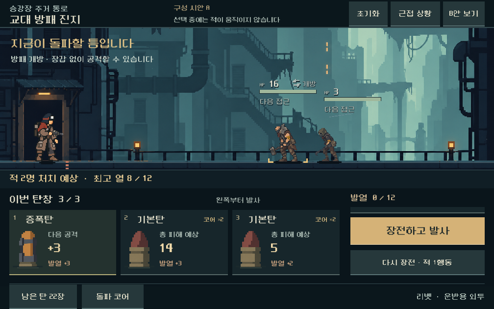
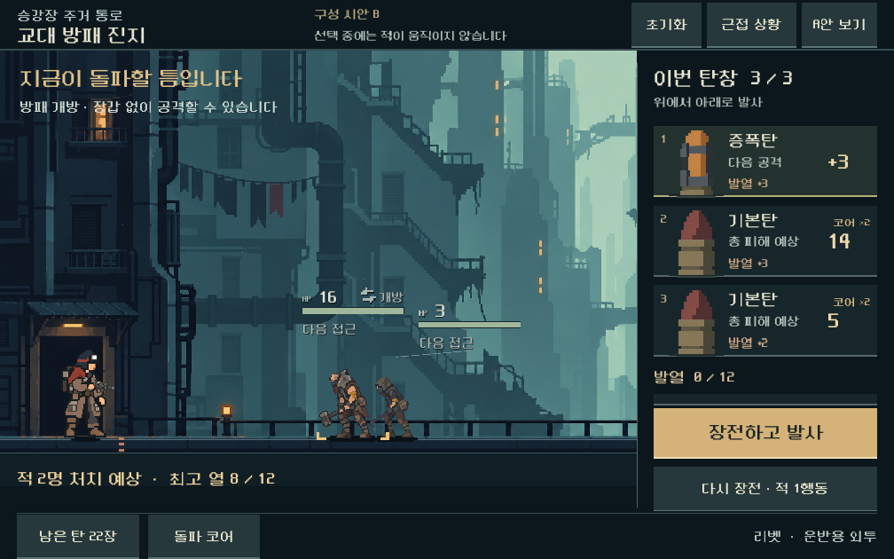

# 전투·UI 개편 1단계 — 행동 흐름과 구성 비교

2026-10-31. [통합 계획](combat-ui-rework.md)의 1단계 결과다. 실제 획득 덱의 현행 전투를 측정하고, 같은 상태로 비교할 수 있는 Godot 구성 시안 A/B를 만들었다. **본편 전투 규칙·메뉴·저장은 변경하지 않았다.** 탄창 전체 추첨과 새 접근/발열 수치는 아직 비교 구현 전이다.

## 결정 상태

- **후속 사용자 선택:** A 하단 탄창형을 채택했다. 탄환 수 확대 요청에 따른 [6칸 후속 비교](combat-magazine-capacity.md)가 최신 시안이며 아래 A/B는 최초 비교 기록이다. 기존 3칸 씬은 보존한다.
- 사용자 승인 범위: 통합 계획의 순차 실행, 전투 행동과 전체 UI를 함께 설계.
- 디렉터 1차 권고: **A 하단 탄창형을 2단계의 기본 구성으로 사용**한다. 가로로 접근하는 적과 왼쪽부터 쓰는 탄환 순서를 넓게 읽을 수 있다. B 측면 탄창형은 비교안으로 보존한다. 이는 사용자 최종 미감 선호 확인과 구별한다.
- 시안의 장전+발사 버튼은 **현행 확정과 발사를 연속 호출**한다. 자기 덱에서 탄창 전체를 자동으로 뽑는 새 규칙을 구현한 것으로 간주하지 않는다.
- 시안은 실제 획득한 준비 상태 두 가지를 전환하는 구성/행동 검토용이다. 손패 선택·순서 편집·탄창 전체 교체·획득·다른 총기별 탄창 길이·새 발사 연출은 후속이다. 본편 UI의 완전한 대체 화면이 아니다.

## 현행 행동 비용

| 행동 | 현행 시간·적 행동 | 탄약·열 처리 | 개편 시 확인할 점 |
| --- | --- | --- | --- |
| 상세 열람·탄 선택·삽입·허용된 순서 이동 | 시간 0 / 적 행동 0 | 계획을 편집. 비축 규칙에서 개별 회수는 금지 | 화면 입력 수와 실제 전술 비용을 분리 |
| 장전 확정 | 시간 0 / 적 행동 0 | 손패의 선택 탄을 탄창으로 이동 | 발사와 통합해도 적 접근 기회가 늘지는 않음 |
| 발사 | 사격 자체 1턴. 다수 무기는 여러 탄 처리 후 적 1행동. 증강은 생존 표적 등에서 중단 | 발사 탄을 사용함으로 이동, 지원·성장·연속 열 적용 | 한 입력의 처리량과 무기별 예외를 함께 비교 |
| 마지막 적·발사체 처치, 대기 증원 없음 | 사격 턴은 기록하지만 그 뒤 적 접근은 생략 | 승리 시 열/연속 부담 정리 | 최종 사격의 열 0만 보고 열 부담이 없었다고 판단하지 않음. 최고 열도 기록 |
| 일반 재장전·장전 포기 | 무기/파츠/과열에 따른 재장전 비용만큼 적 행동 | 계획/탄창 잔탄을 사용함으로 배출, 미장전 손패는 보존·빈자리 보충. 냉각·연속 부담 초기화 | 현재 손패 보충과 새 탄창 전체 교체의 차이를 명시 |
| 과열 뒤 강제 재장전 | 전투가 계속되면 사격과 같은 입력 안에서 추가 행동 비용 발생 | 발사 중단·잔탄 배출·냉각. 리액터 강행 예외 포함 | 버튼 하나의 결과에 포함된 접근 전체를 미리 표시 |
| 비상 보급 | 일반 재장전에 첫 회 추가 1턴, 반복할수록 추가 비용 증가 | 공격탄 고갈 조건에서 임시 기본탄 4발. 영구 소유/특수탄을 복구하지 않음 | 새 탄창 방식에서도 불필요한 보급·무한 재뽑기·지원탄만 남는 막힘 검사 |

근거는 현행 `model.gd`, `ammo_reserve.gd`, `forecast.gd`와 실제 재생 기록이다. 보고서의 명령 수는 합법적인 모델 명령 수이며 실제 사람의 터치 수나 숙련도를 뜻하지 않는다.

## 기준선에서 확인한 것

시드 731042, 운반용 외투, 현행 편성 12의 **5총기 × 실제 획득 경로 5전투 = 25건**을 다시 실행했다. 이전 검증 경로의 턴 수와 소모 탄 수가 모두 일치했다. 실제 적 진행 함수의 호출을 별도 진단 모델로 세었고, 계산 규칙은 그대로 사용했다.

- 25건 중 **12건은 적 행동 없이 종료**했다. 무리전 201과 성장 확인전 602의 10건은 5총기 모두 사격 1턴/적 행동 0회였다.
- 교대 방패전 401은 총기별 적 행동 기회 1~6회였지만, 기록된 행동 경계에서 가장 가까운 살아 있는 적은 내부 거리 17~21에 머물렀다.
- 첫 관문 보스에서는 래칫·스플린터·리액터의 일부 경로가 내부 거리 3까지 갔다. 따라서 모든 무기/전투의 접근을 일괄 상향할 근거는 없다.
- 이는 다음 패까지 알고 탐색한 **도달 가능한 자동 경로**다. 사람의 평균 난이도·승률·전략을 나타내지 않는다. 사수 분기, 다른 시드/복장, 후반과 모바일 장시간 성능은 이번 기준선에 포함하지 않았다.

디렉터 판단: 짧은 무리전의 쓸어버리는 보상은 유지한다. 준비 비용·사격 처리량·적 초기 거리/행동을 별도로 비교해 **의도한 압박전에서 실제 대응이 필요하도록** 조정하는 것이 다음 작업이다.

## 전체 화면 구성안

### A — 하단 탄창형 / 권고

전장을 가로 전체로 확보하고, 하단의 탄환 순서와 우측의 실행·재장전을 나란히 배치한다. 큰 빈 슬롯과 손패/탄창의 중복 표시를 덜어낸 공간에 적의 접근과 탄환의 형태를 키웠다. 열은 실행 근처에 두고 위험은 전장과 재장전 버튼에 함께 표시한다.

장점: 현재 일렬 전장과 가로 발사 순서가 연결되고, 작은 화면에서도 탄환의 예상 피해·발열·실행 버튼을 읽기 쉽다. 후속 과제: 용량이 큰 총기와 손패를 편집하는 대조군에서도 카드/행동이 과밀해지지 않도록 검증해야 한다.

### B — 측면 탄창형 / 비교 보존

탄창·열·행동을 오른쪽에 모으고 전장의 세로 공간을 늘린다. 탄환은 위에서 아래로 읽는다. 동일한 적·탄환·피해·위험을 사용한다.

장점: 배경의 수직 규모와 탄창 관리 영역을 분리하기 쉽다. 단점: 작은 화면에서 전투 가로폭이 줄고, 적들이 모였을 때 가림이 커질 수 있다. 상하 탄창은 가로 전장과 읽는 방향이 달라진다. 이 이유로 A를 우선 권고하며 B를 더 좋거나 나쁜 스타일로 확정하지 않는다.

두 안 모두 실제 예측에서 증폭·코어·전이를 반영한 **탄별 총 피해**, 최고 열, 처치 수를 표시한다. 고정 시안 그림에 숫자를 구운 것이 아니라 Godot 글자와 현행 전투 계산을 사용한다. 현재 재질/연출은 구성 비교 수준이며, 통합 계획 4단계의 최종 시각 완성도 검수는 별도다.

### 같은 상태로 비교하는 규칙

- 기본: 실제 획득한 교대 방패전 저장 → 합법 재장전 1회 → 증폭/기본탄 조합. 방패 개방, 적 2명, 열 한계 12, 탄창 3칸.
- 근접: 같은 저장에서 빈 재장전 13회로 합법적인 근접 상태를 만든 뒤 같은 조합을 준비. 재장전 시 실제 접촉 패배, 사격 시 실제 승리.
- **근접 상태는 화면 검수를 위해 의도적으로 기다린 사례**다. 정상 플레이에서 압박이 충분하거나 새 밸런스가 적용됐다는 증거가 아니다.
- 기존 화면도 기본 시안과 같은 저장/준비 상태로 새로 캡처했다. 비교 시 서로 다른 덱·위험·적 수를 섞지 않는다.

## 2단계에 넘길 비교 조건

| 대표 상황 | 출발 조건 | 확인할 판단 |
| --- | --- | --- |
| 짧은 무리 돌파 | 실제 획득 경로 201, 5총기 | 압박 조정 후에도 잘 만든 공격으로 빠르게 쓸어버리는 성과가 유지되는가 |
| 방패 개방과 접근 | 401의 닫힘/합법 재장전 뒤 열림 | 지금 발사·짧게 사격·다시 장전의 손익과 접근 위험이 달라지는가 |
| 사수·압력탄 | 첫 구역 사수 분기를 실제 경로로 진입해 저장 생성 | 요격과 본체 공격, 탄창 교체 중 생성/접근을 읽을 수 있는가. 이번 25건에는 미포함 |
| 조합 획득 직후 | 보상 이력이 있는 602 | 획득한 탄/코어 덕분에 처치/필요 탄/턴이 어떻게 달라지는가 |
| 강적·탄약 부담 | 첫 관문 802, 특히 이미 가까워지는 총기 | 일반전 압박 강화가 보스의 대응 여지와 유한 탄약을 무너뜨리지 않는가 |

같은 시작 저장·시드·획득 이력으로 A 규칙 후보(현행 조합의 입력 통합)와 B 규칙 후보(탄창 전체 교체)를 비교한다. **화면 구성안 A/B와 규칙 후보 A/B는 서로 독립**이다. 시안 A를 선택해도 탄창 자동 추첨이 채택되는 것은 아니다.

B 규칙 후보의 첫 비교에서는 시작 탄창을 미리 읽게 하고, 교체·사격을 확정하기 전에 결과와 비용을 표시한다. 재장전 잔탄의 배출, 미장전 손패를 없애는 경우의 파츠/복장 대응, 다중 칸 탄·공격탄 없는 탄창·부분 탄창, 발사 중 중단, 다음 전투 복구를 먼저 정한다. 자동 발사로 입력을 줄여도 적 행동을 생략하지 않는다. 첫 탄창의 준비 비용과 이후 교체 비용은 분리 비교하고, 무료 무한 교체는 허용하지 않는다. 이 항목들은 다음 비교 구현의 설계 작업이며 현재 확정 규칙이 아니다.

### 모바일 기준선 준비

실기기 측정표에는 기기/OS, 빌드·규칙 버전, 화면 설정·밝기·충전 상태·시작 열 상태, 복장/무기/시드/경로, 0~5분과 20~30분 구간의 프레임 시간 중앙값·상위 지연·큰 멈춤·메모리·기기 열 상태를 기록한다. 같은 조건의 전후 비교를 사용한다. 이번 작업의 3비율 PC 렌더/터치 검사는 모바일 지속 성능이나 실제 손가락 사용감의 통과가 아니다.

## 실행과 검증

- [시안 열기](../../OPEN_COMBAT_UI_STUDY.cmd): 격리 경로에서 시작. A/B 전환, 기본/근접 상황 전환, 발사·재장전·상세·초기화 확인. 닫으면 종료한다.
- [검증 보고서](../qa/reports/combat_ui_stage1_2026-10-31.md): 기준선·화면·입력 검사, 한계와 소스 보존 결과.
- 다음은 **탄창·발사·접근 압박의 비교 구현**이다. 기존 손패/탄약/총기 특성과 행동 비용을 먼저 연결하며, 본편 채택은 비교 결과를 근거로 결정한다.
