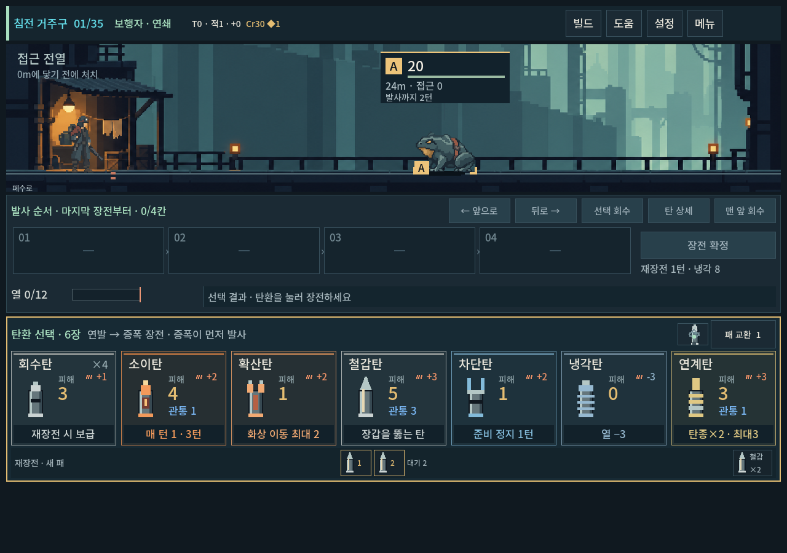

# 도트 아트 제작 기준 — 승인된 그림에서 시작하기

복장·무기 추가 또는 외형·동작 수정은 [복장·무기 제작 파이프라인](equipment-art-pipeline.md)을 함께 읽는다. 해당 계열의 승인 이미지, 생성 프롬프트, 합성 등록, 실제 미리보기와 검증 명령을 연결한다.

2026-10-09 · 사용자가 승인한 현재 표현을 새 제작의 출발점으로 사용한다. 목표는 사용자가 같은 화풍 수정을 반복하지 않도록 **첫 전달 전에 제작자가 비교·수정하는 것**이다. 한 번의 생성 성공이나 무수정 납품을 보장하지 않는다. 세계관과 종별 디자인의 새 판단은 화풍 채택과 구별한다.

[참조 원본·역할·해시 목록](../art/style-reference/manifest.json) · [화풍 결정과 사용자 레퍼런스](pixel-style.md) · [자산 적용 상태](art-assets.md)

## 제작 전에 여는 기준 이미지

이미지 도구에는 아래에서 해당 용도의 원본을 직접 참조 입력으로 제공한다. 파일 경로를 프롬프트에 적는 것만으로 참조가 전달됐다고 간주하지 않는다. 생성 직전 도구가 받는 이미지 개수·순서·역할을 확인하고 기록한다.

| 작업 | 우선 참조 | 함께 볼 실제 화면 | 채택 범위 |
|---|---|---|---|
| 새 캐릭터·몬스터 | [주인공 v2](../../새-게임-프로젝트/assets/art/actor_cohesion_20261005/reclaimer_grouped_v2.png), [전투 배경](../../새-게임-프로젝트/assets/art/tower_sample_20261003/residential_tower.png) | [승인 주인공의 게임 내 크기](../qa/reports/hero_mass_v2_2026-10-05_assets/after_rest_1280.png) | 색면·명암·선 처리. 몬스터에 주인공 복장·인체 비례를 복제하지 않는다. |
| 후속 몬스터 | 주인공 v2, [승인 처마등](../../새-게임-프로젝트/assets/art/monster_concept_20261009/eavesback_v1.png), 전투 배경 | [생물 비교 화면](../qa/reports/residential_creatures_2026-10-09_assets/family_1008.png) | 처마등은 화풍 기준. 새 두 종과 기존 개구리는 비교 대상이며 승인 범위를 혼동하지 않는다. |
| 주인공 새 자세 | 위 주인공과 [4키포즈](../../새-게임-프로젝트/assets/art/actor_motion_20261005/reclaimer_actions_v1.png) | [실제 조준](../qa/reports/actor_motion_2026-10-05_assets/aim_1008.png) | 같은 정체·크기·큰 색면. 재생 속도/연결감은 별도 검수. |
| 새 배경 | 위 전투 배경 | 주인공을 포함한 실제 전장 | 큰 구조·깊이·차가운 공간과 작은 온기. 새 지역의 건축·구도는 별도 설계. |
| 지도 기호 | [7종 원본](../../새-게임-프로젝트/assets/art/map_chart_20261009/survey_symbols.png), [정예 원본](../../새-게임-프로젝트/assets/art/map_chart_20261009/survey_symbols_guard.png) | [채택 탐사도](../qa/reports/map_chart_adoption_2026-10-09_assets/selected_1008x630.png) | 평면 기호·굵은 형태·역할 구분. 건물 미니어처로 바꾸지 않는다. |
| 탄환·파츠·다른 UI | 해당 현행 카드/아이콘과 그 화면 | 새 작업 시작 시 현재 Godot 캡처 | 기존 탄환 카드의 채택 범위를 유지한다. 지도 기호나 캐릭터 음영을 일괄 이식하지 않는다. |

지도 첫 원본의 윗줄 두 번째 **뿔 가면은 제외된 이미지**다. 정예는 두 번째 원본의 `Rect2(488,88,356,316)`만 사용하며 나머지7종은 첫 원본을 쓴다. 참조 도구가 영역을 지정하지 못하면 두 입력의 역할과 제외 영역을 명시한다. 단순히 두 아틀라스 전체를 동일한 승인본이라고 설명하지 않는다.

역사 캡처는 화풍 비교용이다. 캡처에 남은 이전 HUD/층수/기계 적/전투 수치를 현행 기획이나 승인 대상으로 취급하지 않는다. 최신 배치는 실제 실행으로 확인한다.

## 현재 표현의 핵심

| 항목 | 맞는 결과 | 제작자가 먼저 고칠 결과 |
|---|---|---|
| 색면 | 외투·몸통·껍질처럼 큰 면이 먼저 보임 | 주름·철판·도구마다 작은 경계와 강조점이 반복됨 |
| 명암 | 큰 기본면과 묶인 그림자, 역할에 필요한 작은 강조 | 반사광·리벳·노이즈가 전체 표면에 분산됨 |
| 윤곽 | 큰 계단 형태, 겹치는 부위의 선택적 어두운 경계 | 몸 전체를 진한 검정 선이나 밝은 테두리가 감쌈 |
| 부드러운 인상 | 큰 도트 덩어리와 낮춘 내부 대비 | 블러로 번짐, 배경에 묻혀 팔다리와 상태가 사라짐 |
| 팔레트 | 주변 환경과 어울리는 탁한 색, 필요한 부위의 온기/경고 | 새 자산만 흰 반사광·고채도·강한 검정으로 튐 |
| 정보 | 자세·방향·주요 기관은 작게 봐도 구별됨 | 확대한 단독 원화에서만 멋지고 게임 크기에서는 구별되지 않음 |

정확한 색 개수나 모든 에셋의 논리 해상도를 영구 고정하지 않는다. 승인 원본은 고해상도 PNG에 큰 도트 인상을 표현한 자산이며, 고정 격자/제한 팔레트가 자동 보장된 진짜 저해상도 원본은 아니다. 파일 크기, nearest 필터, 프롬프트의 `32px` 문구만으로 동일 화풍이라고 판정하지 않는다.

## 같은 장면에서 확인할 부적합 사례

**주인공 이전 표현:** 내부 선과 강한 경계가 많아 배경보다 조밀했다. 아래 비교는 주인공의 묘사량을 보기 위한 것이며 나머지 그림 전체의 승인/거부를 뜻하지 않는다.


**채택 표현:** 같은 크기에서 복장·총·두 발을 유지하고 큰 청회색 면과 녹슨 어깨색이 남는다. 새 배우 제작의 기준이다.



**지도에서 배운 점:** [이전 시설 지도](../qa/reports/map_art_2026-10-09_assets/selected_1008x630.png)는 실제 공간·미니어처·그래프가 섞였다. [채택 탐사도](../qa/reports/map_chart_adoption_2026-10-09_assets/selected_1008x630.png)는 지도 면과 기호를 구분한다. 공간 구성 문제를 계속 도트 수나 윤곽만 바꿔 해결하지 않는다.

## 공통 제작 지시 템플릿

아래는 복사해서 쓰는 제작 기본값이다. 대괄호는 실제 작업값으로 채운다. 새 디자인의 역할·실루엣·상태는 종별 설계에서 가져오고, 이 문서에 새 몬스터 목록을 복제하지 않는다. 게임명만으로 스타일을 요청하지 않는다.

```text
PURPOSE: [asset family, gameplay role, state]. Production art for the current LoB game.
REFERENCES: Input 1 = [approved style/identity target]. Input 2 = [environment or matching family].
Input 3 = [actual game screenshot, composition/scale context only; do not copy its UI].
SUBJECT AND VIEW: [identity, unique silhouette, pose, facing, camera].
GAME-SCALE TARGET: [measured on-screen occupied width/height at target viewport; source canvas is separate].
STYLE: Broad coherent pixel clusters and quiet color masses. Group internal shadows into large shapes.
Restrained selective contours. Muted material colors that belong beside the supplied reference.
Keep the silhouette and gameplay state clear while suppressing surface detail.
The soft impression comes from larger clusters and lower local contrast, not optical blur.
EXCLUDE: dense seams, tiny bolts, repeated shiny edges, surface grain, dithering,
continuous near-black contour, glossy illustration, smooth blur, baked words or UI.
LOCKS: [what must not change; for a new creature, lock style, not the hero's costume/anatomy].
OUTPUT: [canvas, transparency, one sprite or specified atlas cells, margins, frame count].
```

추가할 용도별 지시:

- **캐릭터·몬스터:** `Use the hero reference for cluster scale, value grouping and edge treatment only. Preserve the new subject's own anatomy. Keep its main action organ readable. No ground or cast shadow baked into the transparent sprite.` 주인공 자세 작업에서는 스타일뿐 아니라 모자·복장·체형·장비도 고정한다.
- **배경:** `Layer broad architecture into foreground, middle distance and muted far distance. Keep the combat band quiet, with a continuous believable ground plane. Local warm habitation lights, no evenly distributed bright detail. No actors, labels, routes or UI.` 지도 배경은 전투 발판을 요구하지 않고 중앙 경로 영역의 대비를 낮춘다.
- **지도 기호:** `Flat chart stencil, one dominant ink color, broad negative spaces, optically matched weight. No miniature architecture, material shading, badge container, horns or fantasy crest. Follow the supplied adopted chart symbols.` 단색 원칙을 배우·배경에 강제하지 않는다.
- **상태·동작 추가:** `Preserve identity, palette, apparent volume and cluster density across frames. Mark the same ground/attachment reference. Change the gameplay pose or organ, not arbitrary decorative details.` 생성 프레임의 발/총구 원점은 실제 이미지에서 다시 측정한다.

참조가 여러 장 필요하면 해당 도구의 지원 범위에 맞춰 순서와 목적을 줄여 명확히 한다. 도구의 입력 한계를 숨기거나 이미지 대신 파일명만 전달하지 않는다. 이전 후보를 고치는 경우 유지할 것과 바꿀 것을 함께 쓴다. 부적합 예시는 기본 스타일 입력으로 섞지 않고 내부 비교에 사용한다.

## 제작·전달 절차

1. **작업 범위 확인:** 사용자 최신 지시와 이 문서를 읽고 해당 계열의 승인 원본·게임 화면을 직접 연다. 새 캐릭터의 컨셉과 화풍을 구분한다.
2. **작업별 크기 기록:** 현재 Godot 화면의 점유 폭/높이, 시점, 바닥·부착 기준점, 잘리면 안 되는 기관을 기록한다. 원본 PNG 해상도와 화면 점유 크기를 혼동하지 않는다. 주인공 기존0.65 배율은 현재 주인공 기준이며 모든 몬스터에 복사하지 않는다.
3. **참조를 실제 입력:** 공통 템플릿에 역할별 지시를 더해 생성/편집한다. 입력 원본·목적·순서·전체 프롬프트를 자산 provenance에 남긴다. 유사 계열은 같은 승인 입력에서 제작한다.
4. **제작자 내부 비교:** 원본/실제 표시 크기/배경 위에서 비교한다. 지나친 잔묘사·윤곽·반짝임·공간 불일치가 있으면 먼저 고친다. 스타일 미달 후보를 완성 자산처럼 전달하지 않는다. 반복해도 개선되지 않으면 같은 프롬프트만 반복하지 말고 원인과 미완성 상태를 명시한다.
5. **게임에서 확인:** 적합 후보를 격리 실행에 넣고 기준 주인공과 함께 본다. 큰 원화의 인상만으로 본편 교체를 결정하지 않는다. 기존 승인 원본은 보존한다.
6. **결과 전달:** 통합 화면, 달라진 점, 기술 확인과 남은 체감을 짧게 전달한다. 도구가 한 번에 만들었는지보다 승인 기준에 맞는 결과인지가 완료 기준이다. 이미 위임된 디자인에서 중간 후보마다 재승인을 요구하지 않는다.

## 검수와 완료 조건

| 구분 | 확인 항목 | 증거 |
|---|---|---|
| 기술 | 파일 크기/알파·잘림·셀 경계·발/총구 기준점·실제 필터 | 자산 메타데이터, 해당 런타임 값과 필요 검사 |
| 화풍 | 기준보다 과한 잔묘사/검은 선/반사광이 없는가, 배경과 어울리는가 | 같은 화면과 표시 크기의 비교 캡처, 제작자 판단 근거 |
| 플레이 | 방향·접지·행동 예고가 읽히는가, 적4마리/공격체/명찰/UI와 충돌하지 않는가 | 실제 Godot 상태별 캡처와 관련 기능 검사 |
| 사람 체감 | 새 컨셉의 선호, 의도 이해도, 모바일 터치/움직임 체감 | 사용자 피드백이 있을 때만 확인 완료로 기록 |

캐릭터/적 변경은 기존 `tools/run_actor_cohesion_checks.ps1`, 동작 변경은 `tools/run_actor_motion_checks.ps1`, 지도 변경은 `tools/run_map_checks.ps1`를 필요한 범위에서 사용한다. 실제로 추가한 새 종·새 상태가 검사에 포함되는지도 확인한다. 모든 작업에 전체 테스트를 일률적으로 반복하지 않는다. PC 기준1280×900·1008×630·1440×630의 캡처 확인은 Galaxy 실기기 검증을 대신하지 않는다.

**새 자산의 기록 최소값:** 용도/컨셉 결정 상태, 참조 파일과 역할, 프롬프트/제작 도구, 원본과 결과 해시, 표시 크기/원점, 기술 확인, 화풍 비교, 사람 확인 여부. 이번 참조 묶음은 제작 절차의 기반이며 아직 새 자산으로 반복 수정 감소를 실증한 결과가 아니다.
