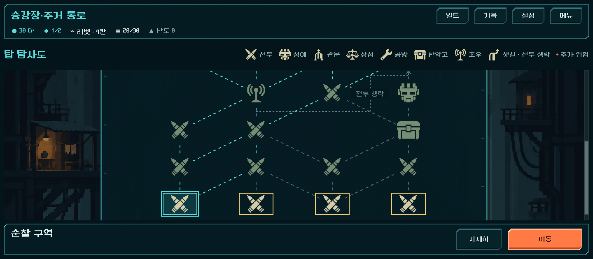

# 지도 UI 검토 — 슬더스식 구성의 적합성과 고유 개편안

2026-11-01. 사용자 요청: 슬레이 더 스파이어를 모티브로 만든 지도의 현재 UI 구성이 적합한지, 우리 게임만의 UI로 개편할 수 있는지 검토. **이번에는 게임 화면·규칙·저장을 바꾸지 않았다.** 아래 개편안은 디렉터 제안이며 사용자 채택 전이다.

## 결론

- **구조(분기·합류 연결망, 시드 생성, 시설을 보고 길을 고르는 방식)는 맞다.** 경로 선택의 재미를 만드는 부분이고, 생성·이동·저장 검증이 모두 노드의 `next` 연결 위에 서 있다. 바꿀 이유가 없다.
- **보이는 방식은 슬더스를 옮겨 온 상태이고, 휴대폰 가로 화면에서는 기능적으로도 손해를 본다.** 같은 크기 아이콘을 세로 열로 늘어놓은 그래프, 위쪽 끝의 목표, 상시 범례가 그대로다. 세계관의 고유 소재(공급 차단·밸브·중앙 명령·기술자)는 지도에 없다.
- **권고: 같은 연결 데이터를 '공급 계통도(배관 도식)'로 다시 그린다.** 외형만 바꾸는 작업이며 라인 + 도트 테마와 같은 언어다.

## 현재 화면에서 확인한 문제

근거 캡처: 라인 테마 적용 후 본편 지도 검사(`qa_runtime/maps/line_theme_20261101/map/`)에서 복사.

| # | 문제 | 근거 |
| --- | --- | --- |
| 1 | **한 화면에 구역의 절반도 안 보인다.** 상단바+범례+하단 선택 영역이 높이의 약42%, 양쪽 탑 배경 띠가 폭의 약35%다. 1구역 8단계 중 4줄 정도만 보이고 관문은 화면 밖이다. 슬더스식 지도의 핵심인 "끝까지 보고 길을 계획하기"를 스크롤 없이 할 수 없다. | 1440×630 캡처(휴대폰 가로 비율에 가장 가까운 검사 크기). 844×390 실기기 비율 지도 캡처는 아직 없다. |
| 2 | **어디를 오르는지 말하지 않는다.** 중앙은 추상적인 순서도이고 탑은 가장자리 띠 그림으로만 있다. 이름은 '탑 탐사도'지만 다른 로그라이크 지도와 구별되는 요소가 없다. | 1280×800·1440×630 캡처 |
| 3 | **모든 장소가 같은 무게다.** 8종 아이콘이 같은 크기·같은 색이다. 구역의 목표인 관문이 위쪽 작은 아이콘 하나이고, 정예도 일반 전투와 크기가 같다. | 같은 캡처 |
| 4 | **임의 각도 사선 점선이 도트 테마와 어긋난다.** 안티앨리어싱을 끈 사선이 각도마다 다른 계단으로 깨진다. 샛길만 직각 선이라 선 언어가 두 가지다. | 1440×630 캡처의 `전투 생략` 선 |
| 5 | **범례가 상시 한 줄을 차지한다.** 아이콘8종+글자. 선택한 장소 이름은 하단에 이미 나온다. | 같은 캡처 |
| 6 | HTML 검토판의 지도 탭에는 오른쪽 정보 패널('다음 갈래' 목록)이 있다. 이는 사용자의 정보 과다 지적으로 없앤 현행 결정([route-map](../../direction/route-map.md#화면과-조작))과 어긋난다. HTML을 그대로 Godot로 옮기면 안 된다. | `docs/qa/reports/ui_line_godot_2026-11-01_assets/map_1280x800_side_by_side.png` |

## 비교한 방향

| 방향 | 얻는 것 | 잃거나 부딪히는 것 | 판단 |
| --- | --- | --- | --- |
| A. 현재 구성 유지(테마만 적용, 완료) | 추가 비용 없음 | 슬더스 인상, 1·3·4번 문제 그대로 | 최소안 |
| **B. 공급 계통도(배관 도식)** | 세계관·결말·라인 테마와 같은 언어, 직각 선으로 도트가 깨끗함, 화면 공간 회수 | 경로를 배관으로 읽는지 사람 확인 필요 | **권고** |
| C. 탑 단면도(층별 방 그림) | 가장 '탑'다움 | 사용자 확정 "물리적 층수와 경로 분리"와 충돌, 구역마다 방 그림 대량 필요 | 권하지 않음 |
| D. 가로 흐름 지도(왼→오) | 가로 화면 공간을 가장 잘 씀 | '위로 오른다'는 감각을 잃음 | 권하지 않음 |

## 권고안 B — 공급 계통도

주인공은 설비 기술자이고, 등반 이유는 중앙 명령이 우리 동네 공급을 막은 것이다. 결말 화면도 이미 공급 도식이 바뀌는 연출을 쓴다. 지도를 기술자가 읽는 탑의 배관·정비 계통도로 바꾸면 지도와 결말이 같은 그림이 된다.

1. **경로 = 배관.** 세로로 오르고 꺾을 때만 가로로 가는 직각 배관(계단식 모서리 1도트 선). 이미 열 단위로 정렬된 현재 노드 배치와 맞는다.
   - 지나온 길: 밝은 채운 관(흐름이 통한 관)
   - 지금 갈 수 있는 길: 청록 실선
   - 그 뒤의 길: 흐린 점선
   - 선택하면 작은 흐름 점이 현재 위치에서 선택한 곳으로 흐른다(없던 움직임 보강, 즉시 연출 설정에서는 생략).
2. **장소 = 계통의 접합부.** 사용자 채택 아이콘8종과 의미는 그대로 쓴다. 현행 결정대로 상시 박스는 두지 않고, 아이콘 아래 작은 관 이음 표시만 둔다. 크기로 위계를 준다: 일반 장소 < 정예 < **관문은 구역 폭에 걸친 큰 밸브/차단문**(구역의 목표).
3. **왼쪽 띠 = 다섯 구역 계통 막대.** 탑 배경 띠 하나를 다섯 구역 진행 막대로 바꾼다. 아래 우리 동네에서 위 중앙 통제구까지, 지나온 구역의 밸브가 열려 있다. 구역 이름만 쓰고 층수·숫자는 쓰지 않는다. 슬더스 지도에 없는 '탑 전체를 오르는 중'이라는 감각과 등반 목표를 항상 보여 준다.
4. **휴대폰 공간 회수.** 범례 줄을 없애고 상단바의 도움말 버튼으로 옮긴다(선택한 장소 이름은 하단에 이미 나옴). 오른쪽 탑 띠를 줄이거나 없앤다. **목표(가설): 한 구역 전체가 스크롤 없이 한 화면에 들어오는 것.** 줄 간격이 현재 구현값(90)보다 좁아지므로 터치 영역과 함께 실제 캡처로 확인한다.
5. **구역 전환.** 관문을 통과하면 왼쪽 막대의 다음 밸브가 열리고 새 구역 계통도로 넘어간다.

### 바꾸지 않는 것

생성 알고리즘, `next` 연결, 이동·방문 검증, 저장 형식, 아이콘8종의 의미, 하단 `자세히`·`이동`, 상세 화면, 정보 공개 범위(예외 조건만 한 줄), 층수 표기 금지.

### 검증되지 않은 것

- 플레이어가 배관을 '갈 수 있는 길'로 읽는지(사람 확인).
- 한 구역 전체가 844×390급 화면에 들어올 때 아이콘·터치 크기가 충분한지(실제 캡처·실기기).
- 흐름 점 연출이 정보 판독을 방해하지 않는지.

## 다음 단계 제안

HTML 검토판 지도 탭에 B안을 스타일 전환으로 만들어 현재 지도와 나란히 비교 → 사용자 채택 시 `docs/direction/`에 기준을 쓰고 Godot 작업자에게 인계.

## 후속 — HTML 시안 제작(2026-11-01)

사용자 요청으로 권고안 B를 HTML 검토판에 `지도: 배관도` 전환으로 만들었다. 844×390에서 관문과 1구역 전체가 한 화면에 들어오는 것을 확인했고, 740×360은 맨 윗줄 일부가 스크롤된다. [시안·화면·검증](../../qa/reports/ui_pipe_map_2026-11-01.md). 사용자 채택 전이며 Godot은 바꾸지 않았다.
