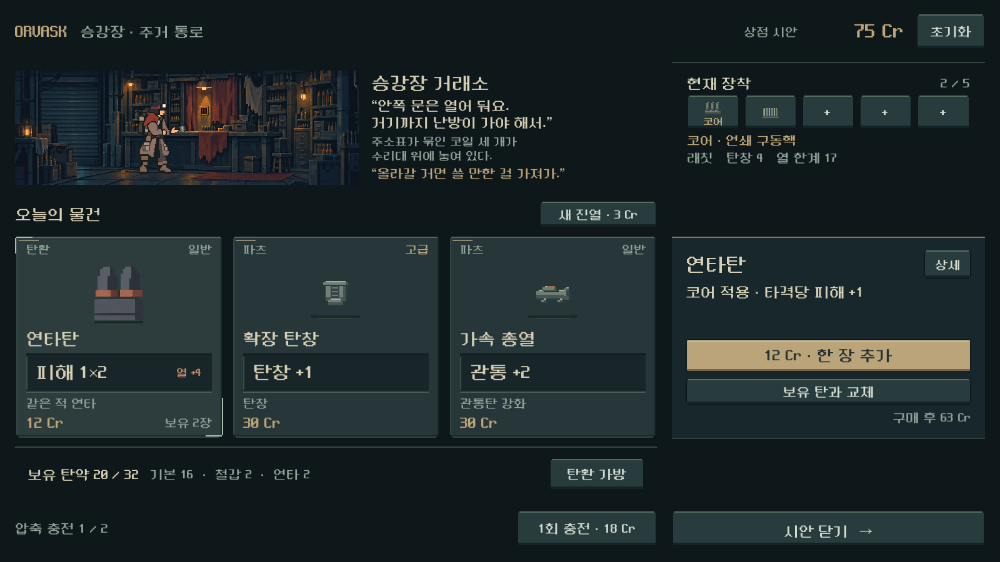
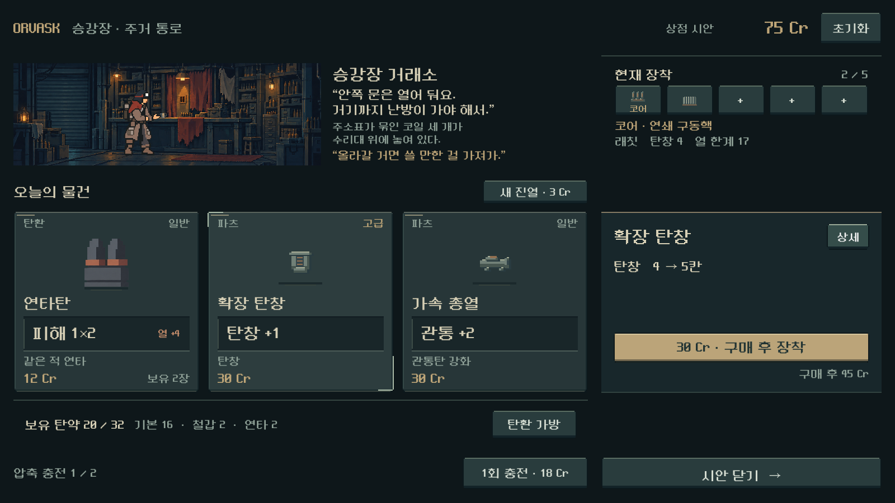
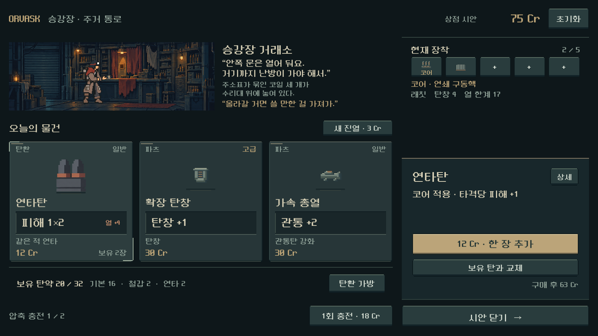
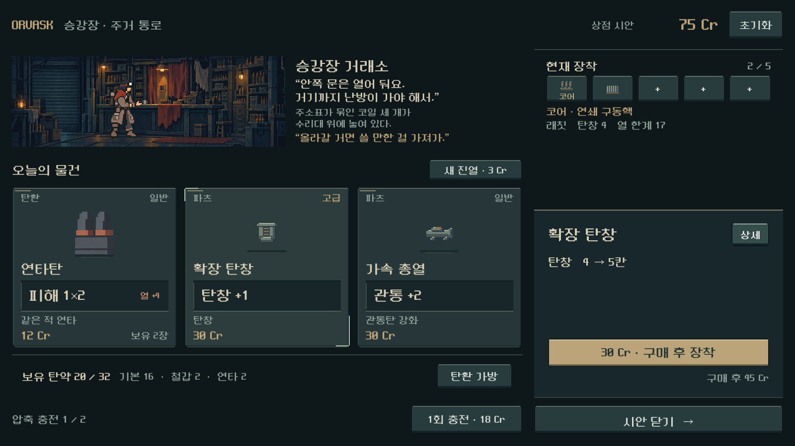
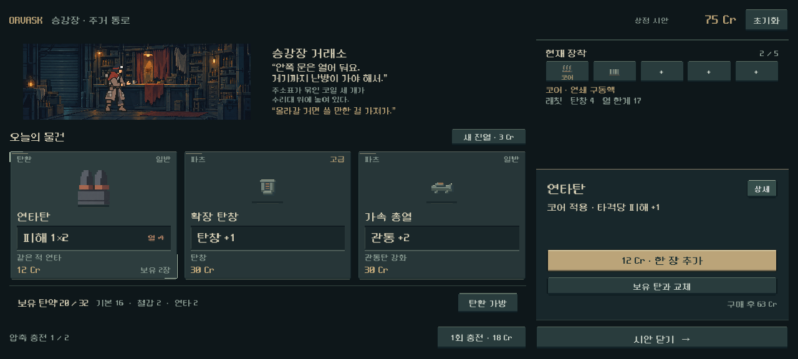
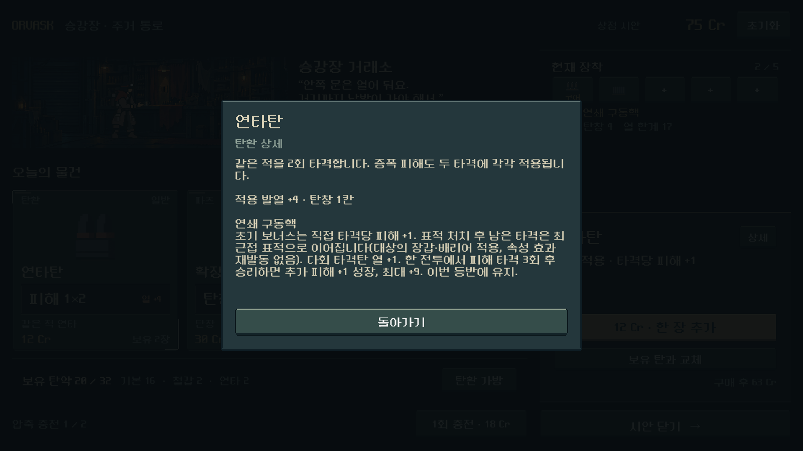
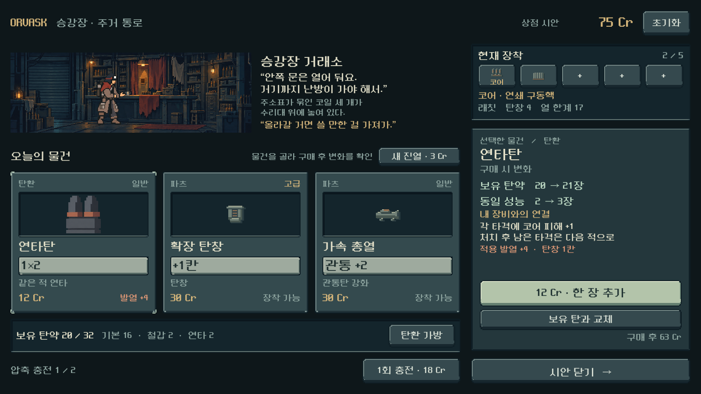
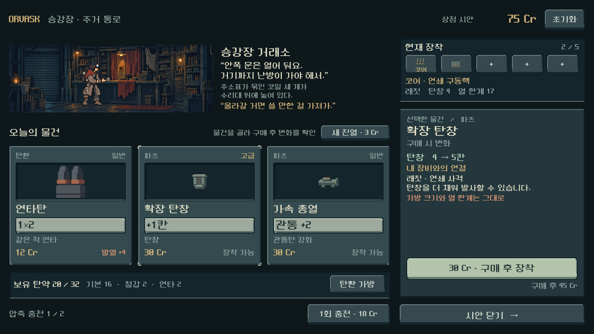
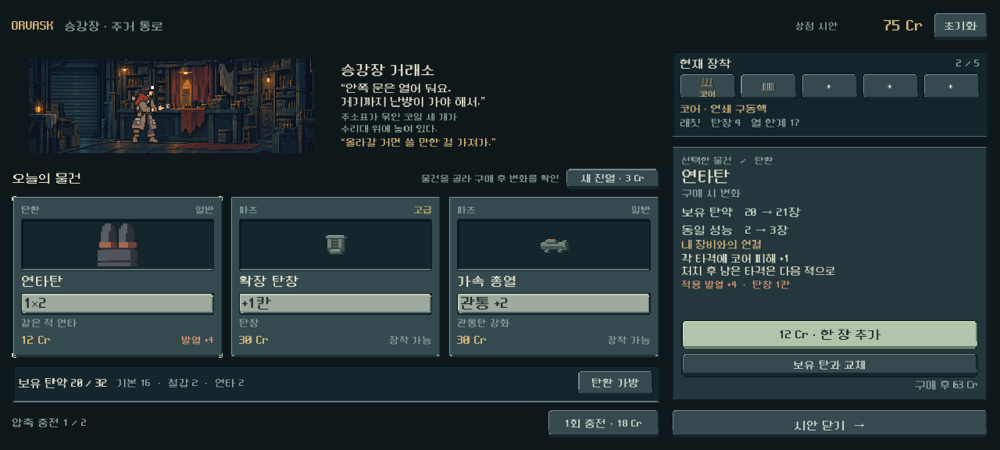
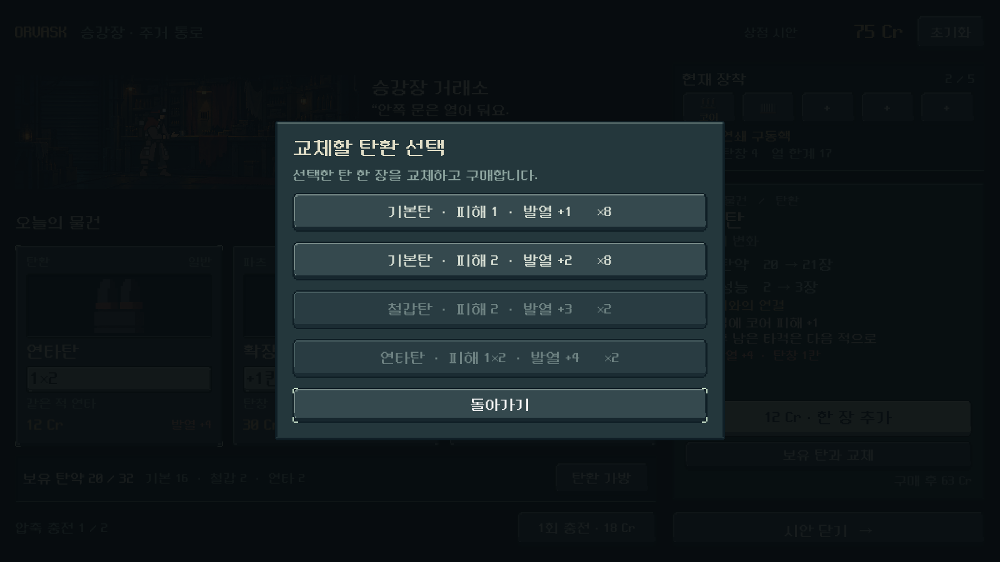

# 상점 와이어프레임 → Godot 인게임 시안

**후속 — 본편 적용 완료:** 사용자의 “전부 인게임 반영” 승인 후 `shop_screen.tscn`으로 실제 등반 상점에 연결했다. 아래는 별도 시안을 만들 당시의 범위이며, 최신 실행은 `PLAY.cmd`다. [본편 적용·검증](../../qa/reports/shop_live_2026-10-25.md).

## 범위와 결정 상태

사용자의 `docs/art/ui-wireframes/Main.dc.html` 검토 후 '인게임 시안부터' 요청에 따라 상품 → 내 장비와의 관계 → 구매 결과를 별도 Godot 화면에 구현했다. **본편 상점 교체 전 사용자 미감 확인용**이며 본편 장면·규칙은 변경하지 않았다.

실행은 저장소 루트 `SHOP_UI_PREVIEW.cmd`. 장면은 `res://redesign/samples/shop_wireframe_preview.tscn`. 초기화/시안 닫기 제공. 진행 저장을 불러오거나 저장하지 않으며 실행 환경도 `qa_runtime/shop_preview`에 격리한다.

## 구성과 예시 상태

- 왼쪽: 기존 상점 실내와 승인 운반복 배우, 입장 이야기, 상품 세 개, 보유 탄약 요약, 압축 충전.
- 오른쪽: 현행 5칸 장착대, 선택 상품, 구매 후 변화, 코어 관계·발열/제약, 구매와 잔액.
- 상단은 장소·재화·시안 조작. 32개 색상 칸은 탄종별 수량과 탄환 가방으로 대체.
- 현행 도트 글꼴·금속 프레임·탄환 원화·파츠 아이콘 재사용. 문자와 가격은 Godot 노드. 신규 비트맵 생성 없음.
- 기준 1600×900의 Container/anchors 기반 TSCN. `tools/build_shop_preview_scene.py`는 제작 시 직렬화 도구이며 런타임 레이아웃 생성기가 아니다.

래칫·연쇄 구동핵/확장 방열판·75Cr·탄약20장·상품3개는 **보기 위한 예시 상태**이며 초반 보상/경제 변경이 아니다. 실제 Campaign의 구매·장착 판정·추가/교체·충전·재진열을 사용한다. 구매 전 파츠는 `can_equip_reward`로 판정한다. 미보유 때문에 잘못 보관 예고가 뜨던 초기 시안 문제를 교정했다.

탄약 교체는 보유 프로필 선택 후 해당 사본 한 장만 변경한다. 현행 규칙으로 교체할 수 없는 항목은 비활성이다. 장착대가 꽉 차면 구매 후 보관되며 능력치는 증가하지 않는다. 상점 압축/개조 서비스는 복원하지 않았다.

## 실제 캡처

### 최신 v3: 상품과 상세 패널 높이 정렬

사용자 요청으로 상품 카드와 우측 상세 패널을 같은 `SelectionRow`에 배치했다. 기준 높이324px와 위·아래 끝선을 공유하며, 독립된 두 열의 빈 공간으로 높이를 맞추던 방식은 제거했다. 상세 패널 안쪽 여백과 버튼 간격을 정리해 구매·교체·잔액이 같은 높이에 들어간다. 상단 이야기/장착대와 하단 탄약/충전/닫기 흐름, v2 색·재질·기능은 유지한다.

Godot MCP 프로젝트 확인 후 기존 격리 GPU 캡처로 검증. 세 화면 비율 및 구매/교체/상세 등924검사 실패0. 탄환·파츠·구매 완료와1280×576 화면을 직접 확인했다. 본편 미교체, 실제 Galaxy는 후속.

### v2: 효과판과 상점 재질 정리

사용자가 효과 영역의 색상 변경과 정형화된 AI 시안 같은 인상의 완화를 요청했다. 밝은 회녹색 효과판을 먹색 금속판/상아색 수치로 바꾸고 발열만 녹슨 주황색으로 구별했다. 구매 버튼은 바랜 황동색, 보조 버튼은 어두운 청회색으로 분리했다. 상품 안의 중첩 아이콘 박스와 장착대/탄약 요약의 외곽 박스를 제거하고, 진열물 아래 접촉 그림자와 절제된 금속 이음선으로 정리했다.

오른쪽은 핵심 변화 한 줄과 구매/교체/잔액을 표시한다. 긴 규칙과 코어 설명은 `상세`로 옮겼다. 코어 배지와 기존 구매 모델은 유지한다. 이번 색/재질은 **디렉터 구현안이며 사용자 미감 확인 전**이다. 본편 상점 교체는 하지 않았다.

공통 도형은 직접 작성한 SVG/StyleBoxTexture이며 `assets/ui/shop_preview/`에 격리했다. 원화·폰트·상품 아이콘은 기존 제작 자산을 재사용한다. 기존 v1 화면은 아래에 보존한다.

최종 검증은 동일 캡처 명령으로 **889검사 실패0**. 세 화면 비율에서 상세 열기/닫기/재화 불변, 기존 구매·교체·충전·재진열·보관과 화면 경계를 확인했다. 실제 GPU 화면에서 색·글자·상품/파츠/재진열/상세를 시각 검수했다. 새로운 구문/런타임 오류 없음. 에디터 import의 Android build-tools 경로 경고는 있었으며 이번 로컬 시안과 무관하다. 실제 Galaxy 가독성과 사용자 선호는 확인 전이다.

### 이전 v1 비교용

## 검증과 한계

후속 사용자 요청으로 장착 슬롯에 금색 `코어` 표기를 추가하고 선택 이름·상세 분류도 코어로 표시했다. 현행 코어 포함 총5칸/코어 최대1개 규칙은 유지한다. 당시499검사 실패0,1600×900 캡처에서 표기 위치 확인. 설명 간소화는 위 최신 v2에서 적용했다.

- Godot MCP로 활성 프로젝트 확인·장면 생성·기동. Godot 4.7. 기존 로컬 GPU 캡처 경로로 검증.
- `powershell -NoProfile -ExecutionPolicy Bypass -File tools/run_shop_preview.ps1 -Capture`: 최종495 검사, 실패0.
- 1600×900 /1280×800 /1280×576의 터치 이벤트 상품 선택·구매, 장면 경계, 교체, 중복 구매 방지, 잔액 부족, 가득 찬 탄약, 가득 찬 장착대의 보관/효과 미적용, 충전, 재진열 확인.
- 실제 GPU 캡처에서 초기 세로 넘침·카드 명암 대비를 교정. 최종 탄환/파츠/모바일/교체/재진열 대표 화면 시각 검수.
- 본편 전체 상점 품목·장기 진행의 완전한 UI 구현이 아니다. 상세 설명/시너지 요약은 대표 예시 중심이다.
- 실제 Galaxy 글자 크기·터치 편의, 사용자 미감, 본편 전체 품목/지역별 이야기 연결은 후속. APK·커밋·푸시·외부 게시 없음. 4구역 본편 작업 유지.

## 실내 배우 후속 교체

2026-10-25 사용자 요청으로 무기를 쥔 듯한 상점 자세를 등 3/4 대화 자세로 교체했다. 시안과 본편에서 같은 새 실내 카탈로그를 사용한다. 상품/상세 패널 높이와 UI 흐름은 유지한다. [실제 최신 화면과 검증](../../qa/reports/service_cohesion_2026-10-25.md). 본편 캐릭터 아트 교체와 상점 UI 레이아웃 본편 전환은 별개이며 후자는 아직 시안 단계다.
