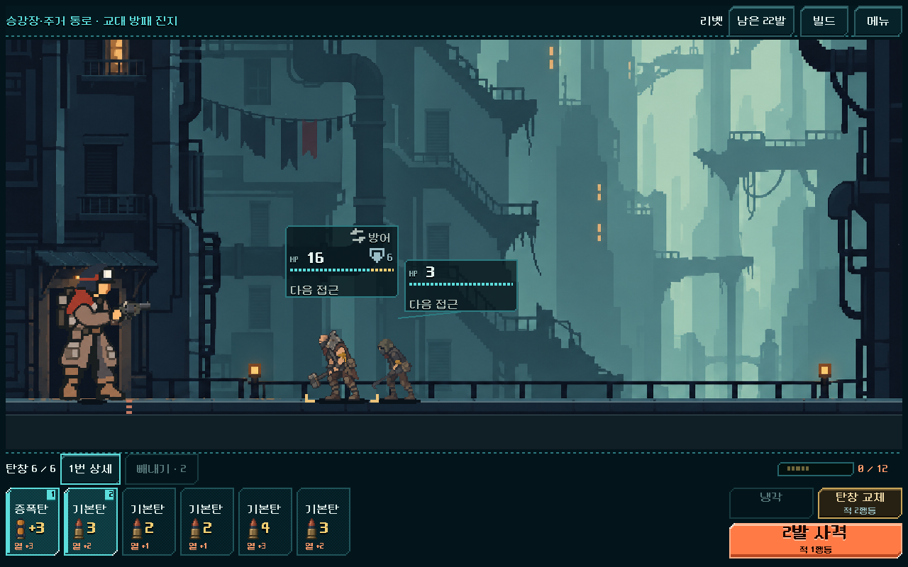
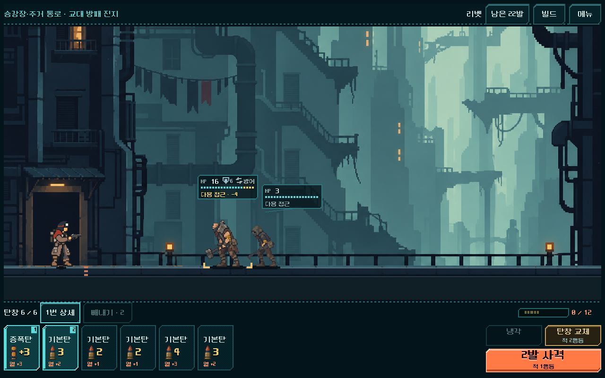
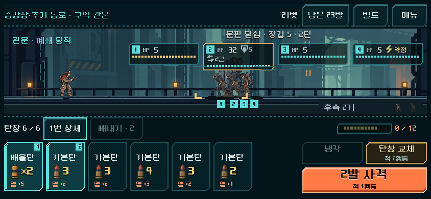
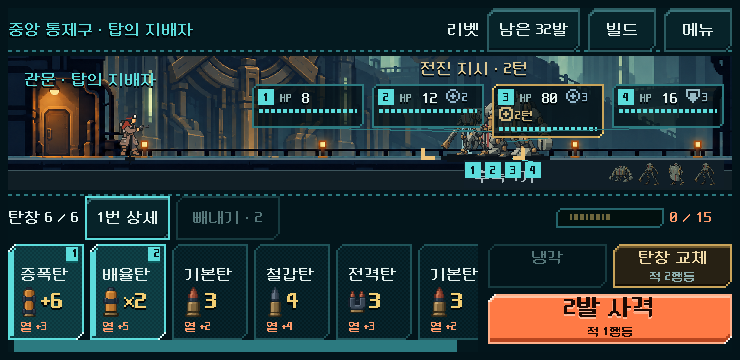

# 전투 캐릭터 비율·몬스터 체력 표시 수정

2026-11-01. 사용자 피드백에 따라 전체 등반의 라인 HUD와 공통 HUD 미리보기를 수정했다. 실행은 `PLAY.cmd`의 개편된 등반이다.

## 원인과 참고

- 수정 전 실제 본편: 플레이어 배율 0.18, 캐릭터 크기 배수 1.0, 참조 높이 300. 큰 전투 화면에서 몸 높이가 약 190px로 일반 적의 두 배 이상이었다. 런타임에서 지역 화면의 스크립트를 교체한 뒤 상속 장면의 축소 배수가 보존되지 않았다.
- 참고: `ui_prototype_2026-10-31/index.html#tab=elite&theme=line`을 브라우저에서 확인했다. 1280px 너비에서 플레이어 몸은 약 90~96px, HTML 라인 테마의 HP는 16px, 보조 글자는 12px, 게이지는 4px 높이/4px 칸/2px 틈이다. 겹치는 적은 체력창·발밑 번호로 대응한다.
- 기존 HTML의 전투 모델·지도·입력은 수정하지 않았다. 본편 체력창은 상태 아이콘과 기존 터치 상세 보기를 수용하기 위해 일반형 128px, 정예/보스형 180px를 사용한다. HTML의 세로로 쌓이는 배치를 그대로 복제하지 않고 기존 수평 충돌 회피를 유지했다.

## 적용

- 플레이어의 HUD 기준 배율을 0.09로 통일했다. 큰 화면에서 기존의 50% 크기이며, 작은 화면에서는 기존 적 축소율을 같이 적용한다. 발의 위치·적 거리·총구의 등록 좌표 방식은 그대로이고 그림자도 몸 비율에 맞췄다. 배경에 맞춘 접지 위치나 몬스터 크기는 변경하지 않았다.
- HP 숫자는 24→16px, 일반형 체력창은 대표 상태 기준 160×74→128×52px. 상태 아이콘은 같은 행에 배치하고 필요한 만큼 줄바꿈한다. 좁은 화면에서는 반복되는 ‘다음 접근’ 문구를 생략하되 특수 행동/접촉 위험은 표시한다. 상세 터치 높이는 최소44px를 보존했다.
- 청록 잔여 체력/금색 확정 예상 피해/적색 도달 위험을 유지했다. 넓은 화면에는 목업처럼 예상 피해 수치를 덧붙인다. 무작위 표적 무기는 기존 `hp_max`를 사용해 확정 피해만 표시한다.
- 겹치는 적에는 체력창과 발밑에 같은 번호를 표시한다. 번호는 전장 순서이며 체력창 상세 입력의 적 인덱스와 연결된다. 몬스터를 옆으로 이동시키지 않는다.
- 1구역 미리보기와 본편5구역이 같은 `redesign/campaign_hud/line_readout.gd`를 사용한다. 전투 계산·덱·저장·탄창 카드/버튼 배치는 수정하지 않았다.

## 같은 상태·크기 전후

동일하게 저장한 리벳/운반복, 시드731042, 1구역 교대 방패 진지. 두 이미지 모두1280×800이다.

| 수정 전 | 수정 후 |
| --- | --- |
|  |  |

## 검증

Godot4.7, OpenGL 호환 모드. APPDATA/LOCALAPPDATA를 `qa_runtime/`로 분리했다. 실제 사용자 저장은 사용하지 않았다.

| 검사 | 결과 | 범위 |
| --- | --- | --- |
| 본편 시각·입력 회귀 | 861검사 / 실패0 | 실제 획득 저장7개(5구역), 1280×800·1008×454·844×390·740×360 총28화면, HP 영역/상태 아이콘 범위·상호 겹침·최소 터치 높이·총구 범위 |
| 동일 검사 입력/상태 | 위 결과에 포함 | 844×390에서 HP창 실제 터치→상세 닫기→중간 탄 빼내기→사격, 렌더링 전후 전투 상태/RNG 동일 |
| 기존 prototype ui | 11,536 / 실패0 | 5총기·반응형 HUD·공개 조작 |
| 기존 prototype flow | 4,258 / 실패0 | 연속 전투·보상·정비·관문 |
| 기존 prototype visual | 1,999 / 실패0 | 글꼴·독립 장면·발열/선택 상태 |
| 기존 prototype direct | 2,167 / 실패0 | 즉시 빼내기·키보드·터치·상태 보존 |
| 기존 prototype scroll | 7 / 실패0 | 가로 스와이프·오선택 방지 |
| 기존 prototype readout | 405 / 실패0 | 사격/냉각/장전/빼내기 뒤 예측, 무작위 사격의 확정 피해, 획득 보상 뒤 실제 입력 |

재현: `tools/run_campaign_magazine.ps1 -Mode visual -RunTag actor_hp_final`; `tools/run_prototype_hud.ps1 -Mode ui/flow/visual/direct/scroll/readout -Fast`(각 모드 별도 실행).

- 본편 근거: `qa_runtime/campaign_magazine_20261101/actor_hp_before/visual`, `actor_hp_final/visual`의 PNG·geometry.json·stdout/stderr. 수정 전 소스는 `actor_hp_before/source`.
- 기존 회귀: `qa_runtime/combat_hud_20261031/prototype_20261101/<mode>`.
- 시각 확인: 일반 적 대비 플레이어 비율, 1/2/5구역 관문과 작은 화면의 번호·상태·위험 정보, 발 접지와 연결선 확인. 사람의 최종 미감/작은 글자 이해도, Android 실기기 지속 성능은 미검증이다. 이 작업에서 전체125전투 밸런스 검사를 재실행하지 않았으며 이전 검증과 구분한다.
