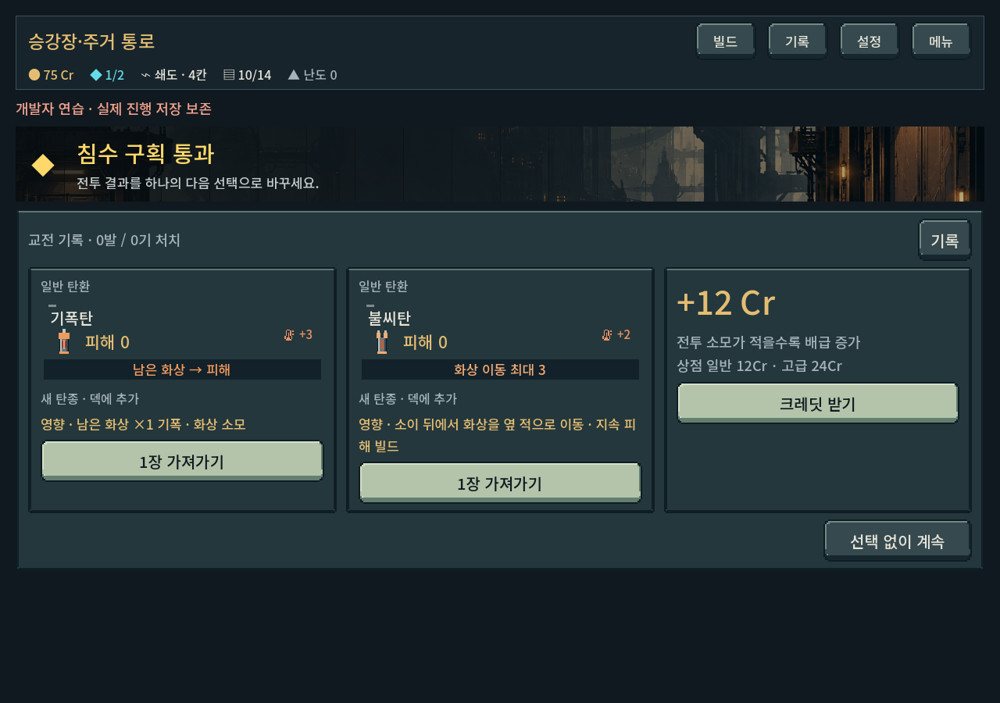
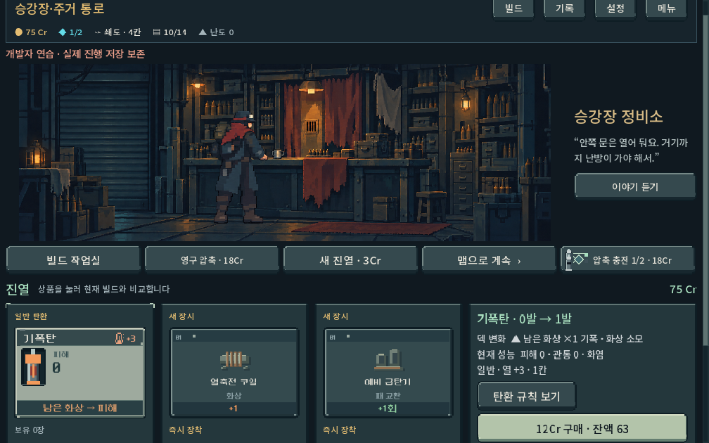

# 탄환 역할·빌드 발견 1차 재정리

2026-10-17 · `prototype/core-redesign` · Godot 4.7 stable · 격리 저장/사용자 저장 비활성 UI.

## 결론과 적용 범위

예약탄/차단탄은 효과가 없는 버그가 아니라 현재 화력 성장에 비해 비용과 사용처가 맞지 않는 문제였다. 새 등반에서 두 탄 및 예약 급탄기 획득을 중단하고, 일반 파츠·기존 코어도 보상 첫 후보에 영향을 주도록 했다. 기존 저장은 원래 발견 규칙과 소유물을 유지한다. 전투 수치 조정은 이번에 하지 않았다.

[20종 역할 판단 및 결정 상태](../../direction/ammo-build-roles.md) · [새 게임 실행](../../../PLAY.cmd)

## 실제 전투 모델 비교

보행자, 일반탄, 동일 순서 입력과 실제 `Model.fire()`를 사용했다. 아래 화살표는 **발사 순서**이며 실제 장전은 역순이다. 기본 열0, 덱12장/나머지 기본탄, 표적 장갑0·HP100을 기본으로 하되 표 안 예외를 사용했다. 성장 코어 비교는 성장4회 상태이며 초반 성능을 뜻하지 않는다. 피해는 행동 종료 시 실제 HP 감소 합계(화상 틱 포함), ‘열’은 사격 행동 종료 값이다. 강제 냉각·마지막 처치 시 열0을 발열 없음으로 해석하면 안 된다.

| 비교 | 실제 결과 | 해석 |
|---|---|---|
| 연쇄: 증폭→예약→철갑 / 기본→증폭→철갑 | 피해11·열8 / 피해19·열7 | 예약은 다음 패에 철갑을 확보했지만 즉시 피해8과 열1을 추가 지불 |
| 열압·시작 열5: 증폭→예약→철갑 / 냉각→증폭→철갑 | 피해0·행동3턴 / 피해15·행동1턴 | 전자는 공격 전 과열. 냉각은 실제 발사 기회를 만드는 지원 |
| 차단, 앞 접근 적2기 뒤 원거리1기 | 차단0회·원거리 발사1회 | 후열 위협에 도달하지 않음 |
| 노출된 HP100 원거리: 차단→기본 / 증폭→기본 | 피해3·발사0회 / 피해6·발사1회 | 차단에 좁지만 실제 생존 이점은 있음 |
| 돌파·노출된 HP16 원거리: 차단→기본 / 증폭→기본 | 피해9·적 생존 / 피해16·처치 | 이 처치선에서는 공격 지원으로 위협 제거까지 가능. 모든 적에게 일반화하지 않음 |
| 장갑4: 파쇄→연타 / 기본→연타 | 피해4 / 피해3, 양쪽 열5 | 피해0 파쇄의 후속 타격 기여 확인 |
| 적3기: 전격, 파츠 없음 / 전이 축전기+분기 전이기 | 피해5 / 피해12, 양쪽 열3 | 전이의 별도 다수 피해 성장축 존재 |
| 적2기, 열축전 코일+열폭주 노심: 소이만 / 소이→불씨 | 피해3+남은 화상5 / 피해4+남은 화상4 | 합계8로 같고 두 표적에 나누어 빨리 소모. 새 화상 총량은 만들지 않아 재설계 우선 후보 |

고정 실험은 역할/비용을 비교하는 근거다. 예약의 덱 전체 장기 기대값, 모든 총기/장갑/파츠 조합의 승률을 측정한 것은 아니다. 불씨의 화상 총량 비교도 향후 틱을 전부 받는 조건이며 실제 과잉 피해/표적 생존에 따라 달라진다.

원본 결과: [comparisons.json](ammo_build_balance_2026-10-17/comparisons.json).

## 기능 및 진행 검증

| 범위 | 결과 |
|---|---|
| 새 역할 비교·획득 후보·저장 호환 | 2,729검사, 실패0 |
| 실제 UI 터치 보상 수령/구매, 1008×630·1280×900·1440×630 | 83검사, 실패0 |
| 기존 다수 처치/성장/편성 관련 규칙 회귀 | 942검사, 실패0 |
| 성장 코어3종×총기5종의 첫 지역 진행 | 6,741검사, 실패0. 15경로/1,091명령, 전부 관문 도달 |

- 후보 검사는 5지역×깊이5조건×20시드. 새 전술탄17종 모두 관측, 중복 계열/제외 탄·파츠 유출/결정성 확인. 이 표본은 등장 확률의 균등함을 보장하지 않는다.
- 기존 코드 수정 전 결과에서 추출한 30시드 고정 자료와 기존 발견 버전 보상/진열을 비교. [고정 자료](../../../새-게임-프로젝트/tests/fixtures/ammo_discovery_legacy.json). 테스트가 `qa_runtime` 백업 소스에 의존하지 않는다.
- 기존 예약탄/차단탄 보유·예약 급탄기 장착·진행 중 예약 고급탄 진열을 복원해 보존 확인. 누락된 발견 버전은0으로 이행, 음수/미지원/소수/문자/불리언 버전 거부.
- 진행은 seed731042, 난도0, 작업복5장, 상점 우선 경로, 탄 선택 자동 정책. 사용자 메뉴 기본 운반용 외투6장과 다르다. 쇄도+열압의 노드401/802는 기본 탐색이 경로를 찾지 못해 넓은 탐색으로 확인(각24/26명령). 난도를 통과용으로 변경하지 않았다.
- 최초 UI 검사에서 짧은 화면의 구매 버튼을 스크롤 전 화면 안에 있어야 한다고 판정한2건은 테스트 전제 오류였다. 실제 상점은 스크롤 화면이므로 버튼으로 스크롤 후 경계/실제 터치 성공을 확인했다. 제품 레이아웃 변경은 없음.
- 고정 자료 JSON의 숫자 타입과 런타임 정수의 비교 차이는 양쪽 JSON 정규화로 교정. 제품 발견 결과 차이는 없었다.

실행: `tools/run_ammo_build_balance_checks.ps1 -Mode rules|ui|campaign`. 회귀는 기존 `run_build_payoff_checks.ps1 -Mode rules`와 같은 러너를 별도 격리 폴더에서 실행했다. [검사 로그 및 진행 요약](ammo_build_balance_2026-10-17/summary.json).

## 화면 확인과 한계

실제 엔진 화면에서 화상 파츠를 장착한 보상 후보 및 상점 구매 정보를 확인했다. 짧은 상점은 기존 스크롤을 사용한다. 새 그림/카드 레이아웃은 제작하지 않았다.

현재 자동 통과는 사람의 선택 재미·장기 균형을 증명하지 않는다. 화상/전격 기존 코어의 상위 지역 경쟁력, 불씨 재설계, 조건부 마무리탄 간 차별화는 남아 있다. Galaxy 실기/청감 검증은 하지 않았다. 새 발견 규칙을 보려면 새 등반을 시작한다. APK·커밋·푸시·외부 게시 없음.
