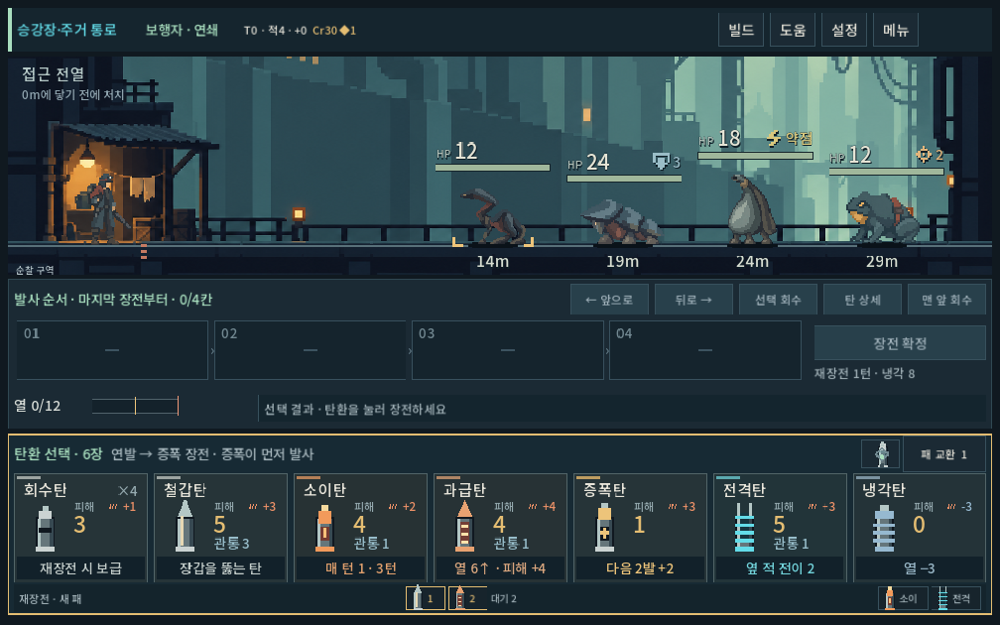
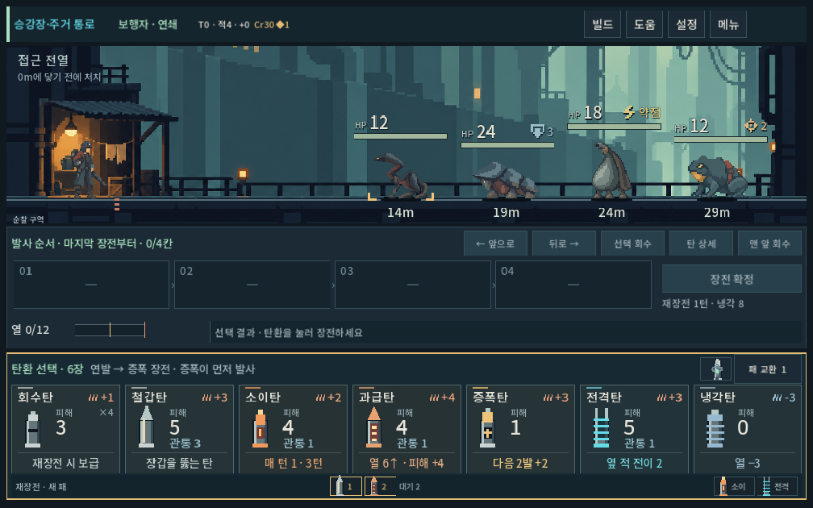
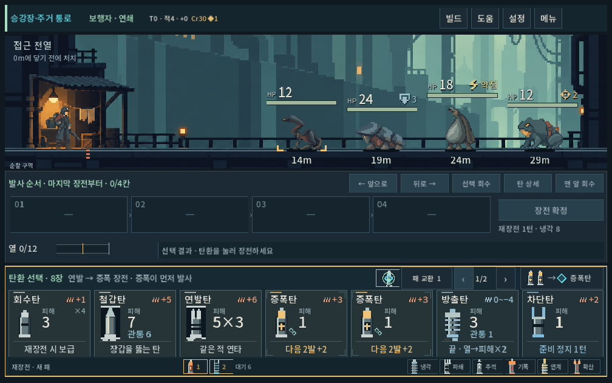
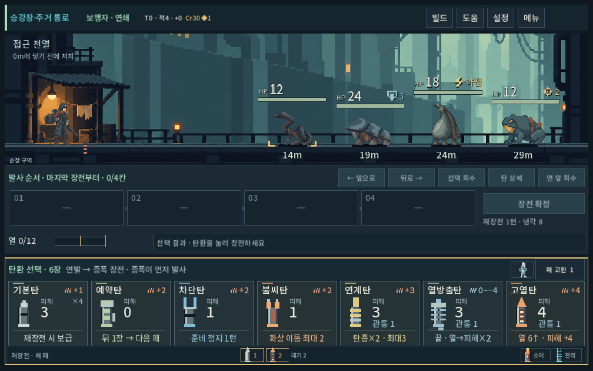

# 전투 탄환 카드 정보 정리

2026-10-09 · 사용자 요청: 승인한 몬스터 HUD에 이어 탄환 카드 최적화.

## 적용

카드 그림과 도트 실루엣, 카드 높이140px, 선택/장전 규칙을 유지한 채 전투 패의 정보 위치를 정리했다. 상단 왼쪽 이름/오른쪽 발열, 가운데 그림/피해/관통, 하단 고유 효과 한 줄이다. 발열은15→18px, 기호0.7→1배로 키우고 냉각/열 소모는 부호와 푸른색으로 구별한다. 피해는30px의 밝은 중립색으로 읽고, 색은 발열·관통·고유 효과를 구분하는 데 쓴다.

압축 가능 표시를 그림 옆으로 옮기고 전체 민트 테두리는 없앴다. 모서리 표시/연결 마름모는 유지한다. 보유 수량은 상단 비용 아래 독립 위치에 둬 이름/압축 표시/관통과 겹치지 않게 했다. 효과 문구마다 있던 내부 박스를 얇은 구분선으로 대체했다. 조건 효과를 뜻 모를 기호로 바꾸거나 설명을 제거하지 않았다. 드래그 미리보기도 전투 카드와 같은 배치를 사용한다.

전투 선택 카드와 드래그 표시가 이번 범위다. 보상·덱 등의 큰 카드 배치는 보존했고, 공용 발열 기호에 선택적 색 인자만 추가했다. 수치·전투 계산은 변경하지 않았다.

## 검증

`tools/run_eavesback_checks.ps1 -Mode layout`: 격리 저장 Godot 실제 렌더 **3342검사/0실패**, stderr 비어 있음. 1280×900,1008×630,1440×630,1280×1024 및5총기의 공개 터치 장전→확정→발사→재장전, 두 칸 탄환/회수/패 페이지/압축 가능 표시를 검사했다. 모든 탄환 변형을1008×630의 실제 패에 배치해 이름이 발열과 겹치지 않고 효과 문구가 잘리지 않는지 확인했다.

1008×630 일반 카드, 압축/방출, 모든 변형 중 복합 정보, 사격 확정 후 비활성 화면을 직접 시각 확인했다. 압축 드래그 입력의 별도 수동 재시험과 Galaxy 실기기, 사람이 느끼는 선택 속도는 이번 검증에 포함하지 않는다. APK/커밋/푸시 없음.

[검증 로그](ammo_card_cleanup_2026-10-09_assets/stdout.log)

## 변경 전

## 변경 후

## 후속 — 탄환 이름 정리

사용자가 검토안을 승인하여 회수탄→기본탄, 확산탄→불씨탄, 연발탄→연타탄, 과급탄→고열탄, 방출탄→열방출탄으로 변경했다. 전투/탄창/대기 목록의 짧은 이름, 공용 상점·보상·덱 데이터, 총기/파츠/도움말/추천 조합의 참조 문구도 통일했다. 탄 회수 조작과 효과로서의 확산 표현은 탄종 이름과 구분한다. 기본탄 설명은 재장전마다 보급되는 기본 탄환으로 명시했다. 내부 ID/효과/수치/저장 형식은 유지했다.

명칭 변경 후 같은 격리 렌더4해상도·5총기3342검사/0실패, 전체 변형 카드의 이름/효과 폭 통과. 1008×630에서 열방출탄과 발열 범위, 압축 연타탄, 불씨탄/고열탄 화면을 직접 확인했다. 이후 도움말/추천의 잔여 축약명 ‘연발’도 ‘연타’로 통일하고 활성 redesign 소스에 이전 탄종명이 남지 않았음을 검색 확인했다. 상점/보상 전체 흐름의 별도 재실행과 Galaxy 실기기 검증은 이번 범위에 포함하지 않는다.

[명칭 변경 검증 로그](ammo_card_cleanup_2026-10-09_assets/names_stdout.log)

