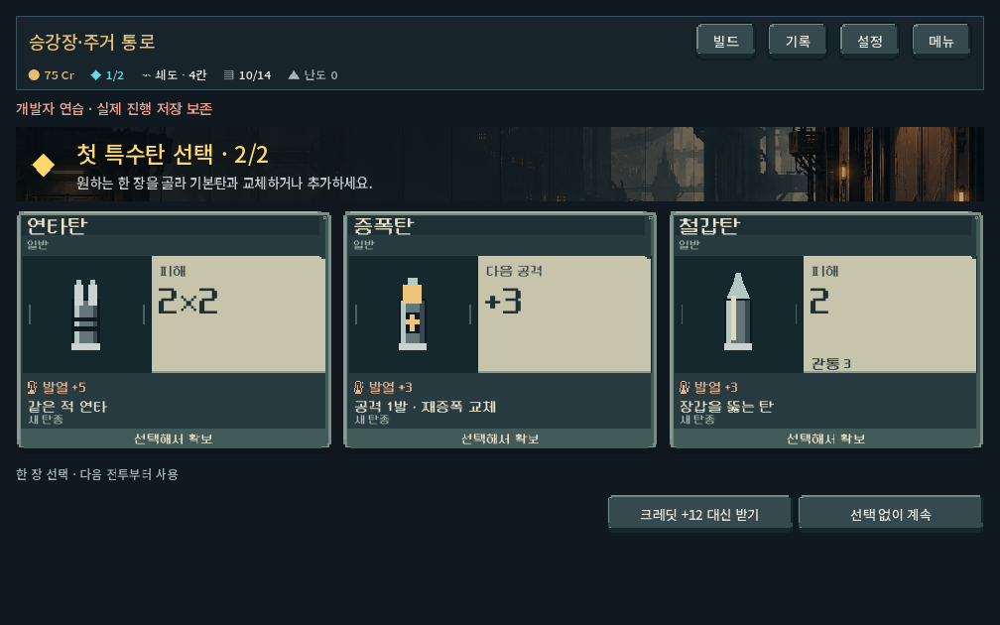
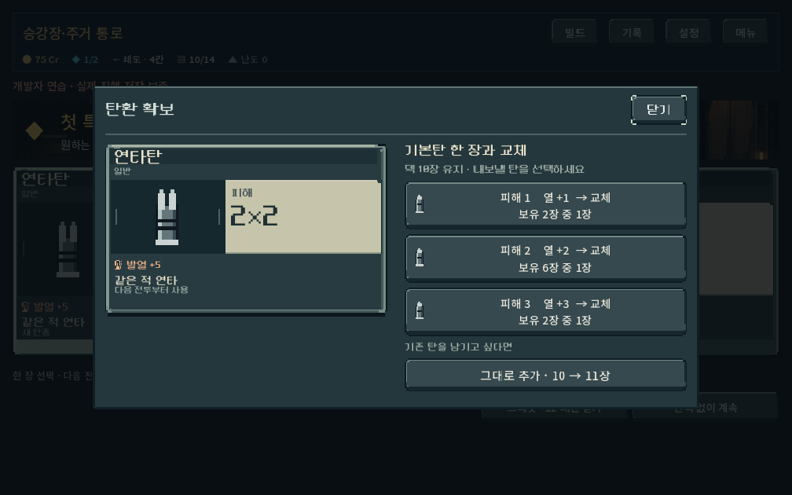
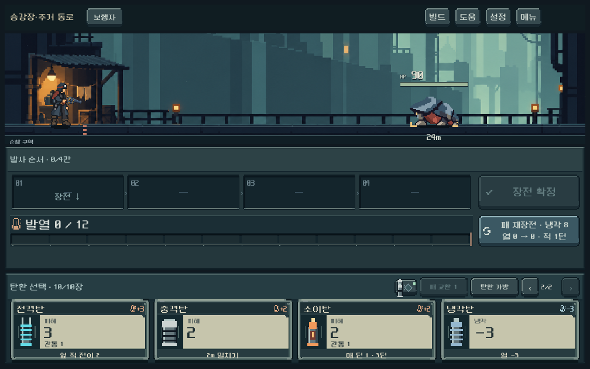

# 탄환 카드와 확보 흐름 — 2026-10-17

## 적용 결과와 판단

사용자는 UI의 감성을 높이기 위해 탄환 카드 디자인도 개편해도 된다고 승인했다. 기존 도트·청회색 조작부를 바탕으로 **정비한 탄약과 성능표**를 한 장의 카드로 보이게 만들었다. 큰 원화나 장식을 더하는 대신 탄환 자리, 성능 면, 이름 띠, 테두리 단면을 구분했다. 이번 스타일은 디렉터 구현안이며 사용자 선호 확인 전이다.

- 어두운 탄환 받침과 밝은 성능표, 계단 모서리·두 개 체결점·눌림 2px를 공용 카드에 적용. 보상/획득은 크게, 전투/상점/가방/개조 비교는 작은 공간에 맞춰 표시한다. 원본 Godot 정수 좌표 드로잉이며 외부 참고 이미지를 배포 리소스로 복사하지 않았다.
- 피해·연타는 숫자와 타격 수, 증폭·냉각 등 지원탄은 실제 주요 효과를 큰 위치에 표시한다. 기존 비전투 카드에서 지원탄이 피해0 중심으로 읽히던 부분을 바로잡았다. 발열은 별도 위치, 관통은 성능표 보조 줄, 압축/위치 제약·개조·등급 표시는 유지한다.
- 보상은 카드 전체를 선택한다. 반복 설명과 겹겹의 패널을 줄였다. 기존 3후보/크레딧/건너뛰기 규칙은 유지한다.
- 탄환 확보 창은 왼쪽 들어올 카드, 오른쪽 기본탄 교체 목록과 추가 행동을 비교한다. 목록에 아이콘·피해·열·개조 종류·동일 사본 수를 표시한다. 교체는 덱 장수 유지, 추가는 전후 장수를 제시한다. 확인 단계 추가 없음.
- 성공한 교체/추가에만 짧은 비차단 알림을 표시한다. 즉시 연출 설정을 따르며 다음 화면으로 이동하면 남지 않는다. 취소는 원래 덱을 보존한다.

`ammo_offer.tscn`, `ammo_acquisition_view.tscn`으로 새 주요 구조를 편집 가능하게 분리했다. 공용 얼굴은 `ammo_card_face.gd`, 기존 데이터/입력 연결은 `ammo_card_view.gd`에 둔다. 파츠·상점 전체 배치 개편은 이번 범위가 아니며 후속이다.

## 전후 화면

[이전 첫 특수탄 선택](earned_ammo_2026-10-17/first_special_1008.png) · [이전 확보 창](earned_ammo_2026-10-17/exchange_1008.png)







[압축탄](ammo_card_design_2026-10-17/compressed_1008.png) · [개조 비교](ammo_card_design_2026-10-17/tune_compare_1008.png) · [포커스](ammo_card_design_2026-10-17/focused_offer_1440.png) · [확보 피드백](ammo_card_design_2026-10-17/acquired_1008.png) · [14장 상점 교체](ammo_card_design_2026-10-17/shop_exchange_1440.png)

화면은 격리된 개발 상태의 실제 Godot 렌더다. 테스트 손패는 필요한 탄을 강제로 배치한 시각 검증용이며 자연 출현 빈도/초반 보유물을 나타내지 않는다. 일부 스트레스 캡처의 6/5는 이 강제 손패 조건이다. 실제 최대 손패/페이지 검증은 10/10 조건으로 별도 수행했다.

## 기능 검증

| 검사 | 확인 내용 | 결과 |
|---|---|---:|
| 새 카드 UI | 장전 전후 높이/LIFO, 압축탄, 손패10장 페이지, 카드 포커스, 취소, 정확한 개조 사본 교체, 큰 글씨와 스크롤, 확보 알림/즉시 설정/이동 후 정리 | 284/0실패 |
| 특수탄 확보 UI | 코어→특수탄, 교체/추가/취소, 구매 가격, 덱14장, 보급/기록 | 322/0실패 |
| 탄환 개별 성장 UI | 위력 프로필, 화력/방열 개조, 압축, 개별 표시 | 398/0실패 |
| 공용 터치 | 모달·페이지 스크롤, 배경 차단, 장전/압축 드래그 | 79/0실패 |

합계 **1,083검사 / 실패0**. 1008×630,1280×900,1440×630 실제 렌더와 터치 이벤트 주입. 확대 글씨1.1 및 즉시 연출은 좁은 화면에서 추가 확인했다. Godot4.7 import 통과. 플레이어 저장과 분리된 `qa_runtime`에서 실행했으며 저장 비활성으로 검사했다.

검수 중 작은 개조 비교 카드의 수치가 아래로 밀리는 문제를 고쳤다. 확보 알림은 `motion_scale()`의 instant 값이0이 아닌0.05인 점을 반영해 설정 이름으로 처리했다. 빠른 화면 이동 뒤 알림이 남는 문제도 정리했다. 변경 후 해당 검사를 재실행했다.

재현 명령:

```powershell
./tools/run_ammo_card_design_checks.ps1
./tools/run_earned_ammo_checks.ps1 -Mode ui
./tools/run_ammo_identity_checks.ps1 -Mode ui
./tools/run_modal_touch_checks.ps1
```

[검사 로그·현재 소스 해시](ammo_card_design_2026-10-17/summary.json). 이번 작업에서 전투/획득 규칙 수치를 변경하지 않았으며, 이전 확보 보고서의 획득·발견·편성·캠페인·캠페인 콘텐츠 등7파일 해시 일치를 확인했다. 전체 프로젝트 동일성을 뜻하지 않는다.

## 남은 범위와 실행

사용자의 감성/가독성 선호, 실제 Galaxy 터치·성능, 장시간 플레이에서의 피로도는 미검증이다. 상점·파츠의 비교/장착 화면과 나머지 전투 조작부는 다음 단계에서 같은 표현으로 연결한다. 카드 변경을 전체 UI 리빌딩 완료로 간주하지 않는다.

`D:/ProjectLoB/worktrees/core-redesign/PLAY.cmd` → 새 등반 또는 개발 보상 화면에서 확인할 수 있다. 기존 저장의 소유물·게임 규칙 유지. APK/Drive/커밋/푸시 없음.
