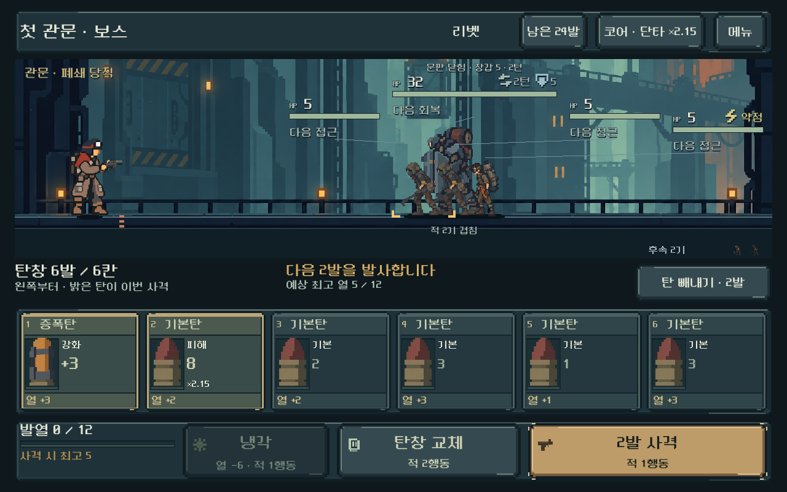
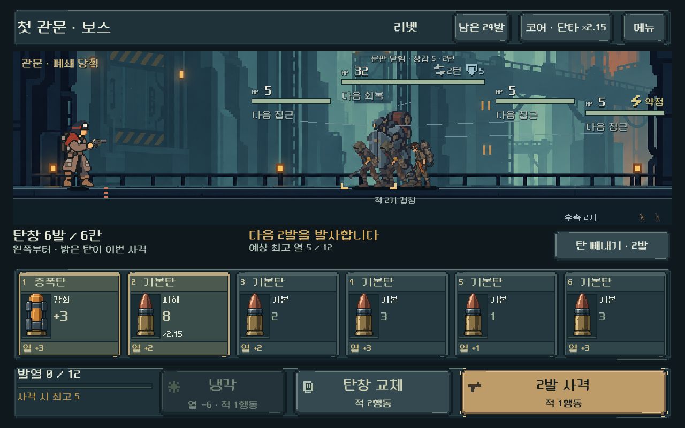

# 탄환 아트 — 현재 배경과 재질 통일

## 요청과 결과

사용자 “탄환도 현재 배경에 맞게 다시 디자인해 줘”에 따라 공용 탄환 아트를 교체했다. 현재 전장·캐릭터·새 HUD와 이전 탄종 원화를 참조로 전달해 새 기본6프레임을 먼저 만들고, 실제 탄창에서 확인한 뒤 같은 원화를 참조해 특수12·이전 저장용2프레임을 추가했다.

청회색 강철과 낡은 황동 탄피를 공통 재질로 사용하고, 구리 탄두·세라믹 증폭부·냉각부·전극을 국소 색과 형태로 구분했다. 철갑의 좁은 관통체, 연타의 두 탄, 냉각 핀, 전격 접점, 충격 피스톤, 파쇄 날, 열방출구 등 탄종별 실루엣을 유지했다. 확대 원화만이 아니라 실제52×80px 영역과 작은 탄창/덱 화면에서 확인했다.

공용 `ammo_art.gd` 한 파일을 통해 전투·보상·덱·상점에 연결했다. 현재189탄환 ID의 원형·개조·등급·이전 저장용 항목을 검사했다.20프레임을 제작했지만 `thermal`은 기존 `bore` 별칭이므로 같은 소이탄 그림으로 표시한다. 새 탄종·수치·규칙 추가가 아니다. 과거 원화와 이전 비교 시안은 보존했다.

## 전후와 실제 화면

같은 비교 보스·총기·탄 순서의 전후 화면이다.

| 이전 | 새 탄환 |
| --- | --- |
|  |  |

[전체 계열 변경 전](ammo_cohesion_2026-10-31_assets/family_before.png) · [전체 계열 변경 후](ammo_cohesion_2026-10-31_assets/family_after.png) · [작은 화면9칸](ammo_cohesion_2026-10-31_assets/nine_slots.png) · [덱](ammo_cohesion_2026-10-31_assets/bag.png) · [현행 상점](ammo_cohesion_2026-10-31_assets/shop.png) · [보상](ammo_cohesion_2026-10-31_assets/reward.png).

전후 계열표는 원화 연결을 확인하기 위한 QA 화면이며 새 게임 메뉴가 아니다. 소이탄 별칭이 두 번 보이는 것은 기존 데이터 대응을 함께 확인하기 위해서다. 새 화면의 사용자 미감·직관성은 별도 확인이다.

## 제작과 자산 안전성

- 도구: 내장 image_gen, 매번 실제 참조 이미지 입력 및 투명 배경 옵션 사용. Godot MCP 프로젝트 연결 확인 후 로컬 엔진에서 적용·검증.
- 결과: `core_rounds.png`, `special_rounds.png`, `legacy_rounds.png`, 각각1536×1024 RGBA. [프롬프트·입력 역할·원본 경로·해시·영역](../../../새-게임-프로젝트/assets/art/ammo_cohesion_20261031/provenance.json).
- 생성 원본은 그대로 복사하고 SHA-256 일치를 확인했다. 이미지 재색칠·리사이즈·후처리는 하지 않았다. 알파를 읽어 실제 물체 범위를 측정하고 Godot UV 영역과 nearest로 표시했다.
- 특수탄 시트의 행 위치가 균등 격자와 조금 달라 자동 영역 검사에서 다음 행 탄두가 섞이는 것을 발견했다. 실제 행 경계를 기준으로 영역을 등록했다. 모든 영역이 원화 안에 있고 비어 있지 않음을 Godot에서도 검사했다.
- 생성 원화의 저알파 배경 잔여와 소프트 알파를 포함한 원본은 보존했다. 물체 주변의 좁은 등록 영역만 사용하며 실제 배경과 탄약 홈 위에서 검은 사각형·잘림·눈에 띄는 후광이 없는지 확인했다. 완전한 이진 알파/고정 픽셀 격자 자산이라고 주장하지 않는다.

## 검증

Godot4.7 stable / Windows / OpenGL Compatibility / RTX4060Ti. 사용자 저장을 사용하지 않고 QA별 APPDATA/LOCALAPPDATA를 분리했다.

| 검사 | 최종 결과 | 범위 |
| --- | --- | --- |
| 현행 탄창 HUD | 13,056검사, 실패0 | 5총기,4해상도/3비율, 사격·중간 빼내기·모달·저장 재개·표시 비용 |
| 현행 상점 | 1,295검사, 실패0 | 5크기, 실제 지도 진입·구매·교체·파츠·저장 복구·읽기/입력 |
| 탄환 아트/공용 표시 | 346검사, 실패0 | 189ID 누락 없음,20영역,3크기 보상·덱·상세·기존 손패, 읽기 전후 상태/RNG 보존 |

HUD:1008×630/1280×576/1280×720/1280×800. 공용 표시:1008×630/1280×800/1440×630. 상점은1600×900/1280×800/1008×630/1280×576/1440×630의5크기다. 각 최종 실행 stderr는 비어 있다. 전장 수치·저장 코드·기존 검사 파일은 변경하지 않았다.

기존 `ammo_collection_ui_runner.gd`는 이전 상점의 `city_offer_compare_0`, `city_shop_tune` 등을 찾다가 중단됐다. 이를 통과로 기록하지 않는다. 현행 `shop_live_runner.gd`로 상점 동작을 검증하고 아트 전용 검사에서 보상·덱·상세를 확인했다. 전용 검사의 최초 실행에는 테스트 코드의 데이터 별칭 오류, 이어 화면 기준 크기를 실제 픽셀 크기로 덮어쓴7개 배치 실패가 있었다. 테스트 코드와 화면 배율을 실제 프로젝트의1280×800 기준으로 고친 뒤346검사를 통과했다. 게임 코드를 바꿔 검사를 우회하지 않았다.

[HUD 원자료](ammo_cohesion_2026-10-31_assets/hud.json) · [공용 표시 결과](ammo_cohesion_2026-10-31_assets/review.json) · [상점 로그](ammo_cohesion_2026-10-31_assets/shop_stdout.log) · [기존 파일 보존](ammo_cohesion_2026-10-31_assets/preservation.json) · [소스 해시](ammo_cohesion_2026-10-31_assets/source_hashes.json). 실패한 이전 검사 로그와 최종 재현 스크립트도 같은 폴더에 둔다.

## 적용 범위와 남은 확인

현재 PC 여정/비교와 공용 원화를 사용하는 본편 화면에 적용했다. 시작 당시634항목 작업 트리와 별도로1,804기존 코드·문서·벡터 파일을 기록해 대조했다. 기존 변경은 공용 원화 표시1파일·방향3문서·일일 기록이며 누락은 없다. 새 원본은 프로젝트 내부에 보존했다.

사용자의 새 미감 평가, Android 실기기 판독성·지속 FPS·발열은 확인 전이다. 기존 배포 APK는 변경하지 않았으며 APK 생성·업로드·커밋·푸시는 수행하지 않았다.
