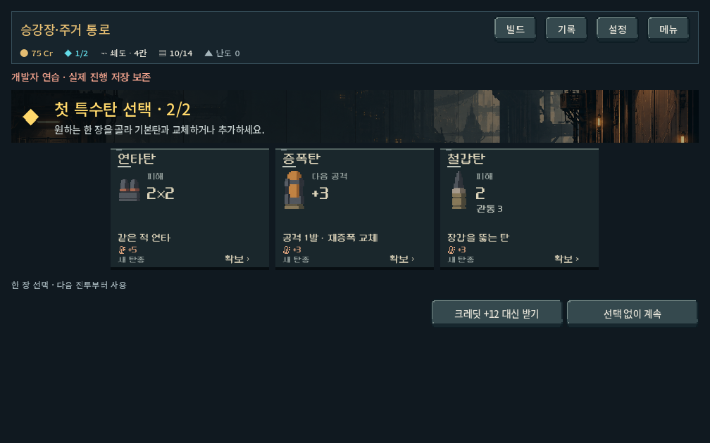
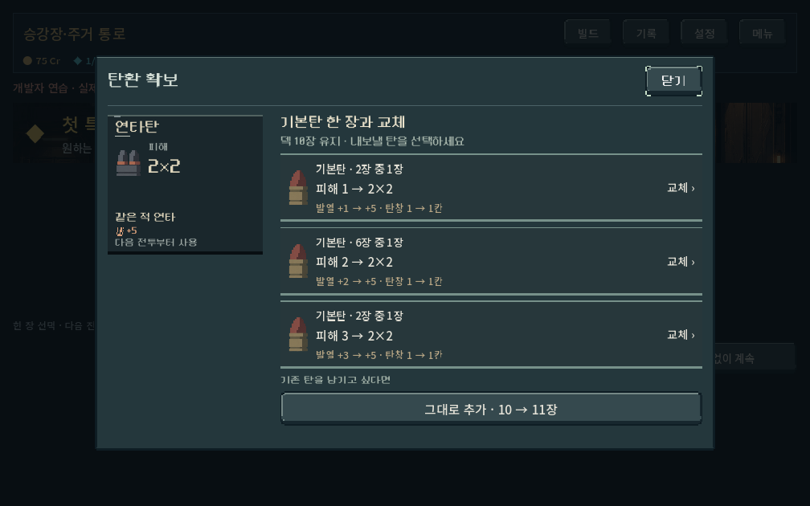
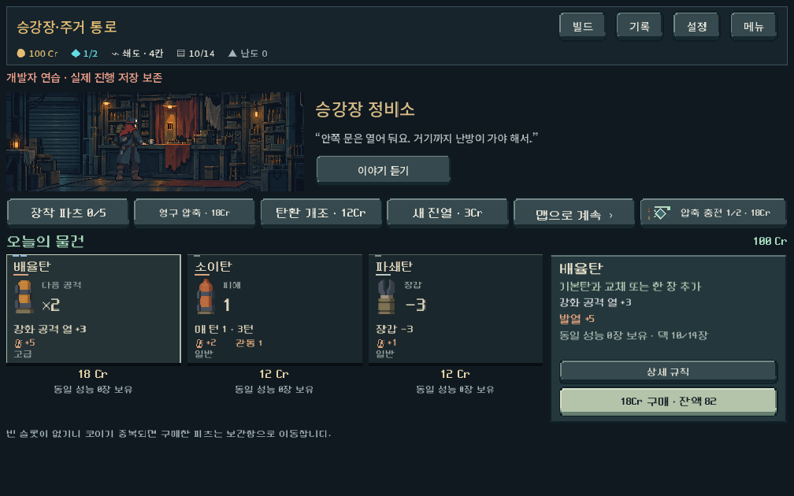
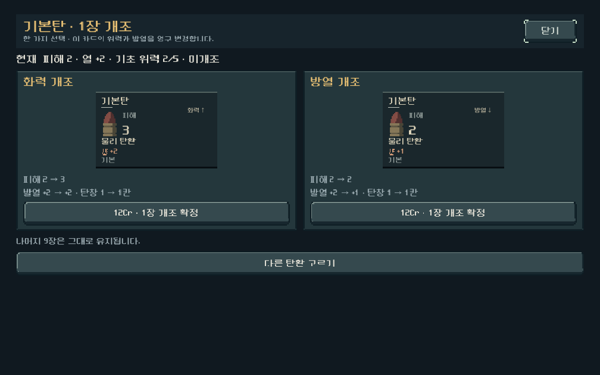
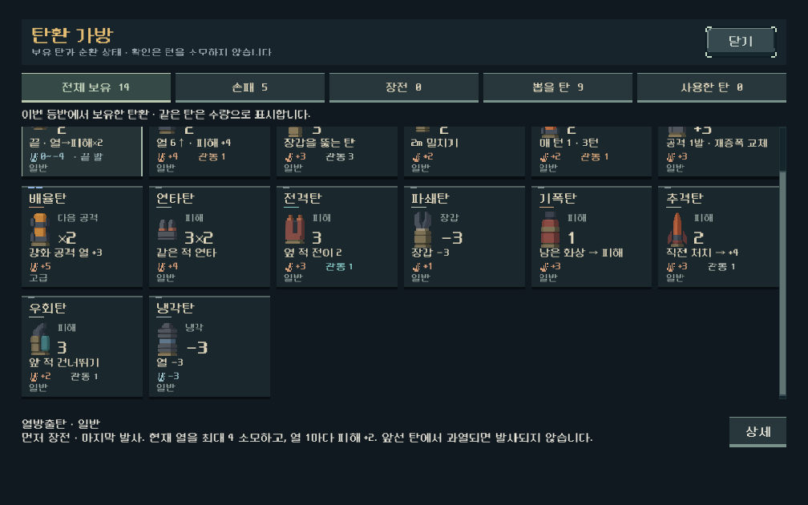
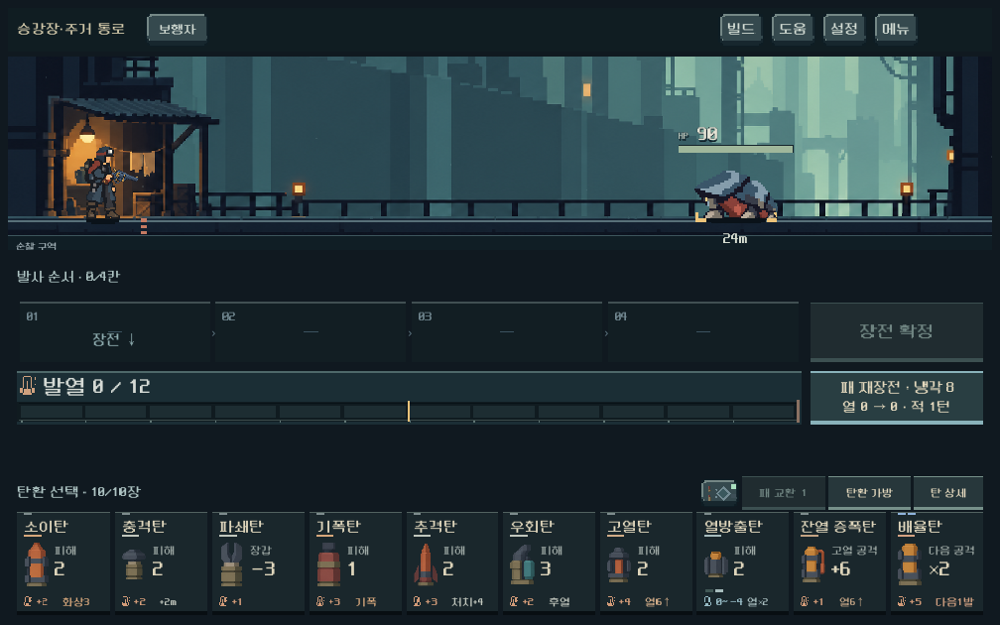

# 탄환 공용 아트·확보와 가방 UI — 2026-10-18

사용자 진행 승인에 따라 다음 단계 중 **탄환 전 화면 디자인 통일**과 **확보·관리 흐름 정리**를 본편에 적용했다. 10자리 전투 손패, LIFO, 발열, 덱 수량과 획득 규칙은 유지한다. 디자인 구현과 내부 검수까지 완료했으며 사용자 미감·Galaxy 실기 검증은 후속이다.

## 적용

- 기존6가족 원화와 새12종 원화(현행11가족 + 기존 연계탄)를 공통 `ammo_art.gd`에서 표시한다. 현재 획득 가능한17가족을 커버하며 개별 위력/개조/압축 변형에도 연결한다. 예약·차단의 기존 보유물은 종전 그림을 보존한다. [생성 프롬프트·출처·해시](../../art/concepts/ammo-recast-20261018/provenance.json).
- 전투, 보상, 상점, 가방, 압축 및 작은 예비탄 표시에 같은 원화를 사용한다. 비전투 카드도 주요 효과 → 발열/장전 제약 → 맥락 순서로 정리. 보상·확보·개조 카드 폭을 제한해 내용이 한쪽에만 몰린 넓은 판을 줄였다.
- 확보 창은 들어올 탄과 내보낼 기본탄을 분리한다. 공격·지원 역할을 구별하여 실제 장비 기준 효과, 발열, 관통 변화, 탄창 점유를 비교한다. 3개 기본 프로필이 있을 때 교체/그대로 추가 행동을 한 화면에서 확인한다. 후보가 많으면 기존 터치 스크롤을 사용한다.
- 개조는 실제 전후 값을 표시하고 최소 발열에 도달한 방열 개조를 비활성화하며 이유를 표시한다. 지원탄 압축에 의미 없는 피해0 대신 냉각/다음 공격 등 주요 효과를 표시한다. 압축의 순서 제약과 덱 최소8장 규칙은 유지.
- `ammo_bag_view.tscn`에 다섯 상태 탭, 내용 스크롤, 고정 설명/상세 버튼을 배치했다. 같은 프로필은 수량으로 묶고, 장전 탭은 개별 발사 순서다. 가방 위에 상세 창을 열고 닫아도 원래 가방과 선택을 유지한다. 열람은 무소모다.

## 실제 게임 화면

공통 보상 카드:

교체와 추가:

상점과 개조:

가방 내부만 터치 스크롤한 상태:

추가 원화를 사용하는 실제 전투10장:

[압축 화면](ammo_collection_2026-10-18/compression_1008.png) · [넓은 화면 가방](ammo_collection_2026-10-18/bag_scrolled_1440.png) · [큰 글씨 빈 더미](ammo_collection_2026-10-18/bag_large_text.png)

## 검증

Godot4.7 실제 GPU, 1008×630 / 1280×800 / 1440×630. 프로젝트 stretch에 따른 논리 화면은 1280×800 또는1828×800이다. 모든 실행은 `qa_runtime/` 격리 APPDATA/LOCALAPPDATA와 저장 비활성 상태다.

| 실행 명령 | 결과 | 범위 |
|---|---:|---|
| `powershell -NoProfile -ExecutionPolicy Bypass -File tools/run_ammo_collection_checks.ps1` | 372 / 실패0 | 교체 전후 값, 방열 하한, 실제 개조·압축 결제, native touch 가방 스크롤/고정 영역/무소모, 중첩 상세, 새 그림10장 전투, 큰 글씨 |
| `tools/run_earned_ammo_checks.ps1 -Mode ui` | 322 / 실패0 | 첫 코어→특수탄, 교체/추가/취소, 가득 찬 덱, 개별 프로필 유지 |
| `tools/run_ammo_bag_checks.ps1 -Mode ui` | 618 / 실패0 | 다섯 상태·수량·순서·임시 압축·이전 저장, 끝 항목 접근과 포커스 복귀 |
| `tools/run_shop_parts_checks.ps1` | 229 / 실패0 | 혼합 진열/구매/파츠/부족한 금액/상한 교체 |
| `tools/run_combat_hand_live_checks.ps1` | 1,444 / 실패0 | 고정10자리·4/6/10장·실제 장전/회수/교환/압축과 상세 |

총 **2,985 검사 실패0**. 확보·가방·상점 회귀는 최초 통합 후 실행했고, 이후 카드 폭/확보 창 높이 최종 조정은 집중372검사로 다시 검증했다. 주요 규칙 `content.gd`, `model.gd`, `campaign.gd`, `ammo_acquisition.gd`는 작업 전후 SHA256 동일하다(`qa_runtime/ui_acquisition/rules_before.json`). 새 스크립트 import 성공, 게임 스크립트 오류 없음.

초기 집중 검사에서는 PC touch 에뮬레이션/윈도 ID 설정 누락으로 swipe가 실패했고, resize 직후 탭을 누르는 테스트가 해제된 버튼을 참조했다. 기존 native-touch runner와 동일한 입력 설정 및 resize 뒤 settle을 적용해 통과했다. 이 결과를 Galaxy 실기 통과로 간주하지 않는다. 엔진 환경의 기존 루트 인증서 저장소 경고만 발생했다.

## 확인 경로와 남은 일

본편은 저장소 루트 `PLAY.cmd`. 첫 승리 보상/상점 확보·개조·압축, 전투의 탄환 가방에서 확인한다. APK·커밋·푸시는 수행하지 않았다.

기능 통과와 대표 이미지 시각 확인은 완료했다. 실제 Galaxy 터치 감도·작은 글씨 판독, 지원탄 비교에 대한 사람의 이해도, 새 원화의 미감은 사용자 확인이 필요하다. 코어·파츠의 전투 기여 피드백 및 첫 구역 전체 플레이 체감은 다음 작업 범위다.
