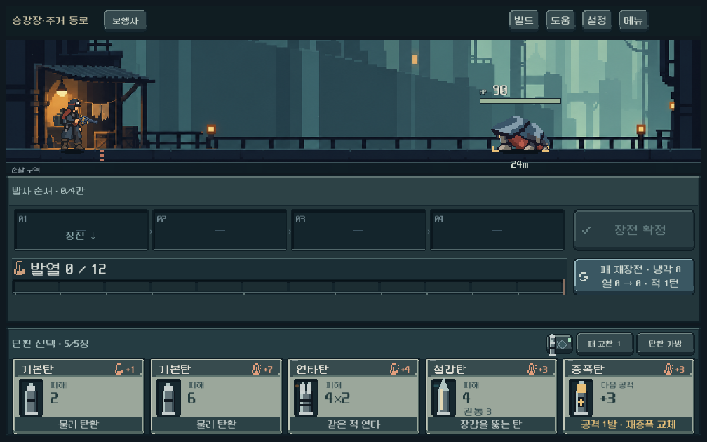
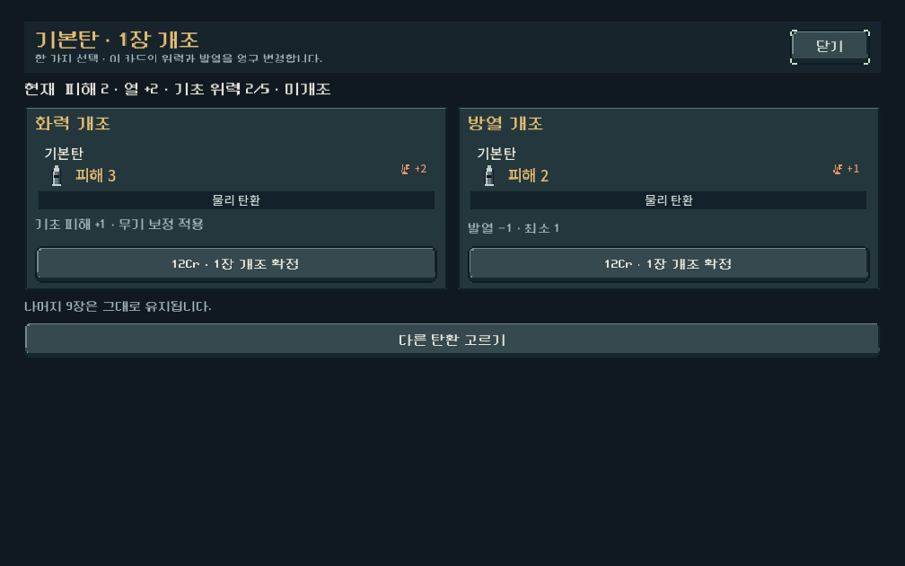
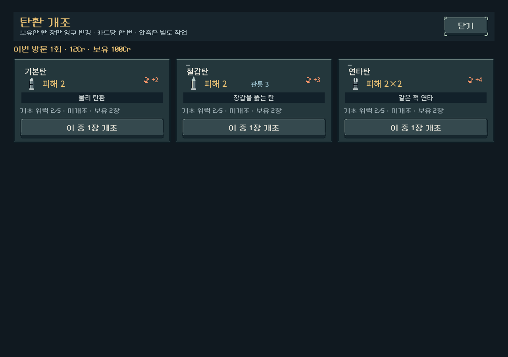

# 탄환 개별 위력·개조와 파츠 역할 이전

2026-10-17 · `prototype/core-redesign` · Godot4.7 · 사용자 저장과 분리한 `qa_runtime/ammo_identity`에서 검증

## 적용

[현행 결정·수치](../../direction/ammo-build-roles.md)를 본편 새 등반에 연결했다. 기본탄/철갑탄/연타탄의 위력1~5, 한 장만 바꾸는 상점 개조, 동일 프로필 압축, 발사/발열/저장/보상/상점/장비 선택/가방을 연결했다. 기존ID를 지우지 않았고 소유물 검증을 느슨하게 하지 않았다. 신규 발견은 버전2이며0/1 저장은 기존 발견 버전을 유지한다. 교차 급탄기의 새 효과는 기존 소유 파츠에도 적용된다.

실행: `PLAY.cmd` → **새 등반**. 상점 → **탄환 개조** → 한 장 선택 → 화력 또는 방열. 첫 구역 깊이5부터 위력4/5도 획득 후보에 포함된다. 훈련·기존 등반에서는 새 프로필이 자동 지급되지 않는다.

## 선택 차이의 실제 계산

보행자, 성장단계4, 시작 열0, 장갑0/HP1000/이동0인 같은 표적, 같은 패에서 최대4장까지 모든 순열을 검사했다. 각 코어의 실제 탄창 제한을 적용하고 **강제 재장전 없이 이번 발사 피해를 최대화**한 선택이다. 아래 순서는 발사 순서이며 장전은 반대다.

공통 패: 기본탄 위력1/5, 연타탄 위력1, 철갑탄 위력4, 증폭탄.

| 코어 | 유리했던 선택 | 실제 피해 | 최고 열 |
| --- | --- | --- | --- |
| 연쇄 | 기본1 → 연타1 → 철갑4 | 31 | 11 |
| 열압 | 연타1 → 증폭 → 기본1 | 16 | 7 |
| 돌파 | 기본1 → 증폭 → 기본5 | 33 | 11 |

[원시 결과](ammo_identity_2026-10-17/comparisons.json). 코어 간 강약 순위가 아니다. 열압의 자발적 과열 충격파·다수 처치·상대 장갑·다음 탄창 비용을 이 비교에서는 최적화하지 않았다. **같은 재료의 유리한 선택이 달라지는 기능 근거**이고 사람의 재미나 전체 지배 전략 부재를 입증하지 않는다.

## 검증

| 검사 | 결과 |
| --- | --- |
| 개별 위력/개조·압축 보존·모든 총기의 실제 발사와 예측·보상 발견·단발 파츠 지속/초기화 | 3,770회, 실패0 |
| 시작 탄환 미리보기·실제 터치 장전/발사·상점 개조/압축·보상,3해상도 | 386회, 실패0 |
| 첫 구역5총기×3성장 코어 | 6,909회, 실패0.15경로/1,119명령 모두 관문 |
| 기존 획득0/1·30시드 고정 자료·저장 회귀 | 2,729회, 실패0 |
| 기존 다수 처치/성장 규칙 | 942회, 실패0 |
| 기존 모듈 보상·상점 구매 UI | 83회, 실패0 |

- 세 해상도는1008×630,1280×900,1440×630. 마우스 신호 호출 대신 공개 버튼에 화면 터치 입력을 전달했다. 모든 UI 저장 비활성.
- 압축은45개 원본 프로필(3종×5위력×미개조/화력/방열)을 계획/탄창/발사/취소 상태에서 복원했다. 임시탄 반환이 단순 탄종ID로 되돌아가지 않고 정확한 위력/개조 원본 두 장을 보존한다. 서로 다른 위력은 합칠 수 없다.
- 상점 한 장만 개조,방문 제한,새 진열 뒤 제한,중복 개조/잘못된 인덱스/모드 거부,저장 재개와 압축 서비스 분리 확인.7복장×5총기의 새 시작 저장 복원 확인.
-5깊이×100시드의 보상/진열에서15개 미개조 위력 프로필 모두 발견. 초반 깊이1/2/3 표본에서 위력4/5와 신규 중단 탄종이 나오지 않음. 등장 확률의 균등함을 증명하지는 않는다.
- 실제 발사와 확정 예측의 적/압력탄/열/강제 재장전 결과 일치와 RNG 비소비 확인. 산개는 무작위 표적이라는 한계를 유지하며 확정 경로로 비교하지 않았다.
- 캠페인seed731042,난도0,작업복5장,상점 우선 자동정책. 열압+산개 노드802는 기본 탐색이 해법을 못 찾아 넓은 탐색으로22명령 통과. 제품 난도를 통과용으로 바꾸지 않았다. 메뉴 기본 운반용 외투6장과 다른 조건이다.

재현: `tools/run_ammo_identity_checks.ps1 -Mode rules|ui|campaign`. [로그·소스 해시·진행 요약](ammo_identity_2026-10-17/summary.json).

## 화면과 수정한 문제

카드의 기존 피해·발열 숫자로 변형을 비교하고 이름·효과 문장은 유지한다. 개조는 전후 성능과 한 장 변경을 보여준다. 요약은 탄종 단위로 묶고 개별 목록은 동일 성능별로 구분한다.

- 동적 카드 레지스트리 도입 후 UI 색상 타입 추론이 깨져 전투 장면을 읽지 못한 결함은 명시적Color타입으로 수정하고 실제 화면 실행으로 검증했다.
- 개조 두 선택의 버튼 높이를 정렬했다. 다른 위력 카드를 ‘새 탄종’이라고 잘못 안내하던 문구는 탄종과 동일 성능 사본 수를 구분하도록 교정했다. 시작 장비의 미리보기도 실제 새 시작 덱 수치를 사용한다.
- 압축 버튼3건의 초기 경계 실패는 스크롤 전 모두 화면 안에 있어야 한다는 테스트 전제 오류였다. 실제 작업실 스크롤로 이동한 후 입력/경계 검증 통과. 준비 화면 다이얼로그를 닫지 않아 이후 터치를 막은 테스트 오류도 공개 닫기 버튼으로 해소했다. 제품 입력 우회는 사용하지 않았다.

## 남은 검증

이번은3종 우선 적용이다. 다른 탄종의 위력 변형은 미구현이며 추가 여부는 역할별로 결정한다. 상위 지역 전체 경제/균형, 고위력5만 모으는 장기 지배 전략, 낮은 위력의 획득 만족도, 압축에 필요한 동일 사본 확보 빈도, 사람의 선택 체감,Galaxy실기/청감은 검증 전이다. APK·커밋·푸시·외부 게시 없음.
