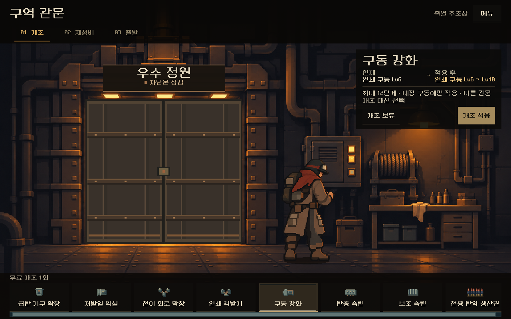
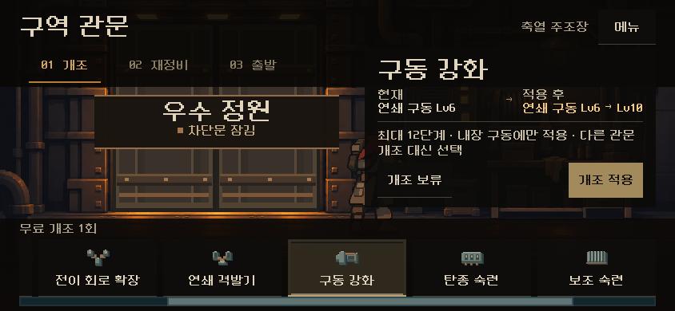
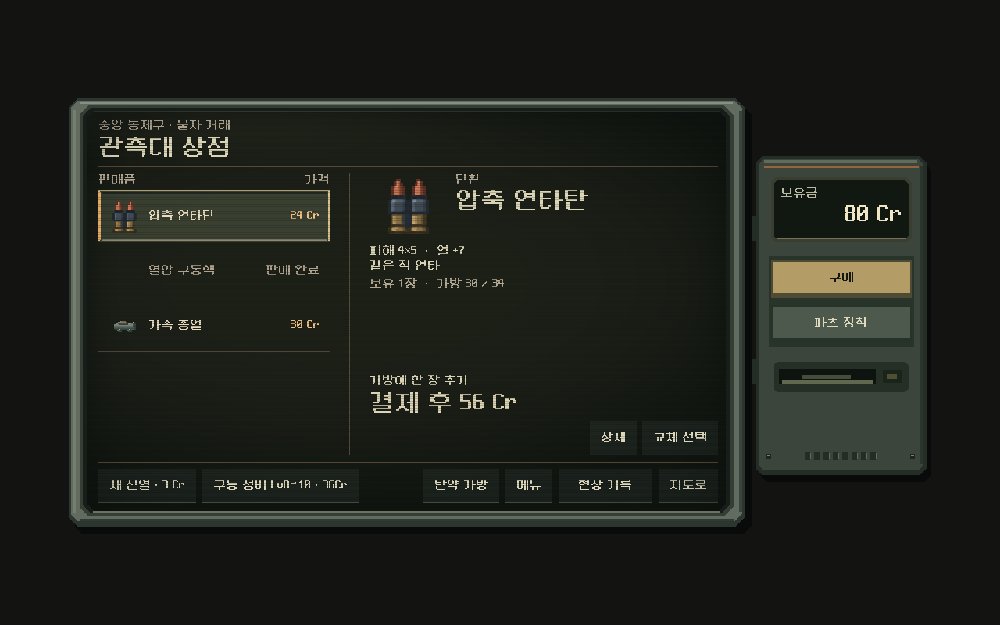
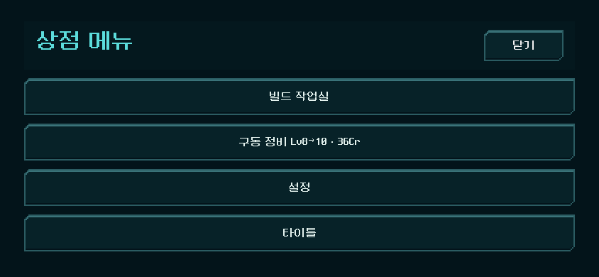

# 탄환·파츠 재정비 — 성장 구조 v2

2026-11-10. 사용자 요청 두 건을 기록한다.
- "전체 탄환과 파츠를 재정비해 줘"
- "1~4까지 진행해 줘"

설계와 결정은 [탄환·파츠 재정비](../../../direction/ammo-parts-v2.md)에 있다. 이 문서는 화면과 변경 파일을 모은다. APK·커밋·푸시는 하지 않았다.

| 화면 | |
| --- | --- |
| 관문: 구동 강화 선택(1280×800) |  |
| 관문(844×390, 선택지 옆으로 넘김) |  |
| 상점: 구동 정비 Lv8→10 · 36Cr(압축 충전 자리) |  |
| 상점(844×390, 메뉴 안 구동 정비) |  |

## 변경 파일

[changes.patch](changes.patch)

| 파일 | 변경 |
| --- | --- |
| `redesign/content.gd` | 보조 숙련 단계(`SUPPORT_MASTERY_STEPS`), 빼내기 한도(`eject_limit`), 예비 급탄기·삼중 시퀀서 v2 문구 |
| `redesign/growth_structure.gd` | 보조 숙련 대상·적용 |
| `redesign/gate_upgrades.gd`, `samples/gate_review/option_icon.gd` | 보조 숙련·구동 강화 선택지, v2에서 옛 상한 확장 제외 |
| `redesign/campaign.gd` | 관문 보조 숙련·구동 강화, 상점 구동 정비(`tune_drive`) |
| `redesign/model.gd` | 빼내기 한도, 리벳 빼낸 탄 뒤로 |
| `redesign/damage_engines.gd`, `core_growth.gd` | 조건 달성 성장 Lv8까지, v2 상한 12 |
| `redesign/magazine_build.gd` | 삼중 시퀀서 v2 4종 |
| `redesign/ammo_discovery.gd` | 획득 판정 v4: 연계탄 재도입 |
| `redesign/attack_boosts.gd` | 강화 저장 상한 16 → 40 |
| `redesign/shop_terminal_live.gd`, `screen.gd` | 구동 정비 버튼과 명령, 리벳 무기 상세 |
| `tests/city_campaign_runner.gd`, `tests/growth_v2_climb.gd`, `tests/growth_structure_rules.gd`, `tests/overhaul_ui.gd` | 명령·정책·검사 |
