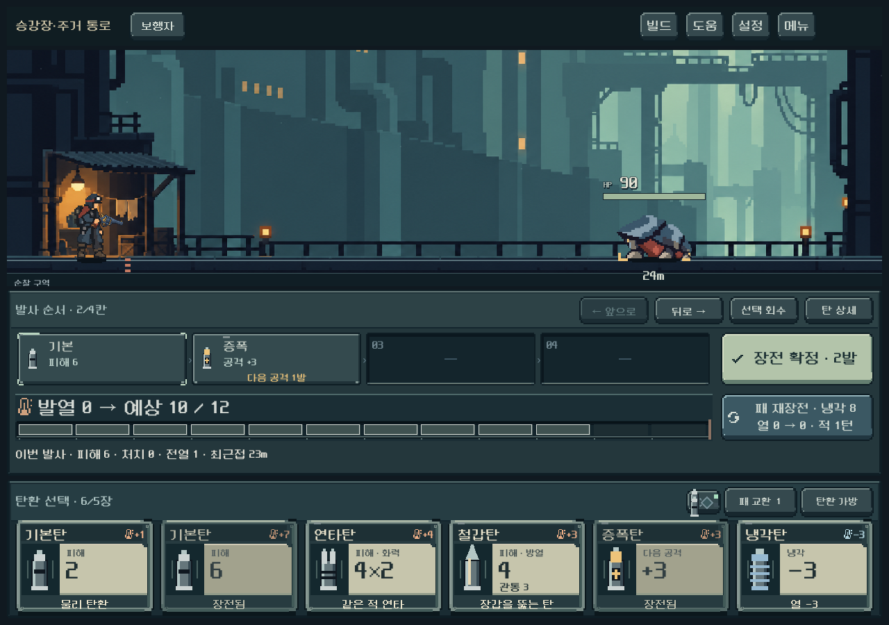
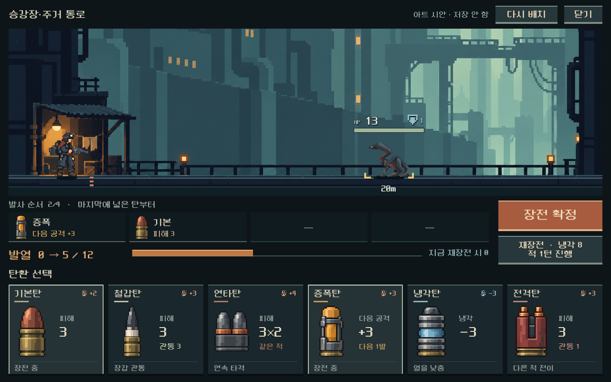
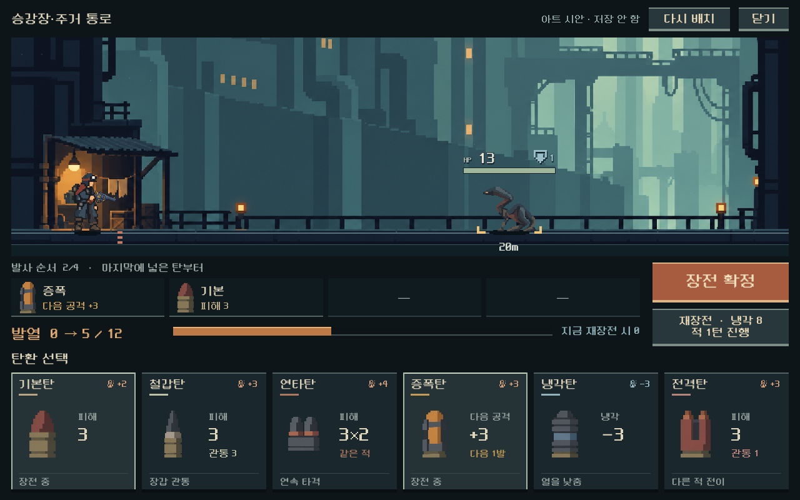
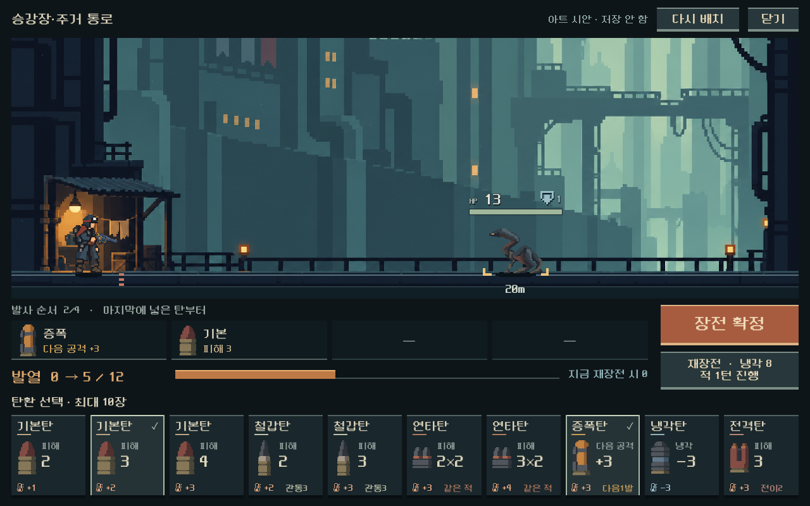

# 탄환 원화와 전투 UI 비교 시안 — 2026-10-17

사용자는 기존 탄환 자체를 다시 디자인하고 싶으며, UI가 여전히 조립된 듯한 인상을 준다고 말했다. 이번 결과는 **디렉터 비교 시안**이다. 본편 UI 교체나 사용자 채택으로 기록하지 않는다.

## 판단과 제작

기존 카드의 작은 금속 막대형 탄환과 반복되는 청회색 프레임이 기능 구분보다 먼저 보였다. 정보 정리와 정렬 개선은 이루어졌으나, 물건 자체의 생김새·재질·비례를 정하는 작업이 부족했다는 판단이다. 익숙해져서 생긴 불만이라고 단정하지 않는다.

- 기본탄: 둔한 구리 탄두와 짧은 황동 탄피.
- 철갑탄: 긴 흑철 관통체와 밝은 절연 고리.
- 연타탄: 하나의 몸체에 묶인 두 탄두.
- 증폭탄: 황토색 코어와 단단한 고정 밴드.
- 냉각탄: 굵은 방열 날개와 탁한 청색 몸체.
- 전격탄: 적갈색 절연체와 두 구리 단자.

승인 주인공·배경을 실제 참조 입력으로 내장 image_gen에 제공했다. 첫 생성 뒤 과한 광택과 주변 광을 줄이는 편집 1회. 원본 PNG를 보존하고 Godot에서 영역만 선택해 그린다. 생성 원본은 고해상도 도트풍 아트이며 엄격한 저해상도 격자/제한 팔레트 자산이라고 주장하지 않는다. [전체 프롬프트·출처·해시](../../art/concepts/ammo-recast-20261017/provenance.json).

카드는 탄환 그림을 키우고 주요 성능과 발열을 분리했다. 탄창은 얕은 홈, 발열은 가로 게이지, 실행은 녹슨 주황색 면으로 시각적 역할을 구분했다. 현재의 캐릭터·배경·적 장면과 같이 놓고 확인했다. 글자와 수치, 클릭 영역은 Godot 컨트롤이다.

## 직접 확인

저장소의 `UI_ART_PREVIEW.cmd` 실행. 탄환 클릭으로 장전, 탄창 칸 클릭으로 회수, 장전 확정→발사, 재장전, 다시 배치가 연결되어 있다. 현재 전투 모델의 위력·발열·냉각·LIFO를 사용한다. 손패에 없는 탄은 비활성으로 표시한다.

본편 `PLAY.cmd`의 탄환 그림과 UI는 이번 작업에서 변경하지 않았다. 새 시안은 고정된 6종/4칸 비교 화면이며, 캠페인 저장과 환경설정을 읽거나 쓰지 않는다. 플레이어 HP·빌드·가방·표적 선택·전체 전투 연출을 포함한 완전한 전투 화면은 아니다. 전체 탄종·압축·개조·10장 손패 등 본편 모든 상태로 확장하려면 기존 기능을 함께 통합해야 한다.

## 실제 화면

아래는 같은 1280×800 출력이지만 상태와 배치가 다른 미감 비교다. 규칙이나 효율의 전후 비교가 아니다.

기존 본편:

새 탄환과 전투 하단 시안:

[좁은 화면](../../art/concepts/ammo-recast-20261017/recast_1008.png) · [긴 화면](../../art/concepts/ammo-recast-20261017/recast_1440.png) · [실제 발사 후](../../art/concepts/ammo-recast-20261017/fired_1280.png)

## 검증과 한계

`powershell -NoProfile -ExecutionPolicy Bypass -File tools/preview_ammo_recast.ps1 -Check`

- 격리 저장 `qa_runtime/ammo_recast`에서 3해상도 실행, 주요 영역 경계/LIFO/실제 확정·발사/장전 예상 발열/발사 후 실제 열 및 캡처 확인. `failures=0`.
- 세 해상도 렌더를 직접 열어 탄환과 수치 간격, 알파 가장자리, 기존 전장과의 대비를 검토했다. 초기 잘못된 기본 전장 참조/예측 열 키/그림과 수치 간격을 한 번의 수정으로 교정한 뒤 재확인했다.
- 에디터 import와 런타임에 GDScript 오류 없음. 기존 Android build-tools 경고는 남아 있으며 이번에 Android export를 실행하지 않았다.
- 검사 입력은 버튼 신호 호출이다. 실제 마우스·Galaxy 터치·장기 플레이 검증과 구분한다. 자동 통과는 미감 만족의 근거가 아니다.

디렉터 판단으로 여섯 탄의 형태와 색면 구분은 이전보다 강해졌다. 버튼·패널의 재질 표현과 전체 HUD 통합은 아직 완성 단계가 아니다. 사용자가 결과에 만족했다고 선기록하지 않는다. 이후 작업은 이 탄환의 시각적 역할을 유지하며 본편의 상태·정보를 복원한 화면에서 카드/행동부 재질을 다듬는 순서다.

## 사용자 피드백 후속 — 크기·명암 v4

사용자는 탄환이 크고 선명하므로 캐릭터·배경 수준의 도트 표현을 요청했다. 카드 그림만 기존 영역 대비0.70 배율로 축소하고 글자·수치·클릭 영역은 유지했다. 작은 탄창 아이콘은 판독성을 위해 표시 영역을 유지하고 같은 새 원화를 사용한다.

내장 image_gen으로 기존 원화와 승인 주인공·배경을 실제 입력했다. 첫 편집의 반사광이 여전히 강해 1회 추가 교정했다. 선택한 `cartridges_v4.png`는 밝은 은색·황동 가장자리, 연속 검은 윤곽, 내부 잘게 나뉜 면을 덜어낸 넓은 색면이다. 블러/사후 색상 필터 없이 원본 PNG를 그대로 등록했다. [전체 프롬프트·참조·해시](../../art/concepts/ammo-recast-20261017/provenance-v4.json).

[이전 시안](../../art/concepts/ammo-recast-20261017/recast_1280.png) · [좁은 화면](../../art/concepts/ammo-recast-20261017/v4_recast_1008.png) · [긴 화면](../../art/concepts/ammo-recast-20261017/v4_recast_1440.png)

기존 격리 시안 러너 3해상도 실패0, 세 캡처 직접 확인. 게임 계산과 본편 화면 변경 없음. `UI_ART_PREVIEW.cmd`에서 수정안을 확인한다. 실제 Galaxy 및 사용자 미감 확인은 후속이다.

## 사용자 피드백 후속 — 최대10장과 카드 밀도

사용자는 카드가 크고 여백이 많으므로 최대10장을 한 화면에서 볼 수 있도록 요청했다. 별도 전투 시안의 손패를10개 독립 Button으로 확장하고 가로 한 줄로 배치했다. 카드 최소 크기112×132, 사이 간격8. 기존192 높이에서132로 약31% 축소하며 남은 높이는 전장이 사용한다. 스크롤/카드 겹침 없이 전체가 보인다.

카드 이름19/주효과28/보조14/발열16의 위계를 사용한다. 기존 반복 설명과 구분선은 제거하고 이름·탄환·주효과·발열·관통/연타/후속 강화/전이 값만 표시한다. 장전 중 표시는 체크로 축약했다. 긴 규칙은 PC 툴팁에서 확인한다. 모바일 상세 열람과 전체 본편 HUD는 여전히 통합 전이다.

새 그림을 다시 생성하지 않았다. 기존v4 원화의 낮은 대비를 유지하고 카드의 그림 영역을31×57로 맞췄다. 시안에서만 기본/철갑/연타의 다른 위력 사본을 포함한10개 고유ID와 가방10장 구성으로 비교한다. 실제 시작 덱이나 가방 성장 규칙 변경이 아니다.

[이전6장](../../art/concepts/ammo-recast-20261017/v4_recast_1280.png) · [1008×630](../../art/concepts/ammo-recast-20261017/ten_recast_1008.png) · [1440×630](../../art/concepts/ammo-recast-20261017/ten_recast_1440.png)

기존 격리 러너를 확장해10장 개별 경계/가로 폭/높이/겹침, 실제10장 가방, 양 끝 카드의 ScreenTouch 주입 장전·회수, LIFO·실제 발사·발열을 검사했다. 세 해상도 실패0. 세 캡처 직접 확인. 실기 Galaxy 검증과 구분한다. 동일 `UI_ART_PREVIEW.cmd`로 실행하며 본편 교체는 아직 아니다.
