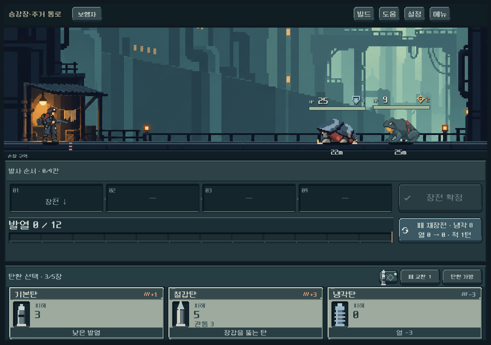
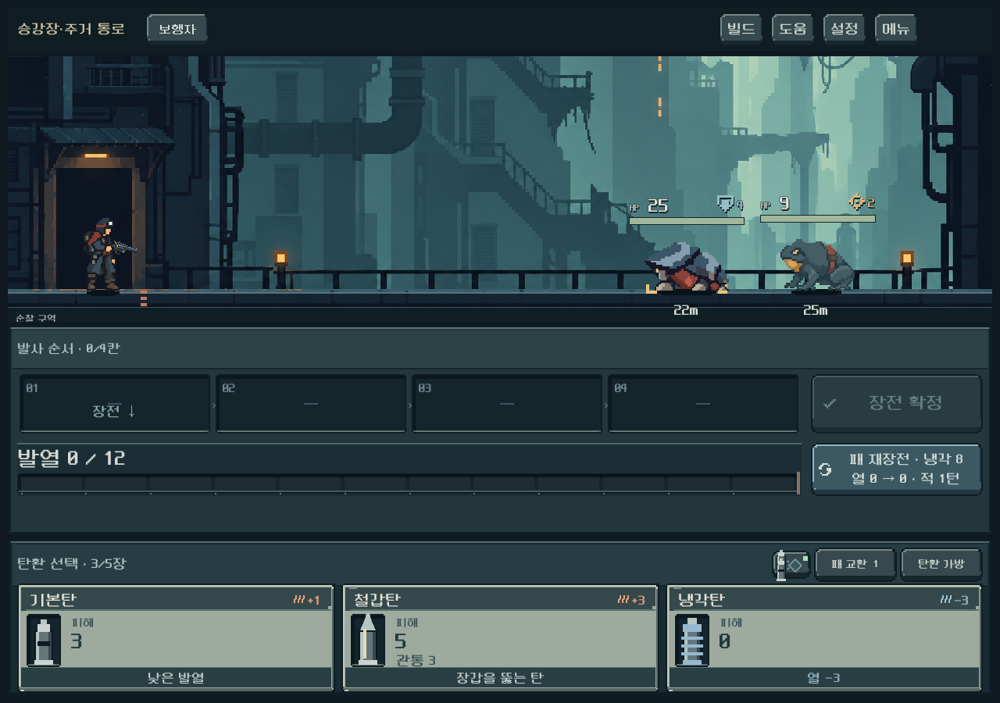
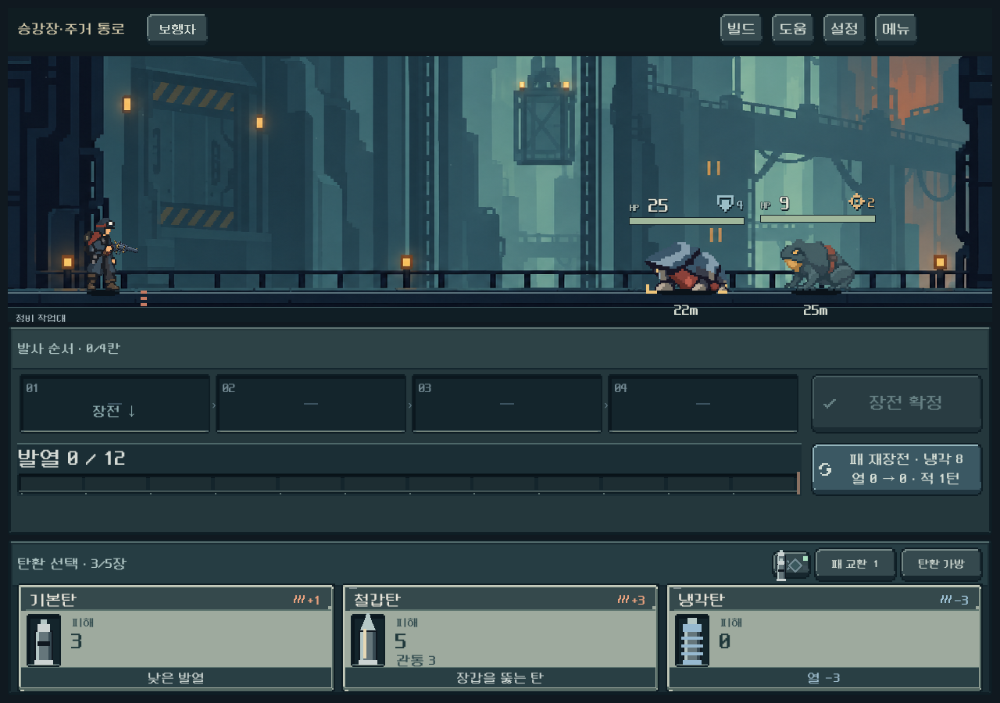

# 구역 내부 배경 전환 — 2026-10-11

## 적용 범위

사용자가 승인한 초반·중반·상층3단계를 첫 구역의 전투에 연결했다. 생활 통로는 기존 승인 원본을 재사용하고, 폐쇄 주거지와 승강 설비는 해당 원본을 직접 참조해 내장 image_gen으로 제작했다. 단순 색조 변경이 아니라 건축물/생활 흔적/승강 장치가 달라진다.

공통 규칙은 현재 노드의 내부 높이와 해당 맵 버전의 구역 길이를 사용한다. 같은 높이에서는 분기·시드·시설 종류와 무관하게 같은 단계다. 맵 구조/길이/전투 수치/저장 버전/RNG는 바꾸지 않았다. 첫 구역8단계에서는1~3/4~6/7~8,12단계 예에서는1~4/5~8/9~12다.

## 실제 화면

세 화면은 같은 배우/거리로 배경만 비교한 QA 장면이다. 실제 플레이는 원래 노드의 적 편성을 따른다. [작은 화면 중반](ascent_background_2026-10-11_assets/stage_1_1008.png) · [가로 화면 상층](ascent_background_2026-10-11_assets/stage_2_1440.png).

## 제작·연결

- `ascent_background.gd`:5구역 공통 단계 선택·배경 등록·지연 로드 캐시. 첫 구역3종이 등록되어 있다.
- `screen.gd`: 캠페인의 현재 노드 높이를 전달한다. 전투 모델의 조우 번호를 사용하지 않는다. 훈련/단독 샘플은 원래 배경을 유지한다.
- 전투 배경에 각 원본의 실제 바닥 높이를 등록했다(기존720, 중반728, 상층772). 이미지가 프롬프트의 요청 좌표에 정확히 맞았다고 가정하지 않았다. 원본 PNG 후처리 없이 Godot에서 접지 기준으로 크롭한다.
- 개발 메뉴에 `구역 배경 · 초반/중반/상층`3개 진입 버튼을 추가했다. 기존 개발 세션의 저장 보호를 따른다.
- [전체 프롬프트·원본/참조 해시](../../../새-게임-프로젝트/assets/art/residential_ascent_20261011/provenance.json).

## 검증

`tools/run_ascent_background_checks.ps1`는 격리 저장에서 경계값8/9/10/12,5구역·두 맵 버전의 분기 일관성, 실제 저장 복원, 전투 화면3해상도, 바닥 정합성·이미지 범위·배치 유지, 모델/RNG 불변, 개발 메뉴 입력을 검사한다. **881검사/실패0**. 발사·재장전 후 재표시에서도 같은 단계의 배경이 유지되는 것을 확인했다. [실행 로그](ascent_background_2026-10-11_assets/checks.log).

화풍·접지·읽기 공간은1280×900/1008×630/1440×630의 실제 캡처에서 확인했다. 사람의 선호·Galaxy 실기기 성능은 후속이다.

## 남은 범위

다른4구역은 단계 계산/등록 구조를 공유하지만 해당 테마의3종 배경은 아직 제작하지 않았다. 등록 전에는 기존 배경을 유지한다. 이번 작업은 전투 배경 대상이며 탐사도·상점 내부 배경 변경을 포함하지 않는다.
