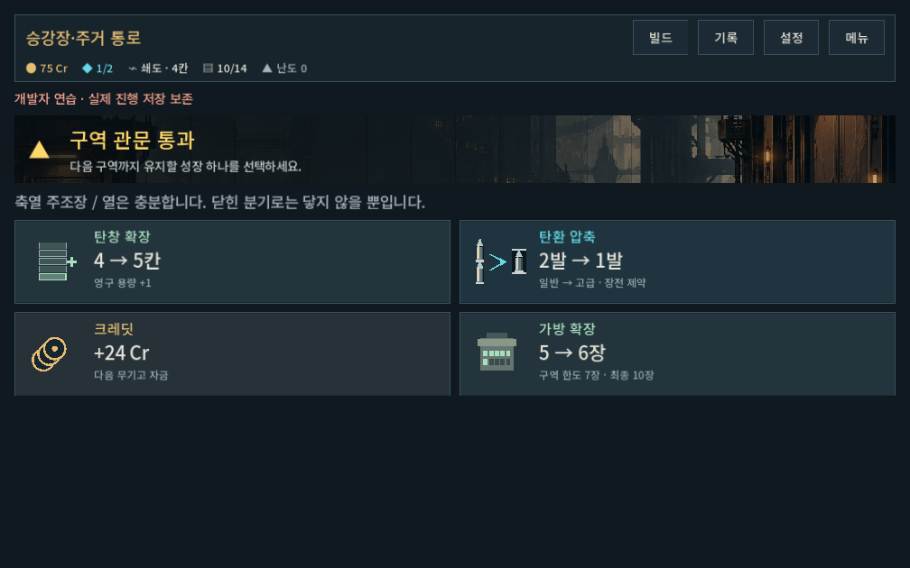

# 기본5장 → 성장 최대10장

2026-10-09. 사용자 확정 범위를 적용했다. [설계·한도·이전 저장](../../direction/outfit-bag.md).

[정비 작업대](bag_growth_2026-10-09_assets/workshop_1008.png) · [구역 한도](bag_growth_2026-10-09_assets/regional_cap_1008.png) · [최대 도달](bag_growth_2026-10-09_assets/maximum_1008.png) · [10장 전투](bag_growth_2026-10-09_assets/ten_cards_1008.png) · [시작 복장](bag_growth_2026-10-09_assets/starting_bags_1008.png)

## 검증

- `run_bag_growth_checks.ps1 -Mode rules`: **756검사/0실패**. 기본5, 정비 한 번 선택·구역/절대 한도·성장치 검증·10장 모델 저장·5총기/3복장·이전 복장6/7/5 저장·버전 불일치 거부. 생성 맵 시드731042에서 정비소 수가 많은 연결 경로로3복장 모두10장 도달과 실제 경로 저장/불러오기 확인. 이 경로 검사는 전투 승리 상태를 테스트에서 공급하므로 실제 난도/승률 검증이 아니다.
- `run_bag_growth_checks.ps1 -Mode ui`: **236검사/0실패**. 실제 Godot1008×630/1280×900/1440×630에서 복장 비교, 정비 선택/기회 소비, 구역 한도 비활성, 관문 선택/지역 전환, 최대10장 비활성, 두 번째 페이지 나머지4종 접근/장전. UI는 격리된 정비/전투 상태를 준비한 후 실제 터치 입력을 사용했다.
- 복장/재장전/과열/저장 회귀 **2030/0**, 성장/상점/저장 회귀 **5189/0**, 파츠 회귀 **2265/0**, 패 순환 회귀 **827/0**.
- 개인 저장과 분리한 APPDATA/LOCALAPPDATA, UI 자동 저장 비활성. 초기 지역만 강제로 바꾼 불완전 저장 테스트를 실제 연결 경로 저장으로 교체해 복귀를 검증했다.
- 작은 화면의 정비·관문·10장 전투를 직접 확인했다. 관문은2×2로 변경하고 정비 문구를 줄여 좁은4열에서 한 글자만 줄바꿈되는 현상을 줄였다. 가방 기호는 직접 작성한 CanvasItem 도형이며 이미지 생성/외부 원본은 없다.

## 범위와 다음 관찰

정비/관문에 투자해 가방을 키우는 성장 시스템이며 실제 주인공 복장 스프라이트나 복장 획득 전용 상점은 추가하지 않았다. 시작 기본5/최대10은 사용자 결정, 운반6/정찰4·교환0/2·구역 한도·투자 비용은 디렉터 첫 적용값이다. 후반 정찰복 우위와 압축/탄창보다 가방 선택이 필수가 되는지는 후속 플레이에서 확인한다. Galaxy 실기기/사람 체감/전체 등반 실전 균형은 미검증. APK/커밋/푸시 없음.

실행: `PLAY.cmd` → 새 등반 준비. 빠른 관문 확인은 개발→관문. 구버전 이어하기는 기존 패를 보존한다.
