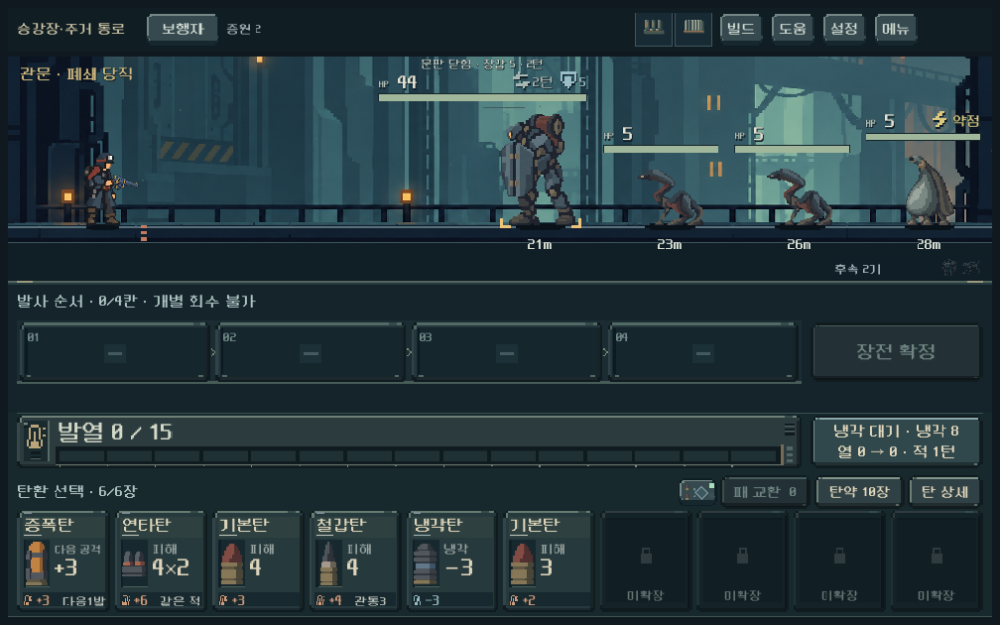
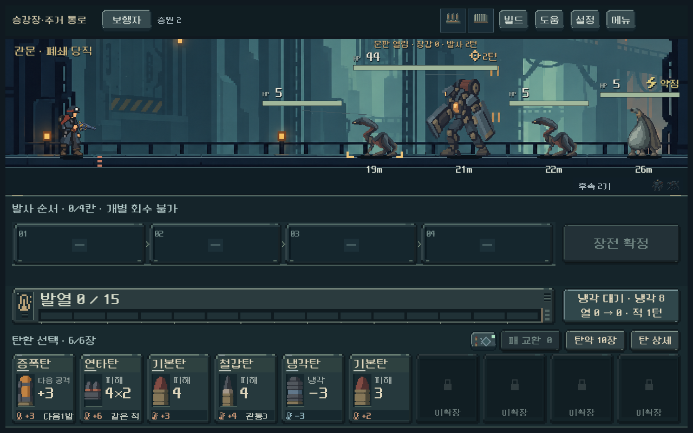

# 폐쇄 당직 문판 장갑 상향 — 2026-10-21

사용자가 보스의 장갑 상향을 요청했다. 실제 피해 계산으로 닫힘 장갑2/4/5/6을 비교한 뒤 **5**를 선택했다. 열린 상태0, HP44, 주기, 호위 구성, 압력탄과 최소 타격 피해 규칙은 유지했다. 정확한5라는 수치는 디렉터 결정이며 사람 체감 승인을 의미하지 않는다.

## 비교 근거

다음은 파츠 없는 보행자, 같은 카드·초기 열0, 보스 본체만 둔 실제 모델의 직접 피해다. 증폭→연타는 위력2 연타, 철갑/기본은 위력3을 사용했다. 발사 순서 기준이며 장전은 역순이다.

| 사격 | 닫힘2 | 닫힘4 | 닫힘5 | 닫힘6 | 열림0 |
| --- | ---: | ---: | ---: | ---: | ---: |
| 기본탄 위력3 | 2 | 1 | 1 | 1 | 4 |
| 철갑탄 위력3 | 4 | 3 | 2 | 1 | 4 |
| 증폭→연타 위력2 | 8 | 4 | 2 | 2 | 12 |

장갑5는 준비된 연타를 열린 때 사용하도록 유도하면서 비교한 철갑탄의 관통 이점도 남긴다. 6은 이 조건의 철갑탄도 최소 피해1에 도달해 5보다 더 올릴 이유가 약하다. 일반 파쇄는 문판을5→2로 낮추며 추가 파쇄로0까지 낮출 수 있다. 소이탄 화상은 장갑과 무관하게 계속 작동한다. 화상 빌드가 닫힘을 우회하는 것은 의도한 대안이다.

5총기×7탄창 구성×4장갑×닫힘/열림의280조건을 실제 모델/예측/저장 검사로 비교했다. 단발 증강은 필요한 후속 사격을 실행했으며 그 사이 턴 변화가 있다. 위 표는 같은 한 번의 연쇄 사격인 보행자만 제시한다.

## 본편 편성 비교

기존 유한 탄약 검사의 시작 기본탄20장+확보탄6장, 성장 코어2단계+방열 파츠, 손패6장 조건을 사용했다. 호위·대기 증원·압력탄·발열·재장전·최근 개별 회수 금지까지 실제 규칙으로 진행했다.

- 장갑2와5 각각5총기×2시드: 총20조건 모두 제한 탐색에서 클리어 경로 발견.
- 장갑5의 종료까지 사용 탄7~20장, 남은 탄6~19장, 적 생존 중 관찰한 최소 거리9~18m.
- 쇄도·산개·증강은 일부 조건에서 탄약/행동 소모가 증가했다. 압쇄의 화상 중심 경로는 같은 소모로 돌파했다.
- 이 탐색은 미래 패/RNG를 알고 준비된 빌드를 사용한다. 사람 승률이나 기본탄만 가진 덱의 성공을 의미하지 않는다. 장갑 상향으로 선택이 더 재미있어졌는지는 별도 사람 검증 대상이다.

[전체 조건·피해·경로 요약](assets/boss_armor_2026-10-21/comparison.json).

## 적용과 저장

`residential_challenges.gd`의 문판 장갑 단일 상수를5로 바꿨다. 새로 진입하는 편성5 폐쇄 당직과 개발 미리보기에 적용된다. 진행 중 전투의 저장 장갑2 또는 파쇄 후 남은 장갑은 변경하지 않는다. 기존 편성1~4와 다른 지역은 유지한다.

기존 전장 문판 예고와 장갑 아이콘은 실제5를 자동 반영한다. 적 상세에는 실제 남은 문판 장갑과 파쇄 후 장갑이 회복되지 않는다는 설명을 추가했다.

## 검증 결과

Godot4.7, `qa_runtime/elite_boss`의 격리 APPDATA/LOCALAPPDATA 사용.

| 검사 | 통과 / 실패 |
| --- | ---: |
| 장갑 비교·유한 탄약 돌파 경로 | 3,207 / 0 |
| 정예/보스 규칙·예측·저장·장갑 개폐·파쇄 | 332 / 0 |
| 실제 UI 1008×630 / 1280×800 / 1440×630 | 1,917 / 0 |

총5,456검사 실패0. [비교 로그](assets/boss_armor_2026-10-21/comparison.log) · [규칙 로그](assets/boss_armor_2026-10-21/rules.log) · [UI 로그](assets/boss_armor_2026-10-21/ui.log). `git diff --check` 통과.

실제 렌더의 상태 문구와 장갑 아이콘을 확인했다. 개발 미리보기의 준비된 패를 사용한 장면이다. 사용자 저장/기존 미커밋 변경을 보존했다. 사람 체감·Galaxy는 미검증이며 APK/커밋/푸시는 수행하지 않았다.
