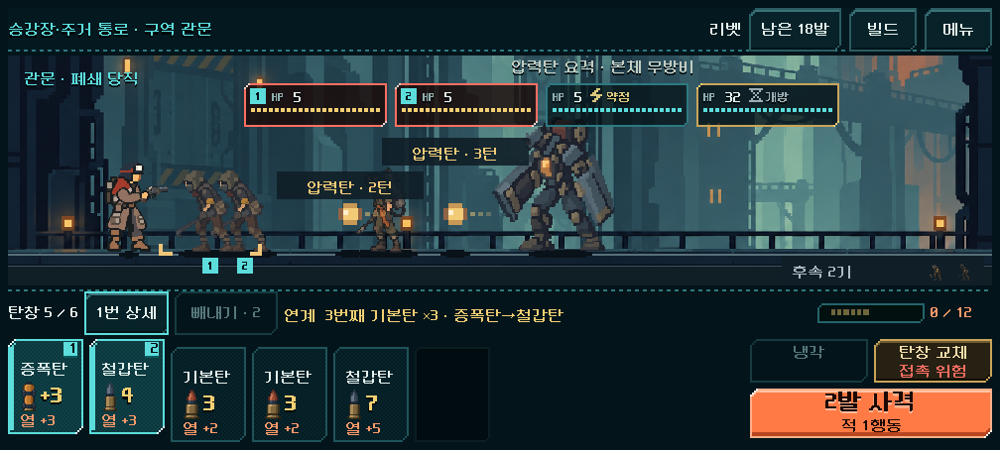

# 보스 스킬 다양화1차 — 연속 압력탄·증원 호출

[현행 결정과 대응 규칙](../../../direction/leader-patterns.md). 사용자 요청에 따라 첫 보스 폐쇄 당직의2연발, 수로의 어미의 증원 호출을 새 도전에 연결했다. 앞 단계의 주조 감독 돌진/반격 창은 유지한다. 이번은 디렉터1차 적용값이며 사람의 재미·최종 균형 확정은 아니다.

## 본편 동작

- 폐쇄 당직: 방어2행동→개방 준비2행동→한 적 행동 간격 압력탄2발. 각각 HP1·속도6m·생성 행동 이동0·독립 식별/요격이며 둘이 모두 사라진 뒤 열린 채2행동 회복한다. 첫 발 이후 다음 발사를 예고한다. 차단으로 다음 발사를 늦추고, 본체를 처치하면 아직 발사하지 않은 탄을 취소한다. 이미 발사된 탄은 남는다.
- 수로의 어미: 호출3행동을 예고한 뒤 기존 대기 돌진형2기를 빈 전열에 부른다. 도약/회복은 함께 진행하며 차단으로 호출을 늦출 수 있다. 전투당1회·전체7기·생존4기 제한과 생성 행동 이동0을 유지한다. 빈칸이 없으면 호출된 적은 대기한다. 보스가 먼저 죽어도 남은2기는 원래 대기 적처럼 등장해 전투 완료를 막지 않는다.
- 증원1차는 총물량 추가 대신 기존2기의 등장 시점을 보스 행동으로 바꾼 비교다. 본체 HP/장갑·총기/탄환/파츠·경제·입력/큰 배치를 바꾸지 않았다. 새 `boss_skills_version=1` 저장만 새 행동을 사용하며, 기존 저장은 단발/자동 증원을 유지한다.

## 기능·본편 화면·저장

| 검사 | 결과 | 확인 범위 |
|---|---:|---|
| 새 스킬 규칙 | 228검사 실패0 | 두 탄의 독립 UID/이동·5총기 실제 요격/예측·실제 요격→차단/처치 순서·본체 화상 선처치/잔탄 유지·회복·버전/불량 저장·유한 호출/잠금·빈칸/생존 상한·호출 중 저장 |
| 본편 UI | 213검사 실패0 | 실제 획득 상태,1280×800/1008×454/2340×1080, 공개 재장전·범위 선택·사격·냉각·상세·독립 탄 표시/표시 겹침·증원 등장·자동 저장/재개 |
| 앞 단계 반격 창 | 296검사 실패0 | 금형 파수꾼/주조 감독·파쇄·구규칙/저장·실제 예측/사격 회귀 |
| 기존 밸런스 규칙 | 320검사 실패0 | 기존 지속 피해/코어·파츠/예측 캐시·구형 저장 |
| 기존 HUD | 11,558검사 실패0 | 기존 화면 구조·조작·빼내기·사격/표시·저장 회귀 |
| 최종 저장 호환 감사 | 185상태 실패0 | 실제6경로의179전투 시작 상태+6종료 원자 저장을 최종 검증기로 복원 |
| 최종 첫 보스 재생 | 50검사 실패0 | 차단 누락 수정 후6실제 획득 상태에서 원래 명령을 재생, 모든 영수증이 전체 경로 기록과 정확히 일치 |

[규칙](runs/rules_accepted/rules.json) · [UI](runs/ui_final/ui.json) · [185상태 복원](runs/restore_complete/restore.json) · [최종 재생](runs/replay_verified/replay.json) · [소스 해시](source_manifest.json). 동시 탄은 최대2개로 제한하고 일반 사수/이전 저장은1개 제한을 유지한다. 중복 UID·앞뒤로 어긋난 발사 일련번호·미선언 버전·3개 탄을 거부한다. 마지막 검증기 강화는 실제185상태 복원과 새 규칙 검사로 확인했다. 추가 차단 대상 수정은 실제 명령 조합과6경로의 정확한 영수증 재생으로 확인했다.

실제 Godot 캡처를 열어 두 탄·각 도달 경고의 분리, 작은 화면 표시와 호출 예고/증원 등장, 상세 가독성을 확인했다. S26비율은 PC 렌더이며 Android 실기기가 아니다. 제거한 HP 아래 ‘다음’ 안내는 다시 추가하지 않았다. 두 탄의 안내가 겹칠 때 해당 안내의 높이를 나누며 전체 HUD 배치는 유지했다.

[다음 발사 예고](salvo_first_1280x800.png) · [두 탄/PC](salvo_two_1280x800.png) · [2연발 상세](salvo_detail_1280x800.png) · [호출 예고](call_warning_1280x800.png) · [증원 등장/S26비율](call_arrived_2340x1080.png).

## 실제 획득 전체 경로

실제 Campaign의 시작·획득·상점·정비·성장과 합법 명령/저장 재개를 사용했다. 시드17 운반용5총기를 확인하고 리액터는 정예 선호 경로/열압, 추가로 시드731042 정찰/소이 노심 선호를 확인했다.

**6개 완주 경로·179전투·15,805검사 실패0**. [집계](summary.json), [획득 덱/파츠·명령·경제·최종 원자 저장](runs/). 별도 강화 국소 비교와 초기 표시 영수증 보완 전 실행을179전투에 중복 합산하지 않았다. 미래 드로/난수를 볼 수 있는 기존 유한 탐색으로 확인한 완주 가능성 증거이며 사람 승률·최적해 증명이 아니다.

| 경로 | 전투 수 | 첫 보스 행동/잔탄 | 수로의 어미 행동/잔탄 | 전체 비상 보급 |
|---|---:|---|---|---:|
| 리벳17 | 30 | 8/10 | 5/15 | 0 |
| 래칫17 | 30 | 7/18 | 8/20 | 0 |
| 스플린터17 | 30 | 12/13 | 6/19 | 0 |
| 리액터·열압17 정예 선호 | 31 | 19/10 | 11/13 | 0 |
| 스파이크17 | 30 | 6/13 | 7/19 | 0 |
| 리액터·소이 노심731042 정찰 | 28 | 19/9 | 10/12 | 2 |

[실제 저장에서 다시 읽은 보스 사건](committed_boss_events.json). 첫 보스의6사례 중4사례에서 동시2발이 나타났고, 나머지2사례는 발사 전에 처치했다. 수로의 어미는4사례에서 실제 호출 뒤2기가 투입됐고2사례는 호출 전 보스 처치 후 남은 대기 적이 등장했다. 완성 화력 조합이 패턴 전에 처치하는 것을 막기 위한 무적 국면/피해 상한을 추가하지 않았다.

## 같은 상태의 스킬 전후 비교

앞 단계에서 실제로 획득한6경로의 첫 보스/수로의 어미 시작12상태를 복제했다. 덱·파츠·발열·적 구성·드로/표적 난수를 유지하고 이전/새 스킬×3정책으로 **72개 국소 전투**를 비교했다. [명령·발사/동시 탄·요격·호출·턴/잔탄·패배 원문](runs/paired_verified/probe.json).

| 보스 | 정책 | 이전 통과/6 | 새 통과/6 |
|---|---|---:|---:|
| 폐쇄 당직 | 최대 사격/빈 탄창 교체 | 3 | 3 |
| 폐쇄 당직 | 공개 고열 냉각/나머지1발 사격 | 3 | 2 |
| 폐쇄 당직 | 미래 난수/드로를 아는 유한 탐색 | 6 | 6 |
| 수로의 어미 | 최대 사격/빈 탄창 교체 | 4 | 4 |
| 수로의 어미 | 공개 고열 냉각/나머지1발 사격 | 3 | 3 |
| 수로의 어미 | 미래 난수/드로를 아는 유한 탐색 | 6 | 6 |

공개 정책은 예비 드로·미래 난수를 읽지 않는다. 표는 같은 상태의 국소 운용 결과이며 자동 정책 전체 여정/사람 숙련도나 승률이 아니다. 요격을 위한 탄/발열과 가까운 호위·지원탄 순서를 함께 다뤄야 한다. 증원 총수가 같아도 호출 전후 표적/처치/성장/난수 진행이 달라지므로 전체 차이를 호출의 단독 인과 효과로 단정하지 않는다. `reserved_deployed`는 보스가 먼저 죽어 일반 투입된 예약 적도 포함하며, 실제 호출 횟수와 구분한다.

현재 범위에 합법적 대응과 실제2연발/호출이 있고6전체 경로가 통과해1차값을 유지한다. 단순 사격 통과율을 낮추거나 모든 빌드에 모든 패턴을 보게 하는 것이 성공 기준은 아니다. 사람의 예고 이해/요격 부담·증원 체감·정찰의 후반 탄 소모/긴 전투·Android·어센션/모든 시드·다른 보스 후속은 미확정이다.

## 발견과 미검증

- 최초 UI 검사3건은 실제 획득 탄창의 선두가 지원탄이고 호위가 탄보다 가까울 수 있는데도 ‘1발 사격은 선두 압력탄을 반드시 요격한다’고 가정해 실패했다. 실제 명령과 기대 Model 전체 상태는 일치했다. [초기 결과/출력](diagnostics/initial_ui_ui.json). 본편 검사는 실제2발 대응과 예측/자동 저장 일치로 수정했고, 요격 자체는 지원탄/호위가 없는 명시적 픽스처에서5총기 실제 명령으로 검증했다. 제품을 바꿔 잘못된 가정을 통과시키지 않았다.
- 실제‘첫 탄 요격→차단탄으로 본체 타격’ 명령을 추가 검증하면서, 새 `burst` 상태가 차단 대상에서 빠져 있던 제품 누락을 발견해 수정했다. 실제2발 명령이 두 번째 발사를 늦추고 소모 후 재개하는 것을 확인했다. 같은 행동에서 요격 후 본체 처치로 남은 발사를 취소하는 경로도 통과했다. [수정 전2실패](diagnostics/rules_complete_rules.json). 수정 후 남았던1실패는1행동 차단이 해당 적 행동에서 이미 소모됐는데 잔여값>0을 기대한 검사 오류였다. [중간 결과](diagnostics/rules_verified_rules.json). 잔여값 대신 보류된 발사와 다음 재개를 검사해228검사 통과했다. 전체6경로의 첫 보스 기록50검사·원문 영수증 일치와72국소 비교도 최종 코드로 다시 확인했다.
- 오래된 압력탄 규칙 스위트도 실행했지만 제거된 `reload_heat` 필드를 참조해 중단됐다. [원문](diagnostics/ranged_rules_runner.stderr.log). **이 스위트 전체를 통과로 처리하지 않았다.** 현행 단발/다중 탄·요격·예측·구형 저장의 확인 범위는 위 새 스킬/앞 단계/HUD 검사로 명시하며, 구형 스위트 전체의 현대화는 남는다.
- 실제 Android 장치·장시간 발열/성능·사람이 느끼는 다양성과 긴장감은 이번 PC/자동 검증으로 통과 판정하지 않는다. APK·커밋·푸시·외부 게시 없음.

실행은 `tools/run_boss_skills.ps1 -Mode rules`, `-Mode ui`, `-Mode probe`, `-Mode restore`다. 전체 경로는 `-Mode climb -Gun heavy -Route elite` 또는 `-Gun heavy -Seed 731042 -Outfit scout -Core inferno`를 사용한다. 모든 실행 저장은 전용 `qa_runtime/boss_skills_20261106/`에 격리한다. 본편은 `PLAY.cmd`에서 새 도전을 시작하면 새 스킬을 사용한다.
