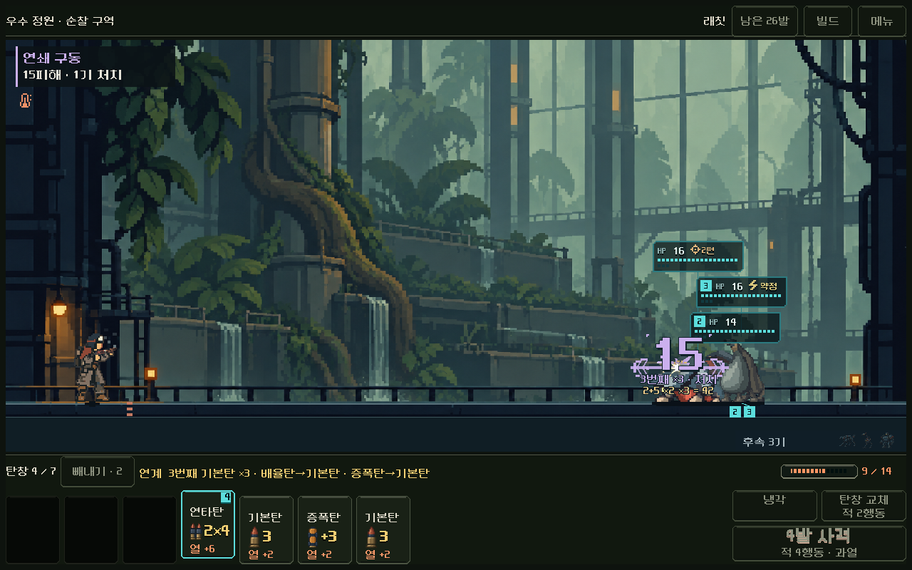
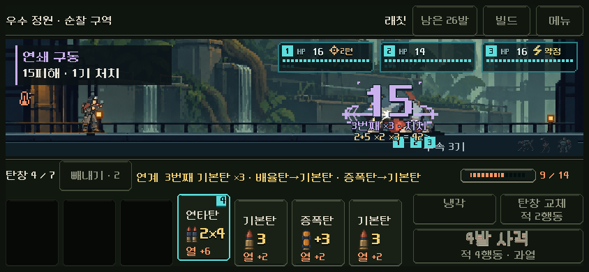
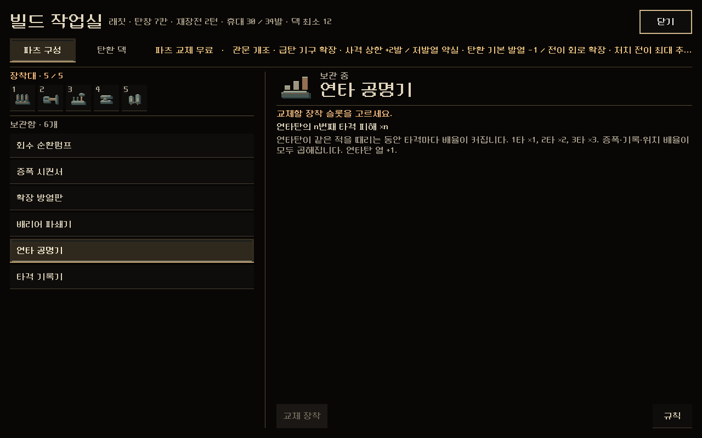
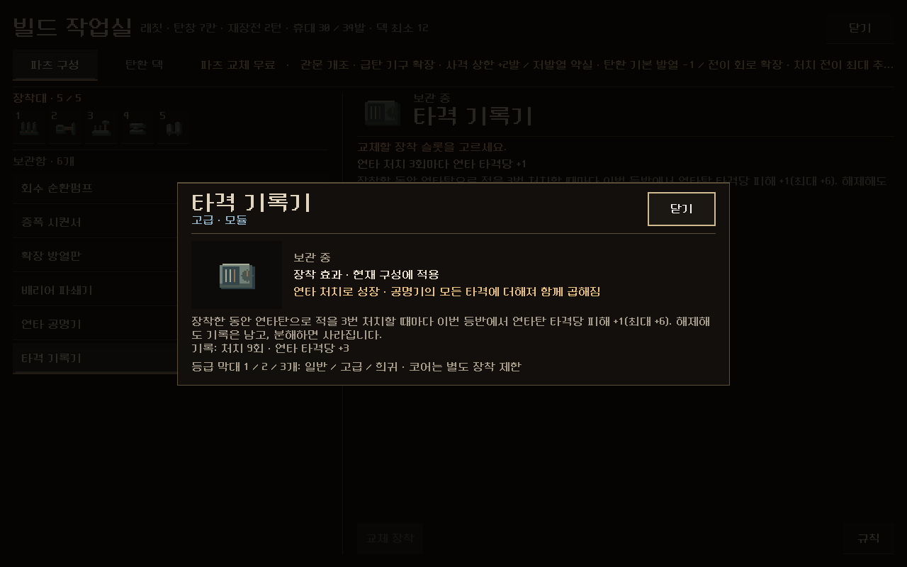

# 빌드 엔진 시험 — 연타·결정타

2026-11-08. 사용자 요청: 빌드·성장 분석에 "내용에 동의하고, 진행해 줘". 설계 원본은 [빌드 엔진](../../../direction/build-engine.md)이다. 이 문서는 구현과 검증 기록이다. APK·커밋·푸시는 하지 않았다.

## 한 일

1. **빌드 3종 설계**: 연타·결정타, 소이·확산, 감속·후속타. 각각 코어 + 배율 + 규칙 변경 + 성장형 파츠로 구성했다. 표는 방향 문서에 있다.
2. **연타·결정타 시험 적용**: 11-08 이후 시작한 새 등반에만 적용한다.
   - **연타 공명기**: 연타의 n번째 타격이 ×n. 연타탄 열 +1.
   - **타격 기록기**: 장착 중 연타로 3번 처치할 때마다 연타 타격당 +1, 최대 +6. 분해하면 기록이 사라진다.
   - 주력이 연타인 등반의 상점·정예 보상에서 제시된다. 이전 저장은 제시도 규칙도 그대로다.
3. **피해 계산 줄**: 전투에서 피해 숫자 아래에 `기본+가산 ×배율 = 합계`가 금색으로 나온다. 합계는 장갑 전 값이라 넘친 피해도 보인다. 발사 결과의 기존 계산 기록으로 만들어 저장에는 아무것도 추가하지 않는다.

| 화면 | |
| --- | --- |
| 실제 래칫 전투의 계산 줄(1280×800) |  |
| 844×390 |  |
| 빌드 작업실 · 연타 공명기 |  |
| 타격 기록기 상세(9처치 · +3) |  |

화면의 줄 `2+5 ×2 ×3 = 42`: 기본탄 2에 증폭 등 +5, 배율탄 ×2, 제3 격발기 ×3으로 계산값은 42다. 적의 남은 HP가 15라 큰 숫자는 15다.

## 수치

통제 계산(래칫, 장갑 0인 표적): 증폭을 받은 연타가 세 번째 발일 때 한 발 피해.

| 기존 최선(구동핵+복열+제3 격발기) | + 공명기 | + 기록기 +3 | + 기록기 +6 |
| ---: | ---: | ---: | ---: |
| 84 | 210 | 300 | 390 |

실제 전투(11-06 래칫 자동 등반, 3~5구역 6전투, 탐색 최선 / 계속 사격, 턴):

| 전투 | 기록 파츠 | 시험 구성 |
| --- | --- | --- |
| 3구역 일반 | 17 / 17 | 8 / 12 |
| 3구역 | 8 / 패배 | 7 / 8 |
| 4구역 정예 | 11 / 12 | 11 / 12 |
| 4구역 | 16 / 16 | 10 / 13 |
| 5구역 | 13 / 18 | 12 / 12 |
| 5구역 관문 | 20 / 26 | 17 / 18 |

순서를 맞춘 플레이가 계속 사격보다 확실히 나아지는 전투가 생겼다(3구역 8 대 12, 4구역 10 대 13). 기록 파츠에서는 둘이 같았다. 자동 플레이 결과라 사람의 체감은 별도로 확인해야 한다.

## 검증

- `tests/build_engine_rules.gd` **25검사 통과**
  - 공명기 배율(n번째 타격 ×n, 증폭·제3 격발기와 곱해짐, 단타 탄에는 무효)과 열 +1
  - 기록(연타 처치만, 장착 중에만, 3처치당 +1, 해제 중에는 무효, 분해 시 소멸)
  - 저장 왕복과 잘못된 기록·플래그 거부
  - 이전 등반 무효
  - 제시(연타 등반 48회 중 16회, 이전 등반 0회)
  - 계산 줄(장갑 0일 때 합계 = 실제 피해)
- `tests/build_engine_ui.gd` **13검사 통과**: 실제 래칫 전투에서 사격해 계산 줄이 뜨는 프레임을 1280×800·844×390에서 캡처. 빌드 작업실 보관함의 새 파츠와 기록기 상세의 기록 표시.
- `tests/build_engine_fights.gd`: 위 실제 전투 비교. 원자료는 `qa_runtime/build_engine_20261108/fights/build_engine_fights.json`.
- 회귀:
  - `tools/run_current_ui_checks.ps1`: 현재 UI 검사 18종 통과(두 새 검사도 목록에 추가해 20종).
  - 규칙: `focus_build_rules` 643, `build_roles_rules` 3048, `damage_engines_rules_runner` 657 통과.
  - `magazine_build_rules`는 64개 중 1개 실패(후미 점화기 비인접 증폭)인데, 변경 전 파일로 되돌려 실행해도 같은 실패다.

## 실수와 정정

- 처음에는 계산 줄 자료를 발사 결과에 새로 넣었다. 그러자 전투 기록이 달라져 '이전 규칙과 완전히 같은지' 보는 `build_roles_rules` 24개가 실패했다. 저장에는 아무것도 추가하지 않고 기존 계산 기록에서 만드는 방식으로 바꿔 다시 통과시켰다.
- 첫 화면에서 계산 줄이 작고(14) 흐렸으며 합계가 없었다. 16으로 키우고 `= 합계`를 붙였다.
- 기록기 상세에 '특정 탄종 없이 적용'이라는 기본 문구가 나왔다. 연타용이라는 연결 문구를 넣었다.
- 분석 답변에서 '성장형 파츠가 없다'고 했는데, 코어 3종은 이미 승리마다 성장한다. 일반 파츠에 없다는 뜻으로 정정했다.

## 남은 것

- 사람 플레이 확인: 계산 줄을 이해하는지, 공명기를 맞추려고 순서를 고민하게 되는지, 너무 쉬워지지 않는지.
- 다음 빌드 2종(소이·확산, 감속·후속타) 구현.
- 덱이 묽다(5구역에서도 기본탄 16장). 휴대 상한이나 기본탄 정리 수단을 검토한다.
- 전투가 짧아지므로 4~5구역 적을 다시 맞춰야 한다.
- 실기기 미확인.

## 변경 파일

[changes.patch](changes.patch)

| 파일 | 변경 |
| --- | --- |
| `redesign/build_engine.gd` | 새 파일. 시험 플래그, 공명기·기록기 규칙, 기록 저장 검증 |
| `redesign/model.gd` | 기록기 가산, 공명기 타격 배율, 처치 기록, 저장 검증 |
| `redesign/content.gd` | 두 파츠 정의, 공명기 열 +1, 기록기 상세의 기록 표시 |
| `redesign/campaign.gd` | 새 등반에 플래그, 분해 시 기록 삭제 |
| `redesign/campaign_content.gd`, `build_choices.gd`, `ammo_discovery.gd`, `build_guide.gd` | 제시 범위(새 등반만, 연타 주력), 분류·연결 문구 |
| `redesign/part_icon_art.gd`, `part_card_view.gd` | 두 파츠 아이콘 |
| `redesign/damage_readout.gd`, `battle_view.gd` | 계산 줄 생성·표시 |
| `tests/build_engine_*.gd` | 새 검사 3개 |
| `tools/run_current_ui_checks.ps1`, `docs/qa/ui-test-suites.md` | 현재 검사 목록에 두 검사 추가 |
