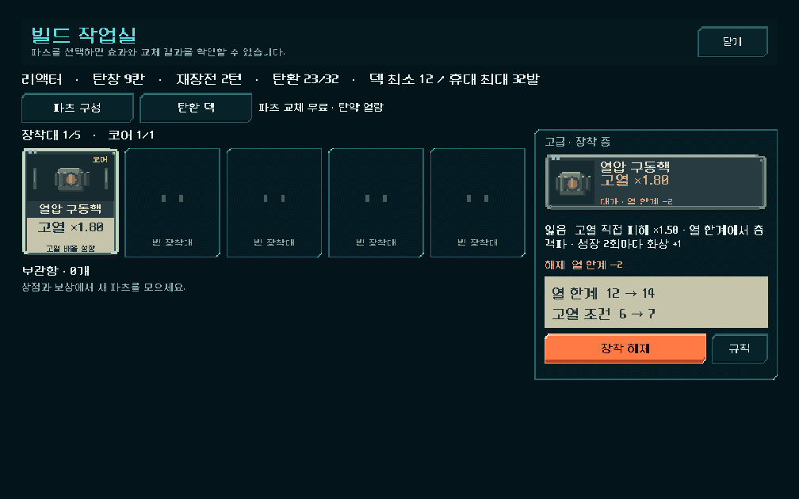
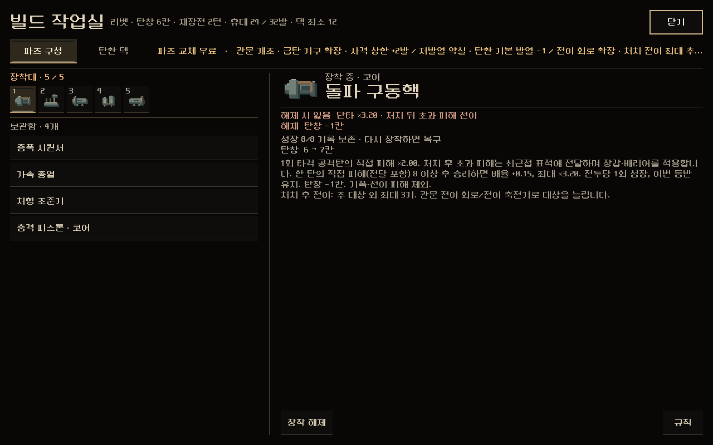
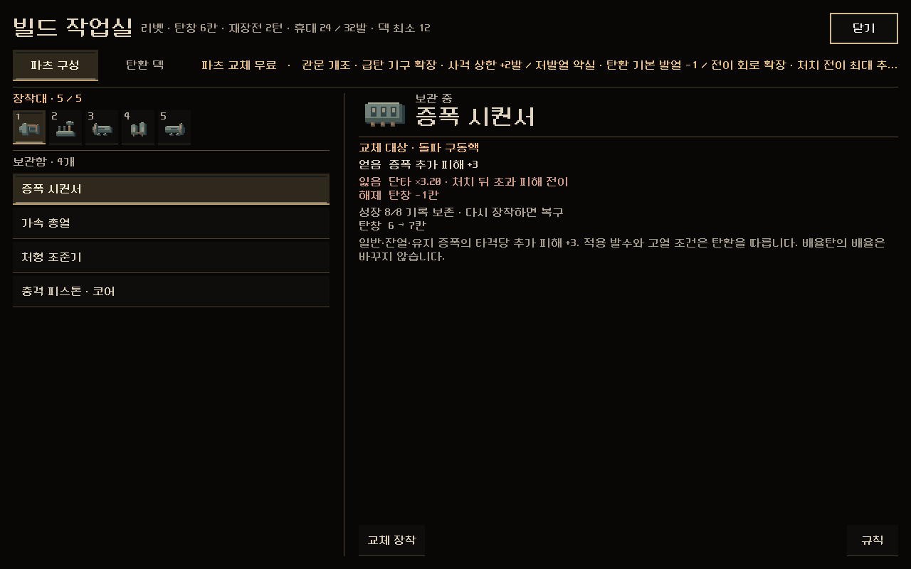
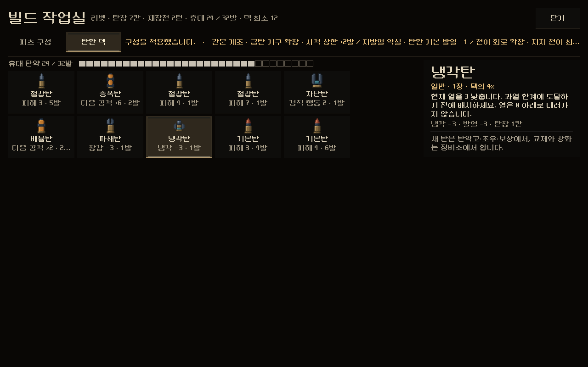
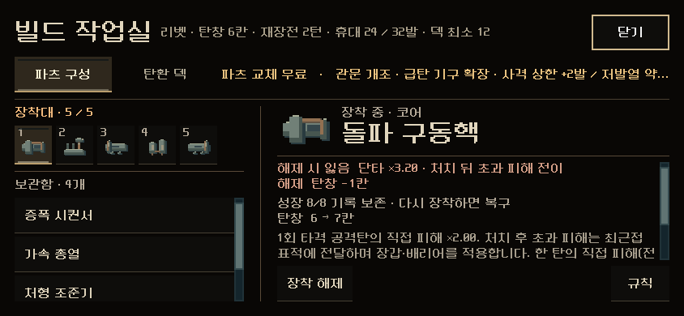
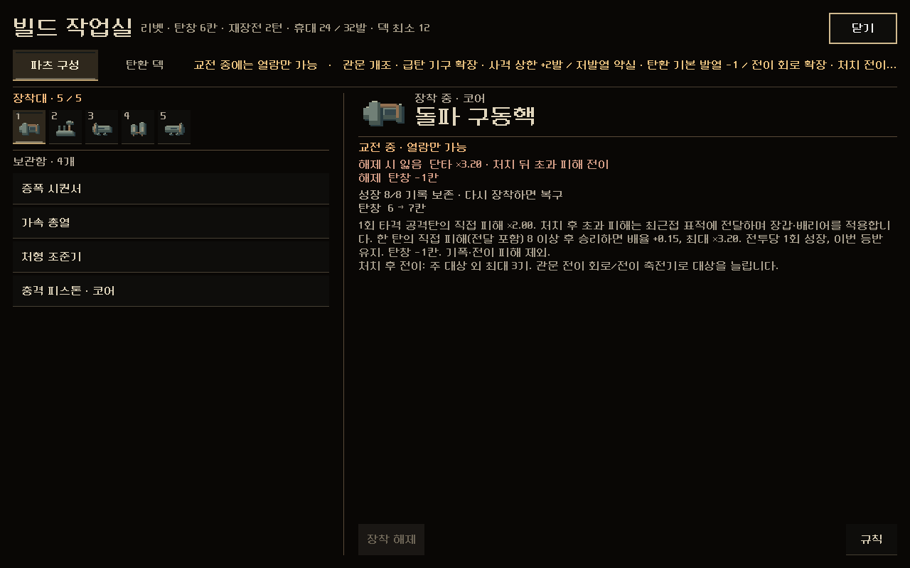

# 빌드 작업실 — 승인된 구성으로 통일

2026-11-08. 사용자 요청: "작업 진행해 줘." 빌드 작업실은 11월 3일 글자 크기 점검 외에는 개편한 적이 없었다. 새 디자인을 만들지 않고, **이미 승인된 구성을 가져와 맞췄다.** 본편에 바로 적용했다. APK·커밋·푸시는 하지 않았다.

## 무엇이 바뀌었나

열리는 곳은 그대로다. 지도의 `빌드`, 탄약고·조우·관문·정비소의 `메뉴 → 내 빌드`, 상점의 `빌드 작업실`, 보상 화면의 `빌드`에서 열린다. 안의 화면만 바뀌었다.

| 이전 | 이후 |
| --- | --- |
|  |  |

- **파츠 구성 탭**: 상점 단말의 파츠 장착 부품(`samples/shop_terminal_review/part_mount.tscn`, 11-04 승인)을 그대로 쓴다.
  - 장착대 5칸과 보관함 목록, 오른쪽에 선택한 파츠의 얻음·잃음·대가·수치 변화가 나온다.
  - 장착대가 차 있으면 보관 파츠를 고른 뒤 바꿀 장착 칸을 누르면 `교체 장착`이 켜진다. 이전의 드롭다운 대신 칸을 누르는 방식이다.
  - 빌드 작업실에서만 붙는 것: `규칙`(파츠 상세 창), 상점·탄약고에서만 보이는 `분해 · +10Cr`(기존 확인 창), 파츠 전체 규칙 문장.
- **탄환 덱 탭**: 탄약고의 휴대 칸 게이지와 탄 묶음 칸을 쓴다. 묶음을 누르면 오른쪽에 그 탄의 등급·장수·덱 비중, 설명, 위력·발열·칸이 나온다. 맨 아래에 '새 탄은 탄약고·조우·보상에서, 교체와 강화는 정비소에서'라는 안내를 둔다.
- 머리줄: 빌드 작업실 · 총기·탄창·재장전·휴대·덱 최소, 탭, 닫기. 탭 옆 금색 줄에 적용 결과와 관문 개조 요약이 나온다.
- **정비소·관문·탄약고와 같은 테마**(`workbench/theme.tres`)다. 청록 틀이 없어졌다.
- 파츠를 바꾸면 본편 처리기로 **자동 저장**되고, 작업실은 닫히지 않고 그대로 다음 조작을 받는다. 이전에는 매번 닫혔다 다시 열렸다.
- 전투 중이거나 등반이 끝난 상태에서는 '교전 중 · 열람만 가능'으로 표시하고 장착 버튼을 끈다.
- 함께 고친 것: 11월 6일 추가된 파츠 `제3 격발기`에 아이콘이 없어 장착대·상점에서 빈칸처럼 보였다. `part_icon_art.gd`에 아이콘을 추가했다(세 번째 탄 위의 격발 뭉치 모양으로, 삼중 시퀀서와 구분).

| 화면 | |
| --- | --- |
| 교체할 칸 선택 |  |
| 탄환 덱 |  |
| 844×390 |  |
| 전투 중 열람 |  |

[탄환 덱 844×390](ammo_844x390.png) · [1008×454](parts_1008x454.png) · [규칙 창](rules_1280x800.png)

## 검증

`tests/build_live_ui.gd`(새 파일): **105검사, 실패0, 스크립트 오류 없음.** 11월6일 최신 구성 자동 등반의 실제 상태를 쓴다. 5구역 입구(장착 5칸 + 보관 4개)와 5구역 전투(`QA_BUILD_DIR`)이다. 세 해상도에서 지도의 `빌드`를 실제로 눌러 확인했다.

- 새 작업실이 열리고 이전 격자 없음, 화면 안 배치
- 칸 선택 전 교체 잠김 → 칸 선택 → `교체 장착` → 장착·보관 이동과 자동 저장, 작업실 유지·적용 안내
- 장착 해제 → 4칸, 다시 장착 → 5칸
- `규칙` 창이 작업실 위에 열림, 지도에서는 분해 숨김
- 탄환 덱: 보유 탄 종류마다 1칸, 묶음 선택 시 상세, 닫기 → 지도
- 전투 상태: 열람만 가능, 장착 버튼 꺼짐

관문·탄약고·조우 본편 검사(메뉴 → 내 빌드 포함)를 다시 돌려 123·85·72검사 통과.

## 남은 것과 주의

- **이전 빌드 작업실 버튼(`equipped_part_detail_*`, `city_part_select_*`, `city_deck_equip_*`, `PartReplacement`, `DeckGrid` 등)을 누르던 오래된 검사 15개는 이제 실패하는 것이 맞다**: `build_synergy_ui_runner`, `city_ui_runner`, `console_visual_runner`, `core_choice_ui`, `gate_ui_runner`, `heat_builds_ui_runner`, `heat_polish_ui_runner`, `interaction_flow_runner`, `modal_touch_runner`, `navigation_ui_runner`, `part_grade_ui_runner`, `parts_revision_ui_runner`, `production_experience_runner`, `progression_ui_runner`, `shop_parts_ui_runner`.
- 분해 버튼은 상점·탄약고 단계에서만 보인다. 이번 검사는 지도·전투 상태만 다뤄, 분해 흐름은 기존 확인 창을 그대로 쓰는 것으로 대신했다.
- 큰 화면에서 장착대 칸이 작다(상점 단말 크기 그대로). 실제로 쓰기 불편하면 칸 크기만 키운다.
- 상점 장착 부품은 여전히 `samples/shop_terminal_review/`에 있다(상점과 공유). 이번에 그 파일은 바꾸지 않고 `build/part_mount_view.gd`에서 확장했다.
- 이전 `campaign_ui.gd::_inspect_part()`와 `deck_loadout.tscn`은 더 이상 호출되지 않지만 지우지 않았다.
- 실기기·사람의 이해도 미확인.

## 변경 파일

[changes.patch](changes.patch) — 이 작업의 변경분만.

| 파일 | 변경 |
| --- | --- |
| `redesign/build/workshop.gd` | 새 빌드 작업실(머리줄·탭·파츠·탄환 덱) |
| `redesign/build/part_mount_view.gd` | 상점 장착 부품 확장: 규칙·분해 버튼, 전체 규칙 문장, 열람 전용 |
| `redesign/campaign_ui.gd` | `deck()`이 새 작업실을 열고 화면의 작업 창으로 등록. `BuildWorkshop` 상수 |
| `redesign/part_icon_art.gd` | `third_striker` 아이콘 추가 |
| `tests/build_live_ui.gd` | 새 본편 빌드 작업실 검사 |
