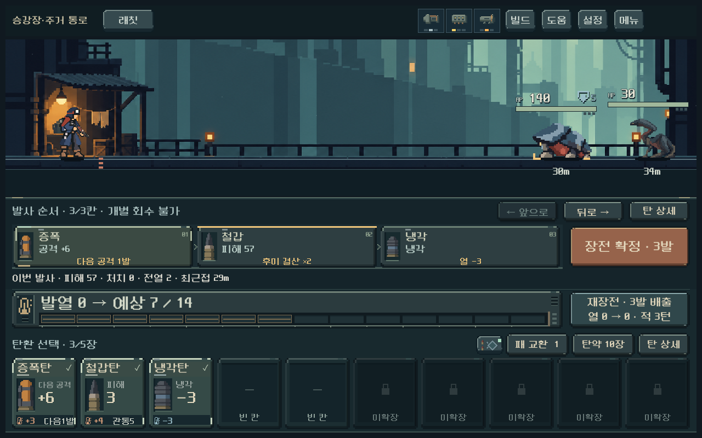
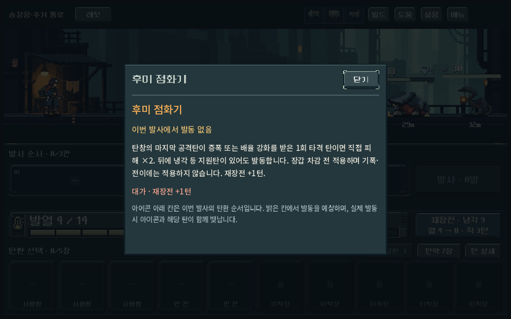
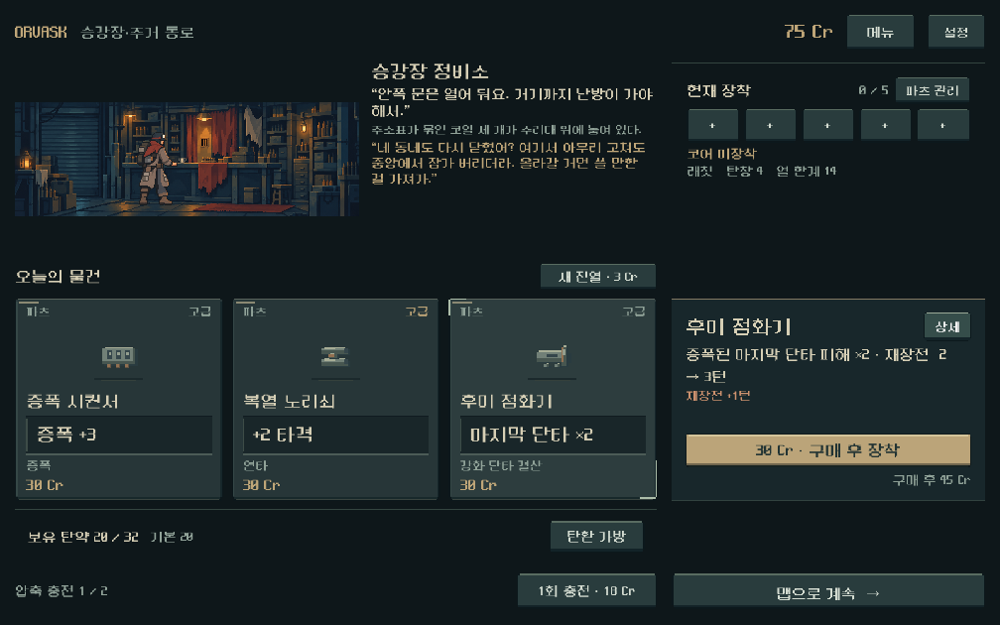

# 플레이 피드백 순차 개편 — 탄환·파츠 조합 1차

2026-10-27. 사용자의 순차 개편 승인 후 두 번째 적용 단계다. 아래 개별 수치는 디렉터 구현값이며, 사용자 체감이나 장기 균형이 확정된 수치는 아니다. 정예·보스·방어 규칙 전체, 가방/슬롯, 거리 표현, 소모품 정책은 후속 단계다.

## 적용 내용

새 캠페인은 `combat_revision=1`로 시작한다. 기존 저장은 필드가 없거나 0이면 종전 규칙을 유지한다. 캠페인과 전투의 규칙 번호가 다르거나 지원하지 않는 값이면 복원을 거절한다. 개발 빌드 실험실도 현행 규칙을 사용한다. 저장 내용·보유 재화·탄환을 일괄 변환하지 않는다.

| 항목 | 이전 | 새 등반 |
| --- | --- | --- |
| 연쇄 구동핵 | 성장당 타격 피해 +1, 최대 +9 | 성장 2마다 +1, 최대 +5; 잔타 연결 유지 |
| 열압 구동핵 | 성장당 배율 +0.25, 최대 ×3.50 | 성장당 +0.15, 최대 ×2.70; 고열/충격파 조건 유지 |
| 돌파 구동핵 | 성장당 배율 +0.25, 최대 ×4.00 | 성장당 +0.15, 최대 ×3.20; 초과 피해 전달 유지 |
| 증폭 시퀀서 | 증폭 추가 피해 +1 | +3; 일반·잔열·이월 증폭, 배율탄 제외 |
| 복열 노리쇠 | 연타 타격 +1 | +2, 연타탄 발열 +1 |
| 후미 점화기 | 탄창 마지막 발 피해 +3 | 강화된 마지막 **공격탄**이 단타이면 직접 피해 ×2; 뒤의 지원탄 허용; 재장전 +1턴 유지 |
| 철갑탄 계열 | 기존 관통 | 무기 배율 적용 전 관통 +2; 일반/압축/개조형에 공통 적용 |

코어만 성장시킨 기본탄 운용보다 지원탄·공격탄·파츠를 맞춘 조합에 힘을 실었다. 타격·고열·단타라는 기존 코어의 운용과 성장 획득 조건은 유지한다. 후미 배율은 장갑 차감 전에 한 번 적용하고, 잔량 전달 시 다시 곱하지 않는다. 고열 판단은 발사 직전 열을 사용한다. 추가 발열은 실제 과열 중단·강제 재장전·적 행동으로 이어진다. 장갑의 피해 차감식과 적 수치는 이번 단계에서 변경하지 않았다.

전투 카드·탄창 예측·피해 계산 상세·발동 표시·파츠 상세·상점 진열/설명/구매·빌드 안내를 같은 규칙 번호에 연결했다. 상점은 재장전 수치가 바뀌는 파츠도 주효과를 함께 표시한다.

## 대표 조합 비교

실제 `Model.load_round/confirm/fire`와 `Forecast.analyze`를 사용했다. 래칫, 코어 성장 0/4/8, 무리/장갑/보스형 HP 조건, 맞는 모듈/무관한 모듈/모듈 없음, 조합 탄/기본탄으로 **162조건**. 한 빌드 안에서 적·성장·장전 탄 수와 모듈 두 칸을 맞췄다. 다른 빌드 사이 탄 수는 다르며 획득 희귀도·비용은 정규화하지 않았다. 피해는 실제 HP 감소로 상한 처리한다. 사람의 승률이나 완전한 밸런스 증거가 아니다.

성장8, 장갑5 적 두 명(HP30/40)의 한 번 사격 결과:

| 빌드 | 맞는 파츠+조합탄, 이전→현재 | 무관한 파츠+조합탄, 이전→현재 | 맞는 파츠+기본탄, 이전→현재 |
| --- | --- | --- | --- |
| 연쇄: 시퀀서+복열, 증폭→연타→연타 | 55→55 | 37→22 | 25→13 |
| 돌파: 시퀀서+후미, 증폭→철갑 | 36→57 | 22→19 | 26→8 |
| 열압: 시퀀서+회수, 잔열 증폭→철갑→냉각 | 42→41 | 39→31 | 10→6 |

연쇄 조합은 두 연타를 연속 발사해 과열되므로 4턴을 소비한다. 돌파 조합은 1턴, 열압 맞춤 조합은 처치 냉각으로 1턴이지만 무관한 모듈 조합은 강제 재장전까지 4턴이다. 피해만 비교해 행동 비용을 감추지 않는다. 같은 등급 기본탄/철갑탄은 무장갑에서 같은 피해, 장갑3/5에서는 철갑탄이 더 큰 피해를 주었다.

## 검증

- 새 규칙 집중 **290검사 실패0**: 후미 순서/단타/강화 조건의 성공·실패, 배리어·초과 피해, 냉각 순서, 무작위 표적 범위, 다섯 무기의 분리된 방아쇠와 중간 저장 복원, 모든 증폭 변형의 저장 유효성, 규칙 번호 검증.
- 대표 조합 **756검사 실패0 / 162조건**. 기존 규칙으로 재실행한 162조건 결과는 개편 전 `builds/current/builds.json`과 완전히 동일했다.
- 기존 기록 복사/저장 회귀 **273검사**, 중앙 본편 **1,775검사**, 기존 저장12상태의 예측/실행 참조 결과 모두 통과. 과거 탄환 확장 검사 묶음의 977실패는 앞선 [성능 보고서](playtest_revision_2026-10-27.md)에 이미 별도 기록했으며 이번에 전체 통과했다고 표기하지 않는다.
- 전투 UI **237검사 실패0**: 1008×630/1280×800의 세 빌드, 실제 장전·확정·발사·상세 열기/닫기, 화면 예측과 최종 적 상태 일치. 테스트용 구성이지 해당 파츠를 실제 획득한 등반 기록은 아니다.
- 상점 UI **92검사 실패0**: 두 해상도×기존/새 규칙, 세 파츠 진열 수치·이점·규칙·구매·디스크 자동저장 복원. 기존 사용자 저장과 분리했다.
- 실제 새 등반: 시드731042, 동일한 첫 보상 선택 정책으로 5무기를 진행. 리벳/래칫/스플린터/스파이크는 1~5구역 엔딩 통과. 총119전투 중118해결. 리액터는 2구역 관문에서 제한 탐색이 해결하지 못해 총15,882검사 중 관련2검사는 실패다. 이전 버전의 같은 정책도 같은 관문에서 중단됐다. 탄 선택을 빌드에 맞춘 리액터 경로는 별도 **4,965검사 실패0**, 1~5구역과 엔딩까지 통과했다. 최종전20턴/남은 탄약1발로 여유가 작으며, ‘모든 획득 선택이 안정적’이라는 결론은 내리지 않는다.

완주한 네 무기의 전투 턴 합계는 리벳90→104, 래칫190→227, 스플린터153→185, 스파이크110→125였다. 동일 선택 정책이지만 전투 입력은 새 계산에서 다시 탐색하므로 단일 요소만 고립한 비교는 아니다. 탐색은 미래 드로우/RNG를 알며 사람의 승률·재미·초행 이해도를 대신하지 않는다.

## 화면과 재현

`tools/run_playtest_revision_checks.ps1 -Mode combat|builds|combat_ui|shop_ui -Tag revised`에서 모드를 하나씩 지정한다. `-Mode builds -Revision 0`은 이전 규칙 비교다. 런타임은 `qa_runtime/playtest_revision_20261026/` 아래에서 분리된다. 전체 등반은 `tools/run_central_live_checks.ps1 -Mode balance -Seeds 731042 -Tag revised_builds`, 리액터 대안은 `-Guns heavy -Acquisition fit -Tag revised_builds_fit_heavy`다. 증거 사본·소스 해시는 이 보고서의 자산 폴더에 둔다.

## 남은 판단

장갑 차감식·적 행동·보스/정예 편성과 파츠 획득 기회를 함께 조정하는 다음 단계가 필요하다. 현재 결과만으로 ‘아무 탄환으로도 클리어’나 ‘발열 위험이 약함’ 전체가 해결됐다고 판단하지 않는다. 가방/탄창/슬롯, 거리순 자리 이동, 탄약 고갈과 소모품, 관문 이벤트 씬도 후속이다. Galaxy 실기기와 사용자 체감은 미확인이다.
