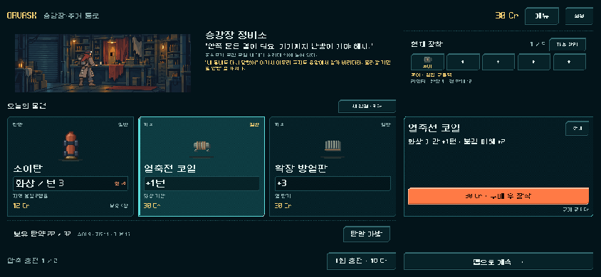
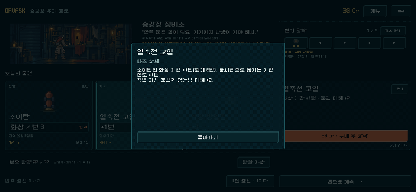
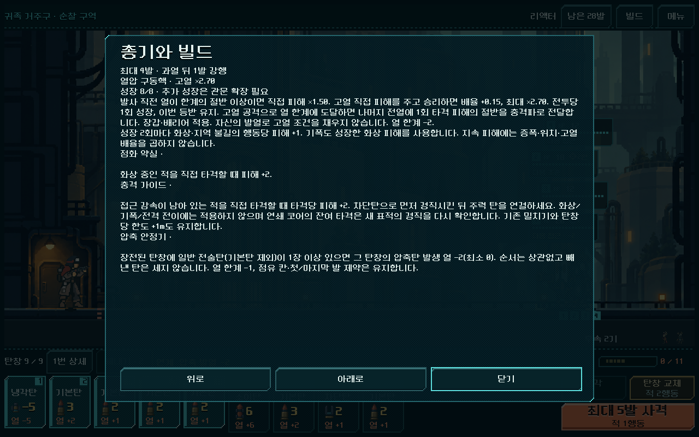
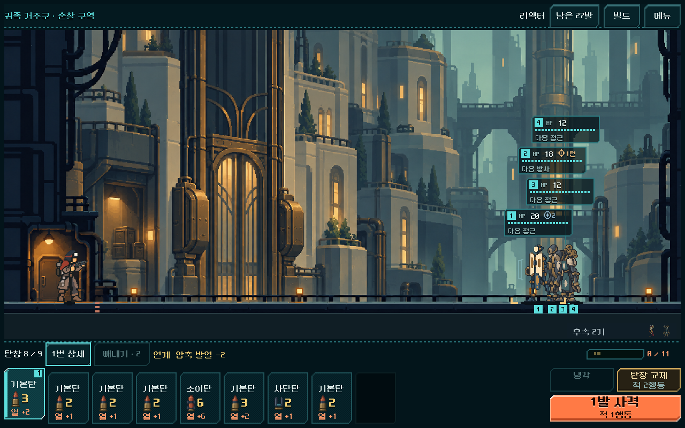

# 역할별 코어·파츠와 보상 선택 검증

2026-11-03 · 우선순위2 실행. [현행 규칙](../../direction/parts-builds.md) · [실행](../../../PLAY.cmd). **새 등반 v3**, 이전 v1/v2 이어하기는 기존 규칙. 승인 범위는 사용자의 순차 개편 실행이며 아래 수치는 디렉터 구현값이다.

## 바꾼 이유와 적용

- 기존 추천이 장착 코어만 보아 같은 열압 코어의 소이/열방출 덱을 구별하지 못했다. 상점·정예의 첫 파츠 추천에 보유 주력 계열과 지원탄을 반영하고, 다른 역할의 두 번째 후보·미등장 우선을 유지했다.
- 첫 구역 대표 파츠: 소이 코일, 전격 축전기, 연타/철갑 제3 격발기, 열방출 연쇄 방열기. 이후에도 후보를 잠그지 않는다. 상점 탄 한 칸은 복사/강화/연관 지원을 순환한다. 가격과 진열 칸, 새 재화는 바꾸지 않았다.
- 전격 분배는 코어여서 연쇄/돌파와 함께 장착할 수 없는데 처치 전이 확장이 연결돼 있었다. v3에서는 합법적으로 동시 장착되는 전이 축전기 모듈로 대상+1을 옮기고 설명/발동을 맞췄다.
- 열폭주 노심: 고정 화상+2·불길3m/4행동, 실제 재장전+1. 최소 재장전2가 이 비용을 삼키던 단발 총기에서도 대가를 적용한다. 충격 피스톤: 경직+1행동. 충격 가이드: 감속 중 직접 타격당+2, 연쇄 후속 표적 재판정. 발동 표시도 실제 사건을 사용한다.
- 관문 전이/성장 개조는 적용되는 코어를 장착했을 때만 제시한다. 큰 직접 피해·첫/세 번째/마지막 위치 배율·v2 열압의 성장2당 화상+1은 유지했다.

## 기능과 통제 비교

| 검사 | 결과 | 범위 |
|---|---:|---|
| v3 규칙 | 3,048 / 실패0 | 80시드×5주력 추천·다른 역할·재진열, 범위/기간/재장전, 경직 만료/연쇄 표적 재판정/발동, 합법 전이 확장, 관문 조건, v1/v2 획득 RNG·실제 모델 결과 |
| 통제 비교 + 실제 보유 코어 분기 | 442 / 실패0 | 8개 비교 상태와 관문에서 소유 코어를 교체한4전투, 합법 입력/저장/복원 |
| 기존 소이 성장 | 842 / 실패0 | v1/v2 성장·불길·기폭/저장, 새 버전 범위 검사 |
| 기존 역할 | 319 / 실패0 | 이전 경직/전이·저장·복장/투자 계약 |
| 실제 화면 | 68 / 실패0 | 844×390·1280×800 상점 선택/상세/구매·잔액·자동저장, 실제 획득 파츠 상세·HUD 사격/저장 |
| 기존 `run_prototype_hud.ps1 -Mode ui -Fast` | 11,536 / 실패0 | 기존 HUD 조작/계산/배치 계약 |
| Godot 임포트 | 통과 | Android build-tools 경고는 기존 로컬 환경 경고. APK를 만들지 않았다. |

통제 비교는 실제 모델을 사용한 고정 시험이며 획득 증거와 구분한다. 단발·정지 적 세 기(3m 간격), 노심+코일의 4행동 피해는 주 대상24→32, 인접 대상0→24, 6m 대상0→0이다. 직접 피해는 동일하고 재장전2→3이다. 압축 차단→연타의 피스톤+가이드 후속 직접 피해는2→6이며, 네 번째 행동에서 추가 감속 한 행동이 드러난다. 전이 축전기+연쇄+복열은 체력1 적4기 중2→3기 처치. 기존 첫/세 번째 조합의 직접 피해8/0/42와 행동 수는 같다. 지속 피해에 배율을 다시 곱하지 않는다.

## 실제 획득 등반

시드17·운반 복장·지도v4·보이는 보상과 소유 파츠만 사용한다. 매 전투 전 합법 장착, 실제 상점 비용·보상 교체·관문 개조를 거쳤고 모든 명령을 저장 후 복원한다. 검색기는 미래 무작위/패를 보므로 아래는 도달 가능성과 자원 지표이며 사람 승률/재미/최적 전략이 아니다.

| 구성 | 전투 | 총 행동 | 비상 보급 | 최소 잔탄 | 결과 |
|---|---:|---:|---:|---:|---|
| 리액터·소이/열압 | 30 | 468 | 0 | 2 | 최종 관문 완료 |
| 버스트·제어/연타/연쇄 | 30 | 397 | 0 | 10 | 최종 관문 완료 |
| 단발·철갑/돌파 | 30 | 417 | 1 | 1 | 최종 관문 완료 |

등반 검사7,222건 실패0. 소이 등반은 점화 약실·충격 가이드, 제어 등반은 가이드·복열·축전기, 직접 등반은 선두·축전기·후미 등을 실제 획득해 사용했다. 모든 제안 파츠를 구매하거나 모든 코어를 장착했다고 주장하지 않는다. 첫 상점30Cr에서 탄12Cr를 우선 구매한 정책은 코일/제3 파츠를 놓쳤다. 같은 상점의 다른 역할 파츠 구매는 화면 입력으로 확인했다. 가격 조정은 다음 전체 경제 검토에서 판단한다.

코어 분기는 같은 실제 획득 관문 저장에서 소유 코어만 교체하고 같은 다음 전투로 갔다. 성장8 열압→열폭주 노심은4구역 첫 전투15→23행동, 열압→충격 피스톤은5구역 첫 전투17→52행동이었다. 두 전용 코어 모두 승리 경로는 있지만 이미 성장한 소이 덱에서 코어만 갈면 상위 장비가 되지 않는다. 제어에 맞춘 덱/순서에서의 비용 대비 선택과 희귀 코어 등장 시점은 후속 플레이·경제 검토 대상이다.

최종 소스의 새 등반90전투 재생은 7,795검사 실패0(리액터2,453·버스트2,440·단발2,902)이다. 각 명령의 행동 수·획득 덱·장착·개조·단일 결산·저장을 대조했다. [리액터](../../../qa_runtime/build_roles_20261103/replay_release_heavy/result.json) · [버스트](../../../qa_runtime/build_roles_20261103/replay_release_burst/result.json) · [단발](../../../qa_runtime/build_roles_20261103/replay_release_single/result.json).

이전 v2 시드17 등반30전투도 기록된 명령으로 최종 관문까지 그대로 재생했다. 호환성2,655검사 실패0이며 당시 v3 재생까지 포함한 전체 배치10,450검사 실패0이다. [v2 포함 재생 결과](../../../qa_runtime/build_roles_20261103/replay_verified/result.json). 이후 v3의 경직 후속/돌파 전이 발동 메타데이터를 보완한 최종 코드에서 위90전투를 다시 재생했고 새 규칙3,048·화면68·통제/분기442검사도 다시 통과했다. v1/v2 코드는 해당 보완의 적용 대상이 아니다.

## 실제 화면과 확인 한계

실제 Godot 캡처를 열어 확인했다. 새 규칙은 기존 상세와 구매 영역에 표시되고 입력/스크롤을 막지 않는다. 844×390 상점의 보조 글자는 작고 일부 픽셀 글자 획이 거칠다. 이번 기능/영역 검사를 모바일 판독성 해결로 간주하지 않는다. Android 실기기 터치/배율·복귀·지속 발열/성능·재장전 복장 혼합·사람 빌드 체감은 별도 미확인이다.

## 재현과 변경 관리

- 작업 전 `qa_runtime/build_roles_20261103/before/`에 988개 관련 파일과 기존 작업 상태를 보존했다. [이번 변경 목록/해시](build_roles_2026-11-03/manifest.json)와 [이번 변경만 비교](build_roles_2026-11-03/changes.diff)를 사용한다. 기존 대규모 미커밋 작업을 초기화하지 않았다.
- 실행: `tools/run_build_roles.ps1 -Mode rules -Label release`, `-Mode climb -Label earned`, `-Mode probe -Label release`, `-Mode ui -Label release`, `-Mode replay -Label ...`. 모두 전용 `qa_runtime/build_roles_20261103/` 아래 APPDATA/LOCALAPPDATA로 진행한다. `QA_REPLAY_GUN`은 v3 총기 하나만 재생하며 비우면 세 등반과 v2 시드17을 재생한다.
- [규칙 결과](../../../qa_runtime/build_roles_20261103/rules_release/result.json) · [통제/소유 코어 분기](../../../qa_runtime/build_roles_20261103/probe_release/result.json) · [90전투/획득 명령](../../../qa_runtime/build_roles_20261103/climb_earned/balance.json) · [화면 결과](../../../qa_runtime/build_roles_20261103/ui_release/result.json).
- 초기 테스트의 잘못된 압축/탄창 배치·파츠 제거 후 밀기 한도, 3행동으로4행동 경직을 비교한 조건, Error값을 bool로 읽은 저장 검사, 옛 상점 선택자·없는 재생 helper를 수정했다. 실패 로그를 보존했고 위 최종 결과와 혼용하지 않는다.
- 기능·시각 확인·사람 이해도는 분리한다. 다음은 복장/지도/전체 성장 경제와 실제 플레이. APK·커밋·푸시·외부 게시는 수행하지 않았다.
