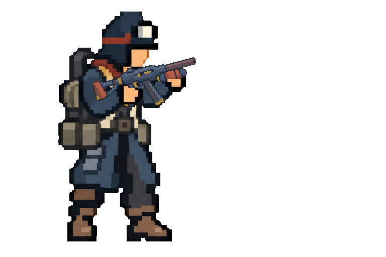
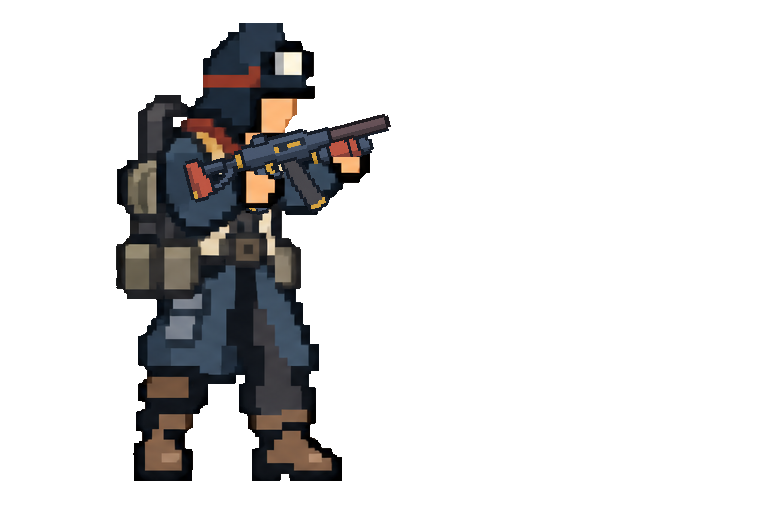
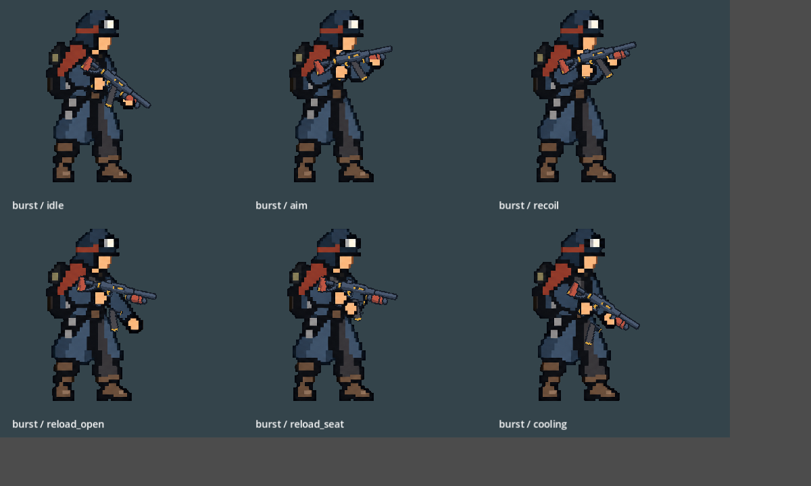
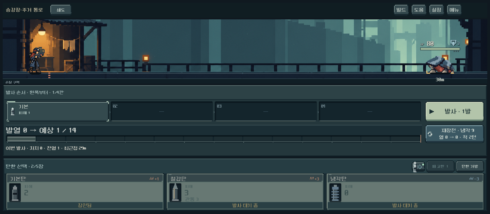

# 쇄도 외곽선·도트 굵기 비교

사용자는 총기의 검은선이 가늘어 캐릭터와 이질적으로 보인다고 지적했고, 쇄도 한 종으로 먼저 기준을 잡는 작업을 승인했다. 10월13일 밤 제작을 시작해 14일 검증 기록을 완료했다.

## 적용

- 내장 image_gen으로 기존 쇄도 v3를 편집했다. 실제 인양 장구+쇄도 합성은 캐릭터의 도트 굵기 비교 참조로 제공했다.
- 총의 바깥 경계를 굵은 짙은 청회색으로 정리하고 총열·탄창의 계단과 내부 색면을 단순화했다. 내부 부품마다 검은 테두리를 추가하지 않았다.
- 1536×1024 RGBA 원본 알파를 보존했다. 프롬프트의 원본 기준 40~50px 선 굵기는 이번 시안의 제작 목표이며 엄격한 측정 결과나 모든 자산의 영구 규격이 아니다.
- 본편 `weapon_actor.gd`에서 쇄도만 `burst_v4.png`로 교체했다. 다른 4종은 v3 유지. 기존 손·총구·탄창 분리 등록값과 동작은 유지했다. 새 이미지의 손잡이·앞손·총구 기준점은 모두 알파128 이상 영역에 있다.
- [전체 프롬프트·참조·원본·해시](../../../새-게임-프로젝트/assets/art/weapons_mass_20261013/provenance_burst_v4.json). 기존 v3를 보존했다.

## 비교

인양 장구와 쇄도의 같은 조준 상태. 확대본은 윤곽 확인용이며 선호에 대한 사용자 확인은 아직 없다.

이전 v3:

수정 v4:

## 검증과 한계

- 격리 APPDATA/LOCALAPPDATA, Godot 4.7 Compatibility. import 오류 없음.
- 동작 회귀 502검사 실패0, 2,828프레임 관찰, 거리 순서·접지 오류0. GPU 렌더에서 반동과 재장전 부품 추출/복귀 확인.
- 신규 복장 본편 1,487검사 실패0. 4복장 × 5총기 × 6자세와 3해상도 포함. 최종 출력 `qa_runtime/outfits_live/20261013_235933`.
- 쇄도의 6자세 점검표, 인양 장구 합성, 실제 전투 화면에서 굵어진 총열·탄창 경계와 손 접점을 직접 확인했다. 실제 화면의 화풍 만족과 Galaxy 실기기 체감은 사용자 확인이 남아 있다.
- 다른 무기에 굵은 선을 일괄 확대 적용하지 않았다. 신규 전체 스타일 채택으로 간주하지 않는다. 규칙·세이브 변경이나 APK·커밋·푸시는 없다.
