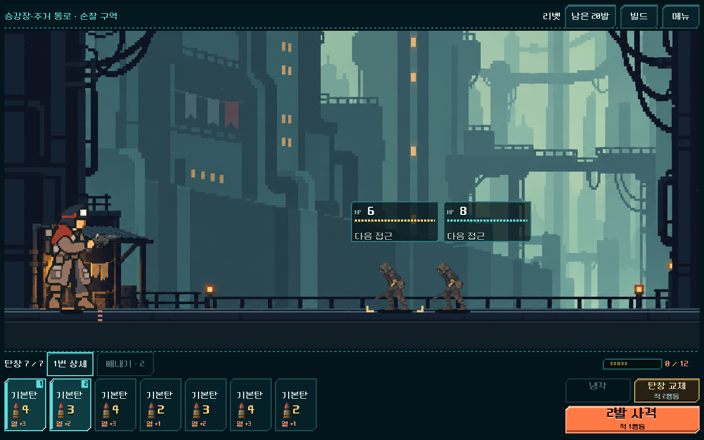
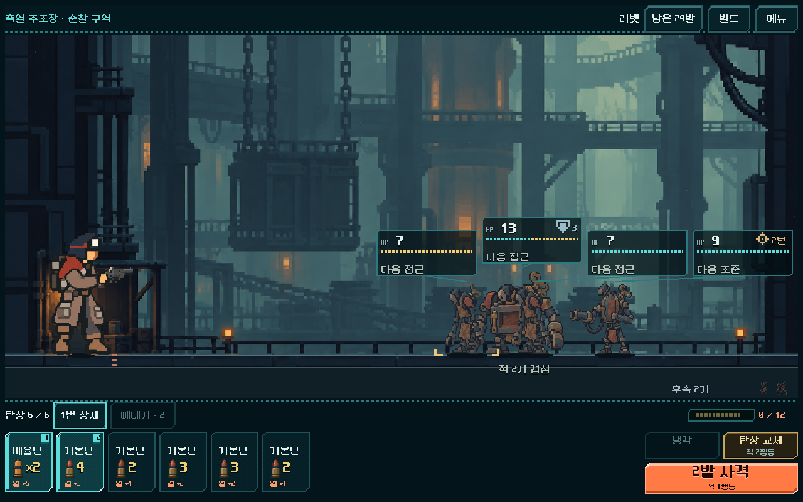
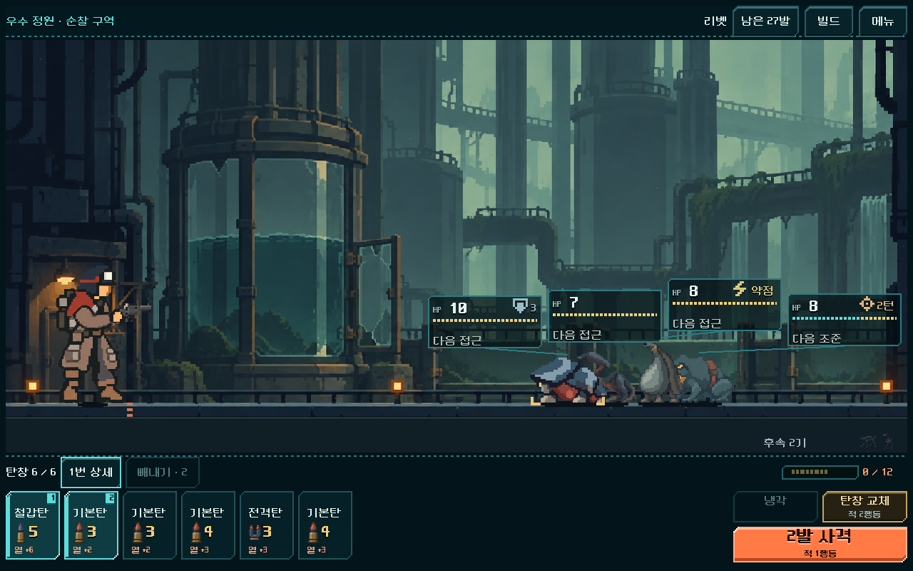
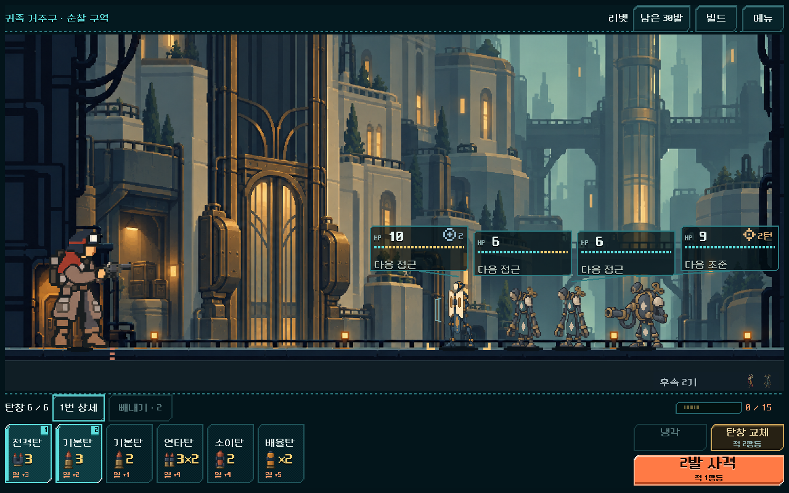
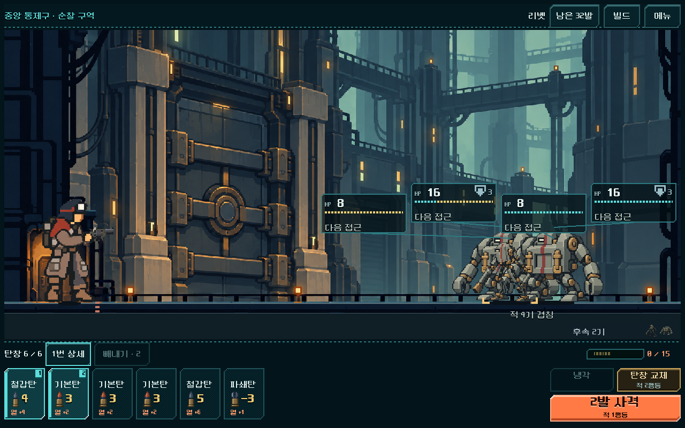
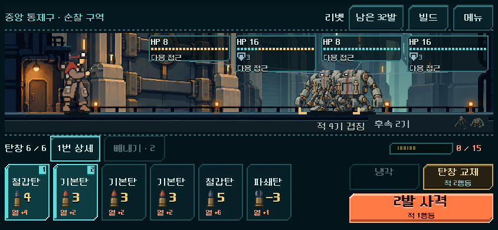
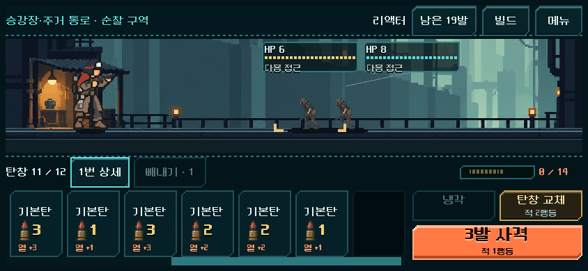
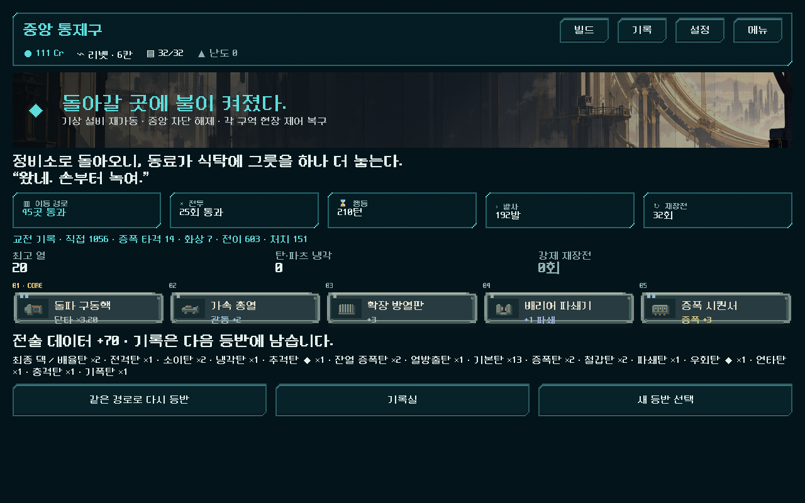

# 전체 등반 — 탄창 개편 본편 통합

2026-11-01. 사용자 요청: “전체 등반에 개편부터 해 줘.” [현행 결정](../../direction/campaign-magazine.md).

## 플레이 경로와 적용 범위

`D:/ProjectLoB/worktrees/core-redesign/PLAY.cmd` → **새 등반**. 장비 선택에서 새로 출발하면 5개 구역 전체에 자동 탄창 장전·총기별 부분 사격·잔탄 보존 냉각·탄창 교체·선택 빼내기와 라인 + 도트 HUD를 사용한다. 지도·장소·보상·상점·공방·관문 재정비·최종 보스·공급 복구·귀환 결과는 기존 본편 흐름을 이어 쓴다.

이전 저장의 **이어하기**는 당시 전투 방식과 화면을 유지한다. 실제 사용자 저장을 열어 수정하거나 변환하지 않았다. 새 등반 시작 시 기존 진행 교체 확인도 그대로 작동한다. 기존 5전투 여정/독립 비교는 별도 실행 경로로 남아 있다. APK·외부 업로드·커밋·푸시는 하지 않았다.

## 변경과 이유

- 본편 새 출발에서만 `magazine_campaign_version=1`을 기록한다. 내부 Campaign.start의 기본값은 이전 규칙을 유지해 과거 저장/시험 자료를 임의 전환하지 않는다. 실제 시작 버튼의 새 규칙 적용을 별도로 검사했다. 캠페인과 전투의 모드가 불일치하는 저장은 거부한다.
- 새 HUD는 본편의 동일한 Campaign/Model 객체에 연결된다. 사격·냉각·교체·빼내기는 기존 명령을 사용한다. 전투 종료 저장 시 정리되는 탄 더미를 연출용 스냅샷에 보존하여, 마지막 사격이 끝난 뒤 본편 보상/패배 화면으로 넘어간다. 행동 결과는 연출 전에 저장된다.
- 주조장·정원·귀족 구역·중앙 통제구의 원래 적 그림과 전용 행동을 유지하고 공통 HP/예고 외형과 작은 화면 배치를 연결했다. 첫 구역은 검증된 접근 압박을 적용한다. 후반 적 수치나 전투 계산은 바꾸지 않았다.
- 고정 9장 반복을 실제 탄창 용량에 맞게 확장했다. 카드 크기는 유지하며 가로 스크롤로 끝 탄까지 선택한다. 12칸 조건은 별도 용량 시험 상태이며 실제 획득 등반의 증거와 구분한다.
- 자동 장전에서 사용할 수 없는 수동 패 교환 파츠 `reserve`, 전투 중 압축 코어 `field_press`를 새 등반 보상/상점/재진열 후보에서 제외했다. 압축 충전 판매도 감추고 명령을 차단했다. 공방의 영구 압축은 실제 거래로 유지 확인했다. 이전 저장의 상품/서비스는 유지한다.
- 장비 선택·총기 정보·첫 안내·규칙·빌드·관문 문구를 새 장전 방식에 맞췄다. 새 등반에서 복장은 총 휴대량으로 설명한다. 훈련/기존 전투의 설명은 분리한다.
- 연출 중 발열 상한을 제한된 전장 표시 자료가 아니라 실제 장착 코어/파츠 상태에서 읽도록 수정했다. 과열·냉각의 실제 열과 기존 효과음/연출 설정을 유지한다.

## 검증

Godot 4.7, 격리 APPDATA/LOCALAPPDATA. 최종 근거는 `qa_runtime/campaign_magazine_20261101/integrated/`이다. 초기 탐색/중단/시험 도구 수정 전 폴더는 최종 통과 증거에 포함하지 않는다.

| 범위 | 결과 |
| --- | --- |
| 실제 획득 전체 등반 | 5총기 × 25전투 = **125전투**, 전부 최종 보스/승리 도달. 행동마다 원자 저장·복원 비교. **10,204검사, 실패0** |
| 본편 화면 연결 | 실제 시작 버튼, 중간 탄 빼내기, 메뉴/이어하기, 리벳의 25전투 실제 터치 사격/냉각/교체와 본편 지도·거래·보상·관문 처리, 3화면 크기 및 12칸 끝 탄 터치. **878검사, 실패0** |
| 분기와 정비 | 획득 상태에서 합법 이벤트 분기 → 매복 → 탄창 전투 → 보상, 상점 재진열/비활성 서비스 과금 방지, 공방 영구 압축, 잘못된 모드 저장 거부. **850검사, 실패0** |
| 시각/종료 보강 | 5구역의 실제 렌더러, 1280×800/844×390, 적 상세/빼내기, 코어 적용 열 상한, 실제 접촉 패배, 공급 복구 → 귀환 결과. **230검사, 실패0** |
| 별도 프로세스 이어하기 | 프로세스1에서 빼내고 종료 → 프로세스2의 본편 이어하기 버튼. 탄 더미·순서·난수·빼내기 잔여·캠페인·프로필 일치. **5+14검사, 실패0** |
| 기존 HUD 검사 | `run_prototype_hud.ps1 -Mode ui -Fast`: **11,536검사, 실패0** |
| 기존 5전투 여정 흐름 | `run_prototype_hud.ps1 -Mode flow -Fast -Suite journey_flow_20261101`: **4,274검사, 실패0** |
| 기존 피드백 검사 | `run_prototype_hud.ps1 -Mode feedback -Fast -Suite journey_feedback_20261101`: **169검사, 실패0** |
| 실행 경로/편집 | PLAY의 실제 엔진·프로젝트·main.tscn 연결 확인, 변경된 추적 파일의 diff 공백 검사 통과 |

본편 UI 검사는 전투를 실제 터치로 실행하고, 전투 밖 연속 재생은 화면의 본편 행동 처리기를 호출했다. 모든 지도/상품 버튼을 손으로 누른 플레이로 표현하지 않는다. 마지막 공급 복구/결과 버튼, 메뉴/이어하기, 탄창 끝 탄은 실제 터치로 검사했다.

전체 등반은 시드731042, 운반용 외투, 난도0의 실제 획득 경로다. 리벳/래칫은 빼내기 없이, 스플린터/리액터/스파이크의 기록은 각각 빼내기3/3/4회로 완료했다. 이는 선택 강제나 최적 횟수의 결론이 아니다. 자동 탐색은 숨겨진 덱 순서와 난수를 읽으므로 **사람의 승률·적정 난이도·재미 증거가 아니다**. 최소 도달 여유가1~2인 전투도 있어 사용자 전체 플레이의 긴장감/억울함 확인이 필요하다.

## 실제 화면

## 남은 확인과 시행 중 발견

- 이전 전체 전투에서는 효과가 있던 수동 패 교환 파츠가 새 탄창 방식에서 기능하지 않는 것을 발견해 새 획득 후보에서 제외했다. 최초 최종 보스 탐색 실패를 적 수치 하향으로 덮지 않고, 적용 불가능한 상품 제거와 빼내기를 포함한 탐색으로 다시 검증했다.
- 기존 시험 클래스의 동적 solver 반환형 추론 오류를 `Array` 명시로 수정했다. 본편 UI 시험의 보상 교체 인수 전달 오류도 고쳤다. 중복 실행으로 같은 QA 저장을 공유한 초기 결과는 폐기하고 `integrated/`로 격리해 재검증했다.
- Android 실기기 발열·지속 FPS·안전 영역, 사람의 초회 이해/전체 난도는 미측정이다. 복장별 선택 가치는 새 방식에서 휴대량 차이를 중심으로 후속 검토한다. 최종 통과는 모든 시드/난도의 균형을 보장하지 않는다.
- 예전 본편 음향 시험의 기존8실패는 [직전 보고서](journey_feedback_2026-11-01.md)에 기록되어 있다. 그 시험을 이번 결과에 통과로 합산하지 않았다.
