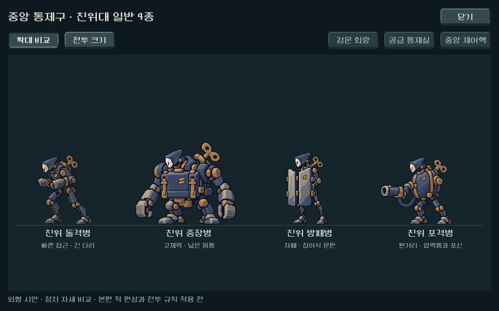
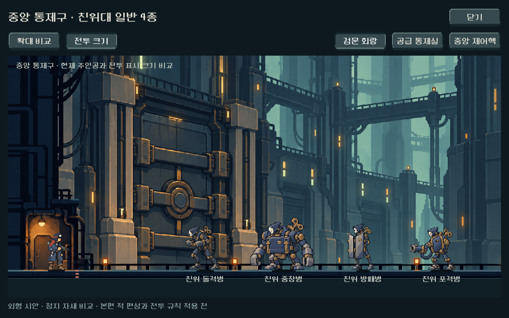
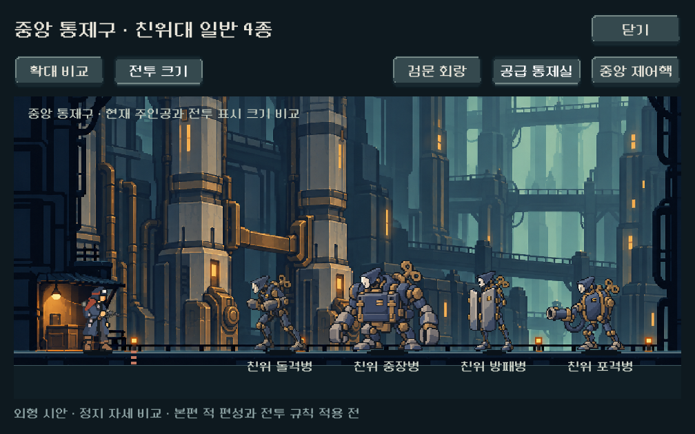
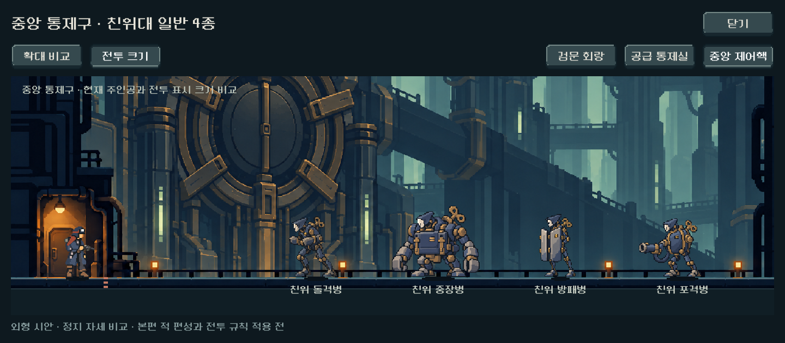

# 중앙 통제구 친위대 일반 4종 — 통합 시안

후속: 사용자 추가안 요청으로 이 원화들은 A ‘태엽형’으로 보존하고 B ‘봉쇄형’을 추가했다. 현재 실행 뷰어와 검증 명령은 두 안을 지원한다. 아래는 최초 A 제작 기록이며 [최신 A/B 비교](central_guard_variants_2026-10-25.md)를 함께 확인한다.

2026-10-25. 사용자의 다음 작업 진행 요청으로 친위대 일반 4종의 원화와 Godot 비교 뷰어를 제작했다. **외형 시안과 개발 메뉴 연결 완료**이며, 본편 편성·수치·행동 패턴 적용 전이다. 정예·최종 보스는 이번 제작 범위에 포함하지 않았다.

## 표현과 결정 상태

사용자가 채택한 5구역의 규율·통일성 방향을 따른다. 아래 외형과 비교용 크기는 디렉터 제작안이며 사용자 미감·역할 이해도 확인은 아직 없다.

| 시안 | 형태로 구분한 역할 | 기존 몸틀과의 연결 | 표시 높이 |
|---|---|---|---|
| 친위 돌격병 | 앞으로 기운 몸, 긴 다리, 접힌 타격 팔 | 신규 순수 기계 | 112px |
| 친위 중장병 | 넓은 사각 몸통, 낮고 무거운 하체 | 금형공의 군용 외장 | 132px |
| 친위 방패병 | 좁고 긴 몸, 두 장의 접이식 문판 | 겹문 시종의 규격화된 방패 | 116px |
| 친위 포격병 | 타원 압력통, 왼쪽 포신, 굵은 연결 호스 | 압력공의 군용 외장 | 108px |

봉인된 상아색 가면, 청회색 외장, 작은 황동 이중 띠와 태엽 키를 공통 요소로 사용했다. 귀족의 가문 장식을 줄이고 산업용 자동인형의 몸틀을 유지했다. 가면·문장은 이번 부대 시안의 제작 선택이며 세계관의 영구 규칙이 아니다.

## 실제 표시

- 확대 비교와 전투 크기 전환, 검문 회랑/공급 통제실/중앙 제어핵 배경 3종 전환.
- 현재 본편의 주인공·리벳 렌더러와 공통 배경/발 기준 사용. 전투 크기는 등록 높이를 그대로 표시한다.
- 원본은 손대지 않고 nearest·기존 알파 컷아웃을 사용한다. 전투 크기에만 기존 배우 색면 묶기·어두운 경계 완화를 적용하며 확대 비교는 원본을 보여 준다.
- 원화는 큰 면 중심이며 제작자 판단으로 네 역할의 실루엣이 구별된다. 중장병의 넓은 체급, 방패의 두 문판, 포격병의 포신과 호스를 작은 화면에서도 확인했다.
- 실제 전투/HUD/피격 상태 시연은 아니다. 밀집 전열·상태 동작·공격 예고 판독은 본편 통합 때 검증한다.

## 원본·프롬프트·등록

도구는 내장 image_gen이며 원화별 1회씩 총 4회 호출했다. 별도 API·PixelLab 호출은 없다. 돌격병에 현행 C 주인공/중앙 배경/금형공을 실제 참조 입력으로 제공하고, 나머지 세 종에 돌격병·각 기반 몸틀·주인공·배경을 순서대로 제공했다.

- [원본 폴더](../../../새-게임-프로젝트/assets/art/central_guard_concepts_20261025/)
- [전체 프롬프트·참조 순서·해시](../../../새-게임-프로젝트/assets/art/central_guard_concepts_20261025/provenance.json)
- [RGBA/알파·크기·해시 측정](../../../새-게임-프로젝트/assets/art/central_guard_concepts_20261025/asset_report.json)
- [영역·발 기준점·표시 크기](../../../새-게임-프로젝트/assets/art/central_guard_concepts_20261025/registration.json)
- [등록 재현 스크립트](../../../tools/register_central_guard_concepts.py)

생성 PNG는 각각 1199×1312 / 1341×1173 / 1199×1312 / 1312×1199이며 원본 해상도와 게임 표시 크기는 다르다. 경계에 alpha 1의 미세 잔여가 있어 기존 alpha 0.5 컷아웃을 표시 때 사용한다. 유효 피사체는 모두 이미지 안에 있고 원본 바이트를 보존했다. 발 좌표는 하단 4% 구간의 양쪽 밑창 범위를 기준으로 측정했다.

## 검증과 한계

`powershell -NoProfile -ExecutionPolicy Bypass -File tools/run_central_guard_concept_checks.ps1`

- Godot 4.7 / Compatibility / RTX 4060 Ti의 실제 GPU 렌더.
- 1280×800, 1008×630, 1440×630에서 확대 1장+배경별 전투 크기 3장씩 **총 12장** 캡처.
- 최종 **481검사, 실패 0**. 화면 안 배치·피사체 겹침·발 기준·표시 크기, 실제 터치로 모드와 배경 전환, 개발 메뉴 진입·닫기·Escape 재진입 검사.
- 격리 저장 파일과 모델 상태가 뷰어 방문 전후 동일하다. 사용자 저장은 접근·수정하지 않았다.
- 첫 실행의 raw image 로딩 경고를 확인해 명시적 Godot Texture2D preload로 수정했다. 최종 캡처 오류 로그는 0바이트다. 에디터 import에는 기존 Android build-tools 경로 안내가 있으나 APK 제작은 수행하지 않았다.
- 원본 4장을 직접 검수했고, 확대/전투 대표 6종 화면을 제작자가 시각 검토했다(최종 재실행 후 4장 재확인). 자동 검사를 사람 선호나 Galaxy 실기 검증으로 확대하지 않는다.
- [검사 결과 JSON](assets/central_guard_concepts_2026-10-25/visual_qa.json), [최종 실행 로그](assets/central_guard_concepts_2026-10-25/capture_stdout.log).
- 변경 전 작업 트리는 `qa_runtime/central_guard_concepts/worktree_before.txt`로 기록했다. 기존 작업을 보존하고 새 시안·등록·검사 및 개발 메뉴 진입만 추가했다.

## 확인 경로와 다음 작업

[PLAY_CENTRAL_GUARDS.cmd](../../../PLAY_CENTRAL_GUARDS.cmd) 또는 게임 메인 → 개발 → **몬스터 시안 · 중앙 친위대**.

다음 제작 단위는 친위대장·탑의 지배자 시안이다. 이후 상태 동작과 전투 규칙·예고를 연결하고 실제 획득 덱의 4→5구역→엔딩 진행을 검증한다. 이번 시안 제작만으로 5구역 본편 구현이나 밸런스가 완료된 것은 아니다.
