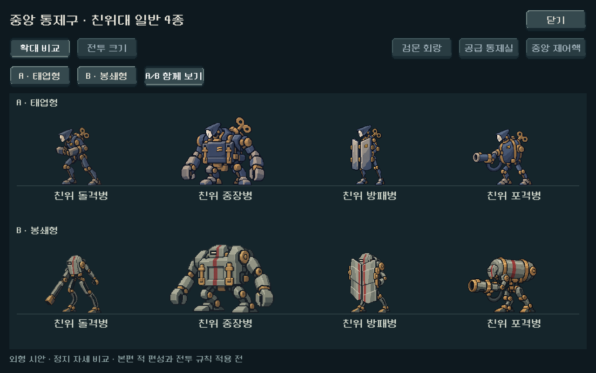
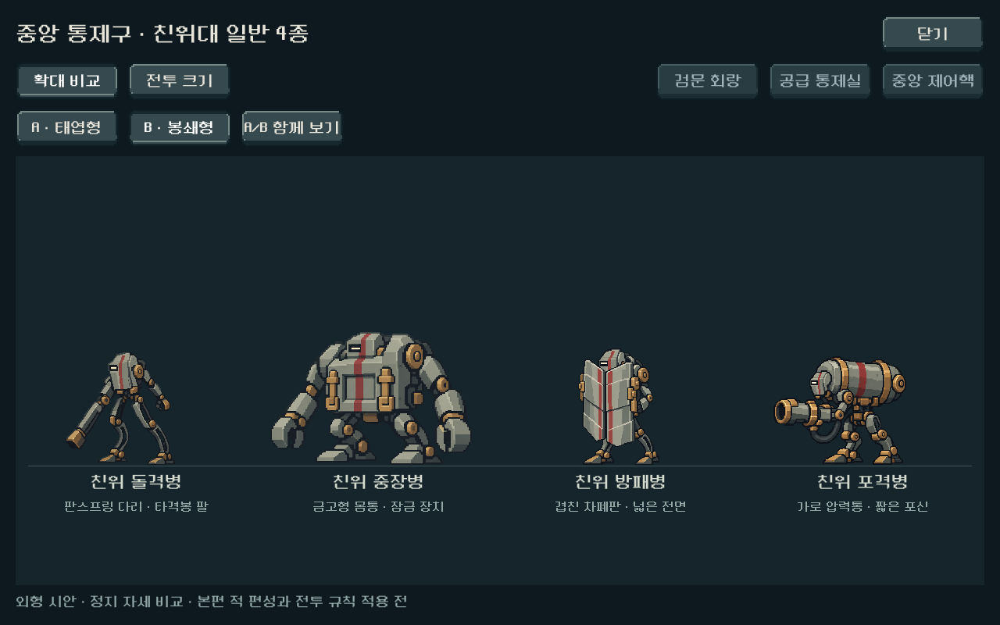
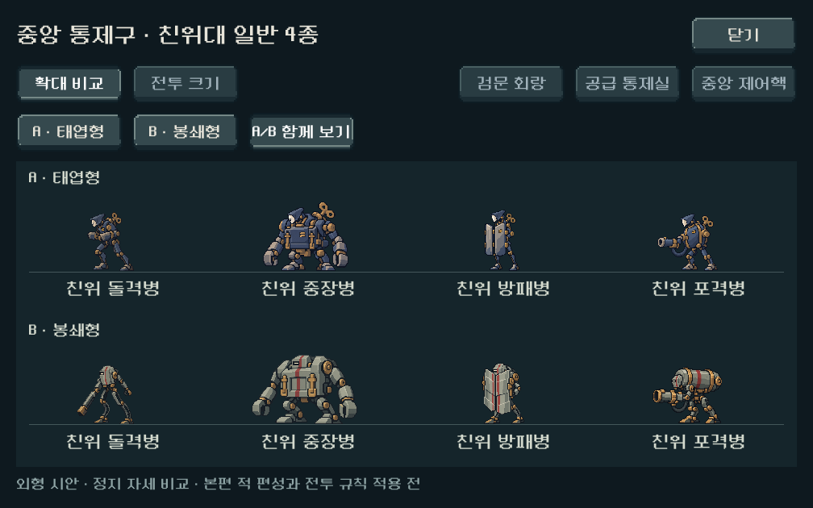
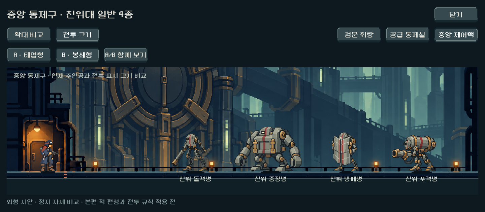

# 중앙 통제구 친위대 — A/B 외형 비교

2026-10-25 제작 시작, 2026-10-26 최종 검수·기록 완료. 사용자가 기존 시안을 긍정 평가하면서 다른 시안도 요청했다. 기존 A안 4장을 보존하고 **B안 ‘봉쇄형’ 4장과 A/B 비교 화면**을 추가했다. A에 대한 긍정 평가와 최종 외형 선택은 구분한다. B의 외형과 명칭은 디렉터 제작안이며 사용자 선택 전이다.

## 두 방향과 역할

A ‘태엽형’은 청회색 외장, 상아색 얼굴과 드러난 태엽 키로 통일한다. B ‘봉쇄형’은 회녹색 밀폐 외장, 가로 시야 틈, 외장에 매립된 황동 태엽 허브와 붉은 세로 띠를 사용한다. 몸체를 검문·차폐 설비처럼 구성해 A와 다른 인상을 만들었다. 두 안 모두 사용자가 채택한 순수 기계 친위대와 규율·통일성 방향을 따른다.

| 역할 | B안의 주요 형태 | 기존 몸틀 연결 | 비교용 전투 높이 |
|---|---|---|---|
| 친위 돌격병 | 머리를 감싼 좁은 몸통, 긴 타격봉, 휜 판스프링 다리 | 신규 순수 기계 | 112px |
| 친위 중장병 | 낮고 넓은 금고형 몸통, 큰 잠금쇠와 집게 팔 | 금형공 | 132px |
| 친위 방패병 | 큰 판이 겹친 두 차폐문, 몸을 가리는 긴 방벽 | 겹문 시종 | 116px |
| 친위 포격병 | 가로 압력통, 낮은 포구와 굵은 연결 호스 | 압력공 | 108px |

## 비교 화면과 적용 범위

[PLAY_CENTRAL_GUARDS.cmd](../../../PLAY_CENTRAL_GUARDS.cmd) 또는 게임 메인 → 개발 → **몬스터 시안 · 중앙 친위대**. 기본 선택은 B안이다.

- A/B 개별 선택에서 확대와 전투 크기를 전환하고 중앙 3배경을 확인한다.
- ‘A/B 함께 보기’는 같은 높이·확대율로 두 줄에 4종씩 배치한다. 이 모드는 외형 비교이며 8기 전투를 표현하지 않는다.
- 현행 주인공과 배경·발 기준을 사용한다. 전투 크기는 등록 높이를 유지하며 기존 nearest, 알파 컷아웃과 배우 색면 묶기를 적용한다.
- 정지 원화와 비교 뷰어만 추가했다. 본편 편성·수치·공격 동작·저장 규칙 적용 전이며 친위대장·탑의 지배자는 이번 제작 범위에 포함하지 않았다.

## 원본과 제작 기록

내장 image_gen으로 최종 4장과 제외한 돌격병 초안 1장, 총 5회 생성했다. 최초 돌격병은 A의 머리·자세와 너무 유사해 별도 초안으로 보존하고, 머리를 감싼 몸통과 판스프링 다리를 가진 안으로 다시 제작했다. 최종 돌격병에는 현재 C 주인공과 중앙 배경을 실제 입력으로 사용했다. 나머지는 B 돌격병, 기존 기반 몬스터, C 주인공, 중앙 배경 순서로 참조했다.

- [B 원본·프롬프트 폴더](../../../새-게임-프로젝트/assets/art/central_guard_alt_20261025/)
- [전체 프롬프트·참조 순서·해시·초안](../../../새-게임-프로젝트/assets/art/central_guard_alt_20261025/provenance.json)
- [RGBA·알파·크기 측정](../../../새-게임-프로젝트/assets/art/central_guard_alt_20261025/asset_report.json)
- [표시 영역·발 기준 등록](../../../새-게임-프로젝트/assets/art/central_guard_alt_20261025/registration.json)
- [기존 A 제작 기록](central_guard_concepts_2026-10-25.md)

최종 원본 크기는 돌격 1312×1199, 중장 1427×1102, 방패 1178×1335, 포격 1312×1199다. 생성 PNG의 바이트를 보존했다. A 4장은 이전 제작 기록의 해시와, B 4장은 생성 원본 및 새 제작 기록의 해시와 일치한다. Python은 알파 영역·발 좌표·메타데이터 측정에만 사용했으며 이미지를 수정하지 않았다. 등록 재현 명령은 `python tools/register_central_guard_concepts.py --variant-b`다.

## 검증과 남은 일

`powershell -NoProfile -ExecutionPolicy Bypass -File tools/run_central_guard_concept_checks.ps1`

- Godot 4.7 / Compatibility / RTX 4060 Ti의 격리 실행. 1280×800, 1008×630, 1440×630에서 A/B 각각 확대와 3배경, 함께 보기까지 **27장** 캡처.
- 최종 **1,444검사, 실패 0**. 실제 터치로 안/모드/배경 전환, 표시 파일·높이·발 기준·겹침·화면 경계, 개발 메뉴 진입·닫기·Escape, 저장·모델 상태 보존을 확인했다.
- 첫 비교 화면에서 B 이름이 A 위치에 겹치는 문제를 시각 검수로 발견했다. 각 행의 발 위치 기준으로 수정하고 전체 캡처/검사를 다시 실행했다. 최종 A/B 1280·1008과 B 중앙 제어핵 1440 화면을 재확인했다. 앞선 B 확대·작은 전투 크기도 확인했다.
- 원본 4종과 실제 화면의 큰 형태·잘림·배경 구별을 제작자가 검토했다. 사용자 선호·역할 이해도 및 Galaxy 실기 검증은 미완료다. 이 검사는 상태 동작이나 본편 전투 균형 검증이 아니다.
- 이전 A 전용 12캡처는 보존했다. [최종 검사 JSON](assets/central_guard_variants_2026-10-25/visual_qa.json), [실행 로그](assets/central_guard_variants_2026-10-25/capture_stdout.log), [오류 로그](assets/central_guard_variants_2026-10-25/capture_stderr.log).
- 변경 전 뷰어·검사·래퍼와 작업 트리는 `qa_runtime/central_guard_concepts/variant_b_before/`에 보존했다. 기존 작업·본편 전투·사용자 저장을 유지했다.

다음은 외형 방향에 맞춘 친위대장·지배자 시안과 상태 동작·본편 전투 연결이다. A/B 최종 선택은 아직 없다.
