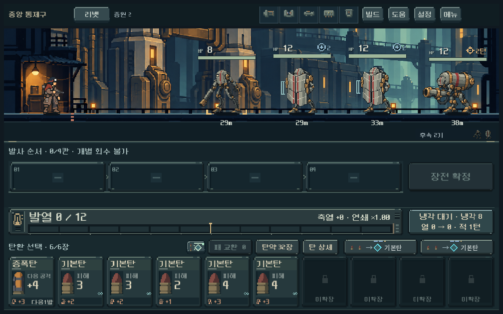
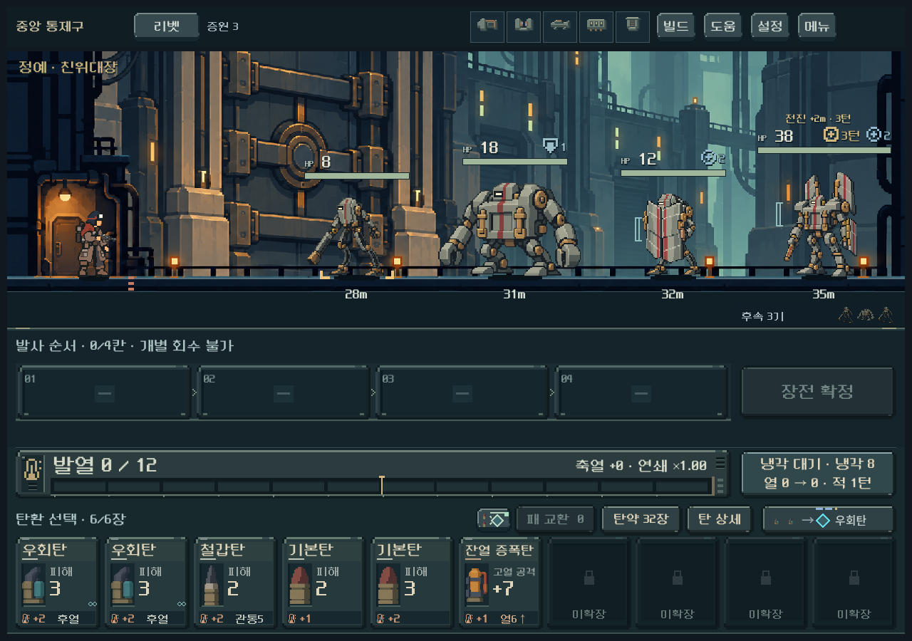
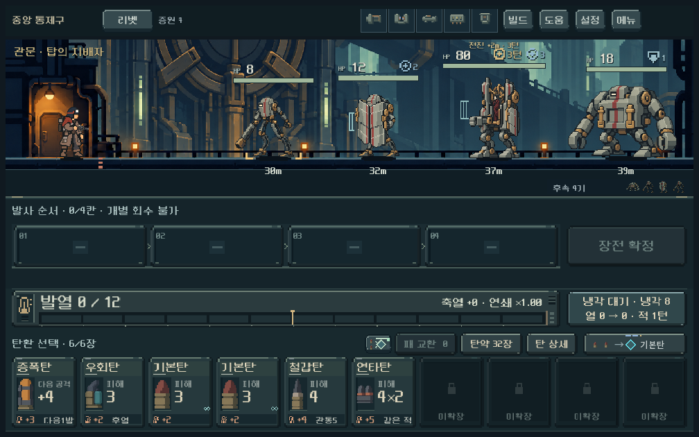
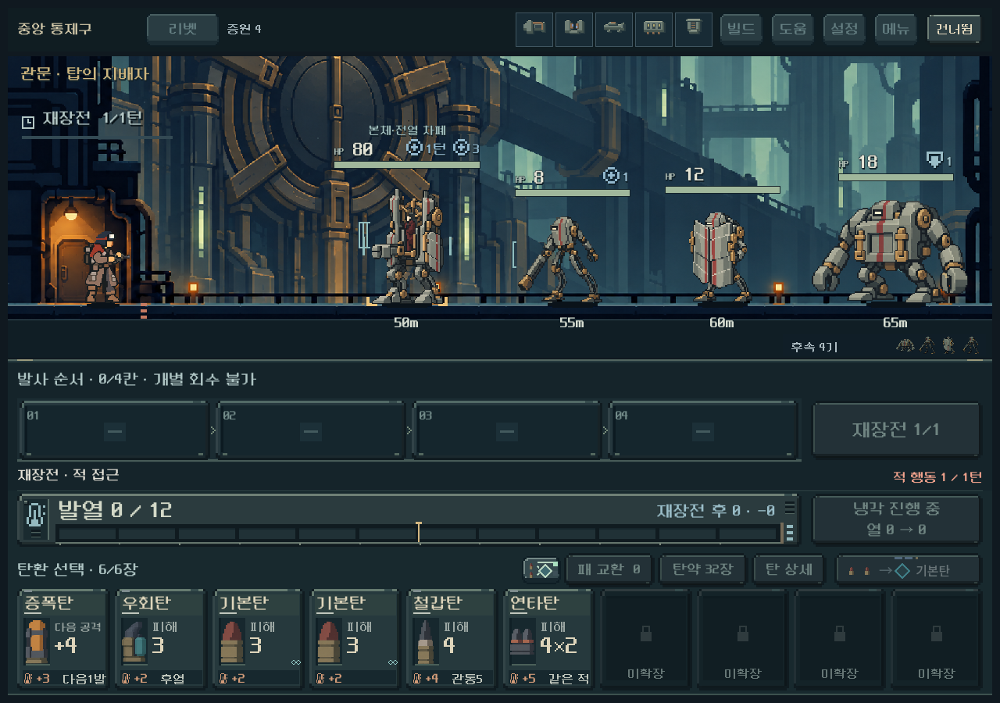

# 중앙 친위대 B 본편·1~5구역 임시 밸런스 — 2026-10-26

사용자 선택 B 일반4종을 새 등반 편성11에 적용했다. 같은 계열의 친위대장·탑의 지배자 추가 원화와 지휘 행동, 차폐 판독, 개발 메뉴 진입, 마지막 보상·엔딩 연결을 구현했다. 추가 지도자 원화와 세부 수치는 디렉터 임시값이다. [현행 규칙·수치·결정 상태](../../direction/central-enemies.md).

## 실제 화면









1008×630,1280×900,1440×630에서 일반/정예/보스와 별도 포격 편성, 지휘 전후, 처치 강조, 보상·엔딩을 렌더했다. 최종 21캡처, 1,079검사 실패0. 대표 화면을 직접 확인해 발 접점·잘림·체력과 몸체 겹침·지휘 문구·작은 화면 실루엣을 검수했다. 보스165→148px 등록으로 HP 겹침을 해소하고, 처치 강조가 나오는 동안 지도자 제목을 숨겨 동일 위치의 문구 충돌을 피했다. 지휘 연출 생략/즉시 모드에서도 최종 표시와 실제 모델이 일치한다.

## 새 게임부터 다섯 구역 연속 검사

기본 난이도0, map3, 편성11, weapon1, 운반 복장으로 시작했다. 정예를 우선하고 연결된 상점/공방을 방문한다. 보상·구매·관문·발사·재장전을 실제 명령으로 실행하고 매 명령 직후 전체 캠페인을 저장/복원했다. 기존 경로를 쓸 때도 새 캠페인에서 현재 모델로 먼저 합법성·승리를 재확인했다. 덱·파츠·코어 레벨을 만들어 넣지 않았다.

기본 획득 정책은 허용된 보상의 첫 항목, 추가 비교는 중복 냉각/지원탄을 제한하는 공개 정보 기반 선택이다. 전투 탐색은 미래 손패와 RNG를 보며 한정된 후보만 탐색하므로 **돌파 가능성 검사이며 사람의 승률이 아니다.**

| 무기 | 시드17 | 시드731042 | 시드931104 |
|---|---|---|---|
| 리벳 | 완주 | 완주 | 완주 |
| 래칫 | 완주 | 완주 | 완주 |
| 스플린터 | 완주 | 완주 | 완주 |
| 리액터 | 완주 | 2구역 탐색 실패 | 완주 |
| 스파이크 | 완주 | 완주 | 완주 |

기본 정책은 **14/15 완주**. 리액터731042의 첫 항목 선택은 소이3·냉각4·대부분 기본탄인 덱으로2구역 관문에서 승리 경로를 찾지 못했다. 이를 숨기지 않고 실패 기록을 보존했다. 같은 시드를 새 게임부터 중복 냉각탄을 피하는 선택으로 재검사한 결과는 **완주**다. 이 비교는 적 수치나 기존 획득물을 임의로 바꾼 것이 아니다. 약한 덱도 반드시 이기도록 모든 보스를 낮추지는 않았다.

총 446전투 시도 중 445전투에서 실제 승리 경로를 재생했다. 캠페인 명령·저장 검사는 56,710회이며, 기본 정책 리액터731042의 경로 실패와 완주 실패 두 항목을 별도 실패로 기록한다. 기능 검사 실패0과 이 탐색 실패를 구별한다.

| 무기 | 승리 재생 전투 | 최소 남은 탄 | 최소 생존 거리 | 최종전 적 행동 수 | 최종전 남은 탄 |
|---|---:|---:|---:|---:|---:|
| 리벳 | 87 | 11 | 11m | 6~11 | 15~23 |
| 래칫 | 87 | 2 | 1m | 16~32 | 2~11 |
| 스플린터 | 87 | 3 | 3m | 13~21 | 3~8 |
| 리액터 | 97 | 0 | 3m | 20~23 | 0~7 |
| 스파이크 | 87 | 15 | 14m | 5~20 | 15~25 |

남은 탄은 전투 사용함에 들어가지 않은 카드 수로, 모두 공격탄이라는 뜻은 아니다. 거리는 각 명령 뒤 살아 있는 적/압력탄 중 최소 거리다. 재장전이 여러 적 행동을 소비하므로 행동 수와 발사 횟수를 혼동하지 않는다. 리액터의 일부 탄약 여유, 래칫의4구역 거리 여유는 작아 사람의 플레이로 이어서 확인한다.

## 비교에서 채택한 조정

- 첫 관문 폐쇄 당직: 편성11에서HP44→32. 장갑5·개방/압력탄 주기·호위를 보존했다. 초기 리액터의 같은 실제 획득 덱에서HP44/36으로 공격탄을 소진하던 사례가HP32에서 통과했다. 낮은 성장의 첫 관문 부담을 줄이는 임시값이다.
- 최종전: 지배자HP80과 지휘3행동은 유지하고 포격병12HP를 중장병18HP로 교체했다. HP만68/72로 낮추거나 거리를4/6m 늘린 비교는 같은 래칫 덱에서 해결하지 못했다. 원거리 요격과 차폐·지휘를 동시에 처리하던 부담을 덜자 원래HP80으로 돌파했다. 최종8기와 유한 호위는 유지한다.
- 2~4구역과 기존 저장1~10은 기존 편성을 유지한다. 새 편성의 수치 원본은 `central_guard.gd`와 `provisional_balance.gd`다.

## 규칙·회귀·저장

| 검사 | 결과 |
|---|---:|
| 중앙 편성·명령·차폐·예측·저장·이전 편성 보존 | 1,775 / 실패0 |
| 중앙 실제 UI·입력·연출·엔딩 | 1,079 / 실패0 |
| 주조장 규칙 회귀 | 1,408 / 실패0 |
| 정원 규칙 회귀 | 359 / 실패0 |
| 귀족 규칙 회귀 | 893 / 실패0 |
| 리액터 규칙 회귀 | 152 / 실패0 |
| 발열 규칙 회귀 | 917 / 실패0 |
| 소이탄 규칙 회귀 | 1,705 / 실패0 |

중장병의 장갑이 파쇄되어0이 된 뒤 저장 복원이 거부되던 검증기를 수정했다. 중앙 차폐의 주 타격·연쇄·열 파동 판독을 연결하고, 전격의 별도 전이 피해는 기존처럼 HP에 직접 들어가는 규칙을 유지했다. 차단/화상으로 지휘를 늦추거나 취소하는 경우, 명령으로 패배하는 경우, 무작위 사격12시드의 예측 범위와 RNG 불변을 검사했다.

처음 발열 회귀의2실패는 과거 압쇄 화상4를 가정한 fixture가 신규 리액터로 시작하던 테스트 문제였다. 해당 과거 규칙 검사를 weapon0으로 명시한 뒤917검사 통과했다. PowerShell5에서 한글 프로젝트 경로를 잘못 읽던 리액터 검사 실행은 UTF-8을 읽는 `pwsh`로 실행해 통과했다. 최초 스크립트 파싱·UI 실패 로그는 `qa_runtime/central_live/`에 보존했고 최종 규칙/UI/캠페인의 런타임 오류 로그는 별도 보관한다.

Godot4.7 import 완료. 기존 Android build-tools 경로 경고는 남지만 이번 작업은 APK 생성 요청이 아니며 데스크톱 실행·검증을 막지 않았다. 커밋·푸시·APK·외부 게시를 수행하지 않았다.

## 재현과 원본

활성 저장소에서 아래 명령을 사용한다. 저장은 모두 `qa_runtime/central_live/` 아래로 격리된다. `Tag`를 바꾸면 이전 증거를 덮어쓰지 않는다.

```powershell
powershell -NoProfile -ExecutionPolicy Bypass -File tools/run_central_live_checks.ps1 -Mode rules -Tag verify
powershell -NoProfile -ExecutionPolicy Bypass -File tools/run_central_live_checks.ps1 -Mode ui -Tag verify
powershell -NoProfile -ExecutionPolicy Bypass -File tools/run_central_live_checks.ps1 -Mode balance -Seeds '17,731042,931104' -Tag verify
powershell -NoProfile -ExecutionPolicy Bypass -File tools/run_central_live_checks.ps1 -Mode balance -Seeds 731042 -Guns heavy -Acquisition fit -Tag verify_fit
```

`PLAY.cmd`의 새 등반 또는 개발 메뉴 중앙 일반전/친위대장/탑의 지배자로 확인한다. 개발 미리보기는 실제5구역 진입 덱을 쓰되 후반 방 이동 시 추가 성장을 가정하지 않으며 사용자 저장을 쓰지 않는다.

승인 B PNG4장과 추가 지도자PNG2장 원본 해시를 재확인했다. B의 기존 생성 기록에는 사용자 채택 상태를 별도 추가했으며 A/B 원본과 비교 화면을 보존했다. 추가 원화는 내장 image_gen 제작이고 Python은 알파·발 위치·해시 측정에만 사용했다. [추가 원화 전체 프롬프트·참조·해시](../../../새-게임-프로젝트/assets/art/central_leaders_20261026/provenance.json). 동작은 정지 원화+절차형 이동·피격·사망·지휘 강조이며 신규 키포즈 시트를 만든 것은 아니다.

[기계 판독 요약과 코드 해시](assets/central_live_2026-10-26/summary.json), [기본 정책731042 전체 명령/실패](assets/central_live_2026-10-26/final_731042/balance.json), [리액터 대안 선택 전체 명령](assets/central_live_2026-10-26/fit_heavy_731042/balance.json), [17 전체 명령](assets/central_live_2026-10-26/final_17/balance.json), [931104 전체 명령](assets/central_live_2026-10-26/final_931104/balance.json).

사용자 B 선택은 확정이다. 추가 지도자 외형의 선호, 지휘 예고를 보고 대응하는 이해도, 장기 재미, 실제 Galaxy 터치·성능은 확인 전이다. 모든 빌드·난이도·경로를 검증했다는 의미로 해석하지 않는다.
