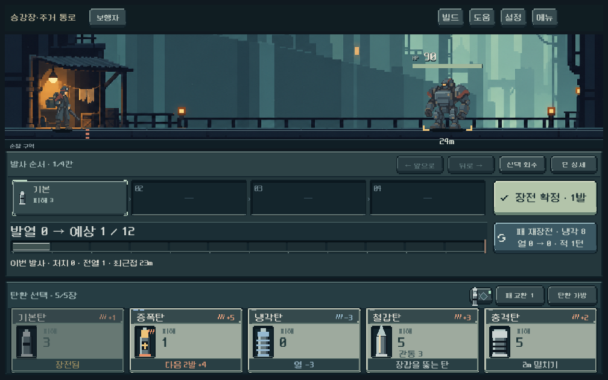
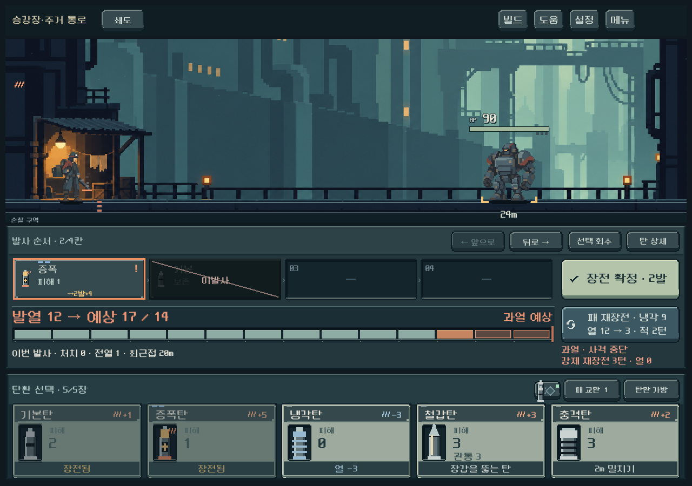

# 전투 패널 정렬 교정

사용자 화면에서 순서 편집 버튼이 상단 배경 띠 하단을 벗어나고, 장전 확정 버튼과 탄환 판의 수직 위치가 어긋났다.

## 원인과 변경

- 상단 장식은 고정 36px였지만 편집 버튼은 40px 이상이었다. 실제 Header의 배치 영역과 여백을 기준으로 배경 띠를 그린다. 패널 위 여백을 10px로 맞춰 버튼이 띠 안에 들어간다. 손패 헤더에도 동일한 실측 규칙을 쓴다.
- 주 행동 버튼 아래의 숨은 2줄 과열 경고 공간까지 중앙 정렬해 버튼과 탄환이 다른 높이에 놓였다. 경고는 기존 결과 행의 오른쪽 220px 영역으로 옮겼다. 숨김/표시 때 공간은 유지한다.
- 장전 확정/발사 버튼을 탄환 판의 보이는 높이 76px에 맞춰, 카드와 위아래 선을 정렬한다. Godot 편집기 미리보기에도 같은 높이를 적용했다.
- 새 행 추가나 전투 계산 변경 없음. 재장전 버튼의 오른쪽 정렬, 발열 UI, 카드 조작 유지.

## 검증

- `run_combat_hierarchy_checks.ps1`: **749검사, 실패 0**. 버튼이 상단 띠 내부 여백 안에 포함되는지, 탄환 판과 주 행동 버튼의 위아래 선 차이가 1px 이내인지 검사 추가.
- `run_combat_affordance_checks.ps1`: **376검사, 실패 0**. 편집/삽입/재장전 미리보기/입력 조작 회귀 포함.
- 1008×630 / 1280×900 / 1440×630: 빈 탄창, 삽입, 회수, 과열 예고, 확정, 강제 재장전 후 배치 안정성 검사.
- 1008×630 삽입 화면과 1280×900 과열 장전 화면을 실제 렌더로 열어 정렬과 경고 가독성 확인.
- 격리 QA 저장 사용. Galaxy 실기기 확인은 후속. APK/커밋/푸시 없음.

