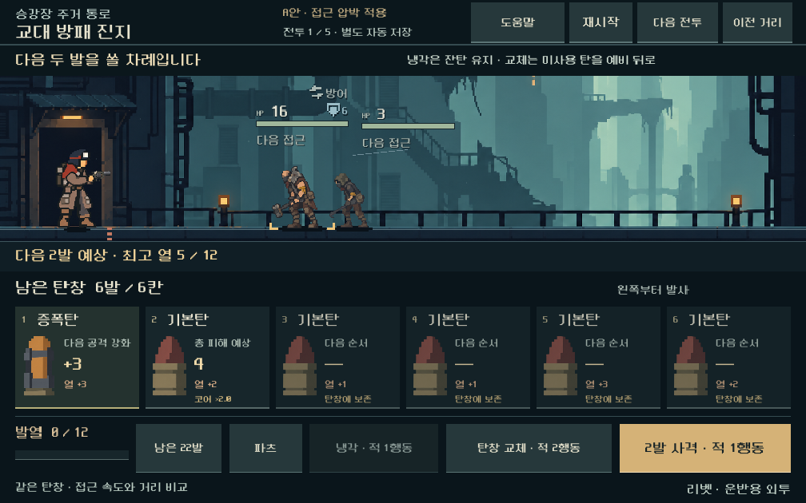
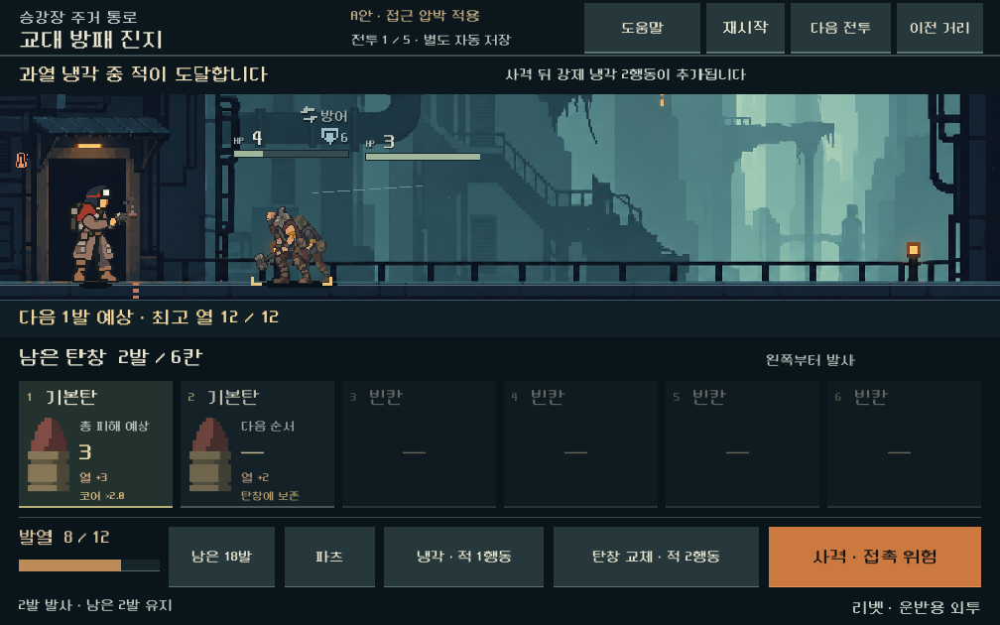
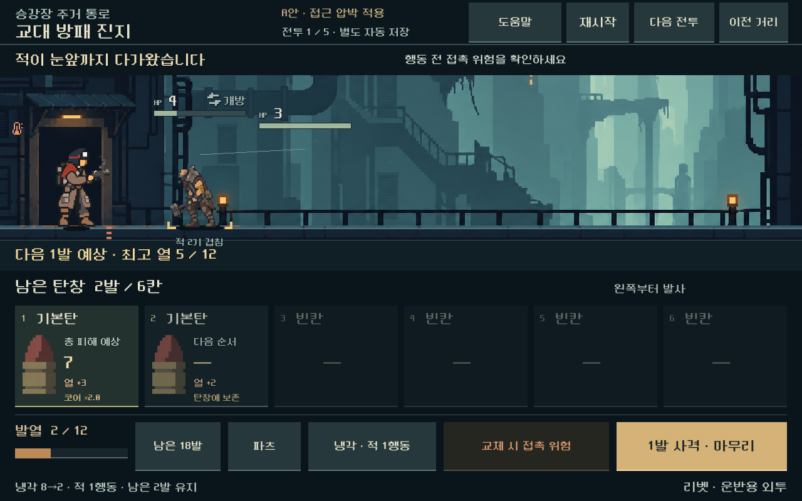

# 탄창·접근 압박 비교 검증

2026-10-31 · Godot 4.7 stable · Windows / RTX 4060 Ti / Compatibility.

[현재 후보와 판단](../../direction/combat-approach.md) · [실행](../../../OPEN_COMBAT_UI_STUDY.cmd)

## 입력과 범위

실제 v12 획득 체크포인트: 시드731042/운반용 외투의 201·401·602·802, 시드17/기본 작업복의301. 모두 리벳+돌파 코어이며 기존 소유 덱·성장·장비를 보존한다. 영구 비교 fixture에 출처를 기록했다. 이 저장은 새 접근 규칙으로 진행하며 얻은 경로가 아니다.

Godot MCP로 프로젝트/엔진을 확인하고 기존 로컬 검사 경로를 사용했다. 모든 신규 검사는 `qa_runtime/combat_approach_20261031/`의 격리 APPDATA/LOCALAPPDATA에서 실행했다. 본편 캠페인과 이전 탄창 비교의 저장 파일을 생성·덮어쓰지 않는 것을 확인한다. 기존 A 배치를 유지하고 주요 화면과 도움말 버튼은 TSCN에 저장한다.

## 규칙과 비교

- 거리5×이동2×탄 순서6×운용2×전투5 = 600조건 후보 탐색. [원자료](assets/combat_approach_2026-10-31/probe.json).
- 기능 검사 3,498개 실패0. 기존/새 압박 60조건의 예측·실행·탄약 보존·매 행동 저장 복원과 추가80조건의 순서 감사를 포함한다. [원자료](assets/combat_approach_2026-10-31/rules.json).
- HP/최대HP/장갑/종류/공격 시계/적 수가 변경되지 않았는지 확인했다. 이동 적의 시작 거리·이동량만 바뀌며 정지 사수와 보스 본체는 유지한다. 예비도 공개된 새 거리에서 기존 시점에 투입된다.
- 버전을 두 번 적용해 거리가 다시 줄어들지 않으며, 저장 복원은 이미 진행한 거리와 RNG를 그대로 유지한다. 미지원 버전·다른 전투 역할·탄창 후보 없는 상태를 거부한다.
- 사격 예측은 실제 모델의 빠른 이동·과열 냉각·발사체·승패와 일치한다. 냉각/교체 대안 예측이 상태와 RNG를 소비하지 않으며 실제 선택 결과와 일치한다.
- 추가80조건 중 동일 냉각 정책 실패5건은 제한 탐색(width48/depth26)으로 찾은 승리 경로를 실제 모델에서 재생했다. 발견된 경로만 해결로 기록하며 인간 승률이나 최적 전략으로 부르지 않는다. 미해결0은 이 범위에만 해당한다.

실제 선택 분기: 기본 방패전 사격2회 뒤 사격은 접촉 패배, 냉각과 교체는 즉시 생존. 냉각 직후에는 남은 탄 사격으로 승리하지만 교체하면 접촉 패배. 기본 보스에서도 냉각 뒤 교체하면 접촉, 후반 교체하면 압력탄 피격인 순간이 따로 확인된다.

검사 초기에 저장 JSON의 정수 버전이 실수로 읽히면서 배열 포함 검사에서 거부되는 문제를 발견했다. 숫자 타입과 정확한 버전값을 직접 검사하도록 수정해 3,498검사를 다시 통과했다. 손상된 비교 저장은 JSON 파서의 반환값으로 처리해 오류 로그 없이 복원을 거부한다.

## 실제 화면과 조작

1008×630, 1280×576, 1280×800에서 실제 터치 입력과 GPU 캡처를 확인했다. 화면/조작 검사 701개 실패0, 캡처24장. 이전 거리/접근 강화 전환은 같은 덱과 탄창 순서를 유지한다. 정상 사격2회 → 위험 예고 → 냉각 → 잔탄 사격 승리와, 같은 상태에서 계속 사격 → 과열 냉각 중 접촉 패배를 모두 실행한다.

다섯 전투의 진입·승리·다음 전투·처음으로 순환, 위험 상태에서 닫고 다시 열어 자동 재개, 비교 선택 저장, 도움말/탄약/파츠 상세, 손상되거나 설정이 불일치한 저장 거부, 종료 뒤 입력 차단을 확인한다. 기존 사격·적 전진 연출을 재사용하며 근접 적의 HP와 안내 줄의 분리를 검사한다.

[화면 검사 원자료](assets/combat_approach_2026-10-31/ui.json). 이번 근접 캡처는 사격2회와 냉각1회로 도달하며, 반복 빈 교체로 적을 일부러 당긴 사례가 아니다. 사람의 위험 이해도와 미감은 별도 검증이 필요하다.

## 회귀·변경 경계

- 이전 탄창 운용 기능 검사 797개 실패0.
- 기존 5총기×5전투 재생 보고서가 이전 검증 산출물과 동일하다. 새 접근은 본편 캠페인 생성 시 활성화되지 않는다.
- 기존 스크립트·씬·리소스/JSON 288개 중 287개 해시 동일. 공통 전투 모델 1개의 변경은 새 비교 저장의 버전 검증 추가다. 피해/적 행동 계산과 기존 탄창 운용/연출 코드는 재사용한다. 이전 비교 씬과 저장은 보존했다.
- [소스·캡처·회귀 해시](assets/combat_approach_2026-10-31/manifest.json).

미검증: 모든 탄 순서/복장/총기, 정예와 후반 구역, 새 규칙으로 실제 획득한 연속 등반, 전체 탄약 경제, 사람의 재미·이해도, 모바일 지속 성능/기기 발열. APK·커밋·푸시·외부 게시 없음.

재현: `tools/run_combat_approach.ps1 -Mode probe|rules|ui`; 회귀 `tools/run_combat_magazine_loop.ps1 -Mode rules`, `tools/run_combat_ui_stage1.ps1 -Mode baseline`.
