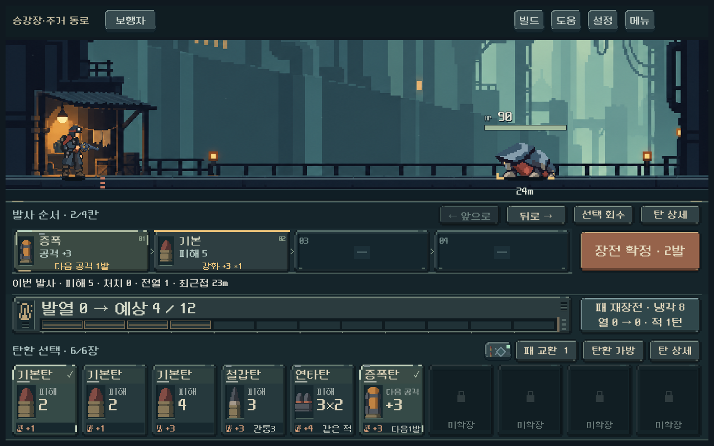
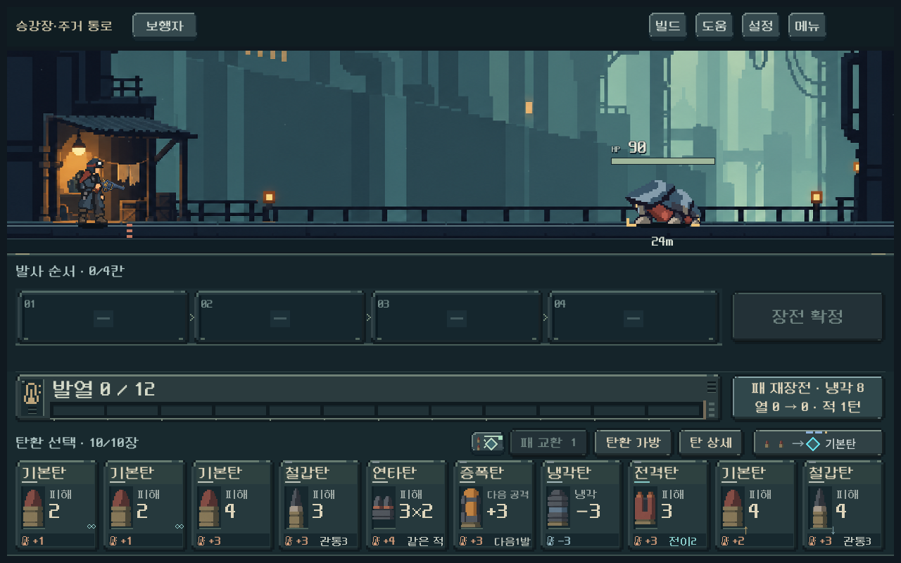

# 전투 발열 간격·탄환 카드 도트 통일

사용자 요청: 발사 카드와 발열 사이를 벌리고, 발열과 탄환 선택은 가깝게 묶는다. 세 영역의 재질과 도트 표현을 통일하고 탄환 카드의 배경·외곽 디테일을 보강한다.

## 적용

- 예상 결과 행을 발사 카드 바로 아래로 이동했다. 결과 행이 발사 영역과 발열 계기 사이를 구분하며, 빈 탄창에서도 같은 높이를 예약해 장전 시 화면이 늘어나지 않는다.
- 발열 바로 아래에 탄환 선택이 이어진다. 공통 바탕과 이음선을 발열 위부터 시작하도록 바꾸고, 발열과 손패 사이의 별도 경계선은 제거했다.
- 손패 카드에 기존 급탄 레일·발열 계기와 같은 계단형 금속 테두리를 적용했다. 이름 띠, 탄약을 놓는 어두운 홈, 하단 발열 비용 띠로 면을 구분했다. 숫자 뒤에는 질감을 더하지 않았다.
- 선택·장전한 탄은 밝은 모서리와 체크 표시, 빈 칸·사용함·미확장은 낮은 대비의 홈으로 구분한다. 등급·점유 칸·배치 제약·개조·압축 가능 표시는 유지했다. 눌릴 때 압축 표시도 카드와 함께 내려간다.
- 기존 글자·탄환 그림 크기, 카드132px 높이, 가방4/6/10장에 관계없는 고정10자리, 조작 영역과 전투 규칙은 유지했다.

## 실제 화면과 간격

1280×800의 논리 좌표 기준이다. 발사 카드/발열의 바깥 사각형과 탄환 선택 제목 행 사이를 측정했다.

| 항목 | 이전 | 이번 |
| --- | ---: | ---: |
| 발사 카드 끝 → 발열 시작 | 4px | 40px |
| 발열 끝 → 탄환 선택 제목 시작 | 44px | 8px |
| 전체 조작부 높이 | 430px | 430px |
| 탄환 카드 높이 | 132px | 132px |

[이전 화면](combat_spacing_2026-10-18/loaded_1280.png)

[작은 화면·큰 글씨·과열](combat_card_finish_2026-10-18/overheat_large_text.png) · [고급·특수 탄환](combat_card_finish_2026-10-18/special_1008.png) · [사용한 자리](combat_card_finish_2026-10-18/spent_1008.png) · [확률형 과열](combat_card_finish_2026-10-18/random_1008x630.png) · [여러 턴 예측](combat_card_finish_2026-10-18/full_scope_1008x630.png) · [긴 창](combat_card_finish_2026-10-18/loaded_1280x900.png)

## 검증과 한계

- `tools/run_combat_hand_live_checks.ps1`: **1,444검사 실패0**. 1008×630/1280×800/1440×630, 가방4/6/10장, 장전·회수·교환·압축·길게 누르기·상세·발사·과열·큰 글씨, 고정 카드 크기 및 세로 넘침 확인.
- `qa_runtime/combat_card_finish/capture.ps1`: 이전 배치 검수 프로브를 이번 격리 경로로 실행. 위 세 해상도와1280×900, 빈 탄창→장전→확정, 확률 과열·여러 턴 예측·재장전 위험의 위치와 경고 전체 폭 확인. **826검사 실패0**. 합계 **2,270검사 실패0**.
- 대표 GPU 캡처를 직접 확인했다. 모델·탄환 콘텐츠·캠페인 SHA256은 이전 기록과 동일하다. 테스트는 격리 저장/저장 비활성으로 수행했다. 알려진 엔진 루트 인증서 환경 경고 외 오류 없음.
- 이번 변경은 배치 순서와 카드 그림에 한정된다. 피니시 연출 코드는 변경하지 않았으며 전체 피니시/열 전용 검사는 이번에 반복하지 않았다. 이전 검증은 [직전 보고서](combat_spacing_2026-10-18.md)에 구분해 남긴다.
- 실제 Galaxy의 조작감과 사용자 미감은 확인 전이다. 새 생성 이미지/외부 자산 도입, APK 생성, 커밋·푸시 없음.

[제작 방식·소스 해시](../../art/combat-card-finish-20261018.json) · [실행](../../../PLAY.cmd)
