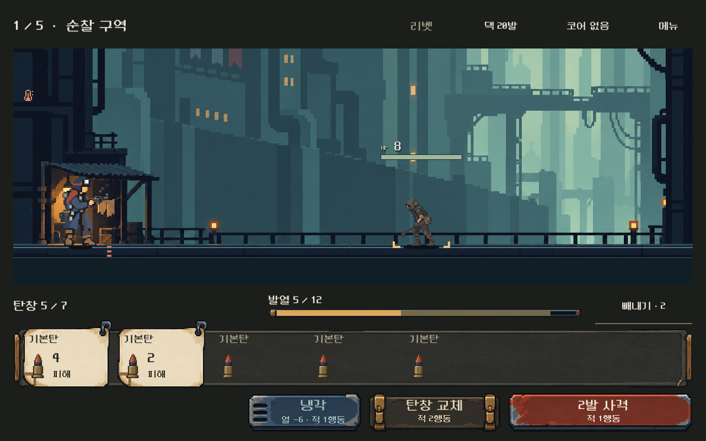
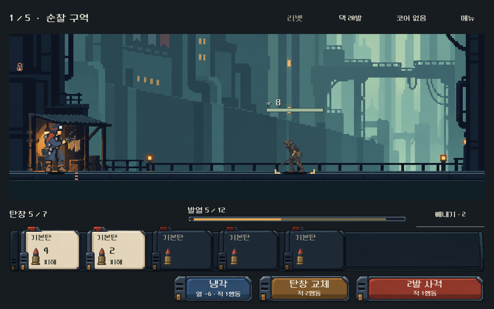
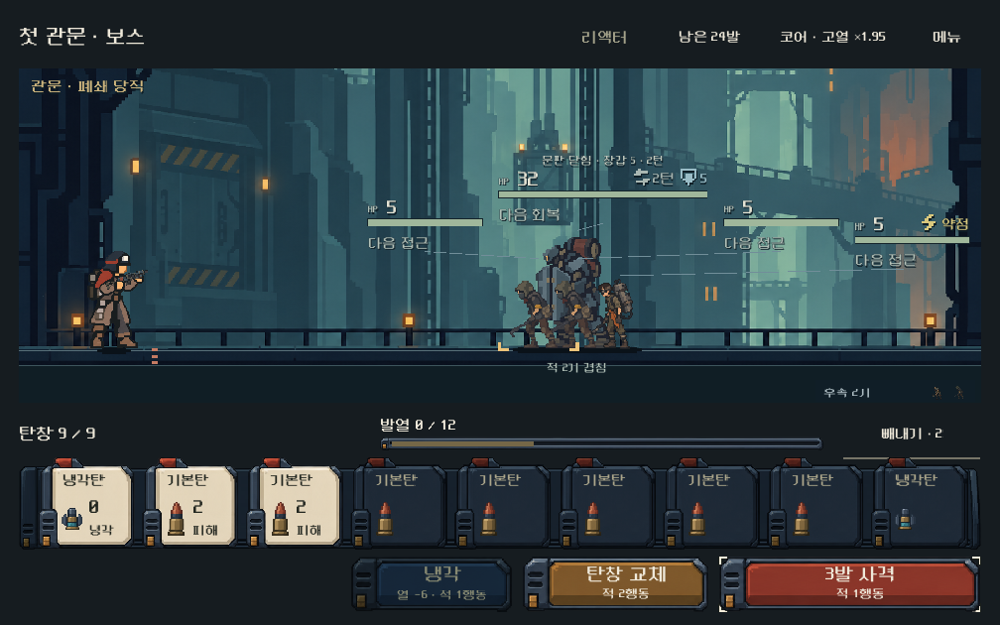
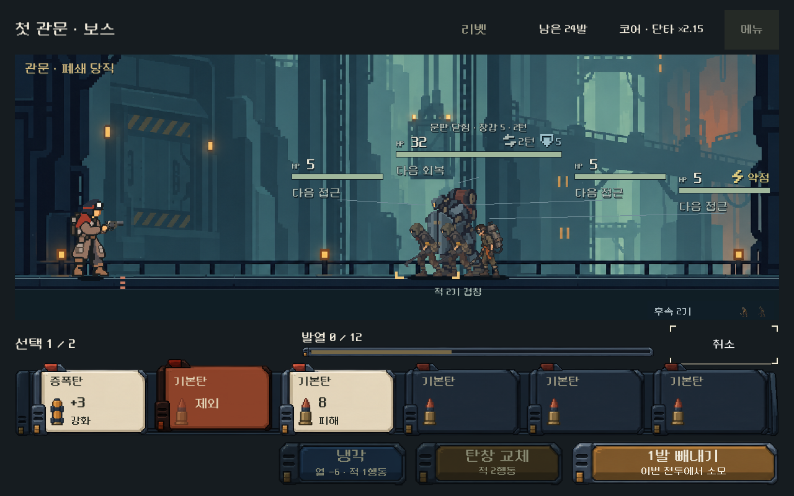

# 전투 UI — 같은 제작소의 급탄 장비

## 피드백과 이번 판단

사용자는 도트 소품 버전이 전보다 나아졌다고 했으나, 각 디자인이 따로 놀고 탄환 카드의 특색이 약하다고 평가했다. 앞선 개선을 최종 미감 승인으로 기록하지 않는다.

이번에는 ‘같은 제작소의 탄약 장비’를 구성 기준으로 삼았다. 카드·레일·버튼·발열계·메뉴의 공통점은 청회색 강철, 깎인 오른쪽 모서리, 왼쪽 이중 홈과 작은 황동 접점이다. 같은 색으로 덮는 대신 상아색 발사 대상·주홍 사격·푸른 냉각·황토색 교체의 역할을 유지한다. 탄환 카드는 종이 표찰에서 뽑기 탭이 있는 급탄 패로 바꿔, 탄창에 끼우고 빼내는 이 게임의 조작과 형태를 연결했다. 이 비유는 디렉터의 구현 판단이며 확정 세계관이나 사용자 선호가 아니다.

발사/대기 패는 같은 실루엣을 쓰되 대기 명암을 낮췄다. 빼내기 선택은 붉은 패·`제외` 문구·6px 상승으로 구분한다. 빈칸에는 패를 그리지 않는다. 이름/작은 탄환을 기본으로 하고 발사할 탄에만 결과를 표시하는 정보량, 위쪽 발열계, 카드 전체 터치, 실제 전투 계산은 유지했다.

## 실제 Godot 화면

직전 같은 전투·같은 첫 사격 후:

현재 같은 상태:

9칸·1008×630:

중간 탄 빼내기 선택:

[1280×576](combat_feedkit_2026-10-31_assets/ready_single_1280x576.png) · [실제 누름](combat_feedkit_2026-10-31_assets/pressed.png) · [상세](combat_feedkit_2026-10-31_assets/detail.png) · [메뉴](combat_feedkit_2026-10-31_assets/menu.png).

## 제작·연결

Godot MCP `get_project_info`로 활성 프로젝트/4.7을 먼저 확인했다. 내장 `image_gen.imagegen`에 승인 배우, 승인 배경, 직전 실제 화면을 역할별 참조로 넣어8부품 원화1장을 제작했다. 원본1536×1024 RGBA는 바이트 그대로 복사했으며 비트맵 후처리는 하지 않았다. 알파128이상 경계와2px 여유를 읽기 전용으로 측정해 AtlasTexture에 등록했다.

[저장 원화](../../../새-게임-프로젝트/assets/art/combat_feedkit_20261031/kit.png) · [전체 프롬프트·참조 역할·원본/결과 해시·영역](../../../새-게임-프로젝트/assets/art/combat_feedkit_20261031/provenance.json) · [네이티브 등록 도구](../../../tools/build_combat_feedkit_resources.py).

주 배치·9분할·축척·대표 상태는 `redesign/samples/hud/combat_hud.tscn`에 저장했다. 탄환 패0.4, 키0.5, 레일/모달1⁄3, 계기0.25축척과 nearest필터를 사용한다. 그림28×44px, 카드108px, 키72px, 상단/빼내기64px, 냉각 폭208px는 유지한다. 새 원화는 고정 영역에 체결부를 두고 읽기 면만 늘린다. 글자/숫자는 Godot 노드다.

초기 통합에서 카드의 너비가9분할 최소 크기만큼 추가되어 옆 칸으로 넘어갔다. 카드 최소 폭100px를 씬에 선언해 초기 크기를 보장했고, 실제 슬롯 안에 그림이 들어가는 검사와5~9칸 캡처로 수정 결과를 확인했다. 이 수치는 현재 구현값이며 영구 픽셀 규칙이 아니다. 실행 중 상태 표시는 발사/대기/제외 아트·명암, 선택 시6px 상승, 버튼 누름2px/복귀뿐이다. 입력 영역은 고정이다.

## 검증

모두 작업별 격리 APPDATA/LOCALAPPDATA와 별도 QA 저장에서 실행했다. Godot 가져오기/실행 오류 없음.

| 범위 | 결과 | 증거 |
|---|---:|---|
| 5총기×4비율 UI, 터치/키보드, 상세/메뉴, 중간 빼내기 취소/확정, 실제 사격/예측/저장 재개 | 12,636검사·실패0 | [UI](combat_feedkit_2026-10-31_assets/ui.json) |
| 3비율 연속5전투, 보상·정비·성장·재개·패배/재도전·총기 선택 | 4,659검사·실패0 | [연속 흐름](combat_feedkit_2026-10-31_assets/flow.json) |
| 최종 실제 캡처,5/9칸을 포함한 슬롯 내 아트 경계, 선택 상태, 실제 포인터 눌림2px/놓기 복귀 | 1,338검사·실패0 | [경계/캡처](combat_feedkit_2026-10-31_assets/geometry.json) |
| 원본 해시·RGBA·투명 모서리·8영역 경계/중심/등록 | 27검사·실패0 | [원화](combat_feedkit_2026-10-31_assets/art_checks.json) |

UI비율은1008×630,1280×576,1280×720,1280×800이다. 작은 글씨 대비 검사는 실제 폰트색×변조색과 원화 중앙색의4.5:1 기준이며, 전체 텍스처/모든 글자 주변의 최저 대비나 실제 모바일 판독성을 보장하지 않는다. 슬롯 범위 검사는 초기9분할 최소 크기로 발생했던 실제 넘침을 재현 방지하기 위해 기존 UI검사에 추가했고 최종 캡처 검사에서 실행했다.

실행: `powershell -NoProfile -ExecutionPolicy Bypass -File qa_runtime/combat_feedkit_20261031/run.ps1 -Mode ui`, `-Mode flow`, `-Mode preview`. 원화 읽기 전용 검수는 같은 폴더의 `audit.py`, 재등록은 `python tools/build_combat_feedkit_resources.py`다.

시작 시2,204개 기존 코드/씬/리소스/문서/도구의 해시와 작업 트리를 보존했다. 최종 [기존 파일 변경 대조](combat_feedkit_2026-10-31_assets/source_delta.json)에서 HUD2·기존검사1·방향4·일지1의8파일만 변경됐고, 예상 밖 변경/누락은0이다. QA 산출물과 새 원화/등록/보고서는 별도 추가다.

## 범위와 남은 확인

PC의 `OPEN_COMBAT_UI_STUDY.cmd`(여정), `OPEN_MAGAZINE_COMPARISON.cmd`(독립 비교)에 적용했다. 본편 전체 화면이나 보상 카드까지 같은 원화로 교체한 것은 아니다. 기존 배우/배경/탄환 PNG, 전투 계산·난수·소유·저장 규칙은 이번 작업에서 수정하지 않았다. 이전 원화/화면은 이력으로 보존한다.

제작자 판단으로 이전 천/종이/서로 다른 체결부의 불일치를 줄였고, 공통 패의 발사·대기·빼내기 구분과 작은 탄환을 확인했다. 한계는 반복 패 구조의 선호, 새 형태가 탄창/빼내기로 자연스럽게 읽히는지, 실제 모바일 판독성과 지속 성능이다. 기능 검사·PC 화면 확인은 사용자 미감 승인이나 Android 실기기 검증을 대신하지 않는다. 고해상도 생성 원화의 도트풍이며 엄격한 저해상도 색상 격자를 보장하지 않는다. APK·외부 게시·커밋·푸시는 하지 않았다.
