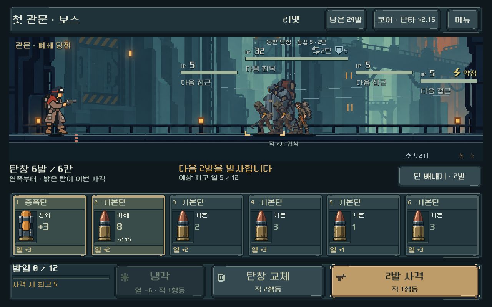
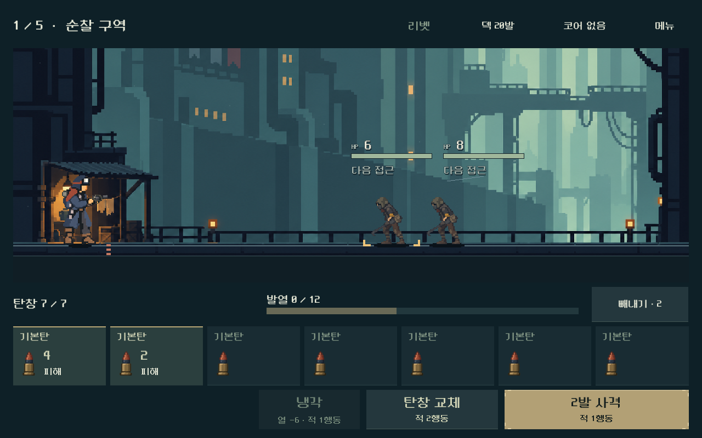
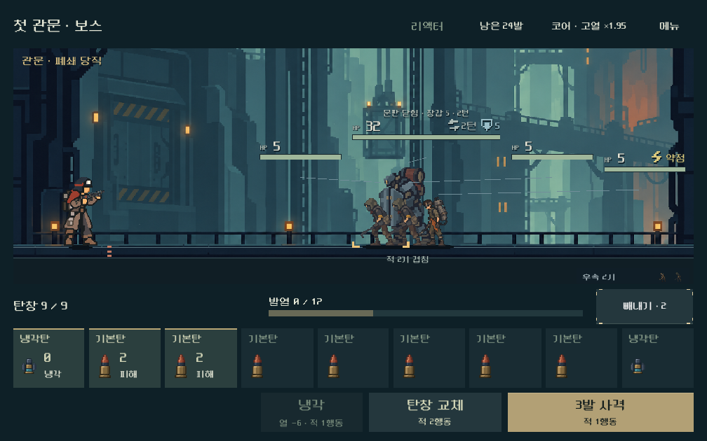
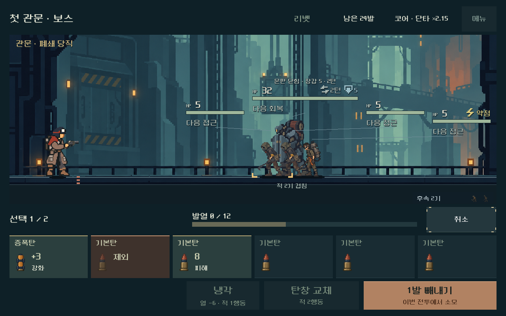
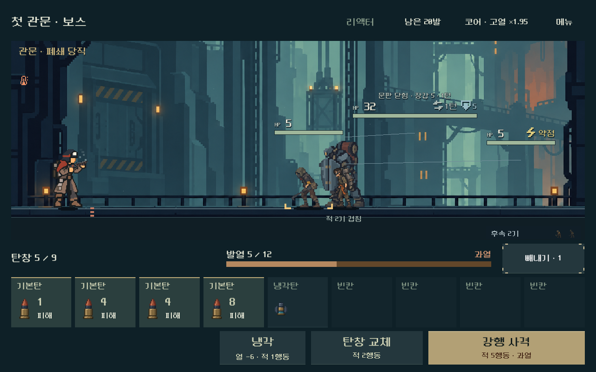

# 전투 HUD 집중도와 탄환 크기 교정 — 2026-10-31

## 사용자 지시와 구현 판단

사용자는 이전 탄환의 도트 표현이 배경·캐릭터와 맞지 않고 큰 표시가 촌스럽다고 평가했다. “다음 2발을 발사합니다”, “예상 최고 열” 제거, 기존 사격 안내 위치로 발열 게이지 이동, 핵심만 잘 보이는 화면은 명시 지시다.

작은 무광 원화·카드의 반복 정보 축소·단순한 청회색 면·황동 주요 행동은 디렉터의 구현 판단이다. 사용자에게 이번 미감이 승인된 것으로 기록하지 않는다. A안 하단 탄창과 선택 빼내기, 실제 전투·소유·저장 계산은 유지한다.

## 변경

- 주 탄창 카드 높이164→108px, 그림 최대 영역52×80→28×44px. 카드 전체 터치 영역은 보존했다.
- 카드 이름과 작은 그림을 기본으로 두고 이번 사격 탄에만 예상 피해/지원 효과를 보인다. 대기 기본 수치, 개별 열, 배율, 칸 수는 상세에서 읽는다. 제외할 탄은 구릿빛과 `제외`로 구분한다.
- 상시 사격/최고 열 문구를 감추고 발열을 탄창 위 중앙으로 옮겼다. 현재 채움·옅은 최고 열 예상 구간·과열 경고는 실제 예측에 연결한다. 선택 빼내기에도 즉시 갱신된다.
- 큰 외피/탄약 홈/조작 기호를 덜어냈다. 사격 버튼과 발사 대상 탄에만 높은 강조를 주고 냉각·교체·사격을 오른쪽에 묶었다.
- 실제 행동 비용, 과열·접촉 위험, 저장 실패 안내는 유지한다. 기본 피해와 적용된 예상 결과는 상세에서 구분한다.
- 상단과 빼내기는64px, 주요 행동은72px 높이다. 검사 중56px 높이가1280×576에서 최소44px 터치 기준을 밑도는 문제를 발견해64px로 보완했다.

탄환은 승인 캐릭터와 기존 탄종 정체성을 실제 입력으로 사용해 다시 생성했다.20프레임 RGBA1536×1024 원본을 무편집으로 연결한다.189ID와 thermal→bore 별칭은 유지하며 그림은 공용 경로의 보상/가방/상점에도 적용된다. [원본 참조·정확한 프롬프트·해시·영역](../../../새-게임-프로젝트/assets/art/ammo_quiet_20261031/provenance.json).

주 배치는 `combat_hud.tscn`, 공통 테마와18개 네이티브 StyleBox에 저장한다. 원본/이전 UI는 보존하고 실행 중에는 상태만 바인딩한다.

## 실제 화면

변경 전:

같은 관문 상태의 변경 후:

실제 여정 첫 전투:

1008×630의9칸 탄창:

빼내기 선택과 과열 예상:

[세부 정보](combat_focus_2026-10-31_assets/detail.png) · [넓고 낮은 화면](combat_focus_2026-10-31_assets/wide.png) · [공용20프레임 표시](combat_focus_2026-10-31_assets/family.png) · [가방](combat_focus_2026-10-31_assets/bag.png).

## 검증

Godot4.7 Compatibility, 실제 렌더링 창과 격리된 APPDATA/LOCALAPPDATA에서 검증했다. 사용자 저장에는 접근하지 않았다.

| 검사 | 결과 | 범위 |
|---|---:|---|
| 전투 UI |9,224 / 실패0|총기5종×화면4종, 터치·키보드·상세·메뉴·빼내기·실제 사격·예측 열·행동 비용·저장 복귀|
| 연속 여정 |3,635 / 실패0|연속5전투·보상·코어/탄 선택·정비·재개·패배/재도전,3화면|
| 공용 탄환 |346 / 실패0|189ID 연결·20프레임 영역/알파·보상/덱/상세3비율·모델/난수 무변경|

최초 UI80건·여정24건 실패는 동일한4개 버튼의 낮은 터치 높이가 반복된 결과였다. 테스트 기준을 낮추지 않고 실제 배치를 수정한 뒤 재실행했다. 새 UI 검사에는 문구 비노출, 게이지 위치/예측값, 작은 그림 상한, 반복 정보 비노출을 추가했다. 기존 상호작용 검사는 유지했다.

[UI 결과](combat_focus_2026-10-31_assets/ui.json) · [연속 여정 결과](combat_focus_2026-10-31_assets/flow.json) · [공용 아트 결과](combat_focus_2026-10-31_assets/art.json). 최종 실제 화면에서 작은 탄환의 형태·금속 광택 축소·작은 화면·선택/과열 상태를 제작자가 검토했다. 자동 검사는 사람의 가독성·미감·재미 승인이 아니다.

작업 시작1,808개 기존 코드·문서·벡터 해시와 대조해 의도한 표시/씬/테마/검사/방향·기록 파일만 변경하며 누락은 없다. 기존 전투 계산과 저장 소스는 변경하지 않았다. [변경 범위](combat_focus_2026-10-31_assets/source_delta.json).

## 적용과 남은 확인

`OPEN_COMBAT_UI_STUDY.cmd`의 탄창 여정과 `OPEN_MAGAZINE_COMPARISON.cmd`의 독립 비교에 반영했다. 본편 기본 진입과 기존 모바일 배포본은 바뀌지 않는다. APK·외부 게시·커밋·푸시는 수행하지 않았다.

사용자의 새 미감/가독성 평가와 Android 실기기 터치·안전 영역·지속 FPS·발열은 별도 확인이다. PC의 화면/기능 통과나 단일 아틀라스 전환을 모바일 성능 개선의 증거로 취급하지 않는다.
