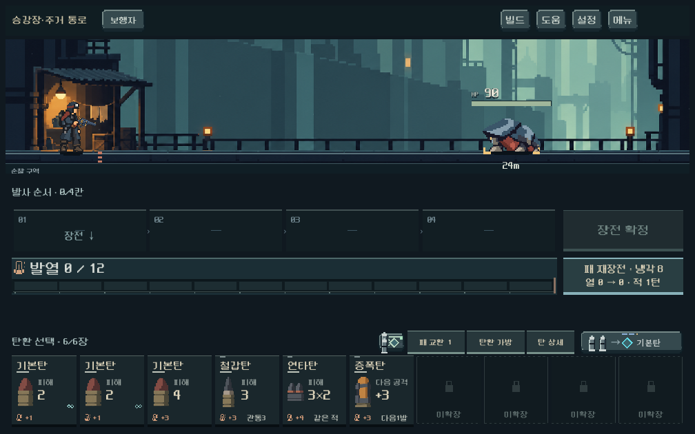
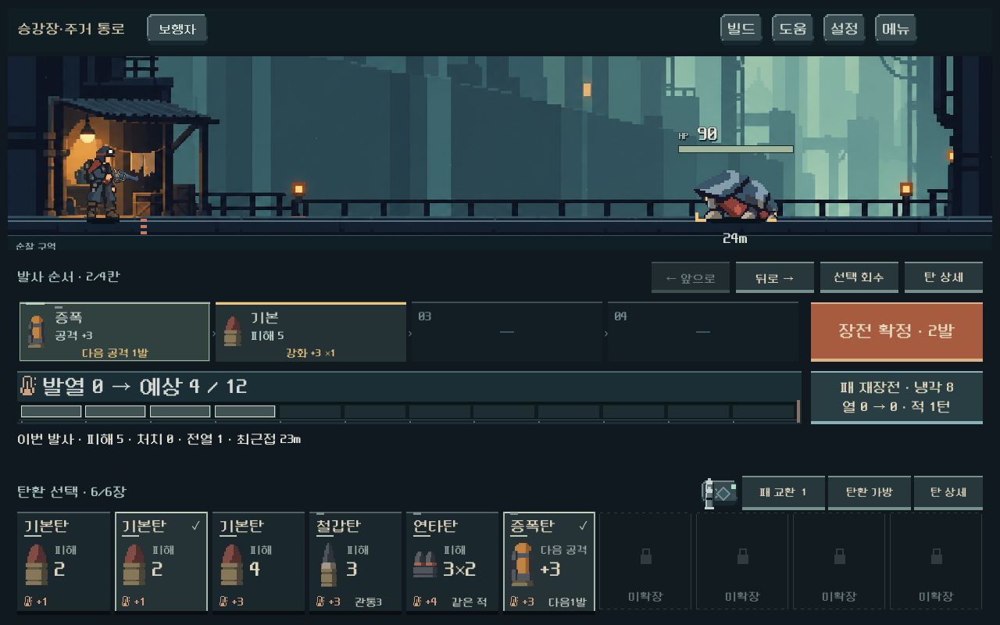

# 전투 카드 본편 통합 · 고정 10칸 — 2026-10-18

사용자는 최근의 작은 탄환/카드 시안을 본편에 연결하도록 승인했으며, 가방이 6칸이어도 카드 여섯 장을 가로로 늘리지 말고 남는 자리를 별도 형태로 표시하도록 요청했다. 전투 규칙·가방 용량·획득 방식은 변경하지 않았다.

## 적용

- 실제 전투 손패를 항상 10자리 한 줄로 표시. 같은 해상도에서 4·6·10장 가방의 카드 크기가 동일하다. 현재 가방 바깥은 흐린 자물쇠/점선의 **미확장**, 가방 안 빈 곳은 **빈 칸**이다.
- 장전한 개별 카드는 원래 자리에 체크로 남는다. 발사 후 **사용함**, 압축한 원본 두 장은 **압축됨**으로 자리를 보존한다. 회수 시 원래 카드를 복구한다. 재장전/패 교환은 새 손패를 구성한다.
- 기본/철갑/연타/증폭/냉각/전격 여섯 가족에 새 v4 원화를 사용한다. 해당 위력·개조·압축 변형도 같은 가족 원화에 실제 수치와 등급/개조/점유 표시를 붙인다. 그 외 가족은 기존 실루엣을 유지한다.
- 카드, 발사 레일, 장전·발사·재장전 버튼, 발열 계기의 면/선/색을 최근 시안에 맞췄다. 장전 중 예상 발열과 실제 열, 재장전 냉각과 과열 위험은 기존 계산을 그대로 사용한다.
- 카드 길게 누르기(0.5초), 우클릭, **탄 상세** 버튼으로 상세를 연다. 장전된 비활성 카드도 길게 누를 수 있다. 상세 전환/닫기는 턴·탄환을 소모하지 않는다. 짧게 누르기와 동일탄 드래그 압축은 유지한다.
- 현행 최대10장에서는 페이지 이동이 필요 없다. 10장을 넘는 과거/개발 저장은 기존 내용 유실 없이 10장씩 넘기는 호환 경로를 둔다.

`PLAY.cmd` → 새 등반/등반 계속 → 전투에서 적용된다. `UI_ART_PREVIEW.cmd`는 이전 비교 시안으로 남는다. 상점/보상/가방의 전체 카드 면 재디자인은 이번 범위에 포함하지 않았다.

## 화면

- [10장 전체](combat_hand_live_2026-10-18/bag10_1440.png)
- [사용한 탄환 자리](combat_hand_live_2026-10-18/spent_1008.png)
- [압축·개조·기타 탄종](combat_hand_live_2026-10-18/special_1008.png)
- [카드 상세](combat_hand_live_2026-10-18/detail_1008.png)
- [과열 경고·큰 글씨](combat_hand_live_2026-10-18/overheat_large_text.png)
- [본편 데이터 연결 전 편집기용 구성](combat_hand_live_2026-10-18/editor_before_binding.png)

## 검증

Godot MCP로 엔진4.7.stable 확인, 기존 CLI/GPU 캡처 경로 사용. 저장 위치는 `qa_runtime/`의 독립 APPDATA/LOCALAPPDATA이며 저장 기능도 비활성화했다. 전투 시드731042, 실제 Campaign/Model/Forecast 및 본편 `main.tscn` 사용.

| 검사 | 결과 |
|---|---|
| `tools/run_combat_hand_live_checks.ps1` | 1,444검사, 실패0 |
| `tools/run_ammo_identity_checks.ps1 -Mode ui` | 398검사, 실패0 |
| 기존 `modal_touch_runner.gd` 격리 실행 | 79검사, 실패0 |

1008×630, 1280×800, 1440×630에서 4/6/10장 크기 동일·단일 행·경계·장전 후 높이 유지 확인. 실제 ScreenTouch로 첫/끝 카드, 개별 중복탄, 회수/LIFO, 압축·원복, 교환, 장전된 카드와 일반 카드의 길게 누르기, 상세 닫기/순환을 검사했다. 실제 발열 증가/과열 예측/재장전 표시도 모델과 대조했다. 기존 터치 검사에서 지도·파츠·본문 스크롤 및 네이티브 압축 드래그 통과. 개별 탄환 개조·상점 압축·획득 회귀도 통과했다.

첫 검사 실패는 이미 숨겨진 `undo` 버튼을 호출한 시험 경로와 그로 인해 남은 교환창이었다. 현행 공개 버튼 `remove_selected`로 수정하고 fixture 진입 시 창을 닫아 재검증했다. 기존 공용 카드 검사도 빈자리 Control과 새로운 카드 면을 구별하도록 수정했다.

환경 로그의 Windows 루트 인증서 저장소 읽기 오류는 별도로 기록했다. 최초 편집기 import에서 격리 환경 Android build-tools 경고가 있었다. 이번 변경의 파싱/런타임 오류는 없고 APK 작업은 하지 않았다. 새 QA 실행기는 알려진 인증서 메시지만 제외하고 다른 엔진 오류는 실패 처리한다.

실제 캡처에서 6/10장, 장전/사용함, 상세, 압축/기타 탄종, 큰 글씨 과열, 편집기용 구성을 확인했다. 자동 검사 수는 완성도 점수가 아니다. **Galaxy 실기기의 글씨·길게 누르기 감도와 사용자 미감은 확인 전**이다. 기타 탄종의 원화 전체 교체와 상점/보상/가방 면의 통일은 후속이다.

## 구현 위치

- `combat_workbench.tscn/.gd`: 10열과 편집기용6장+4빈자리, 프레임 정리.
- `combat_ammo_card.tscn`, `ammo_hand_slot.tscn/.gd`, `ammo_hand_face.gd`, `ammo_art.gd`: 실제 카드/빈자리/공용 원화 표시.
- `ammo_hand_button.gd`, `ammo_hand_details.tscn`, `screen.gd`: 길게 누르기와 실제 소유물·장전·상세 연결.
- `magazine_view.gd`, `heat_gauge.gd`, `combat_treatment.gd`, `hand_surface_*.tres`: 레일/계기/행동 버튼.
- 원화는 기존 `assets/art/ammo_recast_20261017/cartridges_v4.png` 재사용. [제작 출처](../../art/concepts/ammo-recast-20261017/provenance-v4.json).
