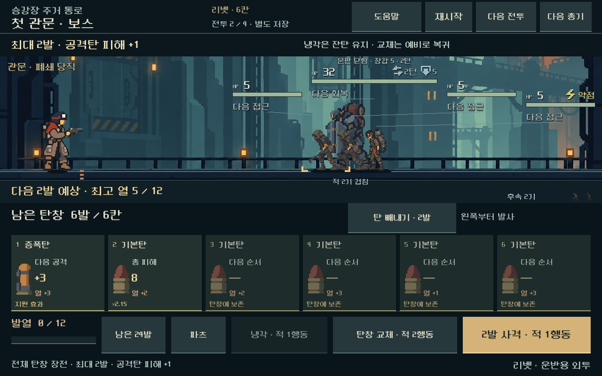
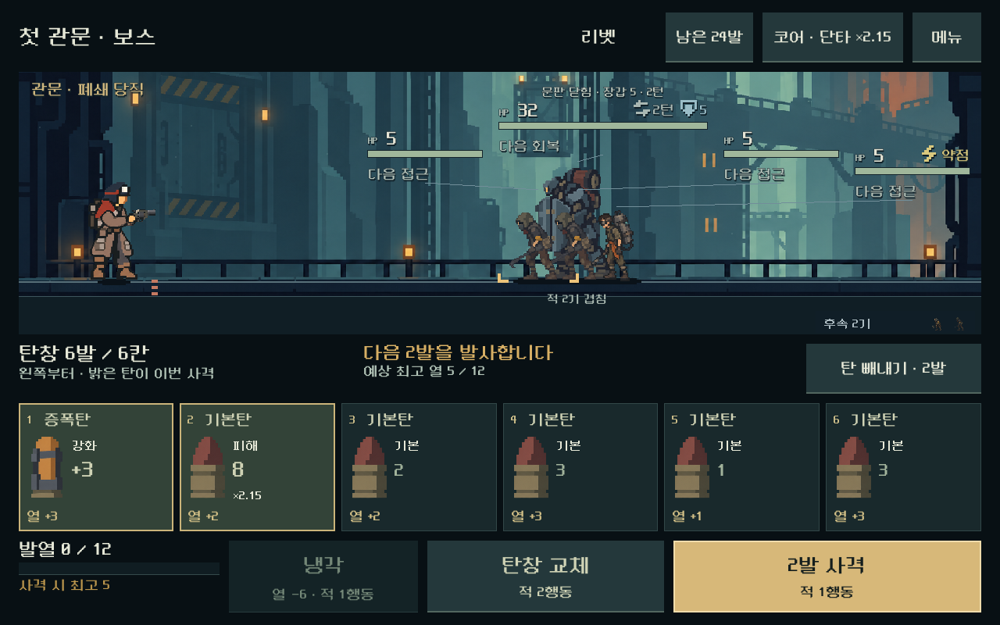

# 전투 화면 배치·디자인 정리 — 2026-10-31

## 결과와 적용 범위

사용자는 후속 플레이 테스트보다 전투 화면의 배치와 디자인 정리를 먼저 요청했다. A안의 하단 가로 탄창과 기존 도트 리소스를 유지하며 **전장의 위협 → 이번 사격 탄과 예상 결과 → 실행 버튼** 순서로 배치했다. [현재 결정](../../direction/combat-hud.md).

상단에는 진행·총기·덱·코어를 남기고 도움말·재도전·새 출발·비교 전환은 메뉴에 모았다. 1280×800에서 전장 높이는 기존312px에서336px로 늘었다. 이번 발사 탄은 황동 테두리와 밝은 면, 대기 탄은 어두운 면, 빼낼 탄은 주황색과 제외/소모 문구로 구분한다. 발열과 냉각을 나란히 두고 사격을 가장 큰 주요 행동으로 표시했다.

PC 실행기 `OPEN_COMBAT_UI_STUDY.cmd`는 새 여정 화면, `OPEN_MAGAZINE_COMPARISON.cmd`는 새 독립 비교 화면으로 연결된다. 기존 저장 위치·형식과 전투·난수·성장 계산을 유지한다. 본편 기본 시작 화면과 기존 배포 APK는 이번 변경의 적용 대상이 아니다.

## 실제 화면

같은 독립 비교 초기 상태를 이전 화면과 새 화면에 넣고 상태 일치를 검사한 뒤 캡처했다.

| 이전 | 개편 |
| --- | --- |
|  |  |

아래는 실제 보상과 성장을 거친 다섯 번째 관문 전투다. 위 비교와는 다른 진행 상태다.

[작은 화면](combat_hud_2026-10-31_assets/ready_single_1008x630.png) · [9칸 탄창](combat_hud_2026-10-31_assets/ready_heavy_1280x800.png) · [중간 탄 선택/무작위 예측](combat_hud_2026-10-31_assets/selected_scatter_1280x720.png) · [넓은 화면/과열](combat_hud_2026-10-31_assets/fired_heavy_1280x576.png) · [메뉴](combat_hud_2026-10-31_assets/menu_single_1280x800.png) · [탄 상세](combat_hud_2026-10-31_assets/detail_single_1280x800.png) · [다섯 전투 완료](combat_hud_2026-10-31_assets/complete_1280x800.png).

## 표현과 입력

- 이번 사격 탄은 기존 예측의 실제 피해·지원 효과·무작위 범위를 표시한다. 대기 공격탄의 ‘기본’은 총기·코어·표적·연계 적용 전 위력이며 상세에서도 차이를 설명한다. 대기 지원탄은 보유 장비를 반영한 효과다.
- 사격 비용은 과열을 포함한 예상 적 행동 수다. 무작위는 최대 행동 수, 즉시 승리는 ‘적 행동 없이 마무리’로 표시한다. 위험 확률 안내가 있는 상태는 기존 위험 안내를 우선한다.
- 탄을 누르면 상세를 열고 빼내기 모드에서는 같은 카드로 선택한다. 저장 실패는 상단에서도 즉시 보인다.
- 메뉴·상세·여정 패널에서 배경 전투 입력을 막는다. 메뉴/상세의 키보드 초점 순환과 Escape 닫기·선택 취소를 제공한다. 버튼에는 자식 활자 외에 접근성 이름을 설정했다.
- 주요 배치·카드·테마는 TSCN/TRES에 저장했다. 기존 컨트롤러를 상속하는 두 어댑터와 공통 표시 코드가 실제 상태만 반영한다. 보상 흐름 패널은 기존 씬에서 분리해 재사용했다.

## 검증

Godot4.7 stable / Windows / OpenGL Compatibility / RTX4060Ti에서 실행했다. Godot MCP로 프로젝트 연결을 확인하고 로컬 엔진에서 직렬화된 씬을 실행했다. 모든 QA의 APPDATA/LOCALAPPDATA는 검사별 경로로 격리했다. 사용자 저장은 사용하지 않았다.

| 검사 | 최종 결과 | 확인 범위 |
| --- | --- | --- |
| 새 HUD 입력·배치 | 13,056검사, 실패0 | 5총기, 4해상도, 경계, 실제 터치, 모달 차단, 저장 재개, 키보드, 표시 비용/실제 명령 비교 |
| 새 여정 흐름 | 4,693검사, 실패0 | 3크기에서 5연속 전투·보상·코어·2정비·완료, 5총기 출발/첫 사격, 패배·재도전·재개 |
| 기존 빼내기 규칙 | 4,011검사, 실패0 | 선택·제거·예측·저장·유한 탄약 회귀 |
| 본편 기존 기준 | 25전투, 실패0 | 기존 기준 전투 재생 |
| 최종 씬 로드 | 종료 코드0 | 최종 소스의 여정 HUD headless 실행, 파싱/실행 오류 없음 |

HUD는1008×630,1280×576,1280×720,1280×800의4해상도·3비율, 여정은1008×630,1280×576,1280×800의3크기·2비율에서 검사했다. 주요 입력 영역 최소44물리px, 긴 문구/9칸 배치, 상세 스크롤, 사격/빼내기 애니메이션을 확인했다. 화면 갱신·상세·메뉴 전후 모델과 난수 상태를 비교했다. 확정적 사격은 표시 시간 비용을 실제 모델의 복사본 실행과 대조했다.

최초 전체 검사도 HUD9,753·흐름4,693검사 실패0이었다. 캡처를 직접 보고 대기 탄의 기본 위력, 과열/즉시 승리 비용, 저장 실패 노출을 한 번에 보완했다. 장비 효과와 기본 다중 타격 수를 구분하고16:9 및 시간 비용 검사를 추가한 뒤 최종 검사를 통과했다. 대표 캡처를 다시 확인했다. 마지막 에디터 대표 화면용 카드 숨김은 실행 중 실제 탄창 수에 따라 덮어쓰며 최종 씬 로드도 통과했다. 이를 독립된 사람 평가로 취급하지 않는다.

재현: 저장소 루트에서 `powershell -NoProfile -ExecutionPolicy Bypass -File tools/run_combat_hud.ps1 -Mode ui`, 이어서 `-Mode flow`. 검사 저장은 `qa_runtime/combat_hud_20261031/{ui,flow,smoke}`다. 여정 검사는 기존 `qa_runtime/magazine_journey_20261031/rules/rules.json`을 사용한다.

[HUD 결과](combat_hud_2026-10-31_assets/ui.json) · [흐름 결과](combat_hud_2026-10-31_assets/flow.json) · [빼내기 회귀](combat_hud_2026-10-31_assets/ejection_rules.json) · [25전투 기준](combat_hud_2026-10-31_assets/baseline.json). 각 실행 stdout/stderr도 같은 폴더에 보존했다. 네 검사 모두 stderr가 비어 있다.

## 기존 작업 보존과 남은 범위

시작 당시 작업 트리623항목과 별도로3,495기존 파일의 SHA-256을 확보했다. 직전 사본과 대조해 기존 파일 중 실행기2개, 현행 방향 문서3개, tracker와 일일 기록만 변경했다. 기존 전투·저장·성장 모델, 원래 비교/여정 소스, 프로젝트 시작 설정은 동일하고 누락 파일은 없다. 새 HUD·검사·방향 문서·보고서는 추가 파일이다. [최종 소스 해시](combat_hud_2026-10-31_assets/source_hashes.json) · [기존 파일 비교](combat_hud_2026-10-31_assets/preservation.json).

사람의 가독성·미감·선택 이해도는 다음 플레이에서 확인한다. Android 주 전투 영역 안전 여백은 구현했으나 실기기 노치·터치·지속 FPS·발열의 검증 결과는 아니다. 기존 전장 캐릭터/적 배치는 유지했다. APK 생성·외부 업로드·커밋·푸시는 수행하지 않았다.
