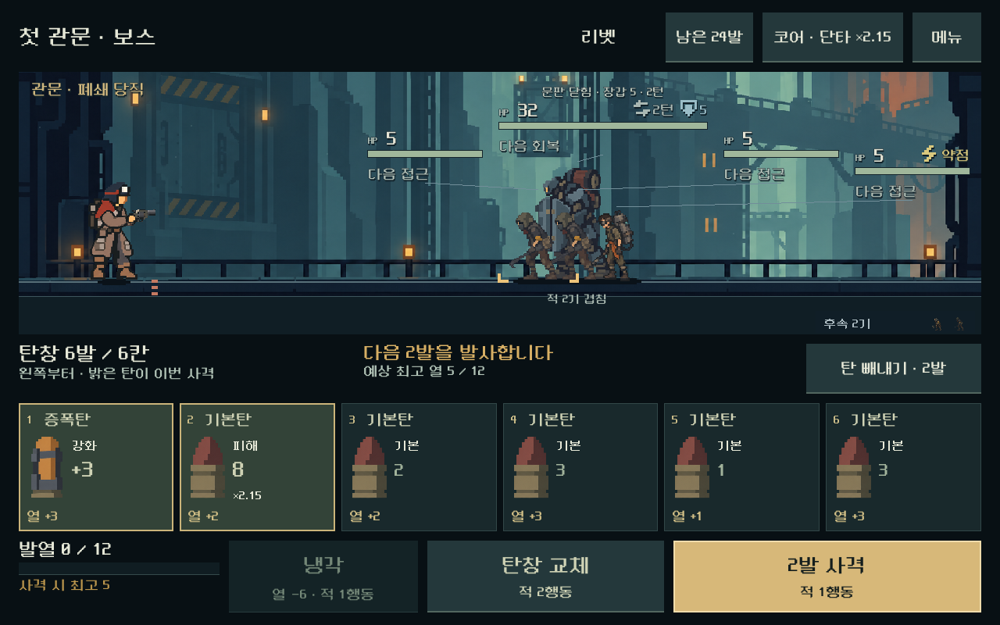
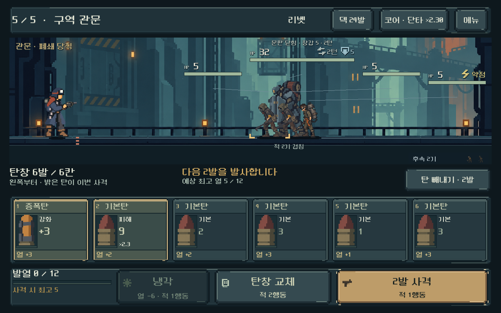

# 전투 UI — 배경·캐릭터와 재질 통일

## 요청과 구현

사용자: “Ui 디자인이 배경과 캐릭터에 어울리는 형태가 되면 좋겠어”. 직전 배치 개편 화면을 기준으로, 정보의 순서는 유지하면서 평면 패널을 현재 주거구 설비와 캐릭터 장구에 어울리는 금속 외피로 바꿨다. [현재 방향](../../direction/combat-hud.md).

- 배경의 탁한 청회색을 상단·탄창·조작부에 적용하고, 필요한 모서리에만 빛과 그림자를 넣었다.
- 탄창에는 이름 띠, 깊은 탄약 홈, 발열 띠를 둔다. 이번 발사 탄의 황동 테두리와 대기 탄의 낮은 명도, 제거 탄의 구릿빛/문구를 구분한다.
- 행동 버튼은 계단형 모서리와 눌림 깊이를 가진 기계식 키로 표현한다. 냉각·탄창 교체·사격에 작은 기호를 함께 표시한다.
- 메뉴·탄 상세의 외피도 통일했다. 중앙 읽기 면에는 노이즈·흠집·과한 광택을 넣지 않았다.

사용자가 확정한 것은 배경·캐릭터와 어울리는 방향이다. 구체적인 재질·프레임 선택은 디렉터 판단이며 새 결과의 사용자 미감 확인은 남는다. 배경·캐릭터·탄환 원화와 전투 규칙은 이번 작업으로 바꾸지 않았다.

## 같은 상태의 전후 화면

현재 실행본에서 같은 총기·획득 상태·전투를 새로 열어 전후 캡처했다. 아래는 독립 비교의 첫 관문 보스 상태다.

| 직전 화면 | 재질 적용 |
| --- | --- |
|  |  |

아래는 별도 여정의 실제 획득·성장을 거친 관문 화면이다.

[작은 화면의9칸 탄창](combat_hud_cohesion_2026-10-31_assets/heavy_1008x630.png) · [무작위 예측/빼내기](combat_hud_cohesion_2026-10-31_assets/selected_1280x720.png) · [넓은 화면](combat_hud_cohesion_2026-10-31_assets/heavy_1280x576.png) · [메뉴](combat_hud_cohesion_2026-10-31_assets/menu.png) · [탄 상세](combat_hud_cohesion_2026-10-31_assets/detail.png).

## 제작과 연결

프레임20종의 SVG/TRES와 기호3종을 `assets/ui/combat_hardware/`에 추가했다. [제작 원본](../../../tools/build_combat_hud_materials.py) · [참조·용도·자산 해시](../../../새-게임-프로젝트/assets/ui/combat_hardware/manifest.json). 직접 작성한 벡터 모양이며 래스터 이미지 생성·편집은 사용하지 않았다. 모서리는9분할로 고정하고 넓은 단색 면만 늘린다. nearest 필터를 적용한다.

주요 외피·탄약 홈·기호·대표 행동 스타일은 `combat_hud.tscn`, 공통 스타일은 `combat_hud_theme.tres`에 저장했다. 실제 상태 연결은 `combat_hud_presenter.gd`에서 수행한다. 장식은 마우스/터치 입력을 무시한다. 기본 여백을 재조정해 프레임을 넣어도 전장·정보·탄창·행동 그룹이 겹치지 않게 했다. 원래 전투 컨트롤러·난수·보상·저장 계산은 재사용한다.

## 실제 검증

Godot MCP 프로젝트 조회 성공. Godot4.7 / Windows / OpenGL Compatibility / RTX4060Ti. 기존 검사 코드를 수정하지 않고 `qa_runtime/combat_hud_20261031/cohesion/` 아래 별도 APPDATA/LOCALAPPDATA로 실행했다. 이전 보고서의 결과·화면을 덮어쓰지 않았다.

| 범위 | 결과 |
| --- | --- |
| 5총기 × 4해상도 전투 HUD | 13,056검사, 실패0 |
| 3크기 여정·보상·2정비·완료·패배·재도전·재개 | 4,693검사, 실패0 |
| Godot에서 실제 로드한9분할·직렬화 스타일·장식 입력 | 21스타일 참조 검사, 실패0 |

HUD는1008×630,1280×576,1280×720,1280×800의4해상도/3비율, 여정은1008×630,1280×576,1280×800의3크기/2비율이다. 실제 터치·키보드·모달 입력 차단·9칸 탄창·문구 경계·최소44물리px 입력·모델/RNG 보존·표시 행동 비용과 실제 결과 비교를 통과했다. 두 전체 실행의 stderr는 비어 있다. 현재 모델을 재사용했으므로 별도 수치 밸런스 재검사는 추가하지 않았다.

제작자가 전후 화면, 작은 화면9칸, 선택 제거, 무작위 예측, 메뉴·상세와 실제 여정 관문을 직접 확인했다. 기능 통과와 화면 검수는 사람의 가독성·미감 평가와 구분한다.

외부 스킬의 `stretch_audit.py`는 Pillow가 SVG를 읽지 못해 중단됐다. 이를 통과로 기록하지 않는다. 대체로 Godot에서 실제 가져온 텍스처 크기/9분할 여백과 대표 스타일 저장·장식 입력 차단을 검사하고 실제 렌더를 확인했다. [대체 검사 결과](combat_hud_cohesion_2026-10-31_assets/materials.json).

[HUD 결과](combat_hud_cohesion_2026-10-31_assets/ui.json) · [여정 결과](combat_hud_cohesion_2026-10-31_assets/flow.json) · [최종 소스 해시](combat_hud_cohesion_2026-10-31_assets/source_hashes.json) · [기존 파일 보존](combat_hud_cohesion_2026-10-31_assets/preservation.json). 원시 stdout/stderr와 실행/재질 검사 스크립트도 같은 폴더에 보존했다.

## 적용 범위

기존 두 PC 비교 실행기에 적용됐다. 시작 당시630항목의 작업 트리를 유지하며,1,757기존 코드·문서·벡터 파일의 해시와 대조했다. 기존 변경은 HUD3파일·현재 방향4문서·일일 기록이며 누락 파일은 없다. 게임 모델·원래 화면·검사 코드는 동일하다.

기존 APK에는 아직 포함되지 않았다. Android 실기기의 안전 영역·지속 FPS·발열과 사용자 미감은 별도 확인이다. APK·업로드·커밋·푸시는 수행하지 않았다.
