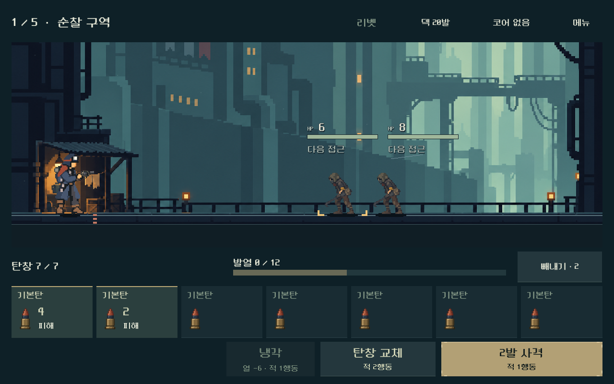
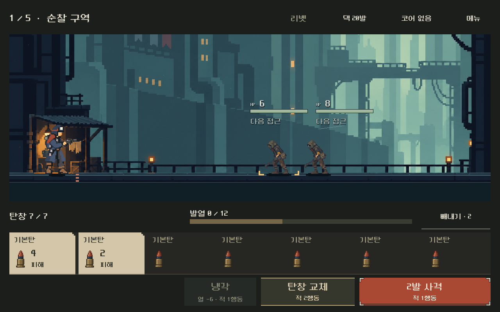
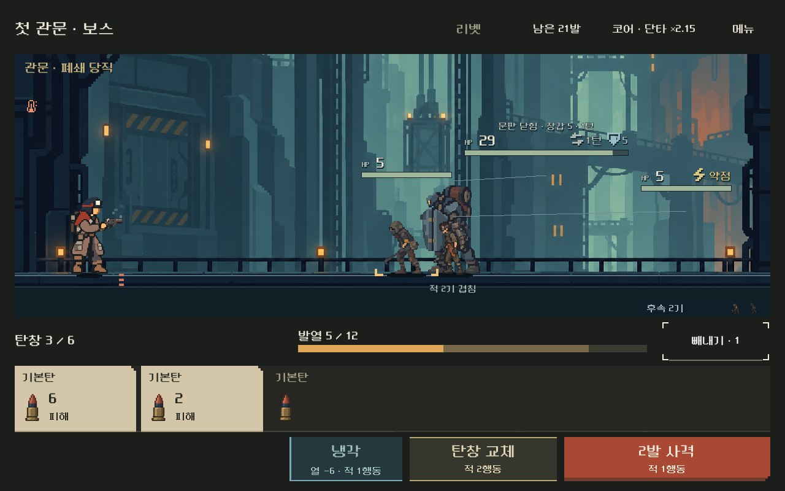
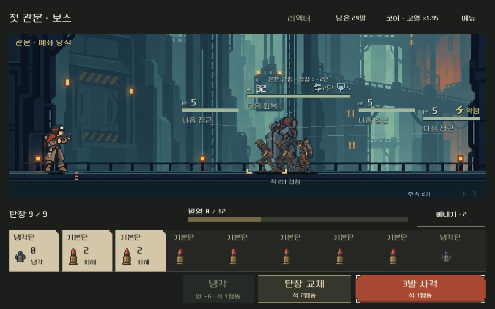

# 전투 UI — 색·형태의 역할 구분 · 2026-10-31

## 사용자 평가와 판단

사용자는 직전 결과의 깔끔함은 좋다고 평가했으나 “AI슬롭 느낌이 너무 강해”, “색감도 다 비슷하고”라고 지적했다. 정돈된 정보량을 유지하면서 고유한 인상을 만드는 것이 이번 범위다. 청회색 직사각형/비슷한 명도 반복이 원인이라는 설명은 디렉터의 시각 진단이다.

이번 화면은 따뜻한 먹색의 공통 탄약 받침, 밝은 상아색 탄약 표찰, 주홍 사격 조작부를 중심으로 한다. 기존 캐릭터의 주황/구리 장구와 차가운 전장 사이에 역할을 나눠 준다. 이는 구현 판단이며 사용자 미감 확정으로 기록하지 않는다.

## 변경 범위

| 역할 | 이전 | 현재 |
|---|---|---|
| 대기 탄 | 청회색 박스가 탄마다 반복 | 공통 받침 위 이름/작은 그림, 개별 외피 제거 |
| 이번 발사 탄 | 대기 탄보다 약간 밝은 면과 황동선 | 상아색 표찰·짙은 글씨·계단형 잘린 모서리 |
| 사격 | 탁한 황동 사각 버튼 | 주홍 조작부, 끝이 잘린 모서리와 낮은 받침선 |
| 냉각 | 다른 보조 버튼과 같은 재질 | 푸른 면과 왼쪽 선, 냉각 가능 상태에서 강조 |
| 탄창 교체 | 청회색 사각 버튼 | 어두운 면과 황동 상하선 |
| 빼낼 탄 | 구릿빛 면 | 붉은 갈색 면·왼쪽 선·제외 문구 |
| 빈칸 | 빈칸 문구 반복 | 빈 자리와 탄창 수로 표현 |
| 키보드/마우스 초점 | 옅은 한 색 모서리 | 밝고 어두운 면 모두에 대응하는 두 색 모서리 |

정보량, 가로 탄창, 그림 최대28×44px, 카드108px, 발열 위치,64px 이상의 상단/빼내기 터치 영역,72px 주요 행동은 유지한다. 발열은 호박색 실제 채움과 어두운 예상 구간으로 구분한다. 과열/접촉 위험과 행동 비용은 같은 버튼에서 계속 읽는다. 사격·최고 열의 반복 문구를 되살리지 않는다.

배경·캐릭터·탄환 PNG, 전투·난수·소유·저장 계산은 변경하지 않았다. 주 화면의 배치/재질은TSCN·테마, 상태별 글씨 색과 빈칸 노출만 기존 presenter에서 바인딩한다. 스타일은 직접 작성한SVG8개·TRES27개다. [제작 원본](../../../tools/build_combat_hud_identity.py) · [용도·해시](../../../새-게임-프로젝트/assets/ui/combat_identity/manifest.json). 이번 UI 재질에는 생성 비트맵이나 글자를 구운 이미지를 추가하지 않았다.

## 실제 화면

같은 여정 첫 전투의 변경 전:

변경 후:

실제 사격 뒤 냉각·열·빈 탄창 공간:

1008×630의9칸 탄창:

[빼내기](combat_identity_2026-10-31_assets/selected.png) · [무작위 피해/빼내기](combat_identity_2026-10-31_assets/random_ejection.png) · [과열](combat_identity_2026-10-31_assets/overheat.png) · [상세](combat_identity_2026-10-31_assets/detail.png) · [메뉴](combat_identity_2026-10-31_assets/menu.png).

## 검증

Godot MCP `get_project_info` 연결 성공:65씬·564스크립트·431에셋. 기존 공식TSCN과 실제 로컬 Godot4.7 렌더 캡처 경로로 구현/확인했다. 게임 저장은 `qa_runtime/combat_hud_20261031/identity/` 아래 격리APPDATA/LOCALAPPDATA만 사용한다.

| 검사 | 결과 | 범위 |
|---|---:|---|
| 전투 UI |10,752 / 실패0|5총기×4화면, 터치·키보드·메뉴/상세·빼내기/취소·사격·예측·저장 복귀 |
| 연속 여정 |4,071 / 실패0|3화면×5전투, 코어/탄 보상·정비·재개·패배 재도전 |
| 가져오기/실행 |오류 없음|Godot4.7 실제 리소스 가져오기·생성SVG·최종 미리보기 |

현재/제외/대기 상태를 보는 기존 검사는 유지했다. 이번에는 실제 표찰과 활성 주요 버튼의 기본/호버/누름 상태에서 글씨 색·modulate를 곱한 색과 해당 이미지 중심색의 대비가4.5:1 이상인지 검사한다. 최초 내부 비교에서 밝은 주홍 면의 작은 글씨 대비가 낮아 도장색과 활자를 보완했다. 빈칸의 반복 문구가 숨는지도 확인한다. 이 수치 검사는 색각 차이·실기기 시인성·사람의 미감을 보장하지 않는다.

[UI 원자료](combat_identity_2026-10-31_assets/ui.json) · [여정 원자료](combat_identity_2026-10-31_assets/flow.json). 제작자는 같은 해상도 전후와 작은 화면·선택·실제 사격 뒤 냉각·과열·모달을 직접 검토했다. [보상](combat_identity_2026-10-31_assets/reward.png)·[정비](combat_identity_2026-10-31_assets/service.png)는 기존 선택 카드의 외형을 유지하며 공통 초점/버튼과 연결 흐름에 회귀가 없는지 확인했다. 사용자에게 새 인상이 확인되기 전에는 AI슬롭 느낌이 해소됐다고 단정하지 않는다.

작업 시작1,503개 기존 코드·씬·리소스·문서 해시와 대조해 의도한 HUD/검사/방향·기록만 변경하고 누락 없음. 기존 원화와 이전 스타일은 유지한다. [대조 결과](combat_identity_2026-10-31_assets/source_delta.json).

## 실행과 경계

`OPEN_COMBAT_UI_STUDY.cmd`와 `OPEN_MAGAZINE_COMPARISON.cmd`에 반영했다. 기존 모바일 배포본은 갱신하지 않았고 APK·외부 게시·커밋·푸시는 수행하지 않았다. Android 실기기의 판독성·안전 영역·지속 성능과 사용자의 새 미감 평가는 후속이다.
