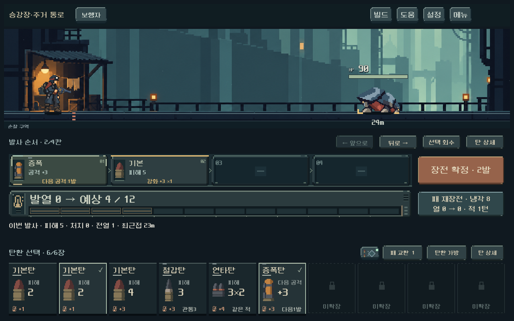
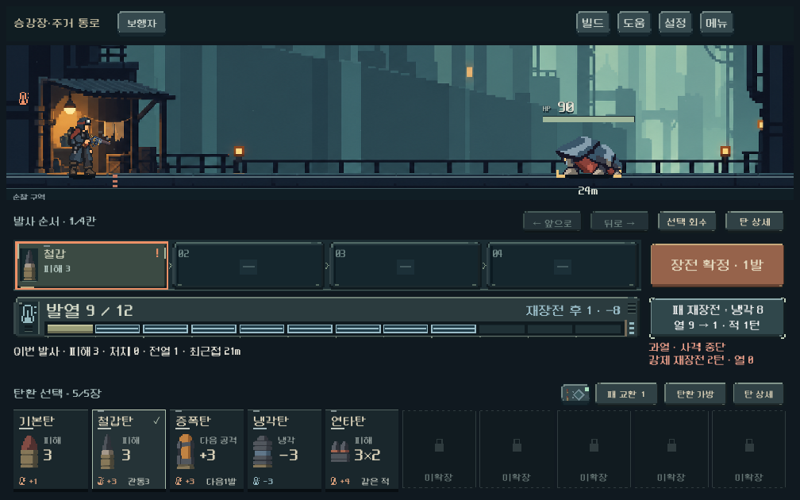

# 발사 순서·발열 계기 도트 폴리싱

사용자는 플레이 밸런스 검증을 직접 더 진행하기로 하고, 전투의 발사 순서와 발열 UI를 더 게임다운 도트 표현으로 다듬도록 요청했다. 이번 범위는 렌더와 버튼 외형이다. 모델·탄환 수치·캠페인 파일의 작업 전후 SHA256이 같으며, 채택된 피니시25%/2.5초와 고정10자리 손패를 유지한다.

## 표현

- 발사 순서를 하나의 급탄 레일로 연결했다. 빈 약실의 홈, 장전 탄의 받침, 계단 모서리와 하단 걸쇠, 작은 순서 번호·방향 기호를 더했다. 선택·증폭·과열·미발사 상태는 기존 실제 예측에 연결한다. 과열 경고가 있는 약실은 같은 위치의 작은 순서 번호를 숨겨 겹침을 막는다.
- 발열은 낡은 금속 계기로 묶었다. 좌측 온도계 덮개와 냉각구, 큰 수치, 파인 눈금 채널, 물리적 한계 끝과 경고등을 사용한다. 현재 열은 채워진 셀, 사격 최고 열은 윤곽 셀, 재장전으로 제거할 열은 푸른 윤곽/제거 표시다. 실제 열 증감의 기존0.36초 반응과 즉시 설정을 유지한다.
- 발사·재장전·편집·가방 등 전투 조작 키에 같은 픽셀 금속 모서리와 받침을 적용했다. 눌림은 내용이2px 내려가고 면이 어두워지며, 키보드 포커스는 네 모서리로 구분한다. 클릭 영역과 레이아웃 최소 높이는 그대로다.
- 장식은 모서리·홈·계기 끝에 집중한다. 숫자 뒤에 노이즈를 깔거나 상시 반짝임을 추가하지 않았다. 열 숫자·예상값·냉각 정보는 숨기지 않는다.

## 실제 화면

[이전 장전 화면](combat_hand_live_2026-10-18/loaded_1280.png)

[큰 글씨·과열](combat_instruments_2026-10-18/overheat_large_text.png) · [넓은 화면](combat_instruments_2026-10-18/loaded_1440.png) · [빈 약실](combat_instruments_2026-10-18/bag6_1008.png)

## 참고와 제작

사용자 [Pinterest 검색](https://kr.pinterest.com/search/pins/?q=distopia%20pixel%20art%20ui)과 해당 pin은 도구에서 직접 열리지 않았다. 대신 공개된 [Mind Scanners 공식 스토어 화면](https://store.steampowered.com/app/1389550/Mind_Scanners/)의 기기 면·눈금·부품 가장자리 표현을 확인했다. 해당 작품의 고채도 적색 배색이나 화면 구성을 복제하지 않고 기존 ORVASK의 탁한 청회색·황동·녹슨 주황과 현재 전투 배치를 따른다. 참고 이미지는 QA 폴더에만 두고 제품 자산으로 넣지 않았다.

새 UI 그림은 `instrument_skin.gd`에서 직접 작성한 픽셀 구성이다. 버튼은40×32 투명 텍스처와9분할, 레일/계기는 정수 좌표 도형으로 그린다. 게임 수치와 한글은 Godot 폰트로 분리한다. 생성형 이미지나 외부 UI 이미지를 제품에 복사하지 않았다. [자산 기록](../../art/combat-instruments-20261018.json).

Impeccable의 기존 화면 보존·상태 검수 절차를 적용하되, 이 Godot 작업에서는 현행 direction 문서가 결정 원본이며 웹 detector/DOM 대신 실제 GPU 화면과 입력 검사를 사용했다.

## 검증

- `tools/run_combat_hand_live_checks.ps1`: 최종 **1,444검사 실패0**.1008×630/1280×800/1440×630,4/6/10장 고정배치, 중복 탄·길게 누르기·압축·회수·순서·발사·과열·큰 글씨. 첫 검수의 경고/번호 겹침을 교정한 뒤 재실행했다.
- `tools/run_heat_live_checks.ps1`: **410검사 실패0**.1008×630/1280×900/1440×630, 장전 최고 열·순서 변경·실제 타격·다섯 총기·냉각·강제 재장전·즉시 설정의 표시 정합성. 열 계기 코드의 최종 실행 결과다.
- 임시 `qa_runtime/console_polish/preview.gd`: 동일 본편 씬과 공개 입력으로3해상도의 과열·재장전 포커스·확정·강제 냉각을 캡처했다. 격리 저장, 저장 비활성. 오류0. 실제 대표 화면을 직접 확인했다.
- 합계 **1,854검사 실패0**. 기존 엔진 루트 인증서 경고 외 스크립트 오류 없음. 사용자 저장/미커밋 작업 보존.

실제 Galaxy 터치·미감은 사용자 확인 전이다. 사람이 느끼는 전투 선택/균형 검증을 대신하지 않는다. 본편은 `PLAY.cmd`. APK·커밋·푸시 없음.
