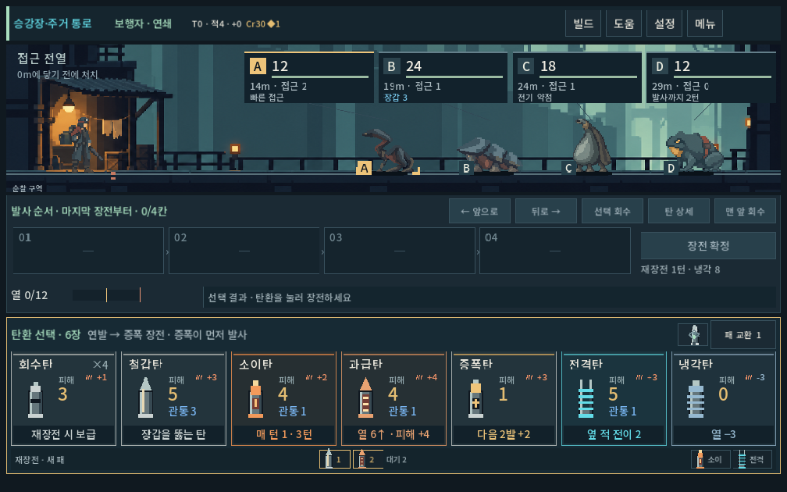
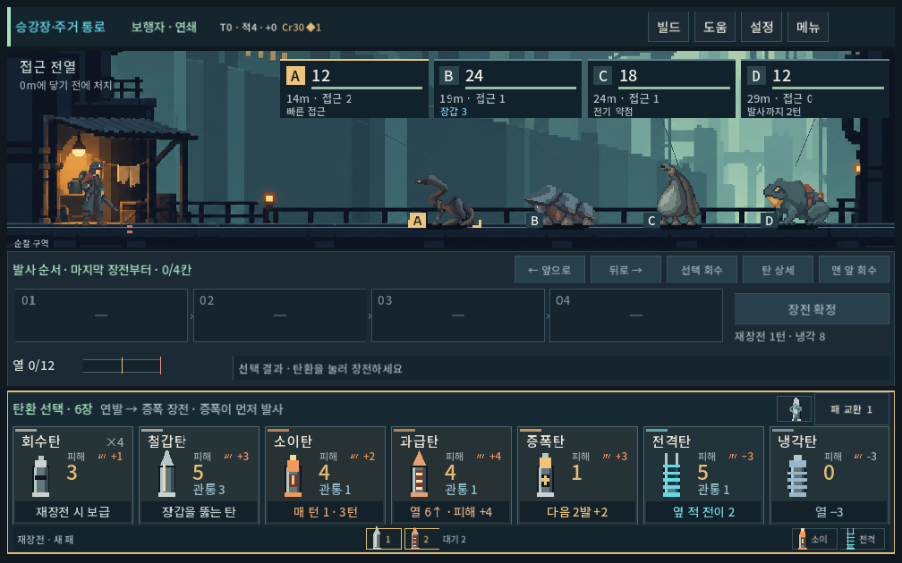
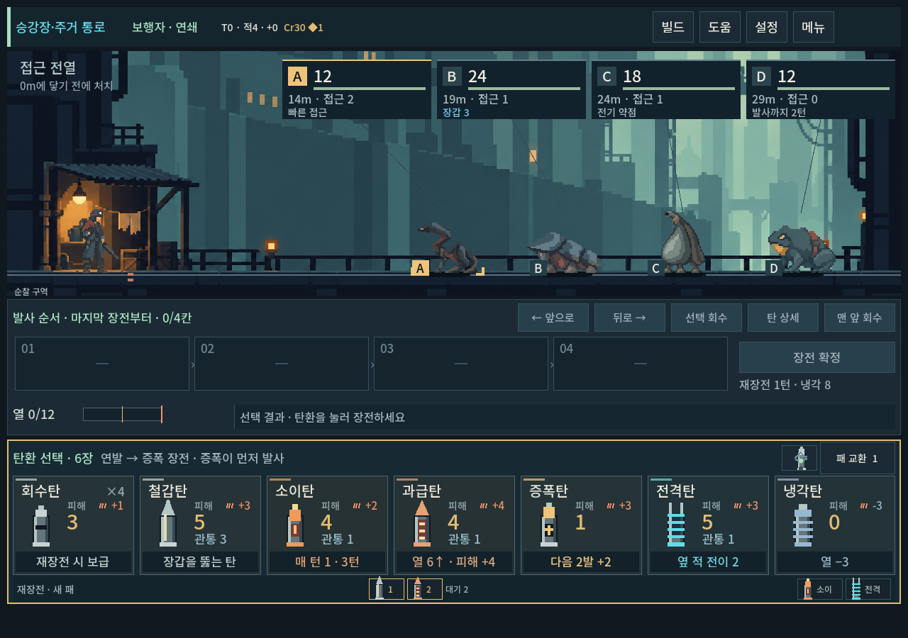
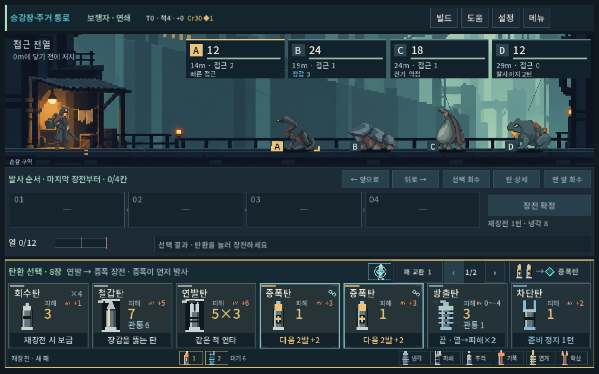

# 전장 높이와 탄환 카드 화풍 조정

2026-10-09 · 사용자 요청: 전장 확대, 탄환 선택 영역 축소, 현행 도트풍과 탄환 카드의 적합성 검토.

## 적용

- 본편/개발 전투 공통: 작은 가로 화면 전장 240 → 280 논리 px(+16.7%). 1280×900에서는 남는 높이를 함께 사용해 345px, 1280×1024에서는 390px.
- 기본 작은 화면의 탄환 선택 패널 256 → 232px(−9.4%), 개별 카드 154 → 140px. 이름20/피해29/관통17/효과17의 글자 크기를 유지하고 내부 간격·패널 여백을 조정했다.
- 탄환 페이지·사용 더미 등의 실제 최소 높이를 측정해 전장의 가용 높이를 계산한다. 조작부가 늘면 전장을 줄이고, 기존 240px를 최저 기준으로 보존한다. 임의로 많은 정보나 접근성 확대까지 무스크롤을 보장하지 않는다.
- 전장 높이와 주인공 표시 배율을 분리했다. 기존 화면별 주인공 크기·발 위치 기준·탄환 발사점 관계를 유지하며 배경을 더 보여 준다.
- 카드의 탄종별 실루엣/큰 도트 덩어리를 유지했다. 밝은 속성색 전체 테두리를 청회색 재질 프레임으로 바꾸고 속성 표시는 상단 짧은 띠·아이콘·효과 문구로 정리했다. 관통 강조색과 압축 표시도 주변 팔레트에 맞췄다. 초점/압축 가능 상태는 분명하게 유지한다.
- 전투 규칙·덱·세이브·몬스터 본편 편성은 변경하지 않았다.

## 화풍 검토

현행 탄환 실루엣은 역할별 형태가 다르고 큰 픽셀 덩어리로 읽혀 유지하는 쪽이 적합하다. 차이는 탄환 그림 자체보다 고채도 프레임과 평평한 패널이 주는 인상에 있었다. 프레임 대비를 낮추고 배경의 청회색/따뜻한 금속색과 연결했다. 작은 상태·숫자는 전장 아트보다 또렷하게 두었다. 글자를 일부러 흐리거나 거친 픽셀 폰트로 바꾸는 것은 이번 방향이 아니다.

새 비트맵 제작 없이 Godot UI 코드로 수정했다. 아래 통합 화면은 제작자 검수이며 사용자 선호 확인 완료로 취급하지 않는다.

## 실제 화면

이전 1008×630:

조정 후 1008×630:

1280×900 — 남는 높이를 전장에 사용:

압축 가능·압축탄·페이지 조작:

## 검증

- 격리 저장, Godot 4.7 실제 렌더, 공개 터치 입력. 1280×900 / 1008×630 / 1440×630 / 1280×1024.
- 5총기의 장전·LIFO·확정·발사·재장전, 예측/실제 적 상태, 카드 이름/효과 폭, 화면 경계/스크롤, 주인공 기존 배율, 압축 가능 표시/2칸 탄환 장전·회수/다음 페이지.
- 재현: `tools/run_eavesback_checks.ps1 -Mode layout`. 최종3134검사/0실패, stderr 비어 있음. [최종 로그](combat_layout_2026-10-09_assets/stdout.log)를 보존했다.
- 기존 생물 시안 UI 검사도 3해상도221검사/0실패. 새 높이에서 명찰·접지·표적 선택·피격·원거리 상태를 확인했다.
- 첫 안에서 작은 두 화면 비율의 세로 넘침을 발견해 여백과 가용 높이 계산으로 수정했다. 최종 검사와 구별한다.
- 사람의 최종 가독성 선호와 Galaxy 실기기 확인은 후속이다. APK는 생성하지 않았다.

플레이: `PLAY.cmd` → 이어하기/새 등반의 전투. 비교 장면은 개발 → 몬스터 시안 · 주거 통로.
