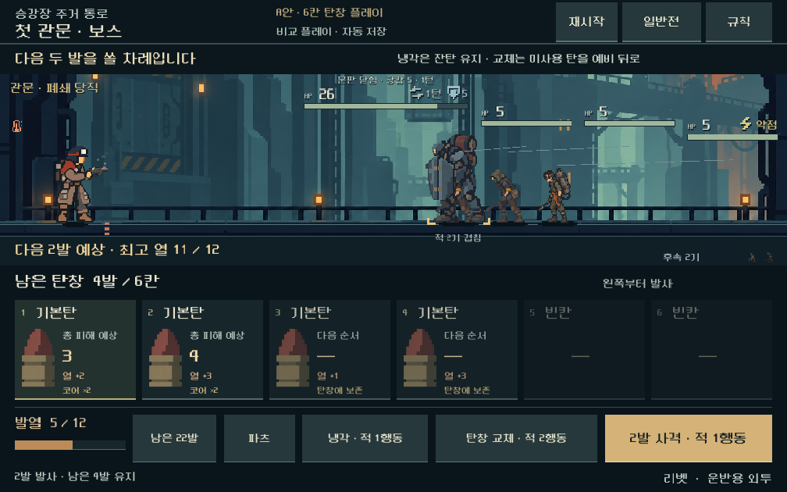
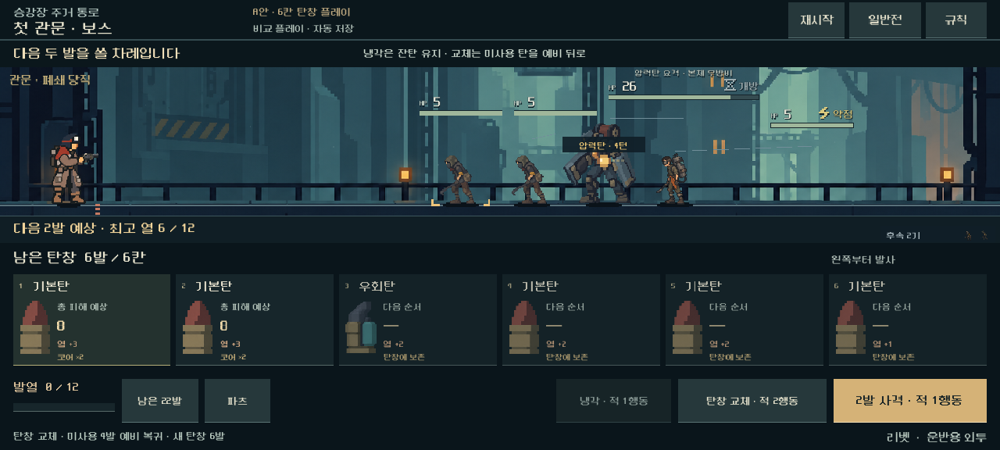
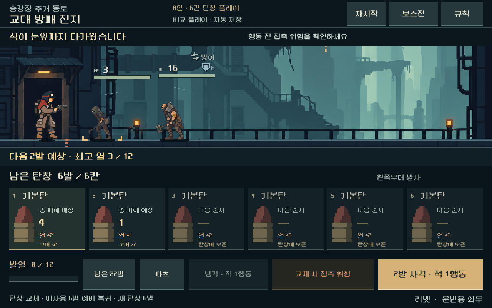

# A안 탄창 운용 비교 검증

2026-10-31 · Godot 4.7 stable · Windows / RTX 4060 Ti / Compatibility renderer.

[현재 규칙·판단](../../direction/combat-magazine-loop.md) · [실행](../../../OPEN_COMBAT_UI_STUDY.cmd)

## 범위

기존 A 하단 6칸 시안을 반복 플레이로 확장했다. 리벳의 두 발 사격, 잔탄을 보존하는 냉각, 보유 덱에서 탄창 전체 교체, 유한 탄약과 비상 보급, 별도 저장/재개를 검증한다. 일반전 401과 보스 802는 기존 v12/운반용 외투/시드731042의 실제 획득 저장에서 가져왔다.

통제 비교는 이전 용량 비교의 정렬된 6발과 방패를 열었던 상태를 그대로 사용한다. 실제 조작 화면은 원본 획득 저장의 예비 순서를 유지하고 방패가 닫힌 일반전에서 시작한다. 이 두 비교의 첫 탄 순서·방패 상태를 같은 것으로 설명하지 않는다.

모든 실행은 `qa_runtime/combat_magazine_loop_20261031/` 아래의 격리 APPDATA/LOCALAPPDATA에서 진행했다. 기존 캠페인 파일은 읽거나 쓰지 않는다. Godot MCP로 프로젝트와 4.7 엔진을 확인한 뒤 현행 로컬 검사 경로로 실행했다. 브라우저 화면을 Godot 검증 대신 사용하지 않았다.

## 기능 검증

- 신규 규칙 검사 797개 실패 0. [원자료](assets/combat_magazine_loop_2026-10-31/rules.json).
- 소유 탄 수량 보존, 미발사 순서 유지, 실제 6칸, 첫/마지막 고정탄 충돌 및 2칸 압축탄, 짧은 마지막 예비, 비상 4발과 비용 증가를 확인했다.
- 사격을 나눠도 연속 발열·탄창 전체의 연계를 유지한다. 냉각은 연속 열 부담을 초기화하되 밀치기 예산을 회복하지 않는다.
- 과열 시 잔탄 보존과 추가 적 행동, 화상으로 냉각 도중 승리, 사격/전체 탄창 예측과 실제 결과, 예측의 상태/RNG 비변경을 확인했다.
- 저장 후 같은 후속 명령의 결과가 일치한다. 비교 버전 누락/잘못된 버전/지원하지 않는 총기/기존 용량 보너스 한계 위반을 거부한다. JSON 정수의 실수 파싱 차이는 양쪽을 동일한 JSON 경계로 정규화해 비교했다.
- 같은 획득 덱·적의 순서만 5시드씩 바꾼 10전투를 끝까지 진행했다. 일반 3~4턴, 보스 10~15턴 승리. 새 규칙으로 보상을 획득하며 진행한 전체 등반이나 최적 전략의 증거는 아니다.

## 화면·조작 검증

1008×630, 1280×576, 1280×800에서 실제 터치 입력과 GPU 캡처를 사용했다. 최종 화면/조작 검사 422개 실패 0, 캡처 18장. 주요 배치는 `combat_magazine_loop.tscn`에 저장했으며 실행 중 주요 패널을 생성/재배치하지 않는다.

일반/보스 전환, 6발 장착, 부분 사격, 남은 탄 보존 냉각, 탄창 교체, 상세 열기/닫기, 초기화, 자동 저장 후 씬을 다시 열어 재개, 강제 냉각, 연속 플레이 승리, 접촉/압력탄 피격 경고와 패배를 확인했다. 행동 중 중복 입력을 막고 기존 사격·처치·전진 연출을 재생한다.

실제 화면 검수에서 두 가지를 수정했다. 압력탄에 맞는 상황을 몸체 접촉으로 안내하던 문구를 원인별로 분리했다. 가까운 적의 HP와 안내 문구가 겹치는 문제는 안내를 전장 위의 별도 줄로 옮겨 해결했다. 자동 배치 검사에 이 경계를 추가했다. 사람의 미감·글자 이해도 통과로 취급하지 않는다.

[화면 검사 원자료](assets/combat_magazine_loop_2026-10-31/ui.json). 접촉/압력탄 위험 캡처는 합법적인 유료 교체를 반복해 만든 경계 검사이며, 정상적인 공격 운용에서 자주 근접한다는 증거가 아니다.

## 회귀와 변경 경계

- 기존 실제 획득 경로 5총기×5전투=25전투 재생의 행동·소모·접근·열 보고서가 작업 전과 동일하다. [재생 결과](assets/combat_magazine_loop_2026-10-31/legacy_replay.json).
- 기존 연속 발열 검사 1,087개/80조건, 유한 탄약 검사 683개 모두 실패 0.
- 작업 전 기록한 기존 스크립트·씬·리소스/JSON 283개 중 280개 해시 동일. 공통 `model.gd`, `content.gd`, `forecast.gd`의 3개만 비교 버전용 분기를 추가했다. 기본 런처는 새 비교 화면으로 연결했다. 이전 A/B 및 용량만 비교한 씬은 보존한다.
- 기존 등반·새 본편 등반의 규칙을 바꾸지 않는다. 비교 모드 활성화는 독립 화면에서만 수행한다. APK·커밋·푸시·외부 게시를 하지 않았다.
- [원본/산출물 해시와 회귀 기록](assets/combat_magazine_loop_2026-10-31/manifest.json).

## 남은 한계

큰 탄창의 실제 활용 경로는 생겼지만 보스에서 최대 15턴이 필요하고 몸체가 여전히 멀리서 정리되는 조건이 있다. 전투가 길어졌다는 사실을 긴장감이나 재미 향상으로 간주하지 않는다. 다음은 접근 압박·다른 총기·새 규칙으로 획득한 연속 초반 전투다. 모든 총기의 발사 주기와 발사체 HP, 전체 등반 경제, 모바일 지속 성능/기기 발열, 사람의 재미·이해도는 미검증이다.

재현: `tools/run_combat_magazine_loop.ps1 -Mode rules` 및 `-Mode ui`; 기존 `tools/run_combat_ui_stage1.ps1 -Mode baseline`, `tools/run_playtest_revision_checks.ps1 -Mode sustained -Tag magazine_loop`, `tools/run_reserve_checks.ps1 -Mode rules`.
