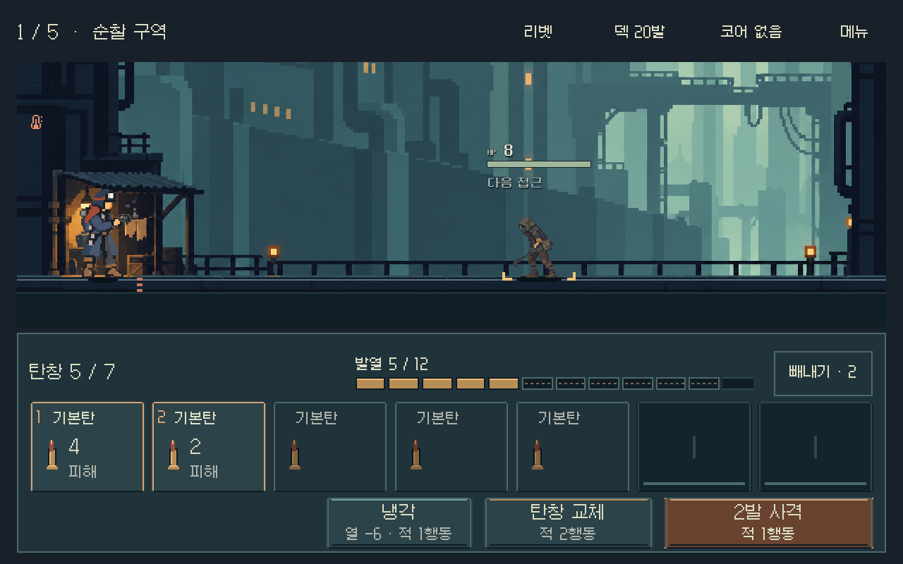

# 픽셀 전투 HUD — 실제 연결

2026-11-01. 사용자가 승인한 [정지 목업](combat_pixel_study_2026-11-01.md)을 탄창 여정과 전투 비교의 실제 공통 화면에 연결했다. **사격·냉각·교체·빼내기·보상/정비·저장 재개 검증 완료.** Android 실기기와 사용자 체감은 별도다.

## 실행과 결과

저장소 루트의 `OPEN_COMBAT_UI_STUDY.cmd`는 연속 탄창 여정, `OPEN_MAGAZINE_COMPARISON.cmd`는 총기/전투 비교로 진입한다. 기존 저장을 그대로 사용한다. 프로젝트 기본 본편 진입 씬이나 모바일 배포본을 변경한 것은 아니다.



[빼내기](combat_pixel_live_2026-11-01_assets/ejection_source.png) · [과열·도달 위험](combat_pixel_live_2026-11-01_assets/danger_source.png) · [9칸/1008폭](combat_pixel_live_2026-11-01_assets/ready_heavy_1008x630.png) · [넓은 비율](combat_pixel_live_2026-11-01_assets/journey_partial_1280x576.png) · [상세](combat_pixel_live_2026-11-01_assets/detail_single_1280x800.png) · [메뉴](combat_pixel_live_2026-11-01_assets/menu_single_1280x800.png).

## 연결한 동작

- 실제 수용량5~9칸을 유지하고 소진된 자리도 홈으로 표시한다. 다음 발사 대상에 순서 번호/따뜻한 테두리/예측 효과를 표시한다.
- 중간 탄 빼내기는 실제 소모/할당량을 사용한다. 선택 외형만6px 올리고 터치 영역은 고정한다. 남은 탄의 발사 번호와 발열 예측을 다시 계산한다.
- 발열은 실제 총기/파츠 상한만큼 나눈다. 현재 열은 채움, 예측 증가분은 점선, 과열 가능성은 위험색과 문구로 표시한다. 고정된 마지막3칸 위험 규칙은 도입하지 않았다.
- 실제1발만 발사된 후 과열되는 사례는 첫1발만 강조한다. 기존 사격 명령명과 `도달 위험 · 패배100%` 같은 실제 위험 정보는 유지한다.
- 냉각·교체·사격의 실제 비용, 잠금/입력 차단/키보드 초점/터치/저장 실패 표시를 유지했다. 사용자 요청으로 없앴던 상시 사격 설명과 피해 요약 문장을 되살리지 않았다.

## 제작과 구조

Godot MCP `get_project_info`로 현재4.7 프로젝트를 먼저 확인했다. MCP의 공개 도구는 이 복합Control/테마/폰트 변경과 격리 캡처에 충분하지 않아 TSCN/리소스 직접 편집과 기존 Godot CLI QA 경로를 사용했다. MCP 접속 실패는 없었다.

- `redesign/samples/hud/combat_hud.tscn`: 에디터에서도 보이는 콘솔/탄창/행동 배치. `combat_journey_hud.tscn`이 상속한다.
- `combat_hud_presenter.gd`: 기존 전투 컨트롤러의 값과 입력에 상태 외피·순서·분할 발열을 연결한다. 전투 모델을 수정하지 않는다.
- `pixel_heat_cells.gd`: 값 변경 시에만 갱신하는 분할 게이지. `pixel_round_icon.gd`: 원형 ID에 대응하는20종 작은 아이콘. 텍스처를 계속 참조해 화면이 흰 사각형으로 바뀌지 않도록 한다.
- `assets/ui/combat_pixel_20261101/`:32×32 프레임,14×22 탄환,2종 BMFont와OFL. 글자/숫자/입력은 이미지에 굽지 않고 Godot 노드로 유지한다.
- Galmuri9의20,711개, Galmuri11의20,965개 글리프를 보존했다. 각 글꼴은1024×2048 두 페이지다. `tools/verify_pixel_hud_assets.py`에서 모든 비트가 원본BDF와 일치하는지 확인한다.
- [출처·해시·원본 대조](../../../새-게임-프로젝트/assets/ui/combat_pixel_20261101/provenance.json), [재제작 도구](../../../tools/build_pixel_hud_assets.py). LibreSprite가 PNG를 작성하며 Python은 메타데이터/도구 호출/읽기 전용 검증을 수행했다.
- Godot [비트맵 폰트 지원](https://docs.godotengine.org/en/stable/classes/class_fontfile.html)을 사용했다. 새 글꼴은 이 HUD/연결된 모달에만 적용한다.

## 검증 결과

최종 가져오기와 캡처/검사는 작업별 APPDATA/LOCALAPPDATA 및 `qa_runtime/combat_hud_20261031/pixel_20261101/` 아래 별도 저장에서 실행했다.

기존6,922파일의 작업 전 해시와 대조해 공통 HUD4파일과 기록/방향 문서4파일만 변경된 것을 확인했다. 전투 계산·기존 자산·프로젝트 설정은 동일하다. [작업 범위 감사](combat_pixel_live_2026-11-01_assets/worktree-audit.json).

| 범위 | 결과 | 증거 |
|---|---:|---|
| 다섯 총기×네 비율, 실제 터치/키보드, 사격/빼내기, 상세/메뉴, 저장 재개, 글자 경계/대비 | 13,436검사·실패0 | [ui.json](combat_pixel_live_2026-11-01_assets/ui.json) |
| 세 비율의 연속5전투, 보상/정비, 성장/재개/재시작/총기 선택 | 4,816검사·실패0 | [flow.json](combat_pixel_live_2026-11-01_assets/flow.json) |
| 실행 전 작성된 화면, 실제 열 상한/순서/빈칸, 냉각/교체, 과열, 글리프 존재/작은 화면 | 1,779검사·실패0 | [visual.json](combat_pixel_live_2026-11-01_assets/visual.json) |
| 원본 글리프41,676개, 작은 탄환20종의 크기/투명성 | 모두 일치 | [자산 검증](../../../새-게임-프로젝트/assets/ui/combat_pixel_20261101/provenance.json) |

비율은1008×630,1280×576,1280×720,1280×800이다. 실제 열 상한10/12 등과 별도 게이지6/8/10/12/14/20칸을 확인했다. 별도 게이지 사례는 게임 밸런스 변경이 아니다. [실행 전 작성된 구성](combat_pixel_live_2026-11-01_assets/authored_scene.png)은 루트 컨트롤러 없이도 UI가 표시되는 캡처다.

검사 명령:

```powershell
tools/run_pixel_hud.ps1 -Mode import
tools/run_pixel_hud.ps1 -Mode ui
tools/run_pixel_hud.ps1 -Mode flow
tools/run_pixel_hud.ps1 -Mode visual
tools/run_pixel_hud.ps1 -Mode capture
python tools/verify_pixel_hud_assets.py
```

초기 검수에서 폰트 내보내기의 캔버스/셀 크기 차이로 한글이 비고, 수명이 끝난 텍스처 참조 때문에 아이콘이 흰 사각형으로 보였다. 전체 캔버스 재열기와 영구 텍스처 참조로 수정하고 원본 비트/실제 화면을 다시 확인했다. 사격 비용 글자의 대비 미달60건도 밝은 글자색으로 수정했으며 최종 검사 실패는0이다. 최초 가져오기의 사용자 설정 경로 쓰기 오류는 격리 경로로 재실행해 해소했다.

최종 편집기 가져오기는 Android `build-tools` 경로 안내를 남겼으나 종료0/파싱·리소스 오류 없음이었다. 실제 캡처/UI/연속 흐름/집중 검사의 오류 로그는 비어 있다. 이번 작업에서 Android 내보내기를 검증했다는 뜻은 아니다.

## 목업과의 차이 및 남은 검증

- 픽셀 원본2배/작은 글자20/큰 글자24를 기준1280화면에 연결했다. 프로젝트의 `canvas_items`/가변 비율은 유지한다.1008 같은 물리 화면에서 모든 픽셀이 정수배로 표시된다는 의미는 아니다.
- 빼내기 버튼은 조작 여유를 위해64px 높이와 한 줄 문구를 사용한다. 하단 콘솔은 실제 자동 배치/안전 여백을 적용해 정지 시안과 간격이 조금 다르다.
- 목업에서 덮였던 전장 하단의 겹침/증원 정보를 보존했다. 전장 높이와 발판 위치가 시안과 다르며, 기존 배경/배우/적 HP 글꼴 자체는 재제작하지 않았다.
- 새 분할 게이지는 상시 프레임 갱신을 사용하지 않는다. 다만 이번 검사는 Android 실기기의 지속 성능·발열·터치 체감 통과를 의미하지 않는다.
- 새 미감과 사격/빼내기의 직관성은 사용자 플레이 확인이 필요하다. APK는 이번에 만들지 않았다.
