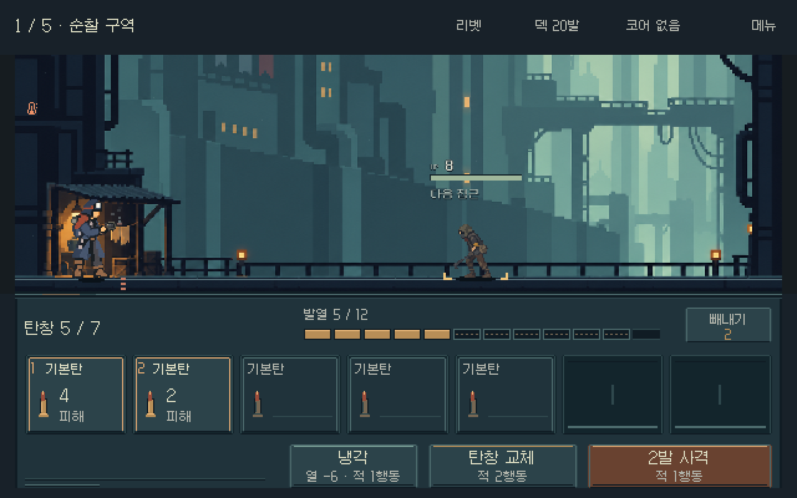

# 전투 UI — 실제 픽셀 목업

2026-11-01. 사용자 “다음 스텝 진행”에 따라, 외부 UI 비평 검토 후 제안한 저해상도 픽셀 목업을 제작했다. **5개 상태의 정지 시안 완료**, 게임 씬 적용·미감 확정·모바일 검증은 별도다.

## 바뀐 표현

- 640×400 캔버스의 정수 좌표에 UI를 그리고 2배로 내보냈다. Galmuri11/9의 원래 비트맵 글리프로 상단과 하단 글자를 맞췄다.
- 어두운 청록 받침과 작은 황동 탄환을 사용한다. 크림색 면·반복 소켓 장식을 걷어내고 발사 대상에 따뜻한 테두리와 순서 번호를 표시한다.
- 탄창 수용량만큼 홈을 그려 빈자리도 보인다. 이번 시안은 6·7·9칸을 포함하며 7칸 고정 규칙이 아니다.
- 발열은 현재 값이 채워진 칸, 예상 증가분이 점선 칸이다. 실제 예측에서 과열이 발생할 때만 위험색을 쓴다. 상한을 12로 바꾼 것이 아니라 이번 실제 사례의 상한이 모두 12다.
- 빼내기 선택은 3원본px(표시6px) 올라오고 `제외`와 붉은 테두리로 구분한다. 선택 후 발사 순서는 남은 탄을 기준으로 매긴다.
- 냉각·교체는 어두운 버튼과 얇은 색 띠, 사격은 낮은 채도의 녹슨 색 면으로 구분한다. 실제 행동 비용과 접촉 위험은 유지한다. 추가 피해 요약 문장은 넣지 않는다.
- 전장 아래에 얇은 금속 이음새와 짧은 조명 반사를 두어 받침이 바닥과 이어지게 했다.

## 실제 상태 대응

| 상태 | 잔탄 / 용량 | 현재 열 / 상한 | 표시 의미 | 결과 |
|---|---:|---:|---|---|
| [장전 완료](../../art/combat-pixel-study-20261101/loaded.png) | 7/7 | 0/12 | 실제 발사 예정 2발, 예상 최고5 | 확인 |
| [부분 소진](../../art/combat-pixel-study-20261101/partial.png) | 5/7 | 5/12 | 실제 사격 후 2빈칸, 다음 최고11 | 확인 |
| [중간 탄 빼내기](../../art/combat-pixel-study-20261101/ejection.png) | 6/6 | 0/12 | 둘째 탄 선택1/2, 첫째·셋째가 발사 예정 | 확인 |
| [최대9칸](../../art/combat-pixel-study-20261101/nine.png) | 9/9 | 0/12 | 리액터의 냉각탄 포함3발, 예상 최고4 | 확인 |
| [과열·도달 위험](../../art/combat-pixel-study-20261101/danger.png) | 2/6 | 8/12 | 실제1발 후 과열·강제 교체, 패배100% | 확인 |

위험 사례의 버튼은 현행 `2발 사격` 명령명을 유지하지만 예측된 발사 대상은 첫1발만 강조한다. 과열 표기와 `도달 위험 · 패배 100%`를 함께 보존한다. 새 수치를 만들어 채운 예시가 아니다. 모델/캡처 원본은 [제작 폴더](../../../art_source/ui/combat_pixel_study_20261101/README.md)에 있다.

## 제작·검증

- Godot 4.7,1280×800의 새 캡처5개. 별도 `qa_runtime/pixel_study_20261101` 저장 경로에서 실제 여정 사격/비교 전투/빼내기 명령을 사용했다. 캡처 실행 오류 없음.
- LibreSprite 1.3 네이티브 픽셀 작성·축소·확대. 원본640×400, 출력1280×800, 모든 출력 픽셀이 정확한2×2 복제인지 검사했다.
- 새로운 상단/하단 UI는 기록한19색만 사용한다.17색은 현재 전장 표본,2색은 글자·위험 명도 파생이다. 전장 전체의 제한 팔레트화는 수행하지 않았다.
- 5개 `.ase`를 다시 내보내 원본 PNG와 픽셀 일치를 확인했다. 원본의 전장 구간은 LibreSprite로 절반 축소한 캡처와 동일하다.
- 5상태의 탄창 용량·잔탄·발사 대상·제외 선택·현재 열·예측 칸을 실제 수집 값과 대조했다. 글리프 누락·할당 폭 초과·화면 밖 글자 없음.
- 실제 1280 표시 이미지5장을 직접 검수했다. 9칸에서도 이름·순서·예상 효과를 표시하고, 선택/비활성/과열을 구분한다.
- [검증값과 파일 해시](../../../art_source/ui/combat_pixel_study_20261101/verification.json), [편집 원본](../../art/combat-pixel-study-20261101/partial.ase), [글꼴 라이선스](../../../art_source/ui/combat_pixel_study_20261101/fonts/OFL.md).

## 적용 경계와 다음 연결

현재 실행 가능한 게임 UI는 직전 feedkit 버전이다. 이번 PNG/ASE는 실제 게임 캡처 위에 그린 정지 목업이며 플레이 가능한 UI가 아니다. 새 파일은 게임 리소스 경로 밖에 있다.

전장과 적 HP/상태 글자는 기존 캡처를 절반 축소한 결과다. 적 정보의 글꼴과 원화 자체까지 새 고정 격자에 맞췄다고 판단하지 않는다. 화면 안쪽 적 정보의 밀도도 이번 수정 대상에서 제외했다.

640×400은 이번 시안 비교값이다. 다른 화면 비율의 자동 배치,1008폭 한글 판독성, 모바일 터치/발열/장시간 성능은 확인하지 않았다. 프로젝트 전체의 `viewport + integer` 전환을 확정하지 않는다.

다음 연결은 이 형태의 프레임/탄환/게이지를 부품으로 분리하고 동적 글자·숫자는 Godot에서 그리는 것이다. 실제 사격·냉각·교체·빼내기, 다른 열 상한, 작은 화면 배치를 함께 확인한다. 미감은 사용자가 이번 통합 이미지를 보고 판단할 범위이며 자동 검증으로 대신하지 않는다.
