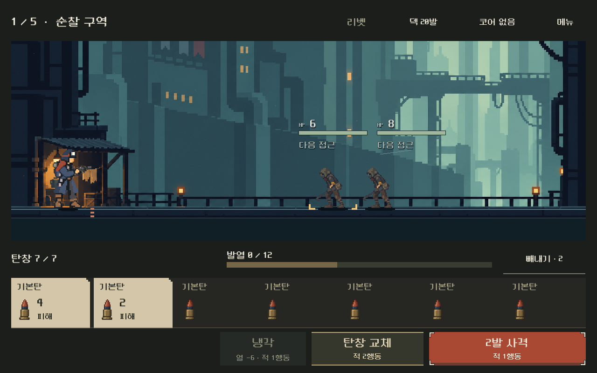
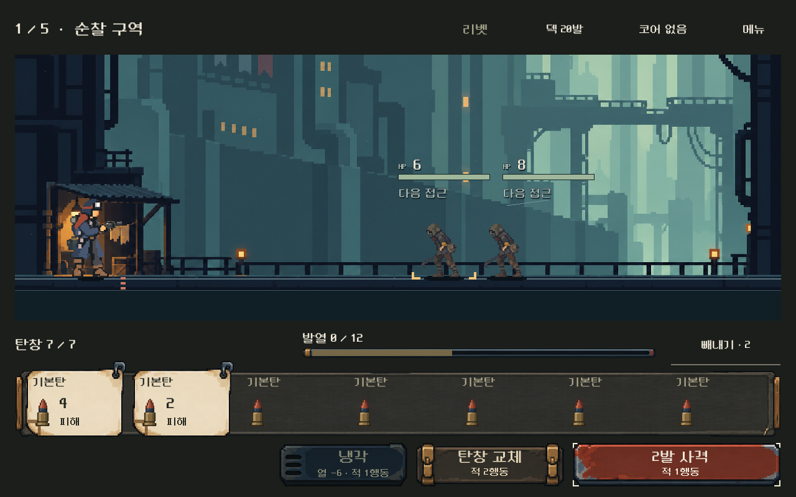
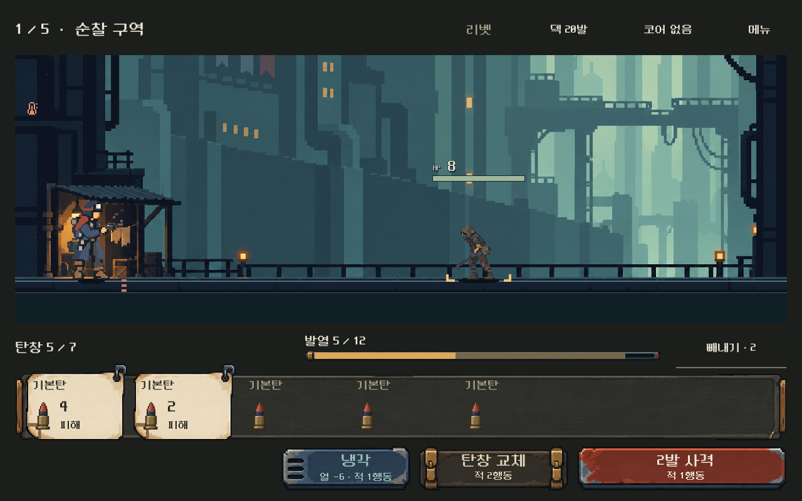
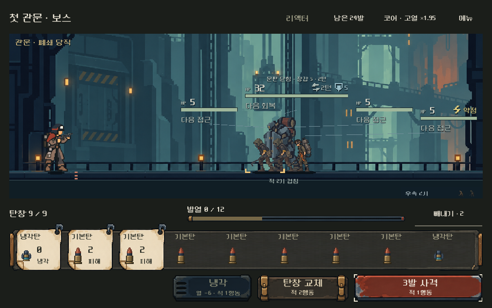

# 전투 UI 도트 소품 원화 — 2026-10-31

## 사용자 평가와 구현 판단

사용자는 정보 정리 후에도 디자인이 계속 마음에 들지 않고 UI에 감성적인 도트풍이 없다고 지적했다. 이전의 색상 구분/벡터 모서리만으로는 이 요구를 충족하지 못했다고 기록한다.

디렉터 판단으로 승인 배우의 작업복/낡은 장구와 전장 배경을 실제 이미지 입력으로 사용해 휴대 정비 물품 형태의 원화를 제작했다. 천 받침·집게 표찰·도장 벗겨진 조작판과 작은 계기 홈을 사용한다. 이 제작 비유와 결과는 사용자 확정 세계관/미감이 아니다. 현재 정보량·작은 탄환·발열 위치·전투 규칙은 유지한다.

## 제작과 적용

내장 `image_gen.imagegen` 사용. 원본1536×1024 RGBA PNG1장을 그대로 프로젝트에 복사했다. 실제 셀 경계가 균등하지 않아 알파128이상 영역을 읽기 전용으로 측정하고2px 여유를 포함한 AtlasTexture8영역을 등록했다. 원본과 결과SHA-256동일, 픽셀 크롭/리컬러/축소 파일 작성 없이 Godot에서 표시한다.

- 천 받침은 전체 탄창 아래 하나만 놓는다. 대기 탄에 개별 박스를 추가하지 않는다.
- 이번 발사 탄에는 집게와 접힌 모서리가 있는 밝은 표찰을 사용한다. 제외할 탄은 같은 표찰을 어둡게 붉혀 문구와 함께 구분한다.
- 사격은 주홍 도장판, 냉각은 푸른 통풍구판, 교체와 빼내기 확정은 황동 걸쇠판이다.
- 발열의 수치/채움은 기존 계산으로 표시하고 원화는 계기 홈만 담당한다. 메뉴/상세는 얇은 금속 뚜껑을 사용한다.
- 헤더 천 탭1종은 원본/등록에 보존하되 화면에는 사용하지 않는다. 추가 장식으로 정보량을 늘리지 않는다.

[원본 PNG](../../../새-게임-프로젝트/assets/art/combat_pixelcraft_20261031/kit.png) · [전체 프롬프트·입력 참조·원본 해시·영역·표시 기준](../../../새-게임-프로젝트/assets/art/combat_pixelcraft_20261031/provenance.json) · [등록 도구](../../../tools/build_combat_pixelcraft_resources.py).

주 배치·아트의0.5/0.4/1⁄3축척·nearest필터·9분할 영역은TSCN에 저장한다. 그림을 원본 크기로 늘렸을 때 커지던 바느질/모서리 걸쇠는 고정 영역을 보완해 검수했다. 표찰은 집게가 글씨를 가리지 않도록 오른쪽에 놓고, 모서리 장식이 헤더의 글씨/게이지와 겹치지 않게 확인했다. 냉각 폭은184→208px로 넓혀 통풍구와 글씨를 분리했다. 버튼 높이72px와 탄 그림28×44px는 유지한다.

실행 중에는 표찰 상태/명도와 버튼 누름의2px 이동만 갱신한다. 버튼의 실제 입력 영역은 움직이지 않는다. 모든 장식은 마우스/터치를 가로채지 않는다. 글자와 숫자는 원화에 굽지 않고 실시간 노드로 남긴다.

## 실제 화면

변경 전:

같은 여정 첫 전투의 변경 후:

실제 사격 뒤:

작은1008×630화면의9칸:

[빼내기](combat_pixelcraft_2026-10-31_assets/selected.png) · [과열](combat_pixelcraft_2026-10-31_assets/overheat.png) · [버튼 누름](combat_pixelcraft_2026-10-31_assets/pressed.png) · [상세](combat_pixelcraft_2026-10-31_assets/detail.png) · [메뉴](combat_pixelcraft_2026-10-31_assets/menu.png) · [1280×576](combat_pixelcraft_2026-10-31_assets/ready_single_1280x576.png).

## 검증

Godot MCP프로젝트 조회 성공 후 기존 Godot4.7 Compatibility 실제 렌더 경로로 검증했다. `qa_runtime/combat_hud_20261031/pixelcraft/` 아래 격리APPDATA/LOCALAPPDATA를 사용한다.

| 검사 | 결과 | 범위 |
|---|---:|---|
| 전투 UI |11,856 / 실패0|5총기×4화면, 문구/크기·표찰/버튼 중앙색 대비·장식 경계/입력무시·메뉴/상세·빼내기·실제 사격·열 예측·저장 복귀|
| 연속 여정 |4,353 / 실패0|3화면×5전투·보상/정비·저장 재개·패배 재도전|
| 원화/영역 |25 / 실패0|원본동일·8영역 경계/알파·17개9분할의 원본 고정영역|
| 눌림/복귀 |2조건 통과|실제 포인터 누름에서2px이동, 놓은 뒤 복귀·실제 사격|

[UI 원자료](combat_pixelcraft_2026-10-31_assets/ui.json) · [여정 원자료](combat_pixelcraft_2026-10-31_assets/flow.json) · [원화/영역 검사](combat_pixelcraft_2026-10-31_assets/art_checks.json). 가져오기/실행의 새 오류 없음. 원화 중심색과 실제 활자색의 대비를 검사했으며 텍스처 전체 픽셀이나 실기기 가독성을 보장하는 검사는 아니다.

제작자는 실제 통합 화면과 작은 화면, 선택/해제, 눌림, 사격 뒤 상태, 모달을 검토했다. 기능 통과·원본 무변형·제작자 화면 확인을 사용자 미감/감성 확인으로 취급하지 않는다. 원본을 보존했다고 엄격한 단일 픽셀 격자나 제한 팔레트가 보장되는 것은 아니며 실제 표시 크기를 기준으로 판단했다.

시작1,577개 기존 코드·씬·리소스·문서/도구 해시 대조에서 의도한 UI/검사/방향·기록 외의 변경이나 누락은 없다. 배경/배우/탄환 원화, 전투/난수/소유/저장 코드와 이전 UI는 보존한다. [대조 결과](combat_pixelcraft_2026-10-31_assets/source_delta.json).

## 적용과 남은 확인

PC `OPEN_COMBAT_UI_STUDY.cmd`와 `OPEN_MAGAZINE_COMPARISON.cmd`에 반영했다. 기존 모바일 배포본은 갱신하지 않았고 APK·외부 게시·커밋·푸시 없음. 새 미감에 대한 사용자 평가와 Android실기기 판독성·안전 영역·지속 성능은 별도 확인이다.
